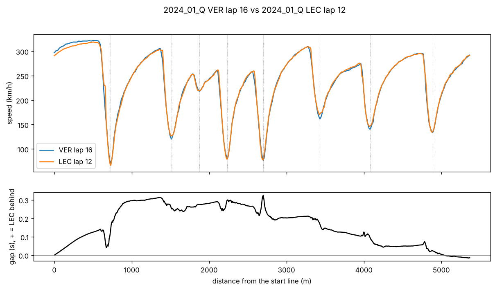

# F1 Pace Intelligence · Team DPEC Weekend Forecaster

> After each practice session, how fast will each car really be on Sunday, how sure are we, and what should the team do about its tyres and pit stops?

DPEC is a solo end-to-end project in data engineering, analytics, machine learning and AI, built on public Formula 1 timing data (2022–2026). It treats the project like a small race-team engineering office: one data foundation, clear rules for what counts as "real pace", forecasts saved **before** each session, and an honest score **after** the race.

**Status:** Phases A (data foundation) and B (history and analytics) are done. Every past weekend can be explored in a pit-wall app on the real data, and a tested answer to *which signals predict Sunday* is in. The forecaster (Phase C) is next. Everything below marked ✅ runs today.


*The pit wall app on real data, Bahrain 2024 qualifying. Every window reads the same weekend, session and drivers, so changing one changes all of them. The session board ranks each driver's best clean lap of the whole session (Leclerc's 1:29.165 came in Q2); the results window shows the official order, with Verstappen on pole at 1:29.179.*

---

## What works today

| | Command | What it does |
|---|---|---|
| ✅ | `dpec ingest` | Downloads every session of every season in the config from FastF1, once, into immutable Parquet files with a manifest (row counts + SHA-256). Re-runs only fetch new sessions; rate limits stop cleanly and resume |
| ✅ | `dpec build` | Rebuilds the DuckDB warehouse from plain SQL files: clean core tables (sessions, laps with quality flags, official results, file inventory, ID maps), then answer tables (weekends, weather, standings, pace, tyre stints, long runs, track evolution, forecast signals) |
| ✅ | `dpec check` | Runs every data check on the real warehouse and fails if any rule is broken or a column is missing from the [data dictionary](docs/data-dictionary.md) |
| ✅ | `dpec sql "…"` | Runs any read-only SQL query on the warehouse |
| ✅ | `dpec compare` | Puts two laps on a 5 m distance grid and shows where one gains or loses time, corner by corner |
| ✅ | `make run` | Starts the pit wall app: a read-only API (FastAPI, 13 addresses) and 11 linked windows in the browser |

### The data, in numbers

| | |
|---|---|
| Seasons | 2022–2026 (ground-effect era, plus the 2026 rules) |
| Sessions saved | 545 (practice, qualifying, sprint, race) |
| Laps | 297,724, of which 163,599 (55%) are clean race pace |
| Raw Parquet on disk | 4.1 GB |
| Teams | 11, under 15 names (AlphaTauri → RB → Racing Bulls, Alfa Romeo → Kick Sauber → Audi) |
| Data checks | 19, all passing on every rebuild |
| Unit tests | 58, run in CI on every push, no internet needed |

---

## The pit wall app

`make run`, then open http://127.0.0.1:8000. Built for a real pit wall: several monitors, layouts you can rearrange and save, Day and Night themes, km/h or mph, and colour-blind safe driver colours.

| Window | What it shows | From |
|---|---|---|
| Session board | Best clean lap per driver, gap, tyre, clean laps | `mart_driver_session_pace` |
| Telemetry, track map, lap delta, corners | Two laps on one 5 m distance grid: speed, throttle, brake, gear, and where the time goes | `dpec compare` |
| Laps and long runs | Every clean lap, practice long runs with fuel correction | `core_laps`, `mart_long_runs` |
| Tyre strategy | Every stint of the race, in finishing order | `mart_stints` |
| Weather and track | Track and air temperature, rain, track evolution | `mart_session_weather`, `mart_track_evolution` |
| Data quality | Why laps aren't clean, per session | `core_laps`, `core_files` |
| Standings, results | Championship after each round; official classification | `mart_standings`, `core_results` |

- **Read-only by design.** Every request opens its own read-only connection, every value goes in as a SQL parameter, and wrong inputs get a clear 422 or 404. The app can't change the data, and the warehouse can be rebuilt while it runs.
- **Linked windows.** One shared context (weekend, session, two drivers, the cursor on the lap) syncs across windows and across browser windows on other monitors.
- **Tested.** API tests run on a small fake warehouse, and window numbers were checked against direct SQL queries.

### A bug only a chart could show

The weather window drew Singapore 2026 with a track temperature of **0 °C**. The data had 47 readings of exactly 0 °C (of 54,295) in 14 sessions, from Mexico City 2022 to Singapore 2026: a sensor dropping out, not a cold track. A new data check now fails on any session whose track temperature falls outside 5–70 °C, and zero readings are treated as missing. Singapore's minimum track temperature is now 38–47 °C.

---

## How it works

```text
FastF1 (official F1 timing feed)
      │  dpec ingest: only file that talks to the internet
      ▼
data/raw/fastf1/season=…/event=…/session=…/*.parquet + manifest.json   (never edited)
      │  dpec build: plain SQL run by DuckDB
      ▼
core_sessions · core_laps · core_results · core_files      (data/warehouse.duckdb)
dim_drivers · dim_teams      ← ID maps, with seeds/teams.csv
      │  sql/marts: answer tables
      ▼
mart_weekends · mart_session_weather · mart_standings · mart_driver_session_pace
mart_stints · mart_long_runs · mart_track_evolution · mart_weekend_signals
      │  dpec check: 19 data checks + the data dictionary
      │
      ├── distance grid → dpec compare                        ✅
      ├── read-only API → pit wall app (11 linked windows)     ✅
      ├── research: what predicts race pace                   ✅ (below)
      ├── forecaster: one shared model for all tracks and years (Phase C)
      └── decisions, debrief, AI assistant                       (Phases C–D)
```

### When is a lap "real pace"?

Every lap gets exactly one reason code: `clean`, or the **first** rule it breaks, in this order:

`no_time` → `generated` → `in_lap` → `out_lap` → `lap_one` → `red_flag` → `safety_car` → `vsc` → `yellow` → `deleted` → `inaccurate` → `wet_tyre` → `slow`

`slow` means slower than 107% of the session's median clean lap. That limit was picked from the data: in races it flags 395 laps at 107%, but 3,445 at 103%, which would throw away the old-tyre laps the tyre model needs. Every rule is also kept as its own yes/no column, so later models can be stricter or looser.

### Checks that make the data trustworthy

Every rule is a SQL query in [`sql/checks/`](sql/checks/) that returns the rows breaking it; empty means pass. `make data` downloads, builds, then runs them all, and stops if one fails.

- The grain of every table is tested: one row per driver, per lap, per session, with no duplicates.
- Results add up: every race hands out 101 or 102 points (102 with the fastest-lap point until 2024) and every sprint 36.
- Penalties decided after the flag are in: for example, Russell's win at Spa 2024 shows as a disqualification.
- An empty table from FastF1 must be listed in `seeds/known_gaps.csv` (1 of about 3,800 saved tables), or the check fails.
- Every driver has an ID and every lap a known team. The official feed has gaps here, fixed from the data itself: sprint-qualifying results have no driver IDs (borrowed from the same season), and two 2026 practice sessions have no team names (taken from the same weekend, or for FP1 stand-in drivers, from their car number).
- Weather readings must be believable: sensor dropouts (0 °C) are caught and treated as missing.
- Every column in the warehouse is described in the [data dictionary](docs/data-dictionary.md); a missing one fails the build.

---

## What predicts Sunday's race pace?

Before building a forecaster, I tested which signals known before the race actually predict it. Race pace = each driver's median clean race lap, as % behind the best; 86 dry weekends, 2022–2026. For each weekend: does the signal put the drivers in the same order as the race (Spearman correlation)?


| Signal (known before the race) | Median correlation per weekend | Weekends above 0.5 |
|---|---|---|
| Qualifying pace | **0.80** | 90% |
| FP2 long runs | 0.59 | 60% |
| All practice long runs (FP1–FP3) | 0.39 | 31% |

- The gap between qualifying and long runs is not luck: a bootstrap over weekends puts it at 0.34 to 0.48.
- Leave-one-weekend-out, the error in predicting race pace is 0.89% of a lap with no signal, 0.60% with qualifying, and 0.59% with qualifying plus long runs: practice adds only about 2%.
- So the forecaster starts from qualifying, and practice has to earn its place. The main caveat: qualifying also sets the grid, and clean air changes race pace.

Full method, numbers and limits: [`reports/b3-practice-vs-race.md`](reports/b3-practice-vs-race.md).

### Lap by lap, on a distance grid



*Bahrain 2024 qualifying: Verstappen's pole lap against Leclerc's best Q2 lap, aligned metre by metre. Top: speed. Bottom: the running gap. The grid reproduces the official lap times to the millisecond (89.179 s vs 89.165 s), and every corner lines up within 10 m.*

---

## Design decisions

Short records of what was decided, why, and what was rejected: [`docs/decisions/`](docs/decisions/)

| # | Decision |
|---|---|
| 0001 | Team DPEC adopts Mercedes's two cars |
| 0002 | Parquet files + DuckDB, no database server |
| 0003 | Clean tables and the ordered lap rules |
| 0004 | Distance grid: computed on demand, not stored |
| 0005 | Results come from FastF1 (which already carries the official classification); no second adapter |
| 0006 | Data checks as SQL that return bad rows; driver and team ID maps |
| 0007 | Answer tables (marts) in plain SQL; pace in % of the session's best; weather dropouts as missing |
| 0008 | Tyre stints, practice long runs, and an explicit fuel-burn correction |
| 0009 | Track evolution measured within each driver (fixed effects); wet sessions flagged, not deleted |
| 0010 | Which signals the forecaster starts with |

---

## Quick start

Needs [uv](https://docs.astral.sh/uv/) and Python 3.12.

```bash
git clone https://github.com/shavkatjony/F1-pace-intelligence.git
cd F1-pace-intelligence
make setup                 # install everything with uv
make test                  # 58 tests, no internet needed
make data                  # download, build, check. First run downloads 2022–2026: hours, about 40 GB of FastF1 cache
make run                   # the pit wall app: http://127.0.0.1:8000
uv run dpec compare 2024_01_Q VER 16 LEC 12
```

Settings (seasons, our team, the slow-lap limit, the grid step, paths) live in [`config/dpec.yaml`](config/dpec.yaml). Nothing is hard-coded.

---

## Roadmap

| Phase | Goal | State |
|---|---|---|
| **A · Data** | One command rebuilds clean F1 data for 2022–2026 | ✅ ingest, clean laps, distance grid, results, download log, checks and ID maps |
| **B · History** | Every "what happened" question answered; which practice signals predict Sunday | ✅ answer tables, forecast inputs, research, pit wall app |
| **C · Forecast** | Race pace and tyre wear with honest ranges, saved publicly before each session, scored after | ⬜ next |
| **D · Explain** | Where the time went, plus an AI race engineer that says "not public" when it doesn't know | ⬜ |
| **E · Public** | Live app and write-up | ⬜ |

How the forecaster will be judged: simple baselines first, walk-forward backtests (never random lap splits, which leak the future), calibrated 80% ranges, and a public record of every forecast.

---

## What public data can't tell us

Fuel load, car setup, tyre temperatures and pressures, and in 2026 the battery (ERS) and active-aero state are not public. Where the project estimates their effect, it is labelled **estimated**, never shown as measured.

---

## Project layout

```text
config/dpec.yaml              all settings
sql/core/                     the SQL that builds the warehouse
sql/marts/                    answer tables built on top of the core
sql/checks/                   data checks: each returns the rows that break a rule
seeds/                        small hand-written tables (team names and lineage, known gaps)
src/telemetry_core/           reusable data layer: ingestion, warehouse, alignment
src/dpec/cli.py               the dpec commands
src/dpec/api/                 the read-only API behind the app
web/app/                      the pit wall app (plain HTML, CSS and JavaScript)
web/prototype/                the first look-only prototype
tests/                        unit tests (fake data, no internet)
docs/decisions/               decision records
docs/data-dictionary.md       every table and column
notebooks/02_research/        the research notebook
reports/                      written results (the B3 report)
```

---

**Author:** Shavkatjon Yuldashev · Data Science, ML, Analytics and AI Engineering · Korea