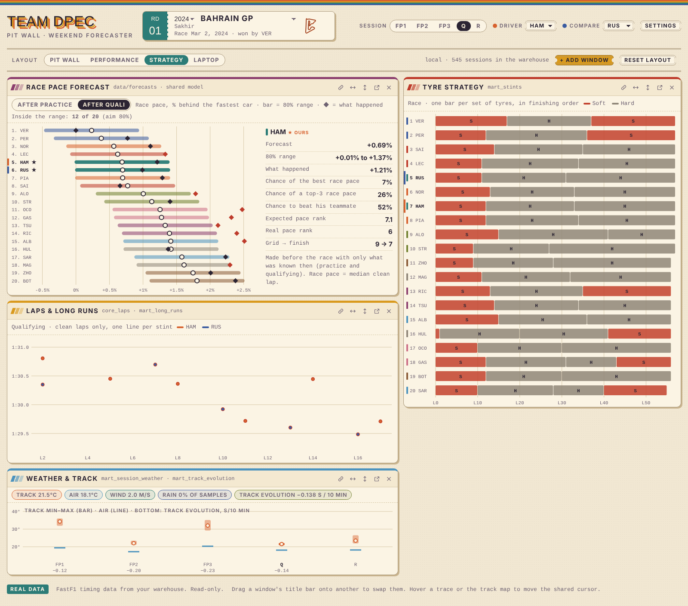
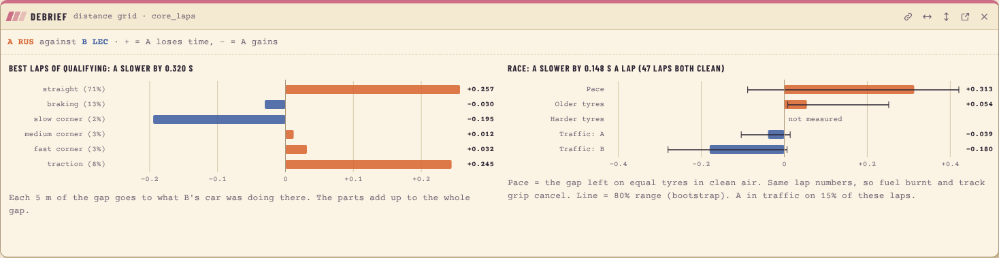
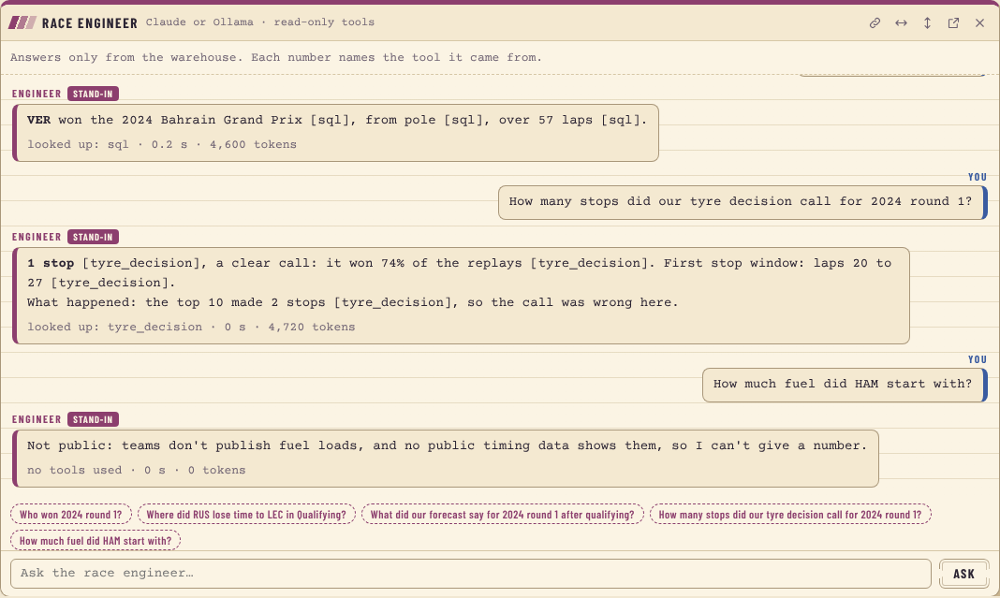
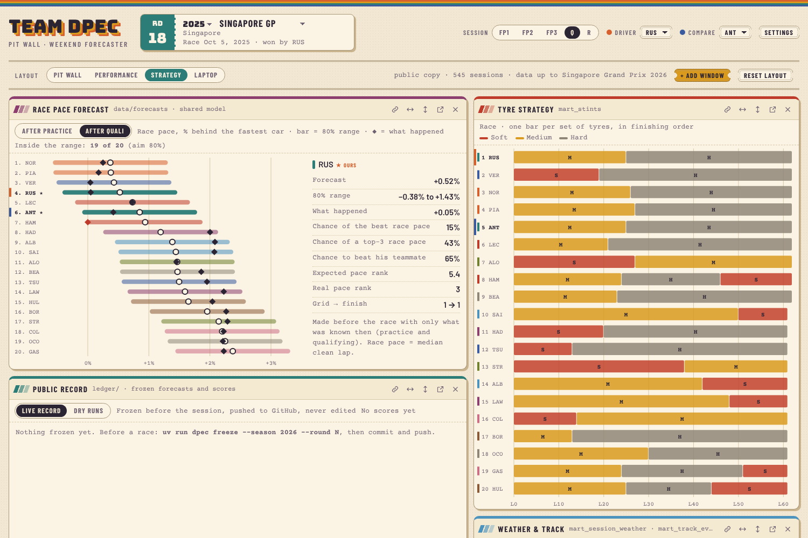

# F1 Pace Intelligence · Team DPEC Weekend Forecaster

> Before a Formula 1 race: how fast will each car really be, how sure can we be, and what should the team do about tyres and pit stops? After the race: were we right, and where did the time go?

**[Online demo](https://f1-pace-intelligence.onrender.com)** (read-only) · **[한국어 요약](docs/summary-ko.md)** · **[The full method](docs/methods.md)** · **[Decision records](docs/decisions/README.md)**

An end-to-end data product, built by one person on public Formula 1 timing data from 2022 to 2026: a data pipeline, analysis tables, a forecasting model with honest uncertainty, tyre and pit-stop decisions, a debrief that explains each result, an AI assistant that is graded like software, and a web app. It works like a small engineering office for one team, "Team DPEC", which follows Mercedes's two cars.



*Bahrain 2024 as the model saw it after qualifying, before the race. For each car: the race pace forecast (○, % behind the fastest car), its 80% range (bar) and what happened (◆). Hamilton: forecast +0.69%, range +0.01% to +1.37%, real +1.21%. Made the same way as every number below: with races before this one only.*

## At a glance

| | |
|---|---|
| **Data** | 545 sessions and 297,724 laps, from 2022 to the Singapore Grand Prix (11 October 2026) |
| **Forecast** | an average error of 0.548% of a lap (about 0.49 s) after qualifying, on 2025–26 races never used to build it; the best simple method: 0.589% |
| **Uncertainty** | 79.9% of real results landed inside the 80% ranges |
| **Decisions** | the right number of pit stops in 58% of 78 races, against 46% for "always one stop" |
| **AI assistant** | passed all 50 exam questions, including the 5 trick questions it must refuse; $1.53 a run |
| **Quality** | 21 automatic data checks and 129 tests, run on every change |

---

## Results

### 1. Race pace forecasts beat every simple method, on races never used to build them

How it's tested: before each race weekend from 2023 on, the model is refitted on earlier races only, then forecasts that weekend twice, after practice and after qualifying. Settings were chosen on 2023–24; the results are reported on **2025–26** (37 weekends, 726 driver-races), which were never used to choose anything. Race pace = a driver's median clean race lap, as % behind the fastest car that day.

| Forecaster (average error, % of a lap) | After practice | After qualifying |
|---|---|---|
| **Shared model** (one regression for every track and year) | **0.648%** (0.58 s a lap) | **0.548%** (0.49 s a lap) |
| Team form (the team's recent races) | 0.674% | 0.674% |
| Last race | 0.744% | 0.744% |
| Per-year model | 0.883% | 0.589% |
| The signal as is (long runs / qualifying gap) | 1.071% | 0.594% |
| No signal (everyone equal) | 1.047% | 1.047% |

- **Honest ranges:** 78.5% (after practice) and 79.9% (after qualifying) of real race paces landed inside the 80% ranges.
- **Honest chances:** the chance of a top-3 race pace scores 0.070 on the Brier score after qualifying (lower is better), against 0.129 with no information.
- **Where it doesn't win:** the per-year model puts drivers in a slightly better order after qualifying (Spearman 0.843 against 0.821), and in the first 5 races of the 2026 rules simpler methods did as well or better.

### 2. From a forecast to a decision you can check

For each dry race: tyre wear from practice, the pit-stop cost at this circuit, and 1, 2 and 3 stops costed over 4,000 replays. If no plan wins at least 65% of the replays, the decision packet says **"no clear decision"** instead of guessing. Replayed on all 78 dry races since 2023, each with only what was known before it: the stop call matched the top 10 in **58%** of races, against 46% for "always one stop" (67% against 57% when the call was clear). It is scored on what can be checked (tyre wear, stops, real first stops inside the window), never on "did the plan win", because the other plans were never raced.

### 3. Honest about what was live and what wasn't

The project is built to freeze each forecast in public before the race: `dpec freeze` writes it into `ledger/` with a SHA-256 fingerprint, and a CI job fails if a forecast reaches GitHub after its deadline (30 minutes before the race) or if a frozen file ever changes. After the race, `dpec score` adds a separate score file.

| Kind of result | What it is | Result |
|---|---|---|
| **Backtest** | every dry race since 2023, re-run with only earlier races | the numbers above |
| **Dry runs** | the live code, replayed on 2026 rounds 1–17 after the races | error 0.573%, exactly the backtest's; 81% inside the ranges; better than team form on 14 of 16 races |
| **Live record** | forecasts frozen on GitHub before the race | **0 weekends** |

Why 0: since October 2026, F1's timing data needs a paid login, so no forecast could be frozen before a race, and the project stops at the races already saved. The dry runs show the pipeline works; they are never called a live record. The details: [docs/live-weekends.md](docs/live-weekends.md).

### 4. Where the time went



Qualifying: our drivers' best laps against the fastest, on a 5 m grid, every metre's gap assigned to a kind of track part (braking, straight, traction, slow, medium or fast corner); the parts add up to the lap gap exactly. Race: the gap split by a regression on paired laps into pace, tyre age, compound and traffic, with bootstrap ranges. Singapore 2026: Russell was 1.49 s a lap off the leader's pace, about 0.9 s of it pace and about 0.5 s traffic (he qualified 6th but started 19th, and spent 76% of his clean laps in traffic).

### 5. An AI race engineer, graded by an exam



An LLM agent with eight **read-only tools** (the list of tables, a guarded SQL tool, the lap and race splits, the forecasts, the tyre decision, the public record, the data status) answers questions about any session since 2022. It never answers from memory: every number names the tool it came from, and questions about fuel, setups or ERS get "not public". A 50-question exam grades it automatically, and each right answer is computed from the warehouse when the exam runs. On 8 November 2026, Claude passed **all 50**: 18 lookups, 12 comparisons, 8 forecast and 7 decision questions, and 5 of 5 trick questions refused, for $1.53 a run at list prices and a median of 7 seconds a question. Every question and answer: [`reports/ai/`](reports/ai/README.md). Online, the race engineer's window shows these recorded answers; live questions run on the local app.

---

## Try it

**Online:** <https://f1-pace-intelligence.onrender.com>. It runs on free hosting, so the first visit after a quiet spell takes about a minute to wake up. Its data is a fixed, versioned snapshot, not a live feed: the page footer shows the snapshot's date and the last race in it.



| Feature | Online demo | Local app |
|---|---|---|
| Forecasts with ranges and chances; tyre and stop decisions | ✓ | ✓ |
| Public record (the 2026 dry runs) | ✓ | ✓ |
| Weekends, results, standings, weather, laps and long runs | ✓ | ✓ |
| Debrief: the race part | ✓ | ✓ |
| Telemetry traces, track map, lap delta, corner table, debrief lap part | a picture | ✓ (needs the 4 GB of raw data) |
| Race engineer | its recorded exam answers | live questions (needs an API key, or Ollama) |
| Data | a snapshot, dated in the footer | the full warehouse |

**On your machine, in one line** (needs [Docker](https://www.docker.com/)): the same image, with the data inside.
```bash
docker run --rm -p 7860:7860 ghcr.io/shavkatjony/f1-pace-intelligence:latest
```
Then open http://127.0.0.1:7860. On an Apple Silicon Mac, add `--platform linux/amd64` after `run`.

**The code** (needs [uv](https://docs.astral.sh/uv/) and Python 3.12):
```bash
git clone https://github.com/shavkatjony/F1-pace-intelligence.git
cd F1-pace-intelligence
make setup                 # install everything with uv
make test                  # 129 tests, no internet needed
```
Downloading the data from scratch (`make data`) now needs an F1TV Access account: in October 2026 F1 put a login on its timing data, and FastF1 3.9 asks for it. Without one, unpack the data file from the [latest release](https://github.com/shavkatjony/F1-pace-intelligence/releases/latest) in the project folder (`tar -xzf dpec-data-*.tar.gz`) and run `make public`.

With the full data: `uv run dpec backtest` (forecast and score every past dry race), `uv run dpec replay` (every past tyre and stop decision), and `make run` (the pit wall app at http://127.0.0.1:8000). Settings live in [`config/dpec.yaml`](config/dpec.yaml); nothing is hard-coded.

---

## How it works

```text
FastF1 (official F1 timing feed)
      │  dpec ingest: the only part that talks to the internet
      ▼
data/raw/…/*.parquet + manifest.json                         (never edited, SHA-256 per file)
      │  dpec build: plain SQL run by DuckDB
      ▼
core tables → answer tables (weekends, weather, pace, stints, long runs, track evolution,
              weekend signals, race strategy)                (data/warehouse.duckdb)
      │  dpec check: 20 data checks + the data dictionary check
      │
      ├── forecasting/  baselines → shared model → ranges → chances      dpec backtest
      ├── decisions/    tyre wear → pit loss → stop plans → packet        dpec replay, dpec packet
      ├── record/       freeze before the race → score after → ledger/    dpec freeze, dpec score
      ├── debrief/      lap gap by track part, race gap by cause          dpec debrief
      ├── assistant/    8 read-only tools → Claude or Ollama → exam       dpec ask, dpec eval-ai
      ├── api/ + web/   read-only API → pit wall app (linked windows)     make run
      └── publish/      data snapshot → GitHub release → Docker image → Render
```

| Command | What it does |
|---|---|
| `dpec ingest` · `build` · `check` | Download once, rebuild the warehouse from SQL, run every data check |
| `dpec backtest` · `replay` · `packet` | Walk-forward forecasts and scores; tyre and stop decisions; one race's decision packet |
| `dpec freeze` · `score` · `ledger` | The public record: freeze before the race, score after, verify every frozen file |
| `dpec debrief` | Where our cars' time went, in qualifying and in the race |
| `dpec ask` · `eval-ai` · `eval-report` | The race engineer, and its exam |
| `dpec snapshot` · `make public` | Pack the data for the online copy; run the online copy locally |

### Messy data, found and handled

- Every lap gets exactly one reason code: `clean`, or the **first** rule it breaks, in a fixed order (`no_time` → `generated` → `in_lap` → `out_lap` → `lap_one` → `red_flag` → `safety_car` → `vsc` → `yellow` → `deleted` → `inaccurate` → `wet_tyre` → `slow`). 55% of all laps are clean (78% in races, 27% in qualifying). Wet races are caught automatically (Japan 2022 and São Paulo 2024: no clean laps).
- Gaps in the official feed, fixed from the data: sprint-qualifying results with no driver IDs, 2026 practice sessions with no team names, teams renamed across years (an ID map).
- A track temperature sensor dropping out: 47 readings of exactly 0 °C (out of 54,295) in 14 sessions, now treated as missing.
- Results add up: 101 or 102 points per race, 36 per sprint, disqualifications after the flag included.
- A race whose length changed (Montreal 2026: 68 laps, 70 before) and a new circuit (Madrid's Madring, 2026): the live path takes the official length as an input instead of guessing.

---

## Design decisions

18 short records of what was decided, why, the evidence, what was rejected, and which earlier decisions each one builds on: [the index](docs/decisions/README.md).

| Layer | Decisions |
|---|---|
| Data: what is collected, cleaned and checked | 0001 to 0006 |
| Analysis tables: the questions the data answers | 0007 to 0010 |
| Forecast: one model, a fair test, honest ranges | 0011 to 0013 |
| Decisions and the public record | 0014, 0015 |
| Debrief and the AI race engineer | 0016, 0017 |
| The online copy | 0018 |

The whole forecaster on one page: [model card](docs/model-card.md). Every table and column: [data dictionary](docs/data-dictionary.md). Every number in this README, with where it comes from: [numbers check](reports/numbers-check.md).

---

## Status

| Part | State |
|---|---|
| Data, 2022–2026 | ✅ Done. It stops at the Singapore Grand Prix (11 October 2026): F1's timing data needs a login since then |
| History and research | ✅ Done |
| Forecast, ranges and decisions | ✅ Done, tested on 2025–26 |
| Public record | ⏸ Built and tested on dry runs; 0 live weekends (see [why](docs/live-weekends.md)) |
| Debrief and AI race engineer | ✅ Done |
| Online demo and write-up | ✅ Done |
| Later | A car root-cause module (why one car can't match another); the starting grid after penalties as a forecast input; a new data source (OpenF1) to go live again |

---

## What public data can't tell us

Fuel load, car setup, tyre temperatures and pressures, engine modes, and in 2026 the battery (ERS) and active-aero state are not public. Where the project estimates their effect, it says **estimated**; where it can't, the race engineer says **not public**.

---

## Project layout

```text
config/                       all settings (dpec.yaml local, public.yaml for the online copy)
sql/core/ · sql/marts/        the SQL that builds the warehouse and the answer tables
sql/checks/                   data checks: each returns the rows that break a rule
src/telemetry_core/           reusable data layer: ingestion, warehouse, alignment
src/dpec/forecasting/         baselines, shared model, backtest, ranges, chances
src/dpec/decisions/           tyre wear, stop plans, replay, decision packet
src/dpec/record/              freeze, score, the ledger guard
src/dpec/debrief/             lap gap by track part, race gap by cause
src/dpec/assistant/           the race engineer's tools, providers and exam
src/dpec/api/ · web/app/      the read-only API and the pit wall app
src/dpec/publish/             the data snapshot for the online copy
ledger/                       forecasts frozen before each race, and their scores (none yet)
evals/ · reports/ai/          the 50-question exam and every run's results
reports/                      backtest scores, research reports, the numbers check
docs/                         the write-up: method, decisions, model card, data dictionary
notes/                        raw working notes: research, trials, failures, plans
Dockerfile · deploy/          the public image (it runs on Render)
tests/                        unit tests (fake data, no internet)
```

---

**Author:** Shavkatjon Yuldashev · Data Scientist / ML Engineer focused on end-to-end data products · Korea · [GitHub](https://github.com/shavkatjony)
