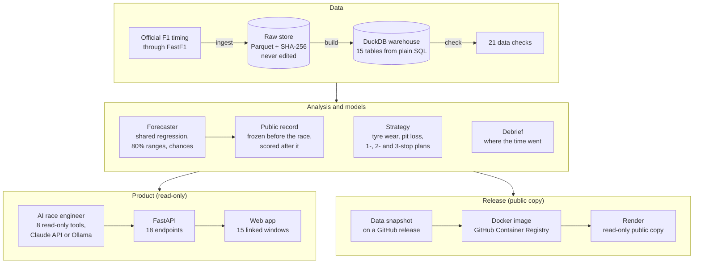

<h1 align="center">F1 Pace Intelligence</h1>

<p align="center">
<b>An end-to-end data science and engineering project: from 297,724 raw Formula 1 laps to tested race forecasts, calibrated uncertainty and pit-stop decisions.</b>
</p>

<p align="center">
<a href="https://f1-pace-intelligence.onrender.com"><b>Live app</b></a>
&nbsp;·&nbsp;
<a href="docs/README.md">Documentation</a>
&nbsp;·&nbsp;
<a href="docs/engineering/README.md">Engineering reference</a>
&nbsp;·&nbsp;
<a href="docs/research/README.md">Research archive</a>
&nbsp;·&nbsp;
<a href="docs/ko/README.md">한국어</a>
</p>

<p align="center">

</p>

<p align="center"><sub>The public copy of the app on the 2025 Singapore Grand Prix. Left: each car's race pace forecast, made after qualifying (○), its 80% range (bar) and what really happened (◆). 19 of the 20 real results landed inside their range. Right: the tyres each car used in the race.</sub></p>

**The problem.** Before every race, a team has to work out how fast each car will really be over a full race distance, and how many times to stop for new tyres. It has a few practice sessions and one qualifying session to go on, and that data is noisy. Almost half of all laps don't show a car's real pace (pit laps, slow laps, yellow flags, safety cars, rain, missing times), and the facts that matter most, such as how much fuel each car carries, are never published. I wanted to find out how well public data alone can answer these questions, and to prove the answers on races the model had never seen.

**Main results** (how each one was measured is under [Results and evidence](#results-and-evidence)):

| | Result | Scope |
|---|---|---|
| **Data** | 545 sessions and 297,724 laps, every lap labelled usable or not, with the reason | every session from 2022 to the 2026 Singapore Grand Prix |
| **Forecast** | race pace forecasts off by 0.548% of a lap time on average after qualifying (about 0.49 s a lap), against 0.589% for the best of five baselines | 37 race weekends in 2025–26, held out from every modelling choice |
| **Uncertainty** | 79.9% of real results inside the 80% ranges | the same 37 weekends |
| **Strategy** | picked the number of pit stops most of the top 10 actually made in 58% of races, against 46% for "always one stop" | 78 dry races since 2023, each replayed with only earlier data |
| **AI assistant** | 50 of 50 exam questions passed, including 5 trap questions it had to turn down | an automatic exam graded against the warehouse, 8 November 2026 |
| **Engineering** | 21 data checks, 129 tests, a Docker image and a public read-only copy | lint and tests on every push |

Every number in this README is traced to its source in the [numbers check](reports/numbers-check.md).

## What this project is

I built F1 Pace Intelligence as a solo project, from the first data download to the deployed app. It is a complete data product on public Formula 1 timing data: a data pipeline and warehouse, statistical research, a forecasting model with calibrated uncertainty, a strategy model, a debrief that explains each result, a web app on a read-only API, and an AI assistant that is graded by an automatic exam.

Formula 1 is the setting, not the point. The same problem turns up in demand forecasting, energy, logistics and manufacturing: data that arrives over time, noisy and incomplete, a few weak early signals, and a plan that has to be made before the outcome is known. This project is about turning that kind of data into forecasts you can trust and decisions you can check afterwards.

To keep the work concrete, the system acts as the analytics office of one imaginary team, Team DPEC, which adopts the two Mercedes cars as its own ([why Mercedes](docs/decisions/0001-dpec-team.md)). The model forecasts every car on the grid; the strategy advice and the debrief are written for "our" two.

## The problem, and how the system answers it

Before each race the system answers three questions:

1. **How fast will each car be on Sunday?** Not over one lap, but over the whole race. I measure this as *race pace*: a driver's median clean race lap, as a percentage behind the fastest car that day.
2. **How sure can we be?** Every forecast has an 80% range, plus three chances: of the best race pace, of a top-3 race pace and of beating the teammate.
3. **What should the team do?** How many pit stops to make and roughly when, given how fast the tyres wear at that circuit.

After the race it answers two more: was the forecast right, and where did the time go?

> **New to Formula 1?** A race weekend has up to three practice sessions, where teams test their cars and tyres, then qualifying, where each driver's fastest lap sets the starting order, then the race: about 300 km, 50 to 70 laps for most races. During the race the tyres wear and lose grip, the car gets lighter and faster as its fuel burns off, and each stop for new tyres usually costs 20 to 27 seconds in the pit lane. Working out that trade-off is the strategy model's job.

From raw data to answers:

| Step | What happens | What comes out |
|---|---|---|
| **Collect** | Each session is downloaded once from the official timing feed (through [FastF1](https://docs.fastf1.dev/)) and saved untouched, with a SHA-256 fingerprint for every file | 545 sessions, 4.1 GB of Parquet files |
| **Clean** | A DuckDB warehouse is rebuilt from plain SQL. Every lap gets one reason code: `clean`, or the first of 13 rules it breaks | 15 tables, about 28 MB |
| **Check** | 20 SQL checks and a data-dictionary check run after every build; each one returns the rows that break its rule | 21 checks, all passing |
| **Measure** | Race pace, fuel-corrected tyre wear, track evolution, practice long runs and pit-stop cost, each defined once in SQL | the tables everything else reads |
| **Forecast** | One regression for every track and year, refitted before each weekend on earlier races only, with 80% ranges and chances | a forecast after practice and another after qualifying |
| **Decide** | Tyre wear and pit-stop cost turned into 1-, 2- and 3-stop plans, each costed over 4,000 draws | a call, or "no clear decision" |
| **Record** | The forecast is frozen in git with a SHA-256 before the race, and scored after it | a public ledger: 0 live weekends so far ([why](#limitations-and-scope)) |
| **Explain** | The qualifying gap is split by kind of track section on a 5 m grid, and the race gap into pace, tyres and traffic | a debrief for any race |
| **Serve** | A read-only API serves a web app of linked windows and an AI assistant with read-only tools | the local app and the public copy |

## Results and evidence

These are the results I am most confident about, each with its scope and how it was measured. The full tables are in the [model card](docs/model-card.md) and the [workstream documents](docs/README.md#workstreams-one-discipline-at-a-time).

### Data at scale, with a quality framework around it

The warehouse holds 545 sessions, from the 2022 Bahrain Grand Prix to the 2026 Singapore Grand Prix (11 October 2026), with 297,724 laps and 54,295 weather readings. The raw files are never edited and the warehouse is rebuilt from them, so every number traces back to a file and a query. Data quality rests on three things:

- **A reason for every lap.** A lap is `clean`, or it gets the first rule it breaks, in a fixed order: pit laps, the first lap, red flags, safety cars, yellow flags, deleted times, wet tyres, laps slower than 107% of the session's clean median, and a few more. Only 55% of laps are clean (78% in races, 27% in qualifying). Wet races flag themselves: Japan 2022 and São Paulo 2024 have no clean race laps at all.
- **21 automatic checks after every build.** Each SQL check returns the rows that break a rule (for example, race points that don't add up to 101 or 102), so a failure points straight at the bad data.
- **Problems in the official feed, found and fixed:** sprint-qualifying results without driver IDs, 2026 practice sessions without team names, teams renamed between seasons (fixed with an ID map), a track-temperature sensor that sometimes reads exactly 0 °C (now treated as missing), and a race that got shorter (Montreal: 70 laps until 2025, 68 in 2026).

Details: [workstream 01](docs/workstreams/01-data-engineering.md) · [which laps count](docs/research/cases/01-lap-eligibility.md) · [problems in the feed](docs/research/cases/02-source-inconsistencies.md)

### Research that shaped the model

Before building a model, I tested which pre-race signal actually predicts race pace. Qualifying won clearly: a median Spearman rank correlation of 0.80 with race pace, against 0.39 for practice long runs, over 86 dry race weekends. The bootstrap 95% interval for the difference runs from −0.48 to −0.34, so it isn't luck. That is why the forecaster is built on qualifying and recent form, and practice long runs are not among its inputs ([the full study](reports/b3-practice-vs-race.md)).

<p align="center">

</p>

Two more findings:

- **Practice overstates race tyre wear.** At Bahrain 2024 practice suggested 0.1395 s of lost time per lap of tyre age, and the race showed 0.0995. So the strategy model forecasts race wear from practice and the circuit's history, never from practice alone.
- **Tracks get quicker during a session.** In all 87 reliable qualifying sessions the lap times fell as the session went on, by a median of 0.15 s every 10 minutes.

Details: [workstream 02](docs/workstreams/02-data-analytics-statistics.md) · [practice or qualifying?](docs/research/cases/03-practice-vs-qualifying.md) · [tyre wear without fuel data](docs/research/cases/04-fuel-and-tyre-degradation.md) · [track evolution](docs/research/cases/05-track-evolution.md)

### Forecasts that beat every baseline on races they never saw

Before each race weekend from 2023 on, the model is refitted on earlier races only and then forecasts that weekend twice: after practice and after qualifying. I chose every setting on 2023–24 and report the results on 2025–26 (37 weekends, 726 driver-races), which played no part in any choice. The error is the mean absolute error of race pace, in % of a lap time.

| Forecaster | After practice | After qualifying |
|---|---|---|
| **Shared model** (one regression for every track and year) | **0.648%** (0.58 s a lap) | **0.548%** (0.49 s a lap) |
| Team form (the team's recent races) | 0.674% | 0.674% |
| Last race | 0.744% | 0.744% |
| A separate model for each year | 0.883% | 0.589% |
| The signal as is (practice long runs, or the qualifying gap) | 1.071% | 0.594% |
| No signal (every car equal) | 1.047% | 1.047% |

It doesn't win everywhere. The per-year model puts the drivers in a slightly better order after qualifying (median Spearman 0.843 against 0.821), and in the first five races under the new 2026 rules, simpler methods did as well or better.

I also replayed the 2026 season through the live forecasting code after the races (16 dry runs). It gave exactly the backtest's error on those races, 0.573%, so the live path and the tested path agree. These dry runs test the pipeline; they are not a live record (see [limitations](#limitations-and-scope)).

Details: [workstream 03](docs/workstreams/03-forecasting-machine-learning.md) · [model card](docs/model-card.md) · [one model or many](docs/research/cases/06-shared-vs-separate-models.md) · [validation without leakage](docs/research/cases/07-temporal-validation-and-ranges.md)

### Uncertainty that means what it says

An 80% range should contain the real result about 80% of the time. On the held-out races it did: 78.5% after practice and 79.9% after qualifying.

Each range comes from the model's own recent mistakes (split-conformal: the 80th percentile of its error size over the previous 10 forecast weekends), so the ranges widen when the model has been wrong lately. The chances are scored as well: for a top-3 race pace after qualifying, the Brier score is 0.070, against 0.129 for a guess with no information (lower is better).

One weakness I know about: the chances are a little too flat, so favourites make the top 3 more often than the model says ([known limits](docs/model-card.md#known-limits)).

### Strategy calls, scored on what can be checked

For each dry race, the strategy model forecasts tyre wear, takes the pit-stop cost at that circuit, and costs a 1-, 2- and 3-stop plan over 4,000 draws of how fast the tyres might wear. If no plan is cheapest in at least 65% of the draws, it says "no clear decision" rather than guess.

I replayed it on all 78 dry races since 2023, each with only what was known before it. Its stop count matched what most of the top 10 finishers did in 58% of races, against 46% for "always one stop". When the call was clear, it was 67% against 57%.

I only score what public data can check: the wear, the number of stops, and whether real first stops fell inside the predicted window. I never score "did the plan win", because the other plans were never raced.

Details: [workstream 03](docs/workstreams/03-forecasting-machine-learning.md) · [scoring a strategy that was never raced](docs/research/cases/08-strategy-modelling.md)

### An AI assistant graded like software

The race engineer is an LLM agent with eight read-only tools: the list of tables, a guarded SQL tool, the lap and race splits, the forecasts, the tyre decision, the public record and the data status. It is not allowed to answer from memory. Every number has to name the tool it came from, and anything public data can't show, such as fuel loads or engine modes, gets "not public".

A 50-question exam grades it automatically. The right answer to each question is computed from the warehouse when the exam runs, so the exam can't go stale. On 8 November 2026 Claude passed all 50: 18 lookups, 12 comparisons, 8 forecast and 7 decision questions, and 5 trap questions about things that aren't public or haven't happened yet. The run made 118 tool calls, took a median of 6.7 seconds per question and cost about US$1.50. The same agent can also run locally on Ollama instead of the Claude API.

Details: [workstream 06](docs/workstreams/06-applied-ai.md) · [every question and answer](reports/ai/README.md)

### Tested, packaged and deployed

129 tests run on fake data with no internet, and GitHub Actions runs them, with a linter, on every push and pull request. A second CI job protects the public record: it fails if a forecast reaches GitHub after its deadline or if a frozen file is ever changed. Publishing a release starts a workflow that builds the Docker image with the data snapshot inside, starts it, checks that it behaves like the public copy (read-only, live chat switched off) and pushes it to GitHub's container registry. Render runs that image as the public copy.

Details: [workstream 04](docs/workstreams/04-ml-engineering.md) · [workstream 05](docs/workstreams/05-backend-engineering.md) · [operations](docs/engineering/operations.md)

## What I built, discipline by discipline

I organised the work like six small departments. Each has its own document: what exists, how to run it, how it is tested and where it falls short.

| Discipline | What I implemented | Read more |
|---|---|---|
| **Data engineering** | A one-way pipeline: each session downloaded once and stored untouched as Parquet with SHA-256 checksums, a 15-table DuckDB warehouse rebuilt from plain SQL, 21 checks after every build, and downloads that resume safely after an interruption | [01](docs/workstreams/01-data-engineering.md) |
| **Data analytics and statistics** | One SQL definition each for a clean lap, race pace, fuel-corrected tyre wear, track evolution and pit-stop cost; the study of which pre-race signal predicts the race (rank correlation, bootstrap intervals); lap and race gaps split into their causes | [02](docs/workstreams/02-data-analytics-statistics.md) |
| **Forecasting and machine learning** | Five baselines and one shared weighted regression, tested walk-forward with no look-ahead; split-conformal 80% ranges; chances from 4,000 simulated race orders; a strategy model that says when it isn't sure | [03](docs/workstreams/03-forecasting-machine-learning.md) |
| **ML engineering** | Runs driven by one settings file and reproducible byte for byte; a backtest and replay that store every forecast; a write-once ledger with SHA-256 and a CI deadline check; dry runs that prove the live path matches the tested one | [04](docs/workstreams/04-ml-engineering.md) |
| **Backend engineering** | A read-only FastAPI service with 18 endpoints and a framework-free web app with 15 linked windows and 4 layouts; one codebase for the local app and the public copy; a Docker image checked by the release workflow and hosted on Render | [05](docs/workstreams/05-backend-engineering.md) |
| **Applied AI** | A tool-using agent with 8 read-only tools and a SQL guard, two interchangeable providers (Claude API and local Ollama), grounding rules, and a 50-question exam with answers computed from the data | [06](docs/workstreams/06-applied-ai.md) |

## How it fits together



A few rules hold the design together:

- **Data flows one way.** Raw files are never edited, and the warehouse can be deleted and rebuilt from them at any time.
- **Models only see the past.** Every forecast and every strategy call uses races strictly before the one it is about.
- **Serving only reads.** The API opens the warehouse read-only, the assistant's tools can't write, and the public copy makes no live AI calls, so visitors can't change anything or run up a bill.
- **One settings file.** Every threshold lives in [`config/dpec.yaml`](config/dpec.yaml); the public copy's settings differ only in the mode.

The full picture, with every store and component: [architecture](docs/engineering/architecture.md).

## Where to check the evidence

| What you want to check | Where |
|---|---|
| How the system is built, run and operated | [Engineering reference](docs/engineering/README.md): [architecture](docs/engineering/architecture.md), [codebase map](docs/engineering/codebase-map.md), [operations](docs/engineering/operations.md) |
| One discipline in depth | [Workstreams 01 to 06](docs/README.md#workstreams-one-discipline-at-a-time) |
| Why it was built this way | [Research archive](docs/research/README.md), with nine case studies |
| Every investigation and its status | [Experiment register](docs/research/experiment-register.md) |
| The design decisions and their trade-offs | [18 decision records](docs/decisions/README.md) (ADRs) |
| The forecaster on one page | [Model card](docs/model-card.md) |
| Every table and column | [Data dictionary](docs/data-dictionary.md) |
| Where each number in this README comes from | [Numbers check](reports/numbers-check.md) |
| The AI exam, question by question | [Exam runs](reports/ai/README.md) |
| The whole story, phase by phase | [Method write-up](docs/methods.md) |

## Try the app

**Online:** <https://f1-pace-intelligence.onrender.com>. It runs on Render's free plan, so it falls asleep after 15 minutes without visitors, and the next visit takes about a minute to wake it. The data is a fixed, dated snapshot that ends at the 2026 Singapore Grand Prix, not a live feed.

<p align="center">

</p>

<p align="center"><sub>The debrief in the local app: Russell against Leclerc at Bahrain 2024. Left: Russell's 0.320 s qualifying gap, split by kind of track section. He lost it on the straights and in the traction zones and won some back in the slow corners. Right: the race gap of 0.148 s a lap, over 47 laps where both were clean, split into pace, tyre age and traffic, with 80% bootstrap ranges.</sub></p>

The debrief also explains forecast misses. At Singapore 2026, Russell was 1.49 s a lap off Leclerc's race pace: about 0.9 s of that was pace and about 0.5 s was traffic. He had qualified 6th but started 19th, and spent 76% of those laps within 1.5 s of a car ahead.

<p align="center">

</p>

<p align="center"><sub>The race engineer in the public copy, showing a recorded exam answer. The 2024 Bahrain call was 1 stop, and the answer says plainly that it turned out wrong (the race ran 2 stops), naming the tool behind every number.</sub></p>

What runs where:

| Feature | Online copy | Local app |
|---|---|---|
| Forecasts with ranges and chances; tyre and stop decisions | ✓ | ✓ |
| The public record and the 2026 dry runs | ✓ | ✓ |
| Weekends, results, standings, weather, laps and long runs | ✓ | ✓ |
| Debrief: the race part | ✓ | ✓ |
| Telemetry traces, track map, lap delta, corner table, debrief qualifying part | a picture | ✓ (needs the 4.1 GB of raw files) |
| Race engineer | its recorded exam answers | live questions (needs a Claude API key, or Ollama) |
| Data | a dated snapshot | the full warehouse |

## Technology stack

| Responsibility | What I used |
|---|---|
| Data collection | FastF1, Parquet (pyarrow) |
| Storage and transformation | DuckDB, plain SQL files with settings placeholders |
| Analysis and modelling | pandas, NumPy, statsmodels (weighted least squares), Jupyter, matplotlib |
| API | FastAPI, Uvicorn, Pydantic |
| Web app | HTML, CSS and JavaScript modules with inline SVG charts; no framework and no build step |
| AI assistant | Claude API (Anthropic Python SDK), Ollama for local models |
| Command line and settings | Typer, YAML |
| Quality | pytest, Ruff, GitHub Actions |
| Packaging and hosting | uv, Docker, GitHub Releases, GitHub Container Registry, Render |

## Run it yourself

**With Docker**, in one line (the data is inside the image):

```bash
docker run --rm -p 7860:7860 ghcr.io/shavkatjony/f1-pace-intelligence:latest
```

Then open http://127.0.0.1:7860. On an Apple Silicon Mac, add `--platform linux/amd64` after `run`.

**From the code** (needs [uv](https://docs.astral.sh/uv/) and Python 3.12 or newer):

```bash
git clone https://github.com/shavkatjony/F1-pace-intelligence.git
cd F1-pace-intelligence
make setup     # install everything with uv
make test      # 129 tests, no internet needed
```

To run the app on real data, download `dpec-data-<date>.tar.gz` from the [latest release](https://github.com/shavkatjony/F1-pace-intelligence/releases/latest), unpack it in the project folder and start the public copy:

```bash
tar -xzf dpec-data-*.tar.gz
make public    # the app at http://127.0.0.1:8000
```

The snapshot holds the full warehouse, so with it you can also rerun the backtest (`uv run dpec backtest`) and the strategy replay (`uv run dpec replay`), or start the local app (`make run`). Downloading the raw data from scratch (`make data`) now needs an F1TV Access subscription, because F1 put a login on its timing data in October 2026. Every command is explained in [operations](docs/engineering/operations.md).

## Limitations and scope

- **Public data only.** Fuel loads, car setups, tyre temperatures and pressures, engine modes, and in 2026 the battery (ERS) and active-aero state are not public. Where the project estimates their effect it says so (the fuel effect is an assumed 0.06 s per lap), and where it can't, the assistant answers "not public".
- **Simple models, on purpose.** The forecaster is one linear regression with at most three inputs, and tyre wear and track evolution are straight-line slopes. There are no inputs for weather, upgrades, penalties or strategy. Wet races and finishing positions are not forecast, and the strategy model plans stops, not tyre compounds. The chances treat each driver's error as independent, which is probably why they are a little too flat.
- **New rules are hard.** In the first five races of 2026, simple baselines did as well or better, and only 68% of real race paces fell inside the after-practice ranges. The ranges caught up a few races later.
- **Not a team tool.** Real teams have far more data than this, including fuel loads, setups and their own cars' sensors and simulators. This project doesn't try to compete with their systems. It measures how far public data can go, and says where it stops.
- **Free hosting.** The online copy sleeps after 15 minutes without visitors, runs on 0.1 CPU and 512 MB of memory, and shows a dated snapshot.

**What was live, and what wasn't.** I built the project to freeze each forecast in public before the race: `dpec freeze` writes it to `ledger/` with a SHA-256, and CI rejects a file that arrives less than 30 minutes before the race or changes later. Since October 2026, F1's timing data has needed a paid login, so no forecast could be frozen before a race. The record therefore shows **0 live weekends**, and the project stops at the races already saved.

| Kind of result | When it was made | What it shows |
|---|---|---|
| Backtest | after the races, using only earlier races | the results above (78 dry races since 2023) |
| Dry runs | after the races, through the live code | that the live path gives the backtest's answers (16 races of 2026) |
| Live record | before the race, frozen on GitHub | nothing yet: 0 weekends |

Restarting needs an F1TV Access subscription or a new data source such as OpenF1 ([details](docs/live-weekends.md)).

## Where everything is

| Folder | What's in it |
|---|---|
| [`src/telemetry_core/`](src/telemetry_core/) | the reusable data layer: download, warehouse, lap alignment |
| [`src/dpec/`](src/dpec/) | forecasting, strategy, public record, debrief, AI assistant, API and publishing |
| [`sql/`](sql/) | the SQL that builds the warehouse, and the data checks |
| [`web/app/`](web/app/) | the pit wall web app |
| [`config/`](config/) | every setting, for the local app and the public copy |
| [`tests/`](tests/) | 129 tests on fake data |
| [`evals/`](evals/) | the AI exam's 50 questions |
| [`notebooks/`](notebooks/) | the original research notebooks |
| [`reports/`](reports/) | backtest scores, research reports, exam runs and the numbers check |
| [`docs/`](docs/README.md) | the documentation: engineering, workstreams, research, decisions, and the [Korean guides](docs/ko/README.md) |
| [`notes/`](notes/README.md) | raw working notes: research, trials, failures and plans |

Not sure where to start? The [documentation index](docs/README.md#start-here) suggests a path for each kind of reader.

---

**Shavkatjon Yuldashev** · Data Scientist / ML Engineer focused on end-to-end data products · Korea · [GitHub](https://github.com/shavkatjony)