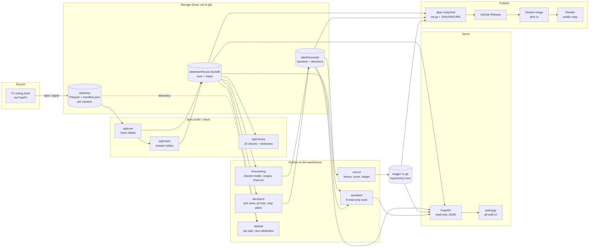

# Architecture

How the implemented system is put together: the data flow from the timing feed to the browser, the stores between the stages, and the boundaries that keep each stage testable. For *where* each part lives in the code, see [codebase-map.md](codebase-map.md). For *how to run* it, see [operations.md](operations.md).

## 1. Design in four rules

1. **Raw data is written once and never edited.** Every later stage can be rebuilt from it ([decision 0002](../decisions/0002-storage.md)).
2. **Every table is plain SQL, rebuilt from scratch.** There are no hand-edited tables and no hidden state in a database server ([decision 0003](../decisions/0003-clean-laps.md), [0007](../decisions/0007-marts.md)).
3. **A forecast may only use what was known before its session.** This is enforced in code, in the walk-forward backtest and, for live forecasts, by a deadline check in CI ([decision 0011](../decisions/0011-target-and-fair-test.md), [0015](../decisions/0015-public-record.md)).
4. **Everything that serves users is read-only.** The API, the AI assistant's tools and the public copy open read-only connections and cannot change the warehouse ([decision 0017](../decisions/0017-race-engineer.md), [0018](../decisions/0018-public-copy.md)).

## 2. Data flow

## 3. Components

### Ingestion

`dpec ingest` asks FastF1 for each session in the configured seasons and writes seven tables per session (`laps`, `results`, `car_data`, `pos_data`, `weather`, `race_control`, `track_status`) as untouched Parquet files. A `manifest.json` per session records row and column counts, which columns were converted from time spans to seconds, and a SHA-256 per file. Sessions already saved are skipped, a failed session is logged and the run continues, and each attempt is appended to `data/ingest_log.csv`. Folders are Hive-partitioned (`season=/event=/session=`) so that DuckDB can read all sessions with one glob.

Result: 545 sessions (practice, sprint qualifying, sprint, qualifying, race) from the 2022 Bahrain Grand Prix to the 2026 Singapore Grand Prix, 4.1 GB of Parquet. The data stops there because F1's timing service has required a login since October 2026 ([decision 0015, update](../decisions/0015-public-record.md#update-5-november-2026-no-live-weekends)).

Details: [workstream 01](../workstreams/01-data-engineering.md).

### Warehouse

`dpec build` runs every `.sql` file in `sql/core`, then `sql/marts`, in file-name order, one table per file, into a single DuckDB file ([`warehouse.py`](../../src/telemetry_core/warehouse.py)). SQL files use dbt-style `{{ placeholders }}` filled from settings, so thresholds live in configuration, not in SQL. There is deliberately no dbt: with 15 tables, file-number ordering is enough ([decision 0007](../decisions/0007-marts.md)).

| Layer | Tables | Grain is stated in |
|---|---|---|
| Core | `core_sessions`, `core_laps`, `core_results`, `core_files`, `dim_drivers`, `dim_teams` | the top of each SQL file and the [data dictionary](../data-dictionary.md) |
| Marts | `mart_weekends`, `mart_session_weather`, `mart_standings`, `mart_driver_session_pace`, `mart_stints`, `mart_long_runs`, `mart_track_evolution`, `mart_weekend_signals`, `mart_race_strategy` | the same |

Every lap in `core_laps` gets exactly one reason code (`clean` or the first rule it breaks), plus one yes/no column per rule ([decision 0003](../decisions/0003-clean-laps.md)). Driver and team identity is resolved through `dim_drivers` and `dim_teams` (team lineages across renames, from [`seeds/teams.csv`](../../seeds/teams.csv)).

Details: [workstream 01](../workstreams/01-data-engineering.md) (build and checks), [workstream 02](../workstreams/02-data-analytics-statistics.md) (what the marts measure).

### Data checks

`dpec check` runs the 20 queries in `sql/checks`. Each returns the rows that break its rule, so an empty result is a pass. It also fails if any warehouse column is missing from the data dictionary. The checks cover grain (one row per key), referential completeness (every race has results, every lap has a team), arithmetic (points and standings add up) and plausibility (weather, track evolution, pit loss). See [decision 0006](../decisions/0006-checks-and-id-maps.md).

Details: [workstream 01](../workstreams/01-data-engineering.md).

### Telemetry alignment

Two laps are compared on a common 5 m distance grid, computed on demand from the raw `car_data` files rather than stored: storing every clean lap would be about 175 million rows for a rarely used comparison ([decision 0004](../decisions/0004-distance-grid.md)). This lives in [`telemetry_core/alignment/`](../../src/telemetry_core/alignment/).

Details: [workstream 02 § 5.9](../workstreams/02-data-analytics-statistics.md#59-telemetry-on-a-distance-grid).

### Forecasting

[`dpec/forecasting/`](../../src/dpec/forecasting/) builds one table of dry-race driver-weekends ([`targets.py`](../../src/dpec/forecasting/targets.py)), hides the columns a checkpoint may not see, and runs every forecaster through the same walk-forward loop ([`backtest.py`](../../src/dpec/forecasting/backtest.py)). The shared model is one weighted least-squares regression for all tracks and years, refitted before every weekend ([`model.py`](../../src/dpec/forecasting/model.py)). It is compared against five baselines. 80% ranges come from the model's own errors over its last 10 forecast weekends ([`ranges.py`](../../src/dpec/forecasting/ranges.py)), and probabilities from 4,000 simulated race orders ([`simulate.py`](../../src/dpec/forecasting/simulate.py)). Outputs: `data/forecasts/backtest.parquet` (not in git) and the summary CSVs in [`reports/backtest/`](../../reports/backtest/) (in git).

Details: [workstream 03](../workstreams/03-forecasting-machine-learning.md) (method and accuracy), [workstream 04](../workstreams/04-ml-engineering.md) (backtest, reproducibility, tests).

### Strategy decisions

[`dpec/decisions/`](../../src/dpec/decisions/) forecasts race tyre wear and pit-stop cost from earlier races, costs 1, 2 and 3-stop plans over 4,000 draws of tyre wear, and returns a call, or "no clear decision" when no plan wins at least 65% of draws ([decision 0014](../decisions/0014-decision-packet.md)). `dpec replay` reruns this for every past dry race with only earlier data.

Details: [workstream 03](../workstreams/03-forecasting-machine-learning.md).

### Public record

[`dpec/record/`](../../src/dpec/record/) freezes a forecast and tyre decision into a write-once JSON file under `ledger/`, with a SHA-256 of its own content, and later writes a separate score file. Pydantic models define the file formats, exported as JSON Schema in [`schemas/`](../../schemas/). A CI job rejects any ledger file that is changed, deleted or arrives after its deadline. No live weekend was frozen, because of the data-access change ([live-weekends.md](../live-weekends.md)). Dry runs of the 2026 season use the same code and are written to `reports/dry-runs/`, never to `ledger/`.

Details: [workstream 04](../workstreams/04-ml-engineering.md#56-the-public-record-ledger).

### Debrief

[`dpec/debrief/`](../../src/dpec/debrief/) splits a qualifying lap gap by kind of track section on the distance grid ([`segments.py`](../../src/dpec/debrief/segments.py)), and a race pace gap into pace, tyre age, compound and traffic with a regression on paired laps plus bootstrap ranges ([`attribution.py`](../../src/dpec/debrief/attribution.py)). See [decision 0016](../decisions/0016-debrief.md).

Details: [workstream 02 § 5.10–5.11](../workstreams/02-data-analytics-statistics.md#510-debrief-a-lap-gap-by-kind-of-track-section).

### AI assistant ("race engineer")

[`dpec/assistant/`](../../src/dpec/assistant/) runs a tool-calling loop: the model receives the question and eight tool definitions, asks for tools by name, the code runs them against read-only data and returns JSON, and the loop repeats until the model answers in words or the question would need more than `max_tool_calls` (8) tool calls in total. The model never sees the warehouse directly. This is **structured tool calling, not document retrieval (RAG)**: answers come from SQL and Python functions over current tables, not from embedded text passages. Provider adapters for Claude ([`claude.py`](../../src/dpec/assistant/claude.py)) and Ollama ([`ollama.py`](../../src/dpec/assistant/ollama.py)) share one conversation interface ([`chat.py`](../../src/dpec/assistant/chat.py)). A 50-question exam grades the assistant against answers computed from the warehouse at run time ([decision 0017](../decisions/0017-race-engineer.md)).

Details: [workstream 06](../workstreams/06-applied-ai.md).

### API and web app

[`dpec/api/`](../../src/dpec/api/) is a FastAPI app with five routers (analytics, forecasts, record, debrief, chat), mounted under `/api`, with the static app at `/`. Every request opens its own read-only DuckDB connection and keeps none between requests, so `dpec build` can take the write lock while the app is running; requests made during a build fail until it finishes ([workstream 05 § 12](../workstreams/05-backend-engineering.md#12-limitations-and-operational-considerations)). Every user value enters SQL as a parameter. The [web app](../../web/app/) is plain JavaScript with no build step: 15 linked windows (session board, laps and long runs, telemetry traces, lap delta, track map, corner table, tyre strategy, weather and track, results, standings, data quality, race pace forecast, public record, debrief, race engineer), layout presets and settings stored in the browser.

Details: [workstream 05](../workstreams/05-backend-engineering.md).

### Publication

`dpec snapshot` packs the warehouse, saved forecasts, ledger and dry runs (12.5 MB for release v1.2) into `dist/dpec-data-<date>.tar.gz` with `SHA256SUMS` and a manifest of the data date and code version. Data never goes into git. Publishing a GitHub Release with that file attached triggers [`release.yml`](../../.github/workflows/release.yml), which builds the [Docker image](../../Dockerfile), verifies every checksum during the build, starts the container, smoke-tests it as the public copy, and pushes it to `ghcr.io`. A free Render web service runs the `:latest` image ([decision 0018](../decisions/0018-public-copy.md)).

Details: [workstream 04 § 5.9](../workstreams/04-ml-engineering.md#59-artifact-policy) (snapshot), [workstream 05 § 5.10–5.11](../workstreams/05-backend-engineering.md#510-docker-image) (image, release, hosting).

## 4. Runtime modes

The same code runs in two modes, chosen by `mode` in the settings file. A test fails if [`config/public.yaml`](../../config/public.yaml) differs from [`config/dpec.yaml`](../../config/dpec.yaml) in anything but `mode`.

| Capability | Local (`config/dpec.yaml`) | Public (`config/public.yaml`) |
|---|---|---|
| Weekends, pace, stints, weather, standings, results, data quality | yes | yes |
| Forecasts, ranges, chances, public record, dry runs | yes | yes |
| Debrief, race part | yes | yes |
| Telemetry traces, lap delta, qualifying lap split | yes | no: needs the 4.1 GB raw files (API answers 404 with the reason) |
| Live questions to the AI assistant | yes (needs an API key or Ollama) | no: each question costs money (API answers 403). Recorded exam answers are shown instead |
| Data freshness | whatever was last built | the snapshot's date, shown in the footer |

## 5. Data stores

| Store | Content | In git? | Rebuilt by |
|---|---|---|---|
| `data/cache/` | FastF1's HTTP cache (34 GB) | no | FastF1 |
| `data/raw/` | Parquet + manifest per session (4.1 GB) | no | `dpec ingest` |
| `data/warehouse.duckdb` | core, dimension and mart tables | no | `dpec build` |
| `data/forecasts/` | `backtest.parquet`, `decisions.parquet` | no | `dpec backtest`, `dpec replay` |
| `data/ingest_log.csv` | append-only download log | no | `dpec ingest` |
| `ledger/` | frozen forecasts and scores (empty: 0 live weekends) | yes, write-once | `dpec freeze`, `dpec score` |
| `reports/dry-runs/` | 2026 dry runs | no (packed into the snapshot) | `dpec pretend` |
| `reports/backtest/`, `reports/ai/` | small evidence CSVs and summaries | yes | `dpec backtest`, `replay`, `eval-ai`, `eval-report` |
| `dist/` | data snapshots | no (attached to GitHub Releases) | `dpec snapshot` |

## 6. Technology choices

| Need | Choice | Why (record) |
|---|---|---|
| Columnar storage | [Apache Parquet](https://en.wikipedia.org/wiki/Apache_Parquet) | compressed, typed, readable by DuckDB and pandas without a server ([0002](../decisions/0002-storage.md)) |
| Analytical SQL | DuckDB, embedded | one user, data fits on a laptop, no server to run ([0002](../decisions/0002-storage.md)) |
| Transformations | plain SQL files + a small runner | 15 tables do not need dbt yet ([0007](../decisions/0007-marts.md)) |
| Settings | YAML read by Pydantic, unknown keys rejected | a typo fails loudly instead of being ignored |
| Regression | statsmodels (weighted least squares) | interpretable coefficients, small data ([0012](../decisions/0012-shared-model.md)) |
| API | FastAPI | typed parameters, OpenAPI docs at `/api/docs` |
| Front end | plain JavaScript, no build step | one person maintains it; nothing to compile |
| LLM | Claude via the Anthropic SDK; Ollama locally | same tools and loop for both, compared on one exam ([0017](../decisions/0017-race-engineer.md)) |
| Packaging | uv with a lock file | the same versions on the Mac, in CI and in the image |
| Delivery | Docker, GitHub Actions, GHCR, Render | the public image is built from tagged code on a clean machine ([0018](../decisions/0018-public-copy.md)) |

## 7. Known architectural limits

- **Single machine, single user.** DuckDB is a file. Rebuilds are full, not incremental. This is adequate for 545 sessions and would need revisiting for multi-user writes.
- **No live data path.** The ingest adapter depends on FastF1, which now needs a paid F1TV subscription for timing data. `freeze`, `score` and the CI checks are ready, but no source feeds them ([live-weekends.md](../live-weekends.md)).
- **Telemetry is local only.** The online copy cannot show traces without shipping the raw files.
- **The public copy sleeps.** On Render's free tier it sleeps after 15 minutes without visitors and takes about a minute to wake.
- **`deploy/huggingface/` is kept but not used.** Hugging Face now requires a paid plan for Docker Spaces ([decision 0018, update](../decisions/0018-public-copy.md#update-5-november-2026-render-instead-of-hugging-face)).

## See also

- [codebase-map.md](codebase-map.md): module-level detail
- [operations.md](operations.md): commands and procedures
- [Research archive](../research/README.md): why it was built this way
- [Data dictionary](../data-dictionary.md) · [Model card](../model-card.md) · [Method](../methods.md)
- [Workstream documents](../README.md#workstreams-one-discipline-at-a-time): [01 data](../workstreams/01-data-engineering.md) · [02 analytics](../workstreams/02-data-analytics-statistics.md) · [03 forecasting](../workstreams/03-forecasting-machine-learning.md) · [04 ML engineering](../workstreams/04-ml-engineering.md) · [05 backend](../workstreams/05-backend-engineering.md) · [06 applied AI](../workstreams/06-applied-ai.md)
