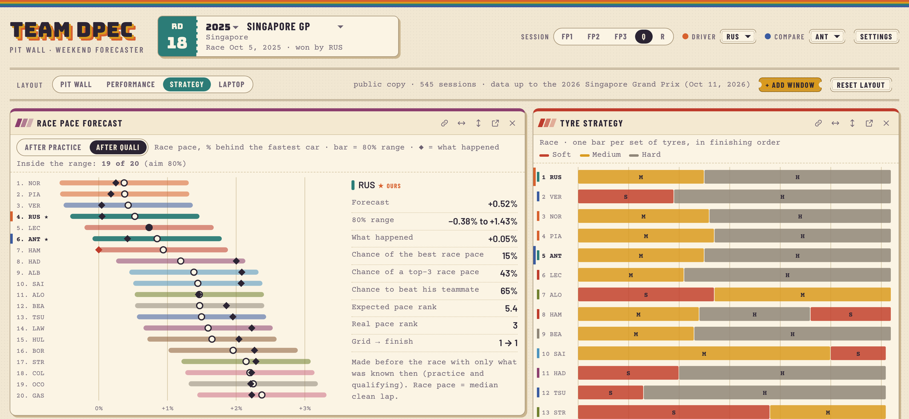

# F1 Pace Intelligence 프로젝트 소개

**공개 데이터만으로 결과가 나오기 전에 예측하고, 그 예측이 맞았는지 스스로 검증하는 엔드투엔드(end-to-end) 데이터 사이언스 프로젝트**

[라이브 앱](https://f1-pace-intelligence.onrender.com) · [GitHub 저장소](https://github.com/shavkatjony/F1-pace-intelligence) · [English README](../../README.md) · [한국어 기술 가이드](project-guide.md) · [용어집](glossary.md)

*2025 싱가포르 그랑프리를 예선 직후에 예측한 화면입니다. 왼쪽은 차량별 예측(○), 80% 예측 구간(막대), 실제 결과(◆)이며, 20대 중 19대의 실제 결과가 구간 안에 들어왔습니다. 오른쪽은 각 차량이 레이스에서 사용한 타이어입니다.*

이 문서는 채용 담당자와 기술 채용 담당자, 그리고 F1을 잘 모르는 분을 위해 썼습니다. 3–5분이면 읽을 수 있고, 기술적인 내용은 [한국어 기술 가이드](project-guide.md)에 자세히 정리했습니다.

## 1. 어떤 문제를 다루나요?

많은 조직이 비슷한 문제를 안고 있습니다. 데이터는 시간이 흐르면서 쌓이고, 잡음과 빈칸이 많습니다. 결과를 알기 전에 몇 가지 약한 신호만 보고 계획을 세워야 하고, 시간이 지난 뒤에야 그 계획이 옳았는지 알 수 있습니다. 수요 예측, 설비 센서 데이터, 에너지 사용량 예측, 물류 계획이 모두 이런 문제입니다.

F1 Pace Intelligence는 이 문제를 실제 데이터로 처음부터 끝까지 풀어 본 프로젝트입니다. 지저분한 시계열 데이터를 정제하고, 무엇이 결과를 예측하는지 통계로 확인했습니다. 그다음 불확실성까지 함께 말해 주는 예측 모델을 만들고, 예측을 의사결정으로 바꾸고, 모델이 한 번도 보지 못한 데이터로 성능을 검증했습니다. 데이터 수집부터 배포된 웹 앱까지 모두 혼자 기획하고 구현했습니다.

## 2. 왜 Formula 1을 골랐나요?

이런 문제를 제대로 연습하려면 네 가지 조건이 필요했고, F1은 네 가지를 모두 갖추고 있습니다.

- **자세한 공개 데이터:** 모든 차량의 모든 랩 타임, 타이어, 날씨, 트랙 상황이 기록되어 공개됩니다. (2026년 10월부터는 유료 로그인이 필요해졌습니다.)
- **빠른 정답:** 레이스가 끝나면 곧바로 공식 기록이 나오므로, 예측이 맞았는지 바로 채점할 수 있습니다.
- **현실적인 제약:** 랩 기록의 절반 가까이는 차량의 실제 속도를 보여 주지 않고, 연료 탑재량처럼 중요한 정보는 팀이 공개하지 않습니다.
- **분명한 의사결정:** "피트 스톱을 몇 번 할 것인가"처럼 예측이 실제 행동으로 이어지는 지점이 명확합니다.

F1은 이런 문제를 풀어 보기 좋은 무대로 고른 것이지, 제가 F1 전문가라는 뜻은 아닙니다. 이 프로젝트로 보여 드리고 싶은 것은 데이터 사이언스, 통계 분석, 머신러닝, 데이터 분석, 백엔드 엔지니어링, 응용 AI를 하나의 제품으로 엮어 내는 능력입니다.

## 3. F1을 모르는 분을 위한 짧은 설명

F1 레이스 주말은 보통 세 단계로 진행됩니다.

| 단계 | 내용 |
|---|---|
| 연습 주행 (Practice) | 최대 세 번 열립니다. 팀이 차량 세팅과 타이어를 시험하는 시간입니다 |
| 예선 (Qualifying) | 드라이버마다 가장 빠른 한 랩의 기록으로 결승 출발 순서(그리드)를 정합니다 |
| 결승 (Race) | 약 300 km, 대부분 50–70랩을 달려 실제 순위가 정해집니다 |

레이스 중에는 타이어가 닳으면서 차가 느려지고, 연료가 줄면서 차가 가벼워져 빨라집니다. 새 타이어로 바꾸려면 피트 레인에 들어가는 피트 스톱(pit stop)을 해야 하는데, 한 번에 보통 20–27초를 잃습니다. 그래서 "몇 번 멈추고 언제 멈출 것인가"가 레이스의 핵심 전략이 됩니다.

이 프로젝트가 예측하는 값은 **레이스 페이스**(race pace)입니다. 결승에서 정상적으로 달린 랩(클린 랩)의 중앙값이 그날 가장 빠른 차보다 몇 % 느린지를 나타낸 값입니다. 한 랩의 순간 속도가 아니라, 레이스 전체에서 차량이 실제로 낸 속도를 뜻합니다.

## 4. 어떤 데이터를 사용했나요?

- **출처:** 공식 F1 타이밍 데이터를 제공하는 오픈소스 파이썬 라이브러리 [FastF1](https://docs.fastf1.dev/)
- **기간:** 2022년 바레인 그랑프리부터 2026년 싱가포르 그랑프리(2026년 10월 11일)까지, 109개 레이스 주말
- **규모:** 545개 세션, 297,724랩, 날씨 기록 54,295건, 원본 데이터 4.1 GB
- **품질:** 전체 랩 가운데 실제 속도를 보여 주는 정상 랩은 55%뿐입니다(결승 78%, 예선 27%). 나머지는 피트 인·아웃 랩, 세이프티 카 상황, 옐로 플래그, 빗길 주행, 기록 누락 같은 랩입니다.

2026년 10월부터 F1 타이밍 데이터를 받으려면 유료 로그인이 필요해져서, 이 프로젝트는 그전에 저장한 데이터까지만 다룹니다.

## 5. 무엇을 만들었나요?

- **데이터 파이프라인:** 세션마다 한 번만 내려받아 원본을 그대로 보관하고(파일마다 SHA-256 체크섬), 순수 SQL로 DuckDB 데이터 웨어하우스(15개 테이블)를 다시 만들며, 빌드할 때마다 데이터 검사 21개를 실행합니다.
- **분석과 통계:** 정상 랩, 레이스 페이스, 연료 효과를 보정한 타이어 마모, 트랙 노면 변화, 피트 스톱 손실 시간을 SQL로 한 번씩만 정의하고, 어떤 신호가 레이스 결과를 예측하는지 검정했습니다.
- **예측 모델:** 모든 서킷과 연도에 쓰는 하나의 가중 회귀 모델입니다. 매 주말 직전에 그 이전 레이스로만 다시 학습하고, 80% 예측 구간과 확률(가장 빠른 페이스, 상위 3위 페이스, 팀 동료보다 빠를 확률)을 함께 제시합니다.
- **전략 결정:** 타이어 마모와 피트 스톱 손실로 1·2·3스톱 계획의 비용을 4,000번 비교하고, 어느 계획도 확실하지 않으면 "명확한 결정 없음"이라고 답합니다.
- **공개 기록:** 레이스 전에 예측을 GitHub에 고정하고(SHA-256, CI 마감 검사), 레이스가 끝나면 채점하는 구조입니다.
- **디브리프:** 예선 랩 차이를 구간 종류별로, 레이스 차이를 페이스·타이어·트래픽으로 나누어 "시간을 어디서 잃었는지" 설명합니다.
- **AI 레이스 엔지니어:** 읽기 전용 도구 8개를 쓰는 LLM 에이전트(Claude API 또는 로컬 Ollama)와, 이를 평가하는 50문항 자동 채점 시험입니다.
- **웹 앱과 배포:** 읽기 전용 FastAPI(엔드포인트 18개), 15개 창이 서로 연결된 웹 앱, Docker 이미지, Render에 배포한 공개 버전입니다.

이야기를 구체적으로 만들기 위해, 이 시스템은 가상의 팀 "Team DPEC"의 분석실처럼 동작합니다. Team DPEC는 메르세데스의 두 차량을 "우리 차"로 정했습니다. 예측은 그리드의 모든 차량에 대해 만들고, 전략 조언과 디브리프는 우리 두 차량을 기준으로 씁니다.

## 6. 실제 결과

아래 수치는 모두 [수치 검증 문서(영어)](../../reports/numbers-check.md)에 출처와 재계산 방법이 정리되어 있습니다.

- **예측 정확도:** 예선 직후 예측의 평균 오차가 랩 타임의 0.548%(랩당 약 0.49초)로, 가장 좋은 베이스라인(0.589%)보다 정확했습니다. 모델을 고르는 데 쓰지 않은 2025–26 시즌 37개 레이스 주말로 평가했습니다.
- **예측 구간:** 같은 37개 주말에서 실제 결과의 79.9%가 80% 예측 구간 안에 들어왔습니다. 구간이 말한 만큼 실제로 맞았다는 뜻입니다.
- **통계 연구:** 비가 오지 않은 86개 레이스 주말에서, 예선 기록이 연습 주행 롱런보다 레이스 페이스를 훨씬 잘 예측했습니다(스피어만 순위 상관계수 중앙값 0.80 대 0.39).
- **전략:** 2023년 이후 드라이 레이스 78개에서, 상위 10명이 실제로 가장 많이 택한 스톱 횟수와 58% 일치했습니다("항상 1스톱"은 46%). 각 레이스는 그 이전 데이터만 써서 평가했습니다.
- **AI:** 2026년 11월 8일 시험에서 50문항을 모두 통과했고, 공개되지 않은 정보를 묻는 함정 질문 5개에도 추측하지 않고 답할 수 없다고 했습니다.
- **품질:** 데이터 검사 21개와 테스트 129개가 있고, 코드를 올릴 때마다 테스트와 린트가 자동으로 실행됩니다.

결과만큼 한계도 분명히 밝혀 둡니다.

- **실시간 공개 기록은 아직 0건입니다.** 레이스 전에 예측을 고정하는 구조는 완성했지만, 2026년 10월부터 데이터에 로그인이 필요해져 실제 레이스 전에 고정한 예측은 없습니다. 2026 시즌을 레이스가 끝난 뒤 실시간 코드로 다시 돌려 본 16개 레이스(드라이 런)는 파이프라인 검증용이며, 실시간 기록이라고 부르지 않습니다.
- **공개 데이터의 한계:** 연료량, 차량 세팅, 타이어 온도와 공기압, 엔진 모드, 2026년의 배터리(ERS)와 액티브 에어로 정보는 공개되지 않습니다. 연료 효과(랩당 0.06초)는 측정값이 아니라 가정입니다.
- **일부러 단순하게 만든 모델:** 입력이 최대 세 개인 선형 회귀입니다. 2026년 새 규정의 첫 다섯 레이스에서는 단순한 방법과 비슷하거나 오히려 더 나빴습니다.
- 실제 F1 팀의 시스템과 경쟁하려는 프로젝트가 아닙니다. 공개 데이터로 어디까지 가능한지 측정하고, 어디서 멈추는지를 솔직하게 보여 주는 프로젝트입니다.

## 7. 이 프로젝트로 보여 드리는 역량

- **데이터 엔지니어링:** 중단되어도 안전하게 이어서 받는 수집 단계, 원본 보존과 체크섬, SQL로 다시 만드는 웨어하우스, 규칙 위반 행을 돌려주는 데이터 검사
- **데이터 분석·통계:** 지표 정의, 순위 상관과 부트스트랩 신뢰 구간, 고정 효과 추정, 랩 타임 차이의 원인 분해
- **머신러닝·예측:** 베이스라인 5개와 비교한 워크포워드 검증, 데이터 누수 방지, 분할 컨포멀 예측 구간, 몬테카를로 시뮬레이션으로 구한 확률
- **ML 엔지니어링:** 설정 파일 하나로 재현되는 실행(바이트 단위까지 같은 결과 확인), 수정할 수 없는 예측 원장, 검증 경로와 실시간 경로가 같은 답을 내는지 확인
- **백엔드 엔지니어링:** 읽기 전용 REST API, 하나의 코드로 운영하는 로컬·공개 두 가지 모드, Docker 이미지, 릴리스 자동화와 배포
- **응용 AI:** 도구 호출(tool calling) LLM 에이전트, SQL 가드레일, 모델 제공자를 바꿀 수 있는 구조, 정답을 데이터에서 직접 계산하는 자동 평가

## 8. 어디서 볼 수 있나요?

- **라이브 앱(읽기 전용):** <https://f1-pace-intelligence.onrender.com>. 무료 서버라서 15분 동안 방문자가 없으면 잠들고, 다음 접속 때 깨어나는 데 1분 정도 걸립니다. 화면의 데이터는 날짜가 표시된 스냅샷이며 실시간 데이터가 아닙니다.
- **GitHub 저장소:** <https://github.com/shavkatjony/F1-pace-intelligence>
- **한국어 기술 가이드:** [project-guide.md](project-guide.md). 데이터 수집부터 배포까지 전체 과정을 엔지니어와 기술 면접관을 위해 설명합니다.
- **용어집:** [glossary.md](glossary.md). F1, 통계, 머신러닝, 엔지니어링 용어를 한국어와 영어로 정리했습니다.
- **영어 기술 문서:** [README](../../README.md) · [문서 목록](../README.md) · [엔지니어링 레퍼런스](../engineering/README.md) · [모델 카드](../model-card.md) · [연구 아카이브](../research/README.md)

---

**Shavkatjon Yuldashev** · 데이터 사이언티스트 / ML 엔지니어 (엔드투엔드 데이터 제품) · 한국 · [GitHub](https://github.com/shavkatjony)
