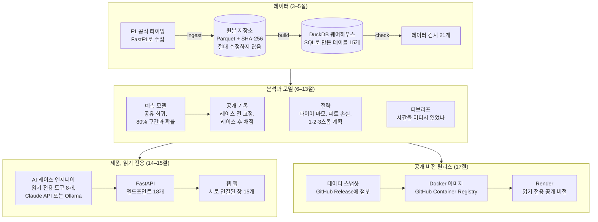
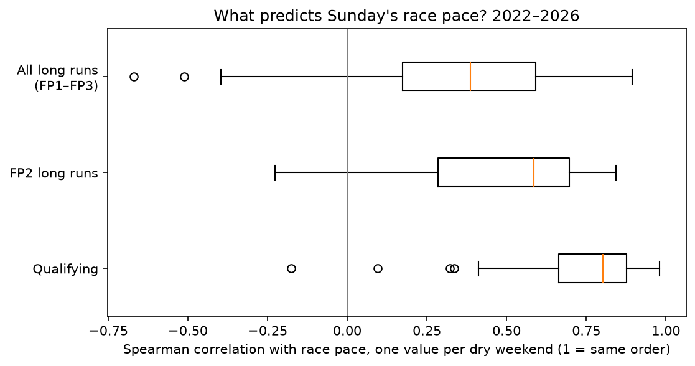

# F1 Pace Intelligence 기술 가이드

**데이터 수집부터 배포까지, 이 프로젝트의 각 부분이 무엇을 하고 전체 시스템 안에서 어떻게 연결되는지 설명합니다.**

[한국어 소개](README.md) · [용어집](glossary.md) · [English README](../../README.md) · [문서 목록](../README.md) · [GitHub 저장소](https://github.com/shavkatjony/F1-pace-intelligence)

이 문서는 데이터 사이언티스트, ML·데이터·백엔드 엔지니어, 그리고 기술 면접관을 위해 썼습니다. 영어 문서를 옮긴 것이 아니라, 이 프로젝트를 처음 보는 엔지니어에게 제가 직접 설명한다고 생각하고 다시 정리했습니다. 각 절은 대체로 같은 흐름을 따릅니다. 어떤 문제가 있었는지, 무엇을 어떻게 만들었는지, 왜 그렇게 했는지, 근거가 되는 결과는 무엇인지, 그리고 어디까지가 한계인지입니다. 코드 수준의 세부 사항은 되풀이하지 않고 절마다 끝에 참고 문서를 연결했습니다. 이 폴더의 한국어 문서 세 개를 빼면, 링크는 모두 영어 문서나 코드로 이어집니다.

F1을 잘 모른다면 [2절](#2-f1-데이터와-용어)과 [용어집](glossary.md)을 먼저 보시면 나머지가 훨씬 쉽게 읽힙니다.

**상태 표시.** 실제 결과와 가정, 앞으로 할 일을 섞지 않으려고 다음 표시를 씁니다.

| 표시 | 뜻 |
|---|---|
| 검증됨 | 구현했고, 데이터 검사·테스트·백테스트 같은 증거로 결과를 확인했습니다 |
| 구현됨 | 코드가 있고 테스트를 통과하지만, 실제 운영에서 나온 결과는 아직 없습니다 |
| 탐색 단계 | 분석에서 관찰한 결과이며, 시스템의 결정에는 직접 쓰지 않습니다 |
| 가정 | 공개 데이터로는 측정할 수 없어서 정해 둔 값입니다 |
| 향후 과제 | 아직 구현하지 않았습니다 |

수치는 모두 저장된 웨어하우스(2022 바레인 그랑프리부터 2026 싱가포르 그랑프리까지)와 저장소에 커밋된 결과 파일에서 나왔습니다. 출처와 확인 방법은 [수치 검증 문서](../../reports/numbers-check.md)에 있고, 다시 계산하지 못한 항목도 그 문서에 따로 적어 두었습니다.

## 목차

각 줄 끝의 경로는 그 절에서 주로 다루는 코드입니다.

1. [문제 정의와 프로젝트 범위](#1-문제-정의와-프로젝트-범위): 무엇을 예측하고, 무엇은 예측하지 않는가 · `config/dpec.yaml`
2. [F1 데이터와 용어](#2-f1-데이터와-용어): 레이스 주말과 세션, FastF1이 주는 7개 테이블 · `src/telemetry_core/ingestion/`
3. [데이터 수집과 적재](#3-데이터-수집과-적재): 545개 세션을 한 번만, 끊겨도 안전하게 내려받기 · `fastf1_source.py`, `writer.py`
4. [데이터 정제와 품질 검증](#4-데이터-정제와-품질-검증): 랩 사유 코드, 원본 데이터의 문제, 데이터 검사 21개 · `sql/core/`, `sql/checks/`
5. [SQL, Parquet, DuckDB 아키텍처](#5-sql-parquet-duckdb-아키텍처): 저장 계층, SQL 실행기, 15개 테이블 · `warehouse.py`, `sql/marts/`
6. [데이터 분석과 통계적 탐색](#6-데이터-분석과-통계적-탐색): 예선 대 롱런 연구, 트랙 에볼루션, 디브리프 · `notebooks/`, `src/dpec/debrief/`
7. [피처 엔지니어링](#7-피처-엔지니어링): 입력 세 개, 그리고 버린 입력들 · `forecasting/features.py`
8. [타이어 마모와 연료 탑재량 가정](#8-타이어-마모와-연료-탑재량-가정): 연료 효과 보정, 연습 주행과 결승의 마모 차이 · `05_mart_stints.sql`, `decisions/tyres.py`
9. [레이스 페이스 예측](#9-레이스-페이스-예측): 모든 서킷과 연도에 쓰는 하나의 가중 회귀 모델 · `forecasting/model.py`
10. [모델 학습과 검증](#10-모델-학습과-검증): 데이터 누수 차단, 튜닝 연도와 테스트 연도, 재현성 · `forecasting/targets.py`
11. [워크포워드 백테스트와 베이스라인](#11-워크포워드-백테스트와-베이스라인): 절차, 베이스라인 5개, 결과 · `backtest.py`, `baselines.py`
12. [예측 구간과 불확실성](#12-예측-구간과-불확실성): 분할 컨포멀 구간, 확률, 보정 · `ranges.py`, `simulate.py`
13. [전략 시뮬레이션](#13-전략-시뮬레이션): 1·2·3스톱 비용, 4,000번 시뮬레이션, 결정 리플레이 · `decisions/plans.py`, `replay.py`
14. [FastAPI와 백엔드 아키텍처](#14-fastapi와-백엔드-아키텍처): 엔드포인트 18개, 로컬·공개 모드, 웹 앱 · `src/dpec/api/`, `web/app/`
15. [AI 도구 호출 아키텍처](#15-ai-도구-호출-아키텍처): 에이전트 루프, 도구 8개, SQL 가드, 50문항 시험 · `src/dpec/assistant/`
16. [테스트와 품질 관리](#16-테스트와-품질-관리): 테스트 129개, CI, 실제 데이터 검증 · `tests/`, `ci.yml`
17. [Docker, CI/CD, 배포](#17-docker-cicd-배포): 스냅샷, 릴리스 워크플로, Render, 공개 기록 · `Dockerfile`, `release.yml`
18. [결과, 가정, 한계](#18-결과-가정-한계): 무엇이 검증되었고, 무엇이 가정이며, 다음에 무엇을 할까

## 전체 구조 한눈에 보기



설계 전체를 붙잡고 있는 규칙은 네 가지입니다.

- **데이터는 한 방향으로만 흐릅니다.** 원본 파일은 절대 고치지 않고, 웨어하우스는 언제든 지우고 원본에서 다시 만들 수 있습니다.
- **모델은 과거만 봅니다.** 모든 예측과 전략 결정은 그 레이스보다 엄격히 이전의 레이스만 씁니다.
- **서비스는 읽기만 합니다.** API는 웨어하우스를 읽기 전용으로 열고, AI의 도구는 쓰지 못하며, 공개 버전은 실시간 AI 호출을 하지 않습니다. 방문자가 데이터를 바꾸거나 비용을 늘릴 수 없습니다.
- **설정 파일은 하나입니다.** 모든 기준값은 [`config/dpec.yaml`](../../config/dpec.yaml)에 있고, 공개 버전의 설정은 `mode`만 다릅니다.

저장소와 구성 요소를 모두 담은 전체 구조는 [architecture.md](../engineering/architecture.md)에 있습니다.

## 1. 문제 정의와 프로젝트 범위

F1 용어를 빼고 말하면 이 프로젝트의 문제는 이렇습니다. 결과가 나오기 전에, 잡음이 많은 몇 가지 신호만 보고 각 대상의 성과를 예측합니다. 그 예측이 얼마나 확실한지 함께 말하고, 예측을 바탕으로 결정을 내립니다. 그리고 결과가 나오면 스스로 채점합니다. F1에서는 대상이 차량이고, 신호는 연습 주행과 예선 기록이며, 결정은 피트 스톱 횟수입니다.

구체적으로는 레이스 주말마다 네 가지 질문에 답합니다.

1. **일요일 결승에서 각 차는 얼마나 빠를까?** 한 랩의 최고 속도가 아니라 레이스 전체의 속도, 즉 레이스 페이스(race pace)입니다.
2. **그 예측을 얼마나 믿을 수 있을까?** 모든 예측에 80% 예측 구간과 세 가지 확률(가장 빠른 페이스, 상위 3위 안의 페이스, 팀 동료보다 빠를 확률)을 붙입니다.
3. **타이어를 몇 번 바꿔야 할까?** 1·2·3스톱 계획을 비교해 결정을 내리고, 어느 쪽도 확실하지 않으면 "명확한 결정 없음"이라고 말합니다.
4. **끝난 뒤에는 어디서 시간을 잃었을까?** 랩 타임 차이를 원인별로 나눠 설명합니다(디브리프, [6절](#6-데이터-분석과-통계적-탐색)).

**예측 대상(target).** 예측하는 값은 `race_pace_gap_pct`입니다. 한 드라이버가 결승에서 기록한 클린 랩(clean lap, 정상적으로 달린 랩)의 중앙값이, 그 레이스에서 가장 좋은 중앙값보다 몇 % 느린지를 뜻합니다. 클린 랩이 10개 이상인 드라이버만 계산합니다.

```text
race_pace_gap_pct = 100 × (그 드라이버의 클린 랩 중앙값 / 그 레이스의 가장 좋은 중앙값 − 1)
```

이 정의에는 결정이 몇 가지 들어 있습니다.

- **초가 아니라 %입니다.** 서킷마다 한 랩의 길이가 달라서, %로 바꿔야 서킷끼리 비교할 수 있습니다. 90초 랩에서 1%는 약 0.9초입니다.
- **평균이 아니라 중앙값입니다.** 규칙을 통과한 느린 랩 몇 개에 값이 끌려가지 않습니다.
- **가장 빠른 차와의 차이입니다.** 그날 서킷의 전반적인 속도(노면, 기온, 서킷 길이)가 자동으로 빠지므로, 모델은 차들 사이의 차이만 배우면 됩니다.
- **순위가 아니라 페이스입니다.** 순위는 출발, 세이프티 카, 전략, 고장이 크게 좌우하는데, 이런 사건은 공개 데이터로 예측할 수 없습니다. 그래서 차의 속도만 예측합니다([결정 0011](../decisions/0011-target-and-fair-test.md)).

**두 번의 예측 시점.** 한 주말에 두 번, 정해진 시점(checkpoint)에 예측합니다. 시점마다 아직 알 수 없는 열은 코드가 지웁니다([10절](#10-모델-학습과-검증)).

- **연습 주행 후** (`after_practice`): 과거 레이스와 이번 주말 연습 주행 롱런을 압니다. 예선 기록과 그리드, 결승 결과는 아직 모릅니다.
- **예선 후** (`after_quali`): 여기에 예선 기록과 그리드가 더해지고, 결승 결과만 모릅니다.

**범위.**

- 2023년부터의 드라이 레이스(비가 오지 않은 레이스)에서 그리드의 모든 차를 예측합니다. 2022 시즌은 학습에만 씁니다.
- 젖은 레이스(결승 랩의 10% 넘게 인터미디어트·웻 타이어로 달린 레이스)는 예측하지 않습니다. 109개 레이스 가운데 13개가 여기에 해당합니다.
- 이야기를 구체적으로 만들기 위해 가상의 팀 Team DPEC를 두고, 메르세데스의 두 차를 "우리 차"로 정했습니다(`adopted_team: Mercedes`, [결정 0001](../decisions/0001-dpec-team.md)). 예측은 그리드 전체에 대해 만들고, 전략 조언과 디브리프는 우리 두 차를 기준으로 씁니다.
- 범위 밖: 순위, 타이어 컴파운드 선택, 레이스 도중의 실시간 전략, 팀 내부 데이터.

**성공 기준.** 제가 성공으로 본 기준은 네 가지였습니다. 모델을 고르는 데 쓰지 않은 연도에서 단순한 방법(베이스라인)보다 정확해야 하고, 80% 구간 안에 실제 결과가 정말 약 80% 들어와야 하고, 전략 결정이 "항상 1스톱"보다 자주 맞아야 하며, 모든 결과를 같은 코드와 데이터로 다시 만들 수 있어야 합니다. 네 가지 모두 충족했습니다([11](#11-워크포워드-백테스트와-베이스라인)·[12](#12-예측-구간과-불확실성)·[13](#13-전략-시뮬레이션)·[10절](#10-모델-학습과-검증)). 반대로 레이스 전에 공개적으로 고정한 예측, 즉 실시간 기록은 0건입니다. 이유는 [17절](#17-docker-cicd-배포)과 [18절](#18-결과-가정-한계)에 있습니다.

**더 보기:** [methods.md § 1](../methods.md#1-the-question) · [결정 0001](../decisions/0001-dpec-team.md) · [결정 0011](../decisions/0011-target-and-fair-test.md) · [워크스트림 03 § 5.1](../workstreams/03-forecasting-machine-learning.md#51-target-and-checkpoints)

## 2. F1 데이터와 용어

**레이스 주말과 세션.** 제 데이터에서 한 시즌은 22–24개의 레이스 주말로 이루어지고, 2026년은 17라운드인 싱가포르 그랑프리까지 저장되어 있습니다. 주말마다 여러 세션(session)이 열립니다.

| 세션 | 코드 | 하는 일 | 세션 수 |
|---|---|---|---|
| 연습 주행 1–3 | FP1, FP2, FP3 | 팀이 세팅과 타이어를 시험합니다. FP1은 신인 드라이버 기용과 부품 시험에도 쓰입니다 | 109, 85, 82 |
| 예선 | Q | Q1–Q3 세 단계에서 가장 빠른 한 랩으로 결승 출발 순서(그리드)를 정합니다 | 109 |
| 스프린트 예선 | SQ | 스프린트의 출발 순서를 정합니다 | 24 |
| 스프린트 | S | 약 100 km의 짧은 레이스입니다 | 27 |
| 결승 | R | 약 300 km, 대부분 50–70랩을 달리는 본 레이스입니다 | 109 |

스프린트 주말(2022년 3번, 2023년부터 해마다 6번)에는 FP3가 없고, 2023년부터는 FP2 대신 스프린트 예선이 열립니다. 그래서 FP2와 FP3의 수가 적고, 합치면 545개 세션입니다.

**FastF1이 주는 데이터.** [FastF1](https://docs.fastf1.dev/)은 F1 공식 타이밍 데이터를 파이썬으로 받아 오는 오픈소스 라이브러리입니다. 세션마다 7개 테이블을 저장합니다.

| 테이블 | 내용 | 이 프로젝트에서의 쓰임 |
|---|---|---|
| `laps` | 랩마다 랩 타임, 섹터 타임, 타이어 종류와 나이, 트랙 상태, 피트 출입 시각 | 거의 모든 분석의 출발점(`core_laps`) |
| `results` | 공식 순위, 그리드, 포인트, 리타이어와 실격 | 공식 결과와 순위표(`core_results`) |
| `car_data` | 차량 텔레메트리: 속도, 스로틀, 브레이크, 기어, RPM, DRS를 초당 약 4번 | 두 랩 비교와 디브리프. 웨어하우스에 넣지 않습니다 |
| `pos_data` | 트랙 위 차의 위치 좌표 | 트랙 지도 |
| `weather` | 1분마다 기온, 노면 온도, 습도, 바람, 비 | 세션 날씨(`mart_session_weather`) |
| `race_control` | 레이스 컨트롤 메시지 | 저장만 합니다 |
| `track_status` | 트랙 상태가 바뀐 기록 | 저장만 합니다. 랩별 트랙 상태는 `laps`의 `TrackStatus` 열을 씁니다 |

**데이터에서 F1 개념이 나타나는 방식.** 아래 개념은 분석 전반에 계속 나옵니다. 정의는 [용어집](glossary.md#f1-용어)에 더 자세히 있습니다.

| 개념 | 데이터에서는 |
|---|---|
| 스틴트(stint): 타이어 한 세트로 달린 연속 구간 | `laps`의 스틴트 번호. 스틴트마다 한 행인 `mart_stints` |
| 타이어 컴파운드: 소프트, 미디엄, 하드(마른 노면용), 인터미디어트, 웻(젖은 노면용) | `compound` 열. 그 밖의 이름(`TEST_UNKNOWN`, 빈 값)은 `UNKNOWN`으로 바꿉니다 |
| 타이어 나이(tyre age): 그 세트로 달린 랩 수 | `tyre_age_laps`. 마모 기울기를 구하는 x축입니다 |
| 트랙 상태: 옐로 플래그, 세이프티 카(SC), 버추얼 세이프티 카(VSC), 레드 플래그 | `TrackStatus`의 코드 2, 4, 6·7, 5. 해당 랩은 클린 랩에서 빠집니다 |
| 삭제된 랩: 트랙 경계를 벗어나 기록이 지워진 랩(트랙 리밋) | `deleted` 표시 |
| 피트 스톱과 피트 손실: 타이어를 바꾸느라 잃는 시간 | 인 랩과 아웃 랩. `pit_loss_s`로 계산합니다([13절](#13-전략-시뮬레이션)) |
| 드라이버와 팀 | 세 글자 코드(VER, HAM, RUS), 차 번호, 팀 이름이 바뀌어도 같은 팀을 가리키는 `team_id`와 계보(lineage) |
| 세션 식별자 | `session_key`. 예를 들어 `2024_01_R`은 2024년 1라운드 결승입니다 |

**2026년의 변화.** 2026년에는 새 기술 규정이 시작되었고, 첫 몇 레이스는 과거 데이터가 잘 맞지 않는 시기가 되었습니다([11절](#11-워크포워드-백테스트와-베이스라인)). 새 규정의 배터리(ERS) 사용과 액티브 에어로 상태는 공개 데이터에 없습니다. 같은 해 마드리드의 새 서킷(Madring)이 생겼고, 몬트리올 결승은 70랩에서 68랩으로 줄었습니다.

**더 보기:** [methods.md § 3](../methods.md#3-the-data) · [데이터 사전](../data-dictionary.md) · [워크스트림 01 § 3](../workstreams/01-data-engineering.md#3-what-was-implemented)

## 3. 데이터 수집과 적재

**문제.** 545개 세션을 모두 받으려면 몇 시간이 걸리고, 그동안 네트워크가 끊기거나 요청 제한(rate limit)에 걸릴 수 있습니다. 게다가 나중에 정제 규칙을 바꿀 때마다 다시 받을 수는 없으니, 받은 데이터를 손대지 않고 보관하면서 무엇을 언제 받았는지 정확히 알아야 했습니다.

**흐름.** `dpec ingest`는 다섯 단계로 동작합니다.

1. **찾기:** 시즌별 공식 일정에서 레이스 주말을 찾습니다(프리시즌 테스트 제외). 세션 시작 후 3시간이 지나야 "받을 수 있는 세션"으로 보므로, 아직 데이터가 없는 미래 세션은 요청하지 않습니다.
2. **건너뛰기:** 이미 `manifest.json`이 있는 세션 폴더는 건너뜁니다(`--force`로 강제 가능).
3. **받기:** `fetch_session()`이 7개 테이블과 세션 정보(FastF1 버전, 이벤트, 시작 시각)를 가져옵니다.
4. **쓰기:** `write_session()`이 테이블마다 Parquet 파일을 쓰고 SHA-256 체크섬을 계산한 뒤, 마지막에 매니페스트를 씁니다.
5. **기록:** 시도마다 `data/ingest_log.csv`에 한 줄을 남깁니다. 시각, 시즌, 라운드, 세션, 상태(`ok`, `failed`, `rate_limited`), 행 수, 걸린 시간, 오류 메시지입니다.

원본 폴더는 하이브(Hive) 방식의 `key=value` 이름을 씁니다. DuckDB가 폴더 이름을 그대로 열로 읽기 때문에, glob 하나로 모든 세션을 읽을 수 있습니다([5절](#5-sql-parquet-duckdb-아키텍처)).

```text
data/raw/fastf1/season=2024/event=01_bahrain_grand_prix/session=race/
    laps.parquet  results.parquet  car_data.parquet  pos_data.parquet
    weather.parquet  race_control.parquet  track_status.parquet  manifest.json
```

**설계에서 중요하게 본 것.**

- **원본은 수정하지 않습니다.** 정제는 전부 SQL에서 하고 원본 Parquet은 받은 그대로 둡니다. 규칙을 바꾸면 웨어하우스만 다시 만들면 됩니다.
- **매니페스트를 마지막에 씁니다.** 7개 파일을 다 쓴 다음에 매니페스트를 쓰기 때문에, 중간에 끊긴 세션에는 매니페스트가 없고 다음 실행 때 다시 받습니다. 몇 번을 다시 실행해도 결과가 같습니다(멱등성, idempotency).
- **파일마다 체크섬을 남깁니다.** 매니페스트에는 파일별 행 수, 열 수, 변환한 열, SHA-256이 들어 있고, `core_files` 테이블에서 어떤 파일이 비어 있는지도 확인할 수 있습니다.
- **실패해도 멈추지 않습니다.** 한 세션이 실패하면 로그에 남기고 다음으로 넘어가고, 요청 제한에 걸리면 깔끔하게 멈춥니다.
- **FastF1은 한 모듈에서만 씁니다.** [`fastf1_source.py`](../../src/telemetry_core/ingestion/fastf1_source.py)만 FastF1을 import하므로, 데이터 출처를 바꿀 때 고칠 곳이 한 곳입니다.

**규모와 결과.** 545개 세션을 모두 받았고, 원본은 4.1 GB, FastF1의 자체 캐시는 34 GB입니다. 텔레메트리는 `car_data` 약 2억 4,100만 행, `pos_data` 약 2억 4,600만 행으로, 웨어하우스에 넣지 않고 두 랩을 비교할 때만 원본에서 한 랩씩 읽습니다. 깨끗한 랩 전부를 5 m 간격으로 저장하면 약 1억 7,500만 행이 되는데, 가끔 쓰는 비교 기능에 비해 너무 크다고 판단했습니다(실험 기록 E06). **상태:** 검증됨.

```bash
uv run dpec ingest                           # 설정된 모든 시즌. 이미 받은 세션은 건너뜁니다
uv run dpec ingest --season 2026 --round 17  # 한 주말만
make data                                    # ingest → build → check
```

**한계.**

- 2026년 10월부터 F1 타이밍 데이터에 로그인이 필요해졌습니다. FastF1 3.9 이상은 유료 F1TV Access 구독이 있어야 하고, 3.8.3은 데이터를 받지 못합니다. 그래서 2026 싱가포르 그랑프리(10월 11일) 이후 세션은 받지 못했습니다. 다시 시작하려면 OpenF1 같은 새 출처나 F1TV 구독이 필요합니다(향후 과제).
- 체크섬은 기록만 하고, 원본을 다시 해시해 비교하는 명령은 아직 없습니다.
- 증분 빌드는 없고 매번 전체를 다시 만듭니다. 웨어하우스가 약 28 MB라 지금은 문제가 되지 않습니다.

**더 보기:** [워크스트림 01 § 3–5](../workstreams/01-data-engineering.md#3-what-was-implemented) · [운영 § 2](../engineering/operations.md#2-data-pipeline) · [결정 0002](../decisions/0002-storage.md) · [사례 09](../research/cases/09-release-deployment-data-access.md) · [live-weekends.md](../live-weekends.md#to-restart)

## 4. 데이터 정제와 품질 검증

**문제.** 공식 데이터라도 그대로 쓸 수는 없었습니다. 전체 랩의 45%는 차의 실제 속도를 보여 주지 않습니다. 피트를 드나든 랩, 세이프티 카 뒤에서 천천히 달린 랩, 기록이 없는 랩, 빗길 랩이 섞여 있습니다. 게다가 원본 피드 자체에도 빈칸과 모순이 있었습니다.

**방법: 랩마다 사유 코드 하나.** 랩을 지우지 않고, 규칙마다 예·아니요 열을 하나씩 두고, 랩마다 사유(`lap_reason`)를 정확히 하나 붙입니다. 정해진 순서에서 **처음** 걸린 규칙이 사유가 되고, 아무 규칙에도 걸리지 않으면 `clean`입니다. 순서가 정해져 있으니 랩 하나는 한 번만 세어지고, 모든 사유의 합이 전체 랩 수와 정확히 같습니다.

| # | 사유 코드 | 규칙 | 랩 수 |
|---|---|---|---|
| 1 | `no_time` | 랩 타임 기록 없음 | 41,890 |
| 2 | `generated` | FastF1이 스스로 채워 넣은 랩(231개 모두 랩 타임이 없어 1번에서 걸림) | 0 |
| 3 | `in_lap` | 피트 레인으로 들어간 랩 | 28,243 |
| 4 | `out_lap` | 피트 레인에서 나온 랩 | 10,789 |
| 5 | `lap_one` | 결승·스프린트의 첫 랩(정지 출발) | 1,883 |
| 6 | `red_flag` | 트랙 상태 5(레드 플래그) | 12 |
| 7 | `safety_car` | 트랙 상태 4(세이프티 카) | 4,144 |
| 8 | `vsc` | 트랙 상태 6 또는 7(버추얼 세이프티 카) | 2,584 |
| 9 | `yellow` | 트랙 상태 2(옐로 플래그) | 10,227 |
| 10 | `deleted` | 스튜어드가 지운 랩(트랙 리밋 위반) | 2,571 |
| 11 | `inaccurate` | FastF1이 타이밍이 부정확하다고 표시한 랩 | 104 |
| 12 | `wet_tyre` | 인터미디어트·웻 타이어 | 8,808 |
| 13 | `slow` | 그 세션 클린 랩 중앙값의 107%보다 느린 랩 | 22,870 |
| | `clean` | 어느 규칙에도 걸리지 않은 랩 | 163,599 (54.9%) |

`slow` 규칙은 마지막에, 1–12번을 통과한 랩의 중앙값을 기준으로 계산합니다. 아주 느린 랩 하나가 기준선을 움직이지 못하게 하려는 것입니다. 기준을 107%로 둔 데도 이유가 있습니다. 107%에서는 결승 랩 395개가 빠지지만 103%로 좁히면 3,445개가 빠지고, 그 안에는 닳은 타이어로 달린 랩, 즉 진짜 레이스 페이스가 들어 있습니다([사례 01](../research/cases/01-lap-eligibility.md)).

세션별 클린 랩 비율은 결승 78.2%, 스프린트 73.6%, FP2 47.0%, FP1 40.7%, FP3 29.5%, 스프린트 예선 28.1%, 예선 26.7%입니다. 예선이 낮은 이유는 예선 랩 대부분이 아웃 랩, 인 랩, 타이어를 식히는 랩이기 때문입니다. 비 오는 레이스는 따로 표시하지 않아도 드러납니다. 2022 일본과 2024 상파울루는 웻 타이어 규칙 때문에 클린 결승 랩이 하나도 없습니다(E02).

**원본 피드에서 찾아 고친 문제.**

- **스프린트 예선 결과에 드라이버 ID가 없음:** 같은 시즌 다른 세션의 같은 드라이버에게서 ID를 가져왔습니다.
- **2026년 5·7라운드 FP1에 팀 이름이 없음:** 같은 주말의 같은 드라이버로, 없으면 같은 시즌의 같은 차 번호로 채웠습니다. FP1에 대타 드라이버가 나왔기 때문입니다.
- **시즌마다 바뀌는 팀 이름:** 15개 이름을 11개 계보로 묶는 `seeds/teams.csv`를 만들었습니다. 예를 들어 Alfa Romeo, Kick Sauber, Audi는 한 계보입니다.
- **노면 온도가 정확히 0 °C:** 센서가 끊긴 것으로 보고 결측 처리했습니다(54,295건 중 47건, 14개 세션).
- **결승 랩 수가 바뀐 서킷:** 몬트리올은 2025년까지 70랩, 2026년에는 68랩이었습니다. 그래서 결승 길이는 그 레이스에서 차가 완주한 가장 많은 랩 수로 둡니다.

**데이터 검사.** `dpec check`는 SQL 검사 20개와 데이터 사전 검사 1개, 모두 21개를 읽기 전용 연결로 실행하고, 하나라도 실패하면 종료 코드 1로 끝납니다. 검사마다 **규칙을 어긴 행을 돌려주는 쿼리**라서, 실패하면 무엇이 잘못됐는지 증거가 바로 보입니다. 예를 들어 6번 검사는 포인트 합이 맞는지 봅니다.

```sql
-- 결승 포인트: 25+18+15+12+10+8+6+4+2+1 = 101, 2024년까지는 패스티스트 랩 1점 추가
-- 스프린트 포인트: 8+7+6+5+4+3+2+1 = 36
SELECT session_key, session_type, sum(points) AS total
FROM core_results
WHERE session_type IN ('R', 'S')
GROUP BY ALL
HAVING NOT ((session_type = 'R' AND total IN (101, 102)) OR (session_type = 'S' AND total = 36))
```

검사는 여섯 종류입니다.

- **단위(grain):** 키마다 정확히 한 행인가. 세션, 랩, 결과, 주말, 페이스, 스틴트, 신호, 전략 테이블을 봅니다.
- **허용된 값:** 모든 랩 사유가 알려진 코드인가.
- **완전성:** 모든 결승·스프린트·예선에 결과가 있는가, 빈 파일이 알려진 공백뿐인가, 모든 드라이버에 ID가 있는가, 모든 랩의 팀이 팀 표에 있는가, 모든 세션에 날씨가 있는가.
- **산술:** 레이스·스프린트 포인트 합이 맞는가, 최종 순위표 포인트가 경기 포인트의 합과 같은가.
- **그럴듯함:** 롱런이 진짜 롱런인가, 트랙 에볼루션이 10분당 1초 이내인가, 기온과 노면 온도가 정상 범위인가, 피트 손실이 15–35초인가(그린 플래그 스톱이 3개 이상인 드라이 레이스).
- **문서:** 웨어하우스의 모든 열이 [데이터 사전](../data-dictionary.md)에 설명되어 있는가.

비어 있는 게 정상인 파일(2023년 9라운드 FP1의 `pos_data`)은 이유와 함께 `seeds/known_gaps.csv`에 적어 두어, 검사가 그것만 예외로 봅니다. 저장된 웨어하우스에서 21개 검사가 모두 통과합니다(2026년 11월 9일). **상태:** 검증됨.

**한계.** 규칙은 결국 경험칙입니다. 트래픽에 막혀 조금 느렸지만 107% 안에 든 랩은 클린 랩으로 남습니다. 데이터 검사는 실제 웨어하우스가 있는 로컬에서만 돌고, CI에서는 가짜 데이터로 만든 작은 웨어하우스에 대한 테스트만 돕니다([16절](#16-테스트와-품질-관리)).

**더 보기:** [사례 01: 어떤 랩을 쓸 것인가](../research/cases/01-lap-eligibility.md) · [사례 02: 원본의 모순](../research/cases/02-source-inconsistencies.md) · [결정 0003](../decisions/0003-clean-laps.md) · [결정 0006](../decisions/0006-checks-and-id-maps.md) · [워크스트림 02 § 5.1](../workstreams/02-data-analytics-statistics.md#51-lap-eligibility-which-laps-count)

## 5. SQL, Parquet, DuckDB 아키텍처

**문제.** 약 30만 랩과 여기서 파생되는 여러 표를 담을 분석 저장소가 필요했습니다. 혼자 노트북 한 대로 운영하니 단순해야 했고, 언제든 원본에서 다시 만들 수 있어야 했으며, 파이썬 코드, API, 노트북, AI 도구가 모두 같은 데이터를 읽어야 했습니다.

**결정: Parquet 파일과 내장형 DuckDB.** 데이터베이스 서버는 두지 않았습니다([결정 0002](../decisions/0002-storage.md)). [Parquet](https://en.wikipedia.org/wiki/Apache_Parquet)은 열 단위로 압축해 저장하는 형식이라 분석용으로 읽기 빠르고 타입이 유지됩니다. [DuckDB](https://en.wikipedia.org/wiki/DuckDB)는 파이썬 프로세스 안에서 돌아가는 분석용 SQL 엔진입니다. Parquet 파일을 glob으로 직접 읽고, 폴더 이름을 열로 쓰고, `median`, `regr_slope`, 윈도 함수 같은 분석 함수를 갖추고 있습니다.

**저장 계층.**

- **다운로드 캐시** (`data/cache/`, 34 GB): FastF1 자체 캐시입니다.
- **원본** (`data/raw/fastf1/…/`, 4.1 GB): 세션마다 Parquet 파일 7개와 매니페스트입니다.
- **웨어하우스** (`data/warehouse.duckdb`, 약 28 MB): 테이블 15개(코어·차원 6개, 마트 9개)입니다.
- **저장된 예측** (`data/forecasts/`, 377 KB와 17 KB): `backtest.parquet`과 `decisions.parquet`입니다.
- **공개용 스냅샷** (`dist/dpec-data-<날짜>.tar.gz`, 12.5 MB): 웨어하우스, 예측 파일, 공개 기록, 드라이 런, `SHA256SUMS`를 묶은 파일입니다.

`data/`는 전부 git 밖에 있습니다. git에는 코드와 SQL, 그리고 작은 결과 표만 올립니다.

**SQL 실행기.** `dpec build`는 [`warehouse.py`](../../src/telemetry_core/warehouse.py)의 작은 실행기로 `sql/core/`와 `sql/marts/`의 파일을 이름 순서대로 실행합니다. 테이블 이름은 파일 이름에서 번호를 뺀 것이고(`01_core_sessions.sql` → `core_sessions`), SQL 안의 `{{ 자리표시자 }}`는 설정 파일 값으로 채웁니다. 채워지지 않은 자리표시자가 남으면 오류를 내므로, 설정이 빠졌는데 SQL은 그럴듯하게 돌아가는 일은 생기지 않습니다. 그래서 107%, 0.06초 같은 기준값은 SQL이 아니라 [`config/dpec.yaml`](../../config/dpec.yaml)에 있습니다. 랩 테이블은 모든 세션의 Parquet을 이렇게 한 번에 읽습니다.

```sql
read_parquet('{{ raw }}/fastf1/*/*/*/laps.parquet', hive_partitioning = true, union_by_name = true)
```

`union_by_name`은 세션마다 열 구성이 조금 다른 파일들을 열 이름 기준으로 합쳐 줍니다. 빌드할 때마다 모든 테이블을 새로 만듭니다.

**15개 테이블.** 열 하나하나의 뜻은 [데이터 사전](../data-dictionary.md)에 있습니다.

| 테이블 | 한 행의 단위 | 행 수 | 용도 |
|---|---|---|---|
| `core_sessions` | 세션 | 545 | `session_key`, 세션 종류, 스프린트 주말 여부 |
| `core_laps` | 드라이버·랩·세션 | 297,724 | 정리된 랩과 사유 코드 |
| `core_results` | 드라이버·세션(R, S, Q, SQ) | 5,469 | 공식 순위, 그리드, 포인트, `team_id` |
| `core_files` | 저장된 파일 | 3,815 | 행 수, 빈 파일 여부, SHA-256 |
| `dim_drivers` | 드라이버·시즌 | 167 | ID, 이름, 차 번호, 팀 |
| `dim_teams` | 팀 이름 | 15 | `team_id`, 계보, 첫 시즌과 마지막 시즌 |
| `mart_weekends` | 레이스 주말 | 109 | 폴, 우승자, 젖은 레이스 여부, 결승 랩 수 |
| `mart_session_weather` | 세션 | 545 | 세션 날씨 요약 |
| `mart_standings` | 드라이버·라운드 | 2,212 | 라운드마다 누적 포인트와 우승 수(윈도 함수) |
| `mart_driver_session_pace` | 드라이버·세션 | 10,282 | 최고·중앙값 클린 랩, 1위와의 차이 |
| `mart_stints` | 스틴트 | 41,403 | 컴파운드, 랩 수, 연료 보정 마모 |
| `mart_long_runs` | 연습 주행 롱런 | 2,603 | 중앙값 랩, 마모, 같은 타이어 최고 대비 차이 |
| `mart_track_evolution` | 연습 주행·예선 세션 | 390 | 10분당 노면 변화와 신뢰 가능 여부 |
| `mart_weekend_signals` | 드라이버·주말 | 2,010 | 예선 차이, 롱런 차이, 레이스 페이스(예측 대상) |
| `mart_race_strategy` | 레이스 | 109 | 연습 주행·결승 마모, 피트 손실, 상위 10명의 스톱 횟수 |

**읽기와 쓰기.** 웨어하우스에 쓰는 코드는 `dpec build` 하나뿐입니다. 데이터 검사, API, AI 도구, 텔레메트리 정렬은 모두 `query()` 함수로 읽기 전용 연결을 열고, 값은 `?` 매개변수로 넘깁니다. 값이 SQL 문자열에 섞이지 않으니 SQL 인젝션 걱정도 없습니다. 28 MB짜리 파일이라 API 대부분이 15–60 ms 안에 답합니다(2026년 11월 9일 측정).

**dbt를 쓰지 않은 이유.** 테이블이 15개일 때는 파일 번호 순서, 자리표시자, SQL 검사, 데이터 사전 검사로 충분했습니다. 25개 정도를 넘으면 다시 검토할 생각입니다(E07). **상태:** 검증됨.

**한계.** DuckDB는 한 번에 쓰는 프로세스 하나 또는 읽는 프로세스 여러 개만 허용합니다. 그래서 `dpec build`가 도는 동안에는 로컬 앱의 요청이 실패합니다("Could not set lock on file"). [결정 0002](../decisions/0002-storage.md)에 적힌 "빠르다"는 이유는 결정 당시 측정한 값이 아니었고, 읽기 속도는 나중에 따로 측정했습니다.

**더 보기:** [결정 0002](../decisions/0002-storage.md) · [결정 0007](../decisions/0007-marts.md) · [데이터 사전](../data-dictionary.md) · [워크스트림 01 § 5](../workstreams/01-data-engineering.md#5-important-components-and-responsibilities) · [architecture.md § 5](../engineering/architecture.md#5-data-stores)

## 6. 데이터 분석과 통계적 탐색

웨어하우스의 마트는 지표를 SQL로 **한 번만** 정의합니다. 클린 랩, 레이스 페이스, 타이어 마모, 트랙 에볼루션, 피트 손실이 각각 한 곳에만 정의되어 있어서, 노트북과 API와 AI가 같은 숫자를 봅니다. 이 절에서는 그 위에서 한 연구 세 가지를 설명합니다.

### 연구 1: 결승 페이스를 가장 잘 예측하는 신호는?

**가설.** 저는 처음에 연습 주행 롱런(long run, 결승처럼 여러 랩을 이어 달리는 주행)이 가장 좋은 신호일 거라고 생각했습니다. 연료를 많이 싣고 결승과 비슷한 조건으로 달리기 때문입니다.

**방법.** 비가 오지 않은 86개 레이스 주말에서, 주말마다 각 신호와 실제 레이스 페이스 사이의 [스피어만 순위 상관계수](https://en.wikipedia.org/wiki/Spearman%27s_rank_correlation_coefficient)(Spearman rank correlation)를 구하고 주말들의 중앙값을 봤습니다. 신호 사이의 차이는 주말 단위 [부트스트랩](https://en.wikipedia.org/wiki/Bootstrapping_(statistics))(5,000번 재표본, seed 0)으로 신뢰 구간을 구했고, 예측력은 주말 하나씩을 빼고 학습하는 교차 검증으로 평균 절대 오차(MAE)를 비교했습니다.

| 신호 | 주말 수 | 순위 상관 중앙값 | 0.5를 넘은 주말 비율 |
|---|---|---|---|
| 예선 | 86 | 0.80 | 0.90 |
| 연습 주행 롱런(FP1–FP3 전체) | 86 | 0.39 | 0.31 |
| FP2 롱런만 | 58 | 0.59 | 0.60 |

- 롱런과 예선의 차이는 −0.41, 95% 신뢰 구간 −0.48부터 −0.34까지로, 우연이 아닙니다.
- 교차 검증 MAE(랩 타임의 %): 신호 없음 0.885, 예선 0.597, 롱런 0.843, 둘 다 0.586.
- 예선은 모든 시즌에서 이겼고(0.66–0.92), 롱런은 한 차가 압도적이었던 2023년에 가장 약했습니다(0.16).



**해석.** 가설이 틀렸습니다. 연습 주행은 팀마다 연료량과 엔진 모드가 다르고 공개되지 않으며, FP1은 세팅 작업, 부품 시험, 신인 기용에도 쓰여서 롱런에 잡음이 많습니다. 예선에서는 모두가 같은 시간대에 전력으로 달립니다. 롱런을 예선에 더하면 오차가 0.597%에서 0.586%로 줄지만, 90초 랩에서 약 0.01초입니다. 예선의 힘 일부는 그리드 자체(앞에서 출발하면 깨끗한 공기에서 달림)에서 나옵니다. 일요일을 예측하는 데는 정당한 정보지만, 순수한 차의 속도라고 말하면 안 됩니다.

**결정.** 그래서 예측 모델은 예선과 최근 성적 위에 만들었고, 롱런은 모델의 입력이 아닙니다([7절](#7-피처-엔지니어링)). **상태:** 검증됨.

### 연구 2: 세션 중에 트랙은 얼마나 빨라지나?

트랙은 세션이 진행될수록 고무가 쌓여 빨라집니다(트랙 에볼루션, track evolution). 그런데 랩 타임을 시각에 대해 그대로 회귀하면 편향이 생깁니다. 빠른 드라이버가 세션 후반에 나오는 경우가 많아서, 트랙이 빨라진 것처럼 보이기 때문입니다. 그래서 각 랩을 **같은 드라이버의 같은 컴파운드 랩끼리만** 비교하는 [고정 효과](https://en.wikipedia.org/wiki/Fixed_effects_model)(fixed effects, within) 추정을 썼습니다.

```text
푸시 랩 = 그 드라이버의 그 컴파운드 최고 기록에서 1.5% 이내인 클린 랩
lap'    = lap_time_s − (세션·드라이버·컴파운드 안의 평균)
minute' = minute     − (세션·드라이버·컴파운드 안의 평균)      (2랩 이상인 묶음만)
evo_s_per_10min = 10 × regr_slope(lap', minute')
```

묶음 안에서는 차, 드라이버, 타이어가 모두 같으니 그 차이가 빠집니다. 첫 버전은 검사 16번(신뢰 가능한 세션은 10분당 ±1초 이내)에서 12개 세션이 실패했습니다. 거의 다 비가 왔거나 마르는 중인 트랙이었고, 몇 개는 푸시 랩을 낸 드라이버가 한두 명뿐이었습니다. 그래서 비가 없고, 웻 타이어 랩이 10% 미만이며, 드라이버가 10명 이상일 때만 `is_reliable`로 표시하는 규칙을 더했습니다. 세션을 지우지 않고 표시만 하니, 모든 세션이 이유와 함께 남습니다.

결과: 신뢰 가능한 예선 87개 모두에서 트랙이 빨라졌고, 중앙값은 10분당 −0.15초입니다. 스프린트 예선은 약 두 배(−0.33초)인데, 앞서 열린 연습 주행이 하나뿐이라 노면이 덜 다듬어져 있기 때문입니다. FP2는 가장 잡음이 커서 74개 중 13개에서 오히려 느려졌습니다. 연료를 많이 실은 롱런이 섞이기 때문입니다. **상태:** 검증됨. 앱에서 보여 주기만 하고 예측에는 쓰지 않습니다.

### 연구 3: 시간을 어디서 잃었나? (디브리프)

레이스가 끝나면 디브리프(debrief)가 우리 차의 시간 차이를 나눠 설명합니다.

- **예선 한 랩의 차이**는 두 랩을 같은 거리 격자(5 m 간격)에 올린 뒤, 격자의 칸마다 구간 종류를 붙여 나눕니다. 구간 종류는 빠른 쪽 랩을 기준으로 브레이킹, 직선(스로틀 95% 이상), 트랙션(시속 200 km 미만 코너의 정점 뒤 풀 스로틀 전까지), 저속 코너(시속 120 km 미만), 중속 코너, 고속 코너(시속 200 km 이상) 순서로 정합니다. 조각을 더하면 전체 차이가 되도록 만들었습니다. 코너 번호 대신 종류를 쓴 이유는 "저속 코너"가 어느 서킷에서나 같은 뜻이기 때문입니다([결정 0016](../decisions/0016-debrief.md)).
- **결승 페이스의 차이**는 두 드라이버가 같은 랩 번호에서 둘 다 클린 랩이고 슬릭 타이어였던 랩끼리 짝을 짓습니다. 짝을 지으면 그 랩까지 태운 연료와 노면 상태가 상쇄됩니다. 그다음 랩별 차이를 [최소제곱 회귀](https://en.wikipedia.org/wiki/Ordinary_least_squares)로 나눕니다.

```text
gap_s = pace + a × 타이어_나이_차이 + b × 컴파운드_경도_차이 + c × A_트래픽 + d × B_트래픽
```

트래픽은 앞차와 1.5초 이내로 결승선을 지난 랩입니다. 각 요인의 몫은 계수 × 입력의 평균이고, 절편(`pace`, 같은 타이어로 깨끗한 공기에서 달렸을 때의 차이)까지 더하면 평균 차이와 정확히 같아집니다. 80% 범위는 랩을 1,000번 재표본한 부트스트랩(seed 0)으로 구하고, 짝지은 랩이 10개 이상일 때만 계산합니다. 이 값은 연관성이지 증명된 원인이 아니며, 도구의 출력에도 그렇게 적혀 있습니다.

예를 들어 2024 바레인에서 러셀은 예선에서 르클레르보다 0.320초 느렸는데, 직선과 트랙션 구간에서 잃고 저속 코너에서 일부를 되찾았습니다. 결승에서는 둘 다 클린했던 47랩에서 랩당 0.148초 느렸습니다. 2026 싱가포르에서는 러셀이 르클레르보다 랩당 1.49초 느렸는데, 그중 약 0.9초가 페이스, 약 0.5초가 트래픽이었습니다. 러셀은 예선 6위였지만 19위에서 출발했고, 그 랩의 76%를 앞차와 1.5초 이내에서 달렸습니다. **상태:** 구현됨. 결과는 앱의 디브리프 창과 `dpec debrief`로 볼 수 있습니다.

**한계.** 두 차가 같은 랩에서 함께 트래픽에 갇히면 두 트래픽 항이 [다중공선성](https://en.wikipedia.org/wiki/Multicollinearity)을 띠어 하나의 부호가 "틀리게" 나옵니다. 이럴 때는 두 항을 합쳐서 읽어야 합니다(E27, 2026 싱가포르).

**이 절에서 쓴 통계 방법.**

| 방법 | 어디에 |
|---|---|
| 중앙값 | 레이스 페이스, 세션 날씨, 피트 손실, 레이스별 마모 |
| 최소제곱 기울기(`regr_slope`) | 스틴트와 롱런의 타이어 마모 |
| 묶음 안 기울기(고정 효과) | 트랙 에볼루션 |
| 주말별 스피어만 상관의 중앙값 | 어떤 신호가 결승 순서를 맞히는가, 예측 모델의 순서 평가 |
| 주말 단위 부트스트랩 | 두 신호 차이의 신뢰 구간 |
| 주말 하나씩 빼는 교차 검증 | 신호별 예측 오차 |
| 짝지은 비교와 최소제곱 분해 | 결승 차이의 원인 분해 |
| 랩 단위 부트스트랩 | 분해한 몫의 80% 범위 |

**더 보기:** [예선 대 롱런 보고서](../../reports/b3-practice-vs-race.md) · [사례 03](../research/cases/03-practice-vs-qualifying.md) · [사례 05](../research/cases/05-track-evolution.md) · [워크스트림 02 § 5](../workstreams/02-data-analytics-statistics.md#5-important-components-and-responsibilities) · [methods.md § 10](../methods.md#10-the-debrief-where-the-time-went) · [결정 0016](../decisions/0016-debrief.md)

## 7. 피처 엔지니어링

입력은 일부러 적게 두었습니다. 학습에 쓸 수 있는 데이터가 드라이 레이스 96개, 드라이버·주말 1,846행뿐이라, 입력이 많으면 잡음을 외우기 쉽습니다. 입력은 세 개입니다.

- **`team_form`:** 팀의 과거 레이스 페이스 차이를 지수 가중 평균(EWM)한 값입니다. 반감기는 3레이스이고, 새 팀은 과거 모든 레이스의 평균을 씁니다. 차의 속도는 대부분 팀이 정하고, 최근 레이스가 더 많은 것을 알려 주기 때문에 넣었습니다.
- **`driver_vs_team`:** 드라이버의 레이스 차이에서 같은 레이스의 팀 평균을 뺀 값의 EWM입니다. 반감기는 6레이스이고, 신인은 0에서 시작합니다. 같은 차 안에서 드라이버가 더하거나 빼는 몫입니다.
- **`quali_gap_pct`:** 이번 주말 예선(Q1–Q3)의 최고 클린 랩이 1위보다 몇 % 느린지입니다. 예선 후에만 씁니다. [6절](#연구-1-결승-페이스를-가장-잘-예측하는-신호는)에서 가장 강한 신호였습니다.

핵심은 `team_form`을 만드는 한 줄입니다([`features.py`](../../src/dpec/forecasting/features.py)).

```python
races["team_form"] = races.groupby("lineage")["team_race_gap"].transform(
    lambda gaps: gaps.shift().ewm(halflife=team_halflife).mean()  # shift: this race not yet
)
```

`shift()` 덕분에 각 레이스의 값은 그 레이스보다 앞선 레이스로만 만들어집니다. 그룹 기준이 팀 이름이 아니라 계보(`lineage`)라서, 이름이 바뀐 팀도 기록이 이어집니다(AlphaTauri, RB, Racing Bulls는 같은 계보). 이 입력들은 미리 만들어 둔 피처 테이블에서 읽지 않고, 예측 함수가 호출될 때마다 그 시점의 과거 데이터로 새로 계산합니다. 나중 정보가 섞일 수 있는 중간 테이블이 아예 없는 셈이고, `test_form_never_uses_a_later_race` 테스트가 이를 확인합니다.

**입력 제거 실험(ablation).** 2023–26년 전체 예측에서 입력을 하나씩 빼고 다시 돌린 결과입니다(평균 절대 오차, 랩의 %).

| 변형 | 연습 주행 후 | 예선 후 |
|---|---|---|
| 전체 모델 | 0.556 | 0.498 |
| `team_form` 제거 | 0.871 | 0.593 |
| `quali_gap_pct` 제거 | 해당 없음 | 0.557 |
| `driver_vs_team` 제거 | 0.567 | 0.503 |
| 최근 가중치 제거 | 0.553 | 0.513 |

연습 주행 후 예측은 `team_form`이 거의 다 맡고, 예선 후에는 예선 차이가 약 0.06%p를 더합니다. `driver_vs_team`은 작지만 두 시점 모두에서 도움이 됩니다. 최근 레이스에 가중치를 주는 것은 예선 후에는 도움이 되고(0.498 대 0.513), 연습 주행 후에는 차이가 없습니다(0.556 대 0.553). **상태:** 검증됨.

**시도했지만 쓰지 않은 것.**

- **롱런 페이스:** 연구 1에서 더해 봐야 0.01초 정도였습니다. 지금은 두 베이스라인과 타이어 마모 예측에만 쓰입니다. 다만 롱런을 공유 모델에 직접 더해 비교한 실험은 기록으로 남기지 않았습니다.
- **서킷별 보정값:** 보정값을 뺀 같은 모델보다 오히려 나빠졌습니다(연습 주행 후 0.569% 대 0.553%, 예선 후 0.535% 대 0.513%, E16). 예측 대상이 이미 그 레이스의 가장 빠른 차 기준이라 서킷의 일반 속도는 빠져 있고, 서킷마다 3–4개뿐인 레이스로 배운 보정값은 대부분 잡음이었습니다.
- **2026 규정 시대 전환:** 2026년용 계수를 따로 배우게 하면 첫 다섯 레이스에서 가장 나빴습니다(연습 주행 후 1.034%, E17). 데이터가 너무 적었고, 최근 가중치가 같은 일을 더 부드럽게 해 줍니다.
- **공개 데이터에 없어서 못 쓴 것:** 연료량, 업그레이드, 결승 중 날씨. 페널티를 반영한 실제 출발 그리드는 다음 과제입니다(E28, 향후 과제).

**더 보기:** [워크스트림 03 § 5.2](../workstreams/03-forecasting-machine-learning.md#52-inputs-built-from-earlier-races) · [사례 06](../research/cases/06-shared-vs-separate-models.md) · [결정 0010](../decisions/0010-forecast-signals.md) · [결정 0012](../decisions/0012-shared-model.md) · [c3 노트북](../../notebooks/03_forecast/c3_ranges_and_chances.ipynb)

## 8. 타이어 마모와 연료 탑재량 가정

**문제.** 레이스 중 차에는 두 가지 효과가 동시에 일어납니다. 타이어가 닳아 느려지고, 연료가 타서 가벼워져 빨라집니다. 그래서 랩 타임을 타이어 나이에 대해 그대로 회귀하면, 기울기에 두 효과가 섞여 타이어 마모가 실제보다 작게 보입니다. 연료를 빼고 싶지만 팀은 연료량을 공개하지 않습니다.

**방법.** 연료가 한 랩 탈 때마다 약 0.06초 빨라진다고 **가정**하고, 그 값을 기울기에 다시 더했습니다. 클린 랩이 4개 이상인 스틴트에서만 계산합니다.

```text
deg_s_per_lap = regr_slope(lap_time_s, tyre_age_laps) + fuel_effect_s_per_lap      (0.06초)
```

이 값은 측정할 수 없으니, 대신 **어디에 영향을 주는지**를 확인했습니다. 연료 보정은 모든 스틴트를 같은 양만큼 옮기기 때문에, 0.04에서 0.08 사이 어떤 값을 써도 컴파운드의 순서(소프트 > 미디엄 > 하드)와 컴파운드 사이의 간격은 그대로입니다. 바뀌는 것은 마모의 절댓값, 그러니까 피트 스톱을 해야 하는 랩입니다(E08). 차나 컴파운드를 비교할 때는 이 가정이 결과를 바꾸지 않고, 스톱 시점을 계산할 때만 영향을 준다는 뜻입니다. 그래서 팀별 연료 모델을 지어내는 대신, 문서화한 상수 하나를 두기로 했습니다. **상태:** 값은 가정, 민감도는 검증됨.

**롱런의 정의.** 연습 주행 롱런은 슬릭 타이어 한 세트로 달린 클린 랩 5개 이상이고, 각 랩이 그 스틴트 중앙값의 2% 이내여야 합니다. 2% 띠는 10랩 동안의 정상적인 마모(약 1%)는 담고, 트래픽 랩과 전력 질주 랩은 걸러 냅니다. 최소 8랩으로 올리면 롱런의 약 60%가 사라집니다. 저장된 데이터에는 롱런이 2,603개 있습니다(FP1 1,091, FP2 1,226, FP3 286). FP2 85개 중 8개에는 롱런이 없는데, 비(2022·2024 일본, 2024 캐나다), 레드 플래그(2022·2023 마이애미, 2025 일본, 2025 싱가포르), 피렐리의 시제품 타이어 시험(2024 멕시코) 때문입니다.

**결과.**

- 결승 마모 중앙값(클린 랩 8개 이상인 스틴트): 소프트 0.085, 미디엄 0.065, 하드 0.057초/랩. **상태:** 탐색 단계(관찰값).
- 연습 주행 마모만 보면 결승 마모를 평균 약 1.6배 크게 잡습니다. 2024 바레인에서는 연습 주행 0.1395초, 실제 결승 0.0995초였습니다. 연습 주행에는 연료, 엔진 모드, 팀마다 다른 프로그램이 섞이기 때문입니다.
- 그래서 결승 마모는 과거 레이스로 학습한 회귀로 예측합니다. 그 서킷의 과거 결승 마모(`circuit_deg`, 새 서킷이면 모든 서킷)를 함께 넣으면 대부분 바로잡힙니다.

```text
race_deg_s_per_lap ~ practice_deg_s_per_lap + circuit_deg      (그 레이스 이전의 레이스로만 학습)
```

과거 레이스가 15개 미만이거나 그 주말에 롱런이 없으면 서킷 기록만 씁니다. 78개 레이스에서 평균 오차는 랩당 0.028초였지만, 80% 범위에 실제 값이 들어온 비율은 73%로 목표보다 낮습니다(E10). **상태:** 검증됨, 범위가 좁다는 한계 포함.

**컴파운드를 모델링하지 않은 이유.** 컴파운드 사이의 페이스 차이는 연료량과 엔진 모드 없이는 믿을 만하게 잴 수 없습니다. 자신 있게 틀리는 컴파운드 모델은 오히려 판단을 흐리기 때문에, 전략 모델은 스톱 횟수와 시점만 다룹니다(E26).

**한계.** 연료 효과는 모든 차와 서킷에 같은 상수입니다. 마모는 직선으로 가정하므로 타이어가 갑자기 무너지는 지점(cliff)은 표현하지 못합니다. 마모 예측의 80% 범위는 실제로 73%만 담습니다.

**더 보기:** [사례 04](../research/cases/04-fuel-and-tyre-degradation.md) · [결정 0008](../decisions/0008-stints-and-long-runs.md) · [워크스트림 02 § 5.3–5.4](../workstreams/02-data-analytics-statistics.md#53-tyre-stints-and-wear) · [워크스트림 03 § 5.8](../workstreams/03-forecasting-machine-learning.md#58-from-pace-to-a-pit-stop-decision)

## 9. 레이스 페이스 예측

**모델.** 모든 서킷과 모든 연도에 쓰는 [가중 최소제곱](https://en.wikipedia.org/wiki/Weighted_least_squares)(WLS) 회귀 하나를, 예측 시점마다 따로 학습합니다([`model.py`](../../src/dpec/forecasting/model.py), statsmodels `smf.wls`).

```text
연습 주행 후: race_pace_gap_pct ~ team_form + driver_vs_team
예선 후:     race_pace_gap_pct ~ quali_gap_pct + team_form + driver_vs_team

학습 행의 가중치 = 0.5 ** (몇_레이스_전인가 / 12)      # 지난 레이스 1, 12레이스 전 0.5
```

- 매 주말 직전에 그 이전의 모든 레이스로 다시 학습합니다.
- 필요한 입력이 있는 학습 행이 50개(`MIN_ROWS`) 미만이면 `team_form`을 그대로 예측값으로 씁니다.
- 모든 드라이버가 먼저 연습 주행 후 예측을 받고, 예선 기록이 있는 드라이버는 예선 후 예측으로 바뀝니다. 그래서 예선 기록이 없는 드라이버도 예선 후 예측을 가집니다.

**왜 이 모델인가.**

- **데이터가 작습니다.** 학습할 수 있는 행이 많지 않아, 입력이 적고 해석할 수 있는 선형 모델이 맞았습니다. 계수를 직접 보고 "예선 차이 1%p가 결승 몇 %p로 이어지는가"를 읽을 수 있습니다.
- **하나의 공유 모델이 나눈 모델보다 낫습니다.** 연도별 모델은 시즌 초반에 행이 너무 적고, 서킷별 모델은 서킷마다 3–4개 레이스뿐이라 만들 수가 없습니다. 결과는 [11절](#11-워크포워드-백테스트와-베이스라인)에 있습니다.
- **최근 가중치로 천천히 적응합니다.** 반감기 12레이스는 약 반 시즌입니다. 반감기를 6, 12, 24, 48레이스로 바꾸거나 가중치를 없애도 튜닝 연도에서는 0.003% 안에서 같았고, 12를 남겼습니다(E18).
- **빠릅니다.** 전체 백테스트가 17초에 끝나므로, 저장된 모델을 관리하는 것보다 매번 다시 학습하는 편이 단순합니다([10절](#10-모델-학습과-검증)).

**출력.** 드라이버마다 예측값(`predicted_gap_pct`), 80% 범위(`low_pct`, `high_pct`), 세 가지 확률(`p_best`, `p_top3`, `p_beats_teammate`)을 냅니다. 같은 입력으로 만든 베이스라인 5개의 예측도 옆에 함께 저장해서, 레이스가 끝난 뒤 같은 조건에서 비교할 수 있게 했습니다. 아래는 2026 싱가포르를 **레이스가 끝난 뒤** 실시간 코드로 다시 돌린 드라이 런 파일에서 한 드라이버만 잘라 낸 것입니다. 형식을 보여 주는 예시일 뿐, 레이스 전에 낸 예측의 증거는 아닙니다.

```json
{
  "driver_code": "ANT", "team": "Mercedes", "ours": true,
  "predicted_gap_pct": 0.4036, "low_pct": -0.5311, "high_pct": 1.3383,
  "p_best": 0.1777, "p_top3": 0.4645, "p_beats_teammate": 0.583,
  "baselines": {"no_signal": 1.5811, "last_race": 0.405, "team_form": 0.3055,
                "signal_as_is": 0.207, "per_year_model": 0.6625}
}
```

**한계.** 입력이 최대 세 개인 선형 모델입니다. 날씨, 업그레이드, 페널티, 전략은 입력에 없고, 순위는 예측하지 않습니다. 규정이 크게 바뀐 직후에는 약합니다([11절](#11-워크포워드-백테스트와-베이스라인)).

**더 보기:** [모델 카드](../model-card.md) · [워크스트림 03 § 5.4](../workstreams/03-forecasting-machine-learning.md#54-the-shared-model) · [결정 0012](../decisions/0012-shared-model.md) · [c2 노트북](../../notebooks/03_forecast/c2_shared_model.ipynb)

## 10. 모델 학습과 검증

**문제.** 시계열 예측에서 가장 흔한 실수는 미래 정보가 학습에 새어 들어가는 데이터 누수([data leakage](https://en.wikipedia.org/wiki/Leakage_(machine_learning)))입니다. 이 프로젝트에서는 누수가 특히 쉽게 일어납니다. 같은 레이스의 행들은 날씨와 노면 상태를 공유하기 때문입니다.

**랜덤 분할을 쓰지 않은 이유.** 일부러 누수가 있는 "예측기"를 만들어 시험해 봤습니다. 같은 레이스에서 팀 동료의 레이스 페이스를 그대로 베끼는 방식인데, 행을 무작위로 나누면 이 방법이 0.51%로 정직한 어떤 모델보다 좋은 점수를 받습니다. 하지만 토요일에는 팀 동료의 결승 결과를 알 수 없으니 실제로는 쓸모가 없습니다. 그래서 랜덤 분할을 버리고 레이스 날짜 순서로 검증합니다(E14).

**누수를 막는 두 가지 장치.** 모든 예측기는 모델이든 베이스라인이든 `forecaster(history, today)`라는 같은 함수 형태이고, 이 두 인자 외에는 아무것도 받지 않습니다.

- **시간:** `history`에는 이번 레이스 날짜보다 **엄격히 이전**인 행만 들어갑니다. 그래서 이번 레이스와 그 뒤의 모든 레이스가 빠집니다.
- **열:** `hide_answers(today, checkpoint)`가 `CHECKPOINTS[checkpoint]`에 적힌 열을 지웁니다. 연습 주행 후 시점에는 결승 결과와 예선·그리드가, 예선 후 시점에는 결승 결과가 빠집니다.

숨긴 열을 읽으려는 예측기는 몰래 쓰는 대신 `KeyError`로 실패합니다. 다음과 같은 "미래를 보지 않는다" 테스트가 있습니다. 나중 레이스나 오늘의 정답을 바꿔도 앞선 예측이 하나도 바뀌지 않아야 통과합니다.

- `test_walk_forward_never_sees_the_future`
- `test_shared_model_never_sees_the_future`
- `test_ranges_never_use_a_later_weekend`
- `test_replay_never_sees_the_future`
- `test_a_forecaster_cannot_read_todays_answer`

**튜닝 연도와 테스트 연도.** 반감기, 구간 창 길이 같은 설정은 **튜닝 연도** 2023–24년(41개 주말)에서만 골랐습니다. 결과는 **테스트 연도** 2025–26년(37개 주말, 드라이버·레이스 726개)에서 보고하며, 이 연도는 어떤 선택에도 쓰지 않았습니다. 2022년은 학습에만 씁니다([결정 0011](../decisions/0011-target-and-fair-test.md)).

**평가 지표.**

| 지표 | 정의 |
|---|---|
| `mae_pct` | 레이스 페이스 차이의 평균 절대 오차, 랩의 % |
| `mae_s` | 같은 값을 90초 랩 기준 초로 환산 |
| `median_rho` | 주말마다 예측과 실제의 스피어만 순위 상관을 구한 뒤의 중앙값. 순서를 맞혔는가 |
| 포함률과 폭 | 실제 값이 80% 범위 안에 든 비율, 범위의 평균 폭 |
| 브라이어 점수 | 확률과 실제 결과(0 또는 1)의 평균 제곱 오차. 낮을수록 좋음 |

**재현성.** 같은 코드와 데이터면 같은 결과가 나와야 합니다.

- 파이썬 3.12와 모든 패키지를 `uv.lock`으로 고정했습니다. CI는 `uv sync --locked`로, lock 파일이 `pyproject.toml`과 어긋나면 실패합니다.
- 4,000번 시뮬레이션은 seed 0을 씁니다. 랜덤 분할은 어디에도 없고 회귀는 결정적입니다.
- 학습한 모델을 파일로 저장하지 않습니다. 매번 다시 학습하고, 예측과 점수를 남깁니다. 대신 레이스 전에 고정하는 예측 파일에는 코드 버전(`code_version`, git 커밋)과 입력의 해시(`inputs_sha256`)를 기록합니다.
- 2026년 11월 9일, 커밋 `eb4d677`을 새로 복제해 저장된 웨어하우스 사본으로 `dpec backtest`(17초)와 `dpec replay`(8초)를 다시 돌렸더니, 커밋된 `scores.csv`, `ranges.csv`, `decisions.csv`와 바이트 단위까지 같았습니다. Parquet 파일은 부동소수점 합산 순서 때문에 최대 1e-13만큼 달랐습니다.

**상태:** 검증됨.

**더 보기:** [사례 07](../research/cases/07-temporal-validation-and-ranges.md) · [워크스트림 04 § 5.1–5.4](../workstreams/04-ml-engineering.md#51-the-forecaster-contract-and-the-two-leakage-cuts) · [결정 0011](../decisions/0011-target-and-fair-test.md) · [`targets.py`](../../src/dpec/forecasting/targets.py)

## 11. 워크포워드 백테스트와 베이스라인

**워크포워드 백테스트**(walk-forward backtest)는 과거의 각 주말을, 그 주말 이전 데이터만 본 모델로 예측해 보는 검증입니다. 실시간으로 운영했다면 했을 일을 과거에 그대로 재현합니다. `uv run dpec backtest`가 다음을 실행합니다.

1. `forecast_table()`이 드라이 레이스 주말마다 드라이버 한 행씩 읽고(예선 차이, 롱런 차이, 그리드, 레이스 페이스, 순위, 포인트), 팀의 계보를 붙입니다.
2. 2023년부터 각 주말 W마다, W의 결승 날짜보다 엄격히 이전인 행이 `history`, W의 행이 `today`가 됩니다. 드라이버가 8명 미만인 주말은 건너뜁니다.
3. 시점마다 `hide_answers()`가 아직 모르는 열을 지웁니다.
4. 예측기 6개(베이스라인 5개와 공유 모델)가 `(history, today)`를 받아 드라이버별 예측을 냅니다.
5. `add_ranges()`가 같은 예측기의 지난 10개 예측 주말 오차로 80% 범위를 붙입니다([12절](#12-예측-구간과-불확실성)).
6. `walk_forward_chances()`가 W의 결승 순서를 4,000번 다시 뽑아 확률을 구합니다.
7. `score()`가 시점, 예측기, 연도 묶음(튜닝, 테스트, 전체)별로 요약합니다.

결과는 `data/forecasts/backtest.parquet`(모든 예측 18,012행, git 밖)와 [`reports/backtest/scores.csv`](../../reports/backtest/scores.csv), [`ranges.csv`](../../reports/backtest/ranges.csv)(git 안)에 저장됩니다.

**베이스라인 5개.** 모델은 단순한 규칙보다 나아야 의미가 있습니다. 베이스라인도 모델과 정확히 같은 입력을 받습니다([`baselines.py`](../../src/dpec/forecasting/baselines.py)).

| 베이스라인 | 예측 방법 |
|---|---|
| `no_signal` | 과거 모든 레이스의 평균 차이를 모두에게. 모든 예측이 넘어야 할 바닥선 |
| `team_form` | 팀의 최근 드라이 레이스 3개 평균 |
| `last_race` | 그 드라이버의 직전 드라이 레이스 값. 신인은 팀 평균 |
| `signal_as_is` | 이번 주말 가장 믿을 만한 신호를 그대로: 예선 차이, 없으면 FP2 롱런, 없으면 롱런 전체, 없으면 팀 평균 |
| `per_year_model` | 한 시즌 안에서 `레이스 차이 ~ 신호` 직선을 학습(이번 시즌 주말이 3개 이상이면 이번 시즌, 아니면 지난 시즌) |

**결과: 테스트 연도 2025–26년** (평균 절대 오차, 랩의 %, [`scores.csv`](../../reports/backtest/scores.csv))

| 예측기 | 연습 주행 후 | 예선 후 |
|---|---|---|
| **공유 모델** | **0.648%** (랩당 0.58초) | **0.548%** (랩당 0.49초) |
| 팀 평균(`team_form`) | 0.674% | 0.674% |
| 직전 레이스(`last_race`) | 0.744% | 0.744% |
| 연도별 모델(`per_year_model`) | 0.883% | 0.589% |
| 신호 그대로(`signal_as_is`) | 1.071% | 0.594% |
| 신호 없음(`no_signal`) | 1.047% | 1.047% |

공유 모델은 두 시점 모두에서, 튜닝·테스트·전체 어느 연도 묶음에서도 오차가 가장 작습니다(2023–26 전체: 0.556%, 0.498%). **상태:** 검증됨.

**이기지 못한 곳도 있습니다.**

- **순서 맞히기:** 테스트 연도 예선 후 순위 상관 중앙값은 연도별 모델이 조금 높습니다(0.843 대 0.821). 연습 주행 후에는 팀 평균이 조금 높습니다(0.776 대 0.767). 오차의 크기와 순서는 다른 질문이라, 둘 다 보고합니다.
- **규정이 바뀐 직후:** 2026년 1–5라운드에서는 공유 모델이 가장 좋지 않았습니다. 연습 주행 후 0.838%로 직전 레이스(0.794%)와 팀 평균(0.803%)보다 나빴고, 예선 후 0.626%로 연도별 모델(0.570%)보다 나빴습니다. 6라운드부터 저장된 마지막 레이스까지(드라이 주말 11개)는 두 시점 모두 다시 가장 좋았습니다(0.713%, 0.571%). 과거 데이터가 새 규정을 모를 때 생기는 약점이고, 최근 가중치 덕분에 몇 레이스 뒤에 따라잡았습니다.

**실시간 경로가 백테스트와 같은 답을 내는지.** 레이스 전에 예측을 고정하는 실시간 코드는 백테스트와 다른 경로로 데이터를 모읍니다. 두 경로가 같은 답을 내는지 보려고 `dpec pretend --season 2026`으로 2026년 드라이 레이스 16개를 실시간 방식으로 고정하고 채점했습니다(레이스가 끝난 뒤에 한 드라이 런입니다). 드라이버 예측 322개가 백테스트와 모두 같았고(최대 차이 0.0000%), 오차는 둘 다 0.573%였습니다. 판정은 GOOD 11, OK 4, MISS 1(카탈루냐)입니다. **상태:** 검증됨.

**더 보기:** [사례 06](../research/cases/06-shared-vs-separate-models.md) · [사례 07](../research/cases/07-temporal-validation-and-ranges.md) · [워크스트림 03 § 11](../workstreams/03-forecasting-machine-learning.md#11-results-and-practical-value) · [모델 카드](../model-card.md) · [live-weekends.md](../live-weekends.md#the-dry-runs-race-by-race)

## 12. 예측 구간과 불확실성

**문제.** "0.4% 느릴 것"이라는 숫자 하나로는 결정을 내릴 수 없습니다. 그 숫자가 얼마나 흔들릴 수 있는지를 함께 말해야 하고, 그 말이 실제로 맞아야 합니다. 80% 구간이라고 했다면 실제 결과가 약 80% 그 안에 들어와야 합니다.

**방법: 워크포워드 방식의 분할 컨포멀 예측.** [분할 컨포멀 예측](https://en.wikipedia.org/wiki/Conformal_prediction)(split-conformal prediction)을 시간 순서에 맞게 썼습니다([`ranges.py`](../../src/dpec/forecasting/ranges.py)).

```text
errors   = 실제 − 예측   (같은 예측기, 같은 시점, W 이전의 예측 주말 10개)
half     = |errors|의 80번째 백분위수
range(W) = 예측 ± half                       (이전 예측 주말이 5개 생기기 전에는 범위 없음)
```

이 방법을 고른 이유는 세 가지입니다. 오차가 특정 분포를 따른다고 가정하지 않습니다. 모델 자신의 최근 오차로 만들기 때문에, 모델이 최근에 많이 틀렸으면 범위가 넓어집니다. 그리고 설명하기 쉽습니다. 창 길이 10은 튜닝 연도에서 골랐는데, 80%에 가장 가까우면서(0.800, 0.810) 거의 가장 좁았습니다([결정 0013](../decisions/0013-ranges-and-chances.md)).

**확률: 4,000번 시뮬레이션.** [`simulate.py`](../../src/dpec/forecasting/simulate.py)가 결승 순서를 4,000번 다시 뽑습니다. 매번 각 드라이버의 예측에 같은 과거 오차 중 하나를 무작위로 더합니다. 가장 빠른 페이스를 가진 비율이 `p_best`, 상위 3위 안에 든 비율이 `p_top3`입니다. 팀 동료를 이길 확률은 드라이버가 정확히 두 명인 팀에서만 계산합니다. seed 0이라 같은 입력이면 같은 확률이 나옵니다. 이것이 몬테카를로 시뮬레이션(Monte Carlo simulation)입니다.

**결과.**

| 지표 | 연습 주행 후 | 예선 후 |
|---|---|---|
| 80% 범위 포함률, 튜닝 연도(평균 폭) | 80.0% (1.44%) | 81.0% (1.39%) |
| 80% 범위 포함률, 테스트 연도(평균 폭) | 78.5% (1.90%) | 79.9% (1.70%) |
| 상위 3위 확률의 브라이어 점수, 테스트 연도(정보 없음) | 0.080 (0.129) | 0.070 (0.129) |
| 팀 동료 이길 확률의 브라이어 점수, 전체 연도(동전: 0.25) | 0.231 | 0.219 |

테스트 연도 포함률은 목표 범위(75–85%) 안에 있습니다. 상위 3위 확률은 정보 없는 추측보다 훨씬 낫습니다. **상태:** 검증됨.

**알고 있는 약점.**

- **확률이 너무 평평합니다.** 전체 연도의 예선 후 예측을 확률 구간별로 묶어 보면, 0.4–0.6을 받은 드라이버는 실제로 62%(말한 값 0.49), 0.6–0.8을 받은 드라이버는 79%(말한 값 0.67)가 상위 3위에 들었고, 0.2–0.4를 받은 드라이버는 21%(말한 값 0.31)만 들었습니다. 강한 드라이버를 과소평가하는 셈입니다. 드라이버마다 오차를 **독립적으로** 뽑기 때문으로 보입니다. 한 주말의 공통 오차는 모두를 함께 움직이므로 순서를 섞지 않아야 하는데, 지금 방식은 순서를 너무 많이 섞습니다. 주말 공통 오차를 넣는 것이 향후 과제입니다(E22).
- **팀 동료 대결은 동전 던지기보다 조금 나은 수준입니다**(0.219 대 0.25).
- **규정 변화 뒤에는 따라가는 데 시간이 걸립니다.** 2026년 1–5라운드의 연습 주행 후 포함률은 68%였습니다. 창 안의 오차가 대부분 오차가 작았던 2025년 것이었기 때문입니다. 창 대신 모든 과거 주말을 쓰면 61%로 더 나빴습니다.

**더 보기:** [사례 07](../research/cases/07-temporal-validation-and-ranges.md) · [결정 0013](../decisions/0013-ranges-and-chances.md) · [모델 카드: 알려진 한계](../model-card.md#known-limits) · [워크스트림 03 § 5.6–5.7](../workstreams/03-forecasting-machine-learning.md#56-ranges-split-conformal-walk-forward) · [c3 노트북](../../notebooks/03_forecast/c3_ranges_and_chances.ipynb)

## 13. 전략 시뮬레이션

**문제.** 페이스 예측만으로는 팀이 할 일을 정할 수 없습니다. "이번 레이스는 몇 번 멈추고, 첫 스톱은 언제 할까?"에 답해야 합니다. 이 결정은 타이어가 얼마나 빨리 닳는지와 피트 스톱 한 번에 얼마를 잃는지에 달려 있는데, 둘 다 불확실합니다.

**단계.**

- **결승 마모 예측:** [8절](#8-타이어-마모와-연료-탑재량-가정)의 회귀를 씁니다. 과거 레이스가 15개 미만이거나 롱런이 없으면 그 서킷의 기록을 씁니다.
- **마모의 불확실성:** 최근 20개 레이스의 마모 예측 오차를 이용해 `max(예측 마모 + 과거 오차, 0)`로 값 4,000개를 뽑습니다.
- **피트 손실:** 그 서킷의 과거 결승 `pit_loss_s` 중앙값입니다. 새 서킷이면 모든 서킷의 중앙값을 씁니다.
- **계획의 비용:** 스틴트마다 `마모 × L × (L − 1) / 2`(새 타이어로 L랩을 달릴 때 잃는 시간의 합)를 더하고, 여기에 스톱 수 × 피트 손실을 더합니다. 스틴트는 최대한 같은 길이로 나눕니다. 연료는 모든 계획에서 똑같이 타므로 비교할 때 상쇄됩니다.
- **계획:** 1·2·3스톱입니다. 마른 노면용 컴파운드 두 가지를 써야 하는 규정 때문에 최소 1스톱입니다.
- **결정:** 4,000번 가운데 가장 자주 가장 싼 계획을 고릅니다. 65% 이상 이기면 "명확"이고, 아니면 "명확한 결정 없음"과 함께 가장 가까운 두 계획을 보여 줍니다.
- **첫 스톱 구간:** 최적 시점보다 1초 이상 손해 보지 않는 랩들입니다. 그 계획의 실제 첫 스톱이 20개 쌓이면, 실제 첫 스톱과 구간 중앙 사이 거리의 중앙값만큼 구간을 옮깁니다. 언더컷 때문에 팀들은 일찍 멈추기 때문입니다.
- **위험 신호:** 두 번째로 좋은 계획이 더 싸지는 마모 값입니다. 두 비용 모두 마모에 대한 직선이라 한 점에서 만납니다.
- **타이어 수명:** 잃은 시간이 피트 스톱 한 번의 비용과 같아지는 랩 수입니다. `L = (1 + sqrt(1 + 8 × pit_loss / wear)) / 2`로 구합니다.

피트 손실은 `인 랩 + 아웃 랩 − 2 × 그 드라이버의 클린 랩 중앙값`을 그린 플래그 상황의 스톱에 대해 구한 중앙값입니다. 세이프티 카나 VSC 중의 스톱은 손실이 작아서 뺍니다.

**무엇을 채점할 수 있는가.** 공개 데이터로는 "그 계획이 이겼는가"를 알 수 없습니다. 다른 계획으로는 레이스를 달리지 않았으니까요. 그래서 확인할 수 있는 것만 채점합니다. 마모 예측의 오차와 범위 포함 여부, 결정한 스톱 횟수가 상위 10명이 가장 많이 택한 횟수와 같은지, 상위 10명의 실제 첫 스톱이 구간 안에 들어왔는지입니다. 비교 기준은 "항상 1스톱"입니다.

**결과: 2023년 이후 드라이 레이스 78개 리플레이.** 각 레이스는 그 이전 데이터와 그 주말 연습 주행만으로 결정했고, `uv run dpec replay`로 다시 만들 수 있습니다.

| 레이스 | 수 | 스톱 횟수 일치 | "항상 1스톱" | 마모가 범위 안 | 첫 스톱이 구간 안 |
|---|---|---|---|---|---|
| 전체 | 78 | **57.7%** | 46.2% | 73.1% | 51.8% |
| 명확한 결정 | 51 | **66.7%** | 56.9% | 68.6% | 46.6% |
| 명확한 결정 없음 | 27 | 40.7% | 25.9% | 81.5% | 66.7% |

마모 예측의 평균 오차는 랩당 0.028초입니다. 리플레이는 1스톱을 49번, 2스톱을 29번 골랐고 3스톱은 한 번도 고르지 않았는데, 실제로는 78개 중 10개 레이스에서 상위 10명이 3번 이상 멈췄습니다. "명확한 결정 없음"이라는 표시에도 의미가 있습니다. 레이스가 팽팽할 때 그렇다고 말하고, 실제로 그런 레이스에서 정확도가 떨어집니다. 65% 기준은 50–80% 사이에서 맞힌 명확한 결정이 가장 많았던 값이지만, 같은 레이스로 확인한 것이라 튜닝된 결과가 아니라 점검으로만 봅니다. **상태:** 검증됨.

**예: 2024 바레인.** 마모 예측 0.0734초/랩(범위 0.0159–0.1308), 피트 손실 25.29초, 1스톱이 4,000번 중 73.9%에서 가장 싸서 "명확한 1스톱", 첫 스톱 구간 20–27랩이었습니다. 그리고 "마모가 0.093초/랩을 넘으면 2스톱이 낫다"는 위험을 함께 적었습니다. 실제 마모는 0.0995초/랩이었고 상위 10명은 대부분 두 번 멈췄습니다. 결정은 틀렸지만, 틀릴 수 있는 이유는 정확히 짚었습니다.

**결정 패킷.** [`packet.py`](../../src/dpec/decisions/packet.py)는 레이스마다 한 페이지를 씁니다. 우리 차의 페이스 예측, 마모 예측, 계획 비교, 결정이 틀릴 수 있는 이유(각각 숫자와 함께), 그리고 실제 결과입니다. 문장은 모두 계산된 숫자를 채운 템플릿이고, AI가 만든 문장은 없습니다(`uv run dpec packet --season 2024 --round 1`).

**한계.** 스틴트를 같은 길이로 나누고, 컴파운드, 세이프티 카, 트래픽, 경쟁 팀은 고려하지 않습니다. 마모 범위가 좁고(80% 대신 73%), 실제 첫 스톱의 절반 정도만 구간에 들어오며, 3스톱은 고르지 못합니다. 채점 기준은 상위 10명이 한 일이지 최적의 계획이 아닙니다. 리플레이는 각 레이스의 실제 결승 랩 수를 써서 작은 누수가 있습니다(2026 몬트리올 68랩, 그전 70랩). 실시간 경로는 직전 레이스의 길이나 `--race-laps`를 씁니다(E24).

**더 보기:** [사례 08](../research/cases/08-strategy-modelling.md) · [결정 0014](../decisions/0014-decision-packet.md) · [워크스트림 03 § 5.8–5.9](../workstreams/03-forecasting-machine-learning.md#58-from-pace-to-a-pit-stop-decision) · [`decisions.csv`](../../reports/backtest/decisions.csv)

## 14. FastAPI와 백엔드 아키텍처

**문제.** 웹 앱의 여러 창, 공개 버전, AI 도구가 모두 같은 데이터를 봐야 합니다. 화면이 SQL을 직접 알 필요는 없게 하고 싶었고, 공개 버전은 같은 코드에서 기능 일부만 끄고 싶었습니다.

**구성.** [`create_app()`](../../src/dpec/api/main.py)이 설정을 읽고 라우터 5개를 `/api` 아래에 붙인 뒤, `web/app/`을 `/`에 연결합니다. 문서는 `/api/docs`에서 볼 수 있습니다. 엔드포인트는 18개(GET 17개, POST 1개)입니다.

- `analytics` (엔드포인트 13개): 상태(`/api/health`), 설정, 주말 목록과 상세, 세션 페이스, 랩, 롱런, 스틴트, 날씨, 데이터 품질, 결과, 순위표, 두 랩의 텔레메트리 비교를 돌려줍니다.
- `forecasts` (엔드포인트 1개): 한 주말의 예측을 돌려줍니다. 두 시점의 예측값, 범위, 확률, 실제 값이 들어 있습니다.
- `record` (엔드포인트 1개): 고정된 주말 목록을 돌려주고, 요청 때마다 파일의 해시를 다시 확인합니다(`intact`).
- `debrief` (엔드포인트 1개): 예선 한 랩의 분해와 결승 차이의 분해를 돌려줍니다.
- `chat` (엔드포인트 2개): `POST /api/chat`은 질문을 받고, `GET /api/chat/recorded`는 가장 최근 시험 답안을 돌려줍니다.

**요청 하나의 흐름.**

1. 창이 필요한 데이터의 주소를 정합니다. 다른 창이 같은 주소를 이미 요청했다면 [`api.js`](../../web/app/api.js)가 캐시된 답을 돌려줍니다.
2. FastAPI가 경로를 찾고 값의 타입을 확인합니다. 세션 값은 `FP1`, `FP2`, `FP3`, `SQ`, `S`, `Q`, `R` 중 하나여야 하고, 틀리면 SQL을 실행하기 전에 422로 답합니다.
3. 핸들러가 `query()`로 매개변수화된 쿼리를 한두 개 실행합니다. 요청마다 읽기 전용 연결을 열고 닫으므로, 연결을 계속 붙잡고 있지 않습니다.
4. 결과 표를 JSON 레코드로 바꿉니다. 결측은 `null`, 시각은 ISO 문자열이 됩니다. 필드 이름은 웨어하우스 열 이름과 같아서 SQL, API, 화면이 같은 단어를 씁니다.
5. 알려진 문제는 쉬운 말로 된 HTTP 오류가 됩니다. 예를 들어 "no weekend 2024 round 30 in the warehouse"(404), 공개 버전의 텔레메트리 요청(404), 공개 버전의 채팅(403), AI 제공자 오류(503)입니다.

**로컬 모드와 공개 모드.** 하나의 코드로 두 가지 버전을 운영합니다. 차이는 설정 하나(`mode`)이고, `config/public.yaml`은 `config/dpec.yaml`과 `mode`만 다릅니다. 테스트(`test_public_settings_only_change_the_mode`)가 이를 확인합니다.

- **텔레메트리, 랩 차이, 트랙 지도, 코너 표, 예선 랩 분해:** 로컬에만 있습니다. 원본이 4 GB라 이미지에 넣지 않았기 때문입니다. 공개 버전에서는 API가 이유와 함께 404를 돌려주고, 창에는 텔레메트리 예시 그림을 대신 보여 줍니다.
- **AI 레이스 엔지니어:** 로컬에서는 실시간으로 질문할 수 있습니다. 공개 버전은 403을 돌려주고, 대신 가장 최근 시험의 실제 답안을 보여 줍니다.
- **그 밖의 모든 기능:** 두 버전에 모두 있고, 공개 버전은 스냅샷 데이터를 씁니다.
- **오류 메시지:** 로컬은 개발자용 전체 내용을 보여 줍니다. 공개 버전은 쉬운 한 문장을 보여 주고, 자세한 내용은 "Details" 안에 넣습니다.

**웹 앱.** [`web/app/`](../../web/app/)은 프레임워크, 번들러, 빌드 단계가 없는 자바스크립트 모듈입니다(`app.js` 614줄, `api.js` 46줄). 차트는 `app.js`가 인라인 SVG로 그립니다. 창은 15종류이고, 모든 창이 하나의 맥락(주말, 세션, 두 드라이버, 랩 위의 커서 위치)을 공유해서 한 창에서 바꾸면 다른 창도 따라 바뀝니다. 레이아웃 프리셋은 네 가지(Pit wall, Performance, Strategy, Laptop)이고, 설정은 브라우저 `localStorage`에 저장하되 `try/catch`로 감싸서 저장소가 막힌 브라우저에서도 화면이 뜹니다. 페이지 HTML에 넣는 텍스트는 `esc()` 함수로 이스케이프하고(35곳), AI 답변도 마찬가지입니다.

**성능.** 전체 웨어하우스에서 대부분의 주소가 15–60 ms 안에 답하고, 디브리프는 약 0.8초 걸립니다. 응답 크기는 전체 주말 목록 24 KB, 한 주말 예측 11 KB 정도입니다. **상태:** 검증됨(API 테스트 17개).

**한계.** DuckDB의 단일 쓰기 제약 때문에 로컬에서 `dpec build`가 도는 동안에는 요청이 실패합니다. 프런트엔드에는 자동 테스트가 없습니다. 공개 버전은 무료 서버라 느리고, 15분 동안 방문자가 없으면 잠듭니다([17절](#17-docker-cicd-배포)).

**더 보기:** [워크스트림 05](../workstreams/05-backend-engineering.md) · [codebase-map.md](../engineering/codebase-map.md) · [operations § 10](../engineering/operations.md#10-public-versus-local-functionality) · [결정 0018](../decisions/0018-public-copy.md)

## 15. AI 도구 호출 아키텍처

**문제.** 엔지니어는 급할 때 화면을 뒤지기보다 질문하고 싶어 합니다. 하지만 대규모 언어 모델(LLM)은 숫자를 그럴듯하게 지어낼 수 있습니다. 그래서 목표를 이렇게 정했습니다. 모든 숫자를 데이터에서 가져오고, 공개되지 않은 것은 모른다고 말하며, 그 행동을 자동 시험으로 측정할 것.

**설계: 도구 8개를 쓰는 에이전트 하나.** [`engineer.py`](../../src/dpec/assistant/engineer.py)의 루프는 단순합니다. 질문과 도구 정의를 모델에 보내고, 모델이 도구 호출을 요청하면 파이썬이 실행해 결과를 돌려주고, 모델이 답을 낼 때까지 반복합니다. 도구 호출은 질문당 최대 8번(`max_tool_calls`)이고, 질문마다 새 대화로 시작합니다.

| 도구 | 하는 일 |
|---|---|
| `tables` | 읽을 수 있는 16개 테이블과 열 목록, 또는 한 테이블의 데이터 사전 항목 |
| `sql` | 가드를 통과한 SELECT 쿼리 하나, 최대 50행 |
| `lap_split` | 두 드라이버의 최고 랩을 구간 종류별로 비교(원본 텔레메트리 필요) |
| `race_gap` | 결승 차이를 페이스, 타이어 나이, 컴파운드, 트래픽으로 분해 |
| `forecast` | 한 주말의 예측, 80% 범위, 확률. 출처 표시: 고정된 공개 기록 또는 워크포워드 백테스트 |
| `tyre_decision` | 스톱 결정, 확실성, 첫 스톱 구간, 마모 예측, 피트 손실, 실제 결과 |
| `public_record` | 고정된 주말 목록과 점수(지금은 "아직 고정된 것 없음") |
| `data_status` | 저장된 시즌, 주말, 세션의 범위 |

**RAG를 쓰지 않은 이유.** 문서를 잘게 나눠 임베딩하고 비슷한 구절을 찾아 넣는 [RAG](https://en.wikipedia.org/wiki/Retrieval-augmented_generation)(retrieval-augmented generation)는 쓰지 않았습니다. 이 프로젝트의 질문은 표에 있는 숫자에 관한 것입니다. 평균, 개수, 순위 같은 집계는 구절이 마침 적어 두지 않는 한 RAG로 답할 수 없지만, SQL로는 질문하는 순간 계산됩니다. 또 도구는 언제나 현재 웨어하우스를 읽으니 다시 색인할 것도 없습니다. 모델이 읽는 유일한 문서는 `tables`가 돌려주는 데이터 사전의 한 테이블 항목입니다.

**SQL 가드.** 모델이 쓴 SQL은 실행 전에 다음을 통과해야 합니다.

1. `SELECT` 또는 `WITH`로 시작해야 합니다.
2. 파일을 읽는 함수(`read_*`, `*_scan`, `glob`, `sniff_csv`)를 쓸 수 없습니다.
3. DuckDB 파서로 확인했을 때 문장이 정확히 하나여야 합니다.
4. 쿼리에 나오는 모든 테이블이 알려진 16개 중 하나여야 합니다. 파일 경로를 테이블처럼 쓰는 것도 여기서 막힙니다.
5. 실행은 읽기 전용 연결에서 하고, 10초가 지나면 DuckDB에 중단을 요청합니다.
6. 결과는 `LIMIT 51`로 감싸서 50행만 돌려주고, 51번째 행이 있으면 `truncated: true`를 붙입니다. 도구 결과는 20,000자까지입니다.

거부되거나 실패한 호출은 예외가 아니라 오류 메시지로 모델에게 돌아갑니다. 모델은 `tables`를 불러 쿼리를 고치거나, 무엇이 없는지 말할 수 있습니다.

**근거 규칙.** 시스템 프롬프트(설정 값을 채우면 1,204자)에 다섯 가지 규칙을 넣었습니다.

1. 모든 숫자는 이 대화의 도구 결과에서 가져온다. 기억하는 숫자는 쓰지 않는다.
2. 연료량, 배터리(ERS) 사용, 차량 세팅, 타이어 온도와 공기압, 액티브 에어로 모드, 팀 무선 내용은 "공개되지 않음"이라고 답하고 추정하지 않는다.
3. 예측에는 항상 80% 범위를 함께 쓴다.
4. 숫자마다 그것을 가져온 도구 이름을 괄호로 붙인다. 예: [sql], [forecast].
5. 답을 먼저 말하고, 다섯 문장이나 작은 표 하나를 넘기지 않는다.

**모델 제공자 분리.** [`chat.py`](../../src/dpec/assistant/chat.py)의 `Chat` 프로토콜 뒤에 어댑터 두 개가 있습니다. Claude 어댑터는 `claude-opus-5-5`를 effort `medium`으로 쓰고, 자동 프롬프트 캐싱을 켭니다. 2026년 11월 8일 시험에서 입력 토큰의 65%가 캐시에서 읽혔습니다. Ollama 어댑터는 로컬 모델 `qwen3:8b`를 temperature 0으로 씁니다. 두 어댑터 모두 같은 도구 정의를 받습니다. 루프의 테스트는 미리 써 둔 대화를 재생하는 `ScriptedChat`을 써서 네트워크 없이 돕니다.

**50문항 자동 시험.** [`evals/questions.yaml`](../../evals/questions.yaml)에는 조회 18, 비교 12, 예측 8, 결정 7, 함정 5문항이 있습니다. 함정 문항은 공개되지 않은 정보나 아직 일어나지 않은 일을 묻습니다. 정답은 파일에 저장하지 않고 시험을 돌리는 순간 웨어하우스에서 SQL로 계산하므로, 레이스가 추가되어도 시험이 낡지 않습니다. 숫자는 허용 오차 0.01 안에서 맞으면 통과합니다.

2026년 11월 8일에 Claude로 돌린 결과는 다음과 같습니다.

- **통과:** 50문항 중 50문항을 통과했고, 함정 5문항은 모두 거절했습니다.
- **도구 호출:** 모두 118번이었습니다(sql 61, tables 41, forecast 5, tyre_decision 4, data_status 2, lap_split 2, race_gap 2, public_record 1). 질문당 중앙값은 3번, 최대는 6번입니다.
- **응답 시간:** 질문당 중앙값 6.7초, 함정 문항은 2.6초였습니다.
- **토큰과 비용:** 667,412 토큰을 썼고, 한 번 돌리는 데 약 1.5달러가 들었습니다.

11월 9일에는 원본 텔레메트리가 필요 없는 49문항의 저장된 답을 현재 웨어하우스로 다시 계산한 정답과 비교했고, 49개 모두 통과했습니다. **상태:** Claude는 검증됨. Ollama는 구현됨(대역 서버로 테스트했지만 실제 로컬 모델로 전체 시험을 돌린 기록은 없음).

**라우터 대신 에이전트 하나.** 여러 전문 에이전트 위에 라우터를 두는 구조도 생각했습니다. 하지만 도구 8개를 가진 에이전트 하나로 50문항을 모두 통과했고, 두 번째 에이전트가 있어야 풀리는 질문 유형은 나오지 않았습니다. 그래서 구조를 단순하게 두고, 시험에서 실패하는 유형이 생겼을 때 두 번째 에이전트가 그것을 고친다면 그때 추가하기로 했습니다(E29, [결정 0017](../decisions/0017-race-engineer.md)).

**한계.**

- 규칙 1은 지시일 뿐 장치가 아닙니다. 답의 모든 숫자를 도구 결과와 대조하는 코드는 없고, 시험은 정답이 답 안에 있는지만 봅니다.
- `parquet_metadata()` 함수는 가드를 통과합니다. 행은 아니지만 파일의 열 이름과 열별 최솟값·최댓값을 돌려줍니다.
- 20,000자에서 자른 결과는 JSON이 깨져서, 끝에 있는 `truncated` 표시가 사라집니다.
- Ollama 어댑터는 `done_reason`을 읽지 않아 길이 제한으로 잘린 답을 표시하지 못합니다.
- 비용 계산식은 캐시 읽기를 입력 가격의 0.1배, 캐시 쓰기를 1배로 계산하지만 공개 가격은 0.05배와 1.25배입니다. 실제 비용은 1.45–1.67달러 사이로, 1.53달러라는 계산값은 그 안에 있는 추정치입니다.
- 공개 버전에서는 실시간 질문을 받지 않습니다(403).

**더 보기:** [워크스트림 06](../workstreams/06-applied-ai.md) · [결정 0017](../decisions/0017-race-engineer.md) · [시험 결과](../../reports/ai/README.md) · [methods.md § 11](../methods.md#11-the-ai-race-engineer-and-its-exam)

## 16. 테스트와 품질 관리

**테스트 129개.** 모두 가짜 데이터로 돌아서 인터넷, 원본 데이터, API 키가 필요 없고, 약 22초에 끝납니다. 웨어하우스 테스트는 가짜 원본 파일로 **실제 SQL을 돌려** 작은 웨어하우스를 만든 뒤 검사합니다.

| 영역 | 파일 | 테스트 수 |
|---|---|---|
| 설정 | `test_config.py` | 5 |
| 수집 | `test_cli_ingest.py`, `test_writer.py`, `test_paths.py` | 7, 4, 2 |
| 웨어하우스와 마트 | `test_warehouse.py`, `test_marts.py` | 16, 11 |
| 텔레메트리 정렬 | `test_distance_grid.py` | 6 |
| 예측 | `test_forecasting.py`, `test_model.py`, `test_ranges.py` | 9, 6, 6 |
| 전략 결정과 공개 기록 | `test_decisions.py`, `test_record.py` | 8, 11 |
| 디브리프 | `test_debrief.py` | 5 |
| AI | `test_assistant.py` | 14 |
| API와 배포 | `test_api.py`, `test_publish.py` | 17, 2 |

**테스트가 증명하려는 것.**

- **단위 테스트:** 함수가 말한 대로 동작하는지 확인합니다. 모든 테스트의 바탕입니다.
- **미래를 보지 않음:** 나중 레이스나 오늘의 정답을 바꿔도 앞선 예측이 그대로인지 확인합니다(`test_walk_forward_never_sees_the_future`).
- **알려진 답:** 가짜 데이터에 심어 둔 규칙을 모델이 찾아내는지, 합이 맞는지 확인합니다(`test_shared_model_learns_a_clear_rule`, `test_score_checkpoint_adds_up`).
- **일치:** 같아야 하는 두 경로가 정말 같은 답을 내는지 확인합니다(`test_live_decision_is_the_replays_decision`, `test_schema_files_are_current`).
- **무결성:** 수정되었거나 늦게 들어온 공개 기록 파일을 잡아내는지 확인합니다(`test_an_edited_file_is_caught`, `test_a_late_forecast_is_found`).

**테스트 밖의 품질 관리.** 테스트는 가짜 데이터에서 코드의 동작을 보고, 다음 명령은 실제 데이터에서 결과를 봅니다.

| 명령 | 확인하는 것 |
|---|---|
| `uv run dpec check` | 실제 웨어하우스의 데이터 검사 21개([4절](#4-데이터-정제와-품질-검증)) |
| `uv run dpec backtest`, `uv run dpec replay` | 예측과 결정의 성능. 결과 표가 git에 있어서 결과가 바뀌면 `git diff`로 보입니다 |
| `uv run dpec pretend --season 2026` | 실시간 경로가 백테스트와 같은 답을 내는가 |
| `uv run dpec eval-ai` | AI 레이스 엔지니어의 50문항 시험(`--dry-run`이면 모델 없이 정답만 출력) |

README의 모든 숫자는 [수치 검증 문서](../../reports/numbers-check.md)에서 출처와 다시 계산한 결과를 확인할 수 있습니다.

**CI.** [`ci.yml`](../../.github/workflows/ci.yml)은 push와 pull request마다 `uv sync --locked`, `ruff check .`(린터), `pytest -q`를 실행합니다. push마다 도는 `ledger` 작업은 공개 기록 파일이 수정·삭제되었거나 마감 뒤에 들어왔는지 확인합니다([17절](#17-docker-cicd-배포)). **상태:** 검증됨.

**한계.** 프런트엔드 자동 테스트는 없습니다. 백테스트와 데이터 검사는 CI에서 돌지 않습니다. CI에는 실제 웨어하우스가 없기 때문입니다. 원본 파일의 체크섬을 다시 확인하는 명령도 없습니다.

**더 보기:** [워크스트림 04 § 5.10–5.12](../workstreams/04-ml-engineering.md#510-evaluation-automation) · [운영 § 7](../engineering/operations.md#7-tests-and-linting) · [codebase-map.md § Tests](../engineering/codebase-map.md#tests)

## 17. Docker, CI/CD, 배포

**문제.** 로컬 버전은 40 GB 가까운 데이터 폴더에 기대고 있습니다. 공개 버전은 그 데이터 없이, 무료 서버에서, 어떤 데이터와 코드로 만들어졌는지 추적할 수 있게 돌아가야 했습니다.

**흐름.**

1. `make snapshot`(`dpec snapshot`)이 웨어하우스, 예측 파일, 공개 기록, 드라이 런을 `dist/dpec-data-<날짜>.tar.gz`로 묶고, 파일마다 SHA-256을 적은 `SHA256SUMS`와 매니페스트를 함께 넣습니다(2026년 11월 9일 기준 12.5 MB, 35개 파일).
2. 그 파일을 첨부해 GitHub Release를 발행합니다.
3. [`release.yml`](../../.github/workflows/release.yml)이 파일을 내려받아 풀고 이미지를 만듭니다. 빌드 중에 `sha256sum -c SHA256SUMS`를 실행하므로, 한 바이트라도 다르면 빌드가 실패합니다.
4. 컨테이너를 띄우고 스모크 테스트 6개를 돌립니다. `/api/health`가 공개 모드인지, 스냅샷 날짜가 있는지, 페이지에 제목이 있는지, 주말 목록에 우승자가 있는지, 기록된 시험 답안이 나오는지, `POST /api/chat`이 403으로 거절되는지입니다. 하나라도 실패하면 이미지를 올리지 않습니다.
5. `ghcr.io/<owner>/<repo>:<tag>`와 `:latest`로 올립니다.
6. Render에서 수동 배포로 `:latest`를 받으면 사이트 하단에 새 스냅샷 날짜가 표시됩니다.

**Docker 이미지.** [`Dockerfile`](../../Dockerfile)은 `python:3.12-slim`에 uv 0.12.24를 쓰고, `uv sync --frozen --no-dev`로 lock 파일 그대로 설치합니다. 라이브러리 층을 따로 두어 `pyproject.toml`이나 `uv.lock`이 바뀌기 전까지 재사용합니다. 앱은 일반 사용자 `dpec`로 실행하고, 포트 7860을 열며, 30초마다 `/api/health`로 상태를 확인합니다. 시작 명령은 공개 설정으로만 앱을 띄우므로, 이 이미지로는 로컬 버전을 실행할 수 없습니다. [`.dockerignore`](../../.dockerignore)는 허용 목록 방식이라 필요한 파일만 들어가고, 40 GB짜리 `data/`는 빌드에 들어갈 수 없습니다.

**릴리스 이력은 파이프라인이 제 역할을 한다는 증거이기도 합니다.** v1.0은 데이터 파일을 첨부하지 않아서 멈췄고, v1.1은 파일이 텍스트로 다시 저장되어 gzip의 첫 바이트 `1f 8b`가 없어져서 멈췄습니다. v1.2는 체크섬 확인과 스모크 테스트를 통과해 배포되었습니다. 잘못된 릴리스 두 개가 사용자에게 닿기 전에 걸러진 셈입니다(E31). 발행된 릴리스는 고칠 수 없어서, 고칠 때마다 새 릴리스를 만들었습니다.

**호스팅.** 처음에는 Hugging Face Docker Spaces를 쓰려 했지만 유료 플랜(월 9달러)이 필요해져서, 같은 이미지를 Render 무료 웹 서비스에서 돌립니다. 0.1 CPU와 512 MB 메모리이고, 15분 동안 방문자가 없으면 잠들고 깨어나는 데 1분 정도 걸리며, `:latest`가 바뀌어도 자동으로 다시 배포하지 않습니다. 특정 호스트에 묶인 형식이 아니라 Docker 이미지로 만들어 둔 덕분에, 호스트를 바꾸는 데는 설정 변경만 필요했습니다.

**공개 기록(ledger).** 실시간 주말을 위해 만든 장치입니다. `dpec freeze`는 대상 세션(예선 후 예측이면 결승, 연습 주행 후 예측이면 예선)이 시작하기 30분 전(`MARGIN_MIN`)까지만 예측을 받아 `ledger/<시즌>/<라운드>-<서킷>/<시점>.json`에 한 번만 씁니다(이미 있으면 거부). 파일 내용의 SHA-256, 코드 버전, 입력 해시도 함께 기록합니다. 바로 commit과 push를 하면 GitHub에 남은 push 시각이 증거가 됩니다. CI의 `ledger` 작업은 push마다 git 기록으로 파일의 추가·수정·삭제를 확인하고, 수정·삭제되었거나 마감 뒤에 들어온 파일이 있으면 실패합니다. 레이스가 끝나면 `dpec score`가 옆에 `score.json`을 씁니다. 파일 형식은 Pydantic 모델에서 만든 JSON Schema([`forecast.schema.json`](../../schemas/forecast.schema.json))로 누구나 검증할 수 있습니다.

**상태.** 이미지, 릴리스, 배포는 검증됨. 공개 기록은 구현됨이지만 **실시간 주말은 0건**입니다. 2026년 10월부터 F1 타이밍 데이터에 유료 로그인이 필요해져서, 레이스 전에 예측을 고정할 수 없었습니다. 레이스가 끝난 뒤 돌린 드라이 런은 `reports/dry-runs/`에 따로 두고, 실시간 기록이라고 부르지 않습니다.

- **백테스트:** 레이스가 끝난 뒤, 그 이전 레이스만 써서 만들었습니다. 11–13절의 결과(2023년 이후 드라이 레이스 78개)가 여기서 나옵니다.
- **드라이 런:** 레이스가 끝난 뒤, 실시간 코드로 만들었습니다. 2026년 16개 레이스에서 실시간 경로가 백테스트와 같은 답을 낸다는 것을 보여 줍니다.
- **실시간 기록:** 레이스 전에 GitHub에 고정하는 기록입니다. 아직 없습니다(0주말).

**한계.** 무료 서버라 느리고 잠이 듭니다. 새 릴리스마다 Render에서 수동 배포가 필요합니다. 실시간 기록을 다시 시작하려면 F1TV Access 구독이나 OpenF1 같은 새 데이터 출처가 필요합니다.

**더 보기:** [사례 09](../research/cases/09-release-deployment-data-access.md) · [워크스트림 05 § 5.10–5.11](../workstreams/05-backend-engineering.md#510-docker-image) · [워크스트림 04 § 5.5–5.8](../workstreams/04-ml-engineering.md#55-the-live-freeze) · [운영 § 9](../engineering/operations.md#9-release-and-deployment) · [결정 0015](../decisions/0015-public-record.md) · [결정 0018](../decisions/0018-public-copy.md) · [live-weekends.md](../live-weekends.md)

## 18. 결과, 가정, 한계

**검증된 결과.**

- **데이터** (검증됨): 545개 세션과 297,724랩이 있고, 모든 랩에 사유 코드가 붙어 있으며, 데이터 검사 21개를 통과합니다.
- **연구** (검증됨): 예선이 롱런보다 결승 페이스를 잘 예측합니다(순위 상관 0.80 대 0.39, 86개 주말).
- **예측** (검증됨): 테스트 연도 예선 후 오차는 0.548%(가장 좋은 베이스라인 0.589%), 연습 주행 후 오차는 0.648%(0.674%)입니다.
- **예측 구간과 확률** (구간은 검증됨, 확률은 너무 평평함): 80% 범위에 실제 결과의 78.5%(연습 주행 후)와 79.9%(예선 후)가 들어왔습니다. 확률은 정보 없는 추측보다 낫지만 보정이 너무 평평합니다.
- **전략** (검증됨): 78개 레이스에서 스톱 횟수가 58% 맞았습니다("항상 1스톱"은 46%).
- **실시간 경로** (검증됨): 2026년 드라이 런 16개 레이스에서 예측 322개가 백테스트와 똑같았습니다.
- **공개 기록** (구현됨): 고정, 채점, CI 감시까지 만들었지만 실시간 주말은 0건입니다.
- **AI** (Claude는 검증됨, Ollama는 구현됨): Claude로 50문항을 모두 통과했고, 함정 5문항은 모두 거절했습니다.
- **배포** (검증됨): 체크섬 확인과 스모크 테스트를 거친 Docker 이미지를 Render 무료 서버에서 운영합니다.
- **재현성** (검증됨): 백테스트와 리플레이 결과 표가 바이트 단위까지 재현됩니다.

**가정.** 공개 데이터로 측정할 수 없거나, 제가 정한 기준값입니다. 모두 설정 파일이나 코드 한 곳에 있습니다.

- **연료 효과:** 랩당 0.06초이고, 모든 차와 서킷에 같다고 둡니다. 0.04–0.08초로 바꿔도 컴파운드 순서와 간격은 그대로였습니다.
- **느린 랩 기준:** 클린 랩 중앙값의 107%입니다. 103%와 비교했을 때 닳은 타이어로 달린 랩을 지켜 주는 값입니다.
- **롱런:** 클린 랩 5개 이상이고, 각 랩이 중앙값의 2% 이내여야 합니다. 8랩으로 올리면 롱런의 약 60%가 사라집니다.
- **푸시 랩:** 드라이버의 그 컴파운드 최고 기록에서 1.5% 이내인 랩입니다. 트랙 에볼루션에서만 씁니다.
- **트래픽:** 앞차와 1.5초 이내입니다. 디브리프에서만 씁니다.
- **타이어 마모:** 타이어 나이에 대해 직선이라고 둡니다. 그래서 급격한 성능 저하는 표현하지 못합니다.
- **명확한 결정:** 4,000번 중 65% 이상 이겨야 합니다. 리플레이와 같은 레이스로 점검했을 뿐, 이 값을 튜닝하지는 않았습니다.
- **첫 스톱 구간:** 최적보다 1초 이내로 손해 보는 랩들입니다. 실제 첫 스톱의 52%가 구간 안에 들어왔습니다.
- **시뮬레이션의 오차:** 드라이버마다 서로 독립이라고 둡니다. 확률이 너무 평평해지는 원인으로 추정합니다.

**한계.**

- **실시간 기록이 없습니다.** 레이스 전에 고정한 예측은 0건이고, 모든 성능 결과는 백테스트입니다.
- **공개 데이터만 씁니다.** 연료량, 세팅, 타이어 온도와 공기압, 엔진 모드, 2026년의 배터리와 액티브 에어로는 볼 수 없습니다.
- **일부러 단순한 모델입니다.** 입력이 최대 세 개인 선형 회귀이고, 날씨, 업그레이드, 페널티, 전략은 입력에 없습니다. 젖은 레이스와 순위는 예측하지 않습니다.
- **규정이 바뀌면 약합니다.** 2026년 첫 다섯 레이스에서는 단순한 방법이 비슷하거나 더 나았습니다.
- **불확실성의 약점:** 확률이 너무 평평하고, 마모 범위는 실제로 73%만 담으며, 팀 동료 대결은 동전 던지기보다 조금 나은 정도입니다.
- **팀의 도구가 아닙니다.** 실제 F1 팀은 연료량, 세팅, 자기 차의 센서와 시뮬레이터 데이터를 갖고 있습니다. 이 프로젝트는 그런 시스템과 경쟁하려는 것이 아니라, 공개 데이터로 어디까지 갈 수 있고 어디서 멈추는지를 재는 것입니다.

**향후 과제로 정해 둔 것.**

- 새 데이터 출처(OpenF1)나 F1TV Access 구독으로 실시간 주말 다시 시작하기. 공개 기록은 시간이 쌓여야 설득력이 생깁니다.
- 페널티를 반영한 실제 출발 그리드를 예측 입력으로 넣기(E28, 2026 싱가포르 디브리프에서 나온 과제).
- 시뮬레이션에 주말 공통 오차를 넣어 확률 보정하기(E22).
- 두 차의 속도 기록을 코너별로 비교해 "왜 한 차가 다른 차를 따라가지 못하는가"를 찾는 원인 분석 모듈. 처음부터 계획했고, 구조에 자리를 남겨 두었습니다.

**알고 있지만 아직 손대지 않은 것.** 원본 체크섬 재확인 명령, 증분 빌드, 프런트엔드 자동 테스트, SQL 가드의 `parquet_metadata()` 구멍, 20,000자에서 잘린 JSON, Ollama의 `done_reason`, 실제 로컬 모델로 돌린 전체 시험, 실제 공개 가격에 맞춘 비용 계산식입니다.

**마치며.** 이 프로젝트에서 제가 가장 많이 배운 것은 잘 된 부분보다 틀린 부분이었습니다. 연습 주행 롱런이 가장 좋은 신호라는 처음 가설은 틀렸고, 트랙 에볼루션의 첫 버전은 데이터 검사에서 떨어졌으며, 릴리스 두 번은 파이프라인에서 멈췄습니다. 데이터 출처가 막혔을 때도 드라이 런을 실시간 기록처럼 보이게 하지 않고, 저장된 레이스에서 멈췄습니다. 이런 기록을 숨기지 않고 남겨서, 누구든 숫자 하나하나를 코드와 데이터까지 따라가 확인할 수 있게 만드는 것이 이 프로젝트에서 가장 중요하게 생각한 부분입니다.

**더 보기:** [모델 카드](../model-card.md) · [실험 기록](../research/experiment-register.md) · [methods.md § 14–15](../methods.md#14-what-public-data-cant-tell-and-other-limits) · [live-weekends.md](../live-weekends.md) · [수치 검증 문서](../../reports/numbers-check.md)
