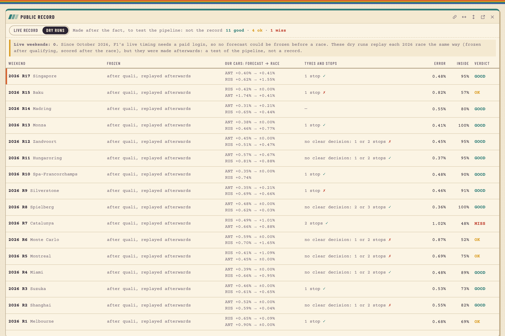

# The public record: live weekends

**Live weekends so far: 0.** No forecast has been frozen on GitHub before a race.

## Why there are none

Since October 2026, Formula 1's timing service needs a login. FastF1 3.9 and later ask for a
paid F1TV Access subscription, and FastF1 3.8 gets no data at all. Without the new sessions'
data, nothing can be forecast before a race, so the project stops at the races already saved:
545 sessions, up to the 2026 Singapore Grand Prix (11 October 2026). This was decided on
5 November 2026 ([decision 0015](decisions/0015-public-record.md), its update at the end).

## Three kinds of result, never mixed

| | Backtest | Dry runs | Live record |
|---|---|---|---|
| What it is | every dry race since 2023, forecast again with only earlier races | the live code, replayed on 2026 rounds 1–17 | a forecast frozen on GitHub before the race, scored after it |
| Made | after the races | after the races | before the race |
| Proves nothing was tuned on the result? | no: I ran it afterwards | no: the same | yes: GitHub's timestamp, and a SHA-256 in every file |
| Where it is | `data/forecasts/` (in the data snapshot); scores in [`reports/backtest/`](../reports/backtest/) | `reports/dry-runs/` (in the data snapshot) | `ledger/` (created with the first frozen forecast) |
| In the app | the race pace forecast window | the public record window, labelled "replayed afterwards" | the public record window |
| So far | 78 races; the README's results | 16 races scored | 0 weekends |

The dry runs show that the live path gives the same answers as the tested path: an error of
0.573%, exactly the backtest's 0.573% on the same races (largest difference 0.0000%). They are
a test of the pipeline, never a live record.

## The dry runs, race by race

Made after qualifying, with only what was known then. Round 16 (Bahrain) was a wet race, so it
has no race pace to score.

| Round | Circuit | Drivers | Error | Inside the 80% range | Better than team form | Stop call | Stops right | Verdict |
|---|---|---|---|---|---|---|---|---|
| 1 | Melbourne | 16 | 0.68% | 69% | yes | 1 stop | yes | OK |
| 2 | Shanghai | 17 | 0.55% | 82% | yes | no clear decision: 1 or 2 stops | no | GOOD |
| 3 | Suzuka | 22 | 0.53% | 73% | yes | 1 stop | yes | GOOD |
| 4 | Miami | 18 | 0.48% | 89% | yes | no clear decision: 1 or 2 stops | yes | GOOD |
| 5 | Montreal | 20 | 0.69% | 75% | yes | no clear decision: 1 or 2 stops | no | OK |
| 6 | Monte Carlo | 21 | 0.87% | 52% | yes | no clear decision: 1 or 2 stops | no | OK |
| 7 | Catalunya | 21 | 1.02% | 48% | no | 2 stops | yes | MISS |
| 8 | Spielberg | 20 | 0.36% | 100% | yes | no clear decision: 2 or 3 stops | yes | GOOD |
| 9 | Silverstone | 22 | 0.46% | 91% | yes | 1 stop | no | GOOD |
| 10 | Spa-Francorchamps | 20 | 0.48% | 90% | yes | 1 stop | yes | GOOD |
| 11 | Hungaroring | 22 | 0.37% | 95% | yes | no clear decision: 1 or 2 stops | yes | GOOD |
| 12 | Zandvoort | 20 | 0.45% | 95% | yes | no clear decision: 1 or 2 stops | no | GOOD |
| 13 | Monza | 21 | 0.41% | 100% | yes | 1 stop | yes | GOOD |
| 14 | Madring | 20 | 0.55% | 80% | yes | none (new circuit) | – | GOOD |
| 15 | Baku | 21 | 0.82% | 57% | no | 1 stop | no | OK |
| 17 | Singapore | 21 | 0.48% | 95% | yes | 1 stop | yes | GOOD |

In all: 16 races, 322 drivers, error 0.573%, 81% of real race paces inside the 80% ranges,
better than team form on 14 of 16 races, verdicts 11 GOOD, 4 OK, 1 MISS. The stop call was
right on 9 of the 15 races that had one.

Verdict: MISS if the error is above 1.05% (no better than "no signal") or under half of the real
paces are inside the ranges; GOOD if the error is at most 0.55% after qualifying and at least 70%
are inside; OK otherwise.

## How a live weekend works, once data is back

1. After qualifying, at least 30 minutes before the race: `make freeze ROUND=<n>` downloads the
   new sessions, rebuilds and checks the warehouse, and writes the forecast into `ledger/`.
2. Commit and push `ledger/` at once. On every push, CI fails if a new forecast reached GitHub
   after its deadline, or if any frozen file was changed or deleted.
3. After the race: `make score ROUND=<n>`, then commit and push the score file.
4. Anyone can check the record: `uv run dpec ledger` (every file valid and unchanged).

## To restart

- an F1TV Access subscription (FastF1 3.9 and later), or
- OpenF1 as a new data source, through a new ingest adapter.

`dpec freeze`, `dpec score` and the CI checks are ready and unchanged.
