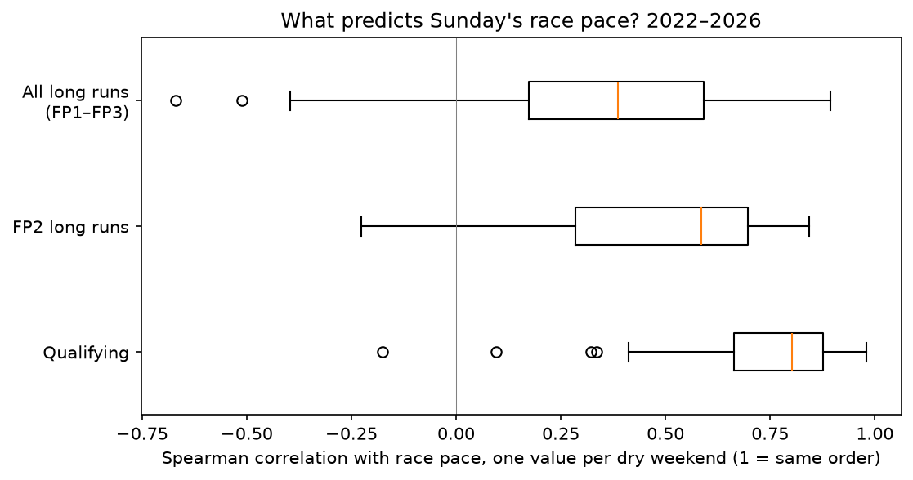

# Case 03 · Does practice or qualifying predict the race?

Decision: [0010 · Which signals the forecaster starts with](../../decisions/0010-forecast-signals.md) (2026-10-24) · Register: E13

## 1. Research question
Of the signals available before a race, which best predicts each driver's race pace: practice long runs or qualifying pace?

## 2. Initial hypothesis
Practice long runs should win. They are run on race-like fuel loads over many laps, so they look like "race practice". Qualifying is a single fast lap on low fuel.

## 3. Dataset and scope
2022–2026, dry races only: 96 dry races and 1,846 driver-weekends in `mart_weekend_signals`. Correlation comparisons use the 86 dry weekends where both signals exist (58 weekends for FP2 long runs alone).
Target: race pace = a driver's median clean race lap as % behind the best median that race, drivers with 10+ clean laps.

## 4. Method
- For each weekend, the [Spearman rank correlation](https://en.wikipedia.org/wiki/Spearman%27s_rank_correlation_coefficient) between each signal and race pace; then the median across weekends.
- Uncertainty: [bootstrap](https://en.wikipedia.org/wiki/Bootstrapping_(statistics)) over weekends (5,000 resamples, seed 0) of the per-weekend difference.
- Predictive value: leave-one-weekend-out linear regression and its mean absolute error, with each signal alone and both together.
- Split by season, and FP2 long runs separately from all long runs.

## 5. Results

| Signal | Weekends | Median ρ | Share of weekends above 0.5 |
|---|---|---|---|
| Qualifying | 86 | 0.80 | 0.90 |
| All long runs (FP1–FP3) | 86 | 0.39 | 0.31 |
| FP2 long runs | 58 | 0.59 | 0.60 |

- Long runs minus qualifying: −0.41, 95% CI −0.48 to −0.34. The gap is not chance.
- Leave-one-weekend-out MAE (% of a lap): no signal 0.885, qualifying 0.597, long runs 0.843, both 0.586.
- Qualifying wins in every season (0.66–0.92); long runs are weakest in 2023 (0.16), a season with one dominant car.

## 6. Interpretation
The hypothesis was wrong. Practice runs are done on unknown fuel loads and engine modes, and FP1 is used for setup work, parts tests and rookie drivers, so long runs are noisy. In qualifying everyone runs flat out at the same time. Adding long runs to qualifying reduced error from 0.597% to 0.586%, about 0.01 s on a 90 s lap. Part of qualifying's strength is the grid itself (starting in clean air), which is legitimate for forecasting Sunday but must not be described as pure car speed.

## 7. Decision influenced
- Qualifying pace is the forecaster's main signal; FP2 long runs are a secondary input and sanity check; FP1 long runs are not used ([decision 0010](../../decisions/0010-forecast-signals.md)).
- The two checkpoints follow from this: *after practice* (no qualifying yet) and *after qualifying* ([decision 0011](../../decisions/0011-target-and-fair-test.md)).
- A stated reversal condition: if the backtest shows FP2 long runs cut error by more than 5% on top of qualifying, give them a larger role.

## 8. Known limitations
- Qualifying sets the grid, and the grid affects race pace through clean air; the correlation is not purely about car speed.
- Long runs are compared on the same compound, but fuel loads are unknown across teams.
- Sprint weekends have one practice session, so long runs are thin there. Wet races were excluded, so the result says nothing about rain.

## 9. Evidence and implementation
- Notebook (original): [`notebooks/02_research/b3_practice_vs_race.ipynb`](../../../notebooks/02_research/b3_practice_vs_race.ipynb)
- Report: [`reports/b3-practice-vs-race.md`](../../../reports/b3-practice-vs-race.md)
- Data: [`sql/marts/08_mart_weekend_signals.sql`](../../../sql/marts/08_mart_weekend_signals.sql), [`06_mart_long_runs.sql`](../../../sql/marts/06_mart_long_runs.sql)
- Used by: [`src/dpec/forecasting/baselines.py`](../../../src/dpec/forecasting/baselines.py) (`SIGNALS`), [`model.py`](../../../src/dpec/forecasting/model.py)
- Narrative: [methods.md § 6](../../methods.md#6-research-what-actually-predicts-race-pace)
- How it works now: [workstream 02 · Analytics and statistics](../../workstreams/02-data-analytics-statistics.md) · [workstream 03 · Forecasting and machine learning](../../workstreams/03-forecasting-machine-learning.md)

Previous: [Case 02](02-source-inconsistencies.md) · Next: [Case 04 · Tyre wear with unknown fuel](04-fuel-and-tyre-degradation.md)
