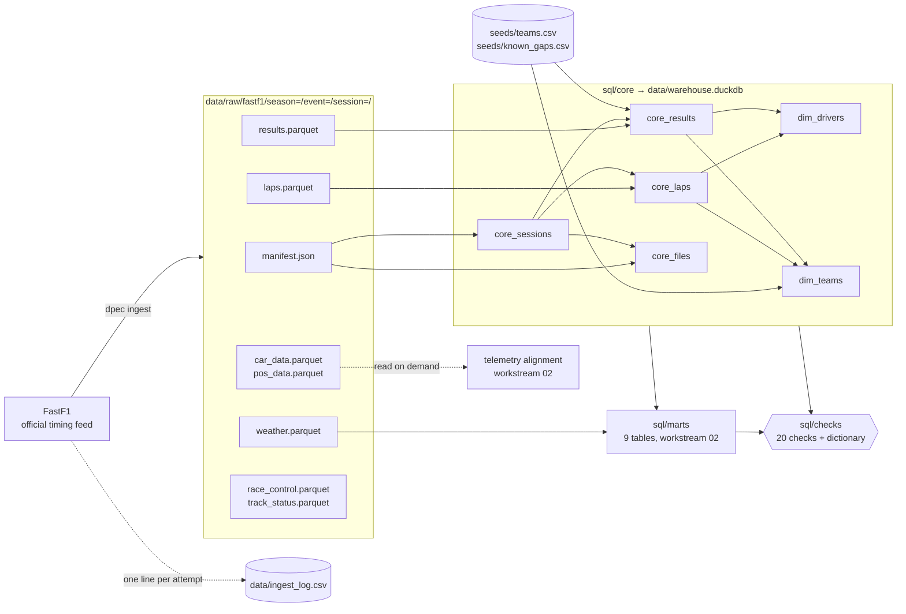

# 01 · Data engineering

Workstreams: **01 Data engineering** · [02 Analytics and statistics](02-data-analytics-statistics.md) · [03 Forecasting and machine learning](03-forecasting-machine-learning.md) · [04 ML engineering](04-ml-engineering.md) · [05 Backend engineering](05-backend-engineering.md) · [06 Applied AI](06-applied-ai.md)

This document describes the data layer as it exists now: what it does, how it is built, and how to run and verify it. The reasons behind the design are in the research archive ([case 01 · Lap eligibility](../research/cases/01-lap-eligibility.md), [case 02 · Source inconsistencies](../research/cases/02-source-inconsistencies.md)) and in decision records [0002](../decisions/0002-storage.md), [0003](../decisions/0003-clean-laps.md), [0005](../decisions/0005-results-and-log.md), [0006](../decisions/0006-checks-and-id-maps.md) and [0007](../decisions/0007-marts.md). Status labels (Implemented, Validated, Assumed, Future) follow the [evidence levels](../research/README.md#evidence-levels) of the research archive.

## 1. Overview

The data engineering workstream turns the public Formula 1 timing feed into a checked warehouse that can be rebuilt at any time, and that every other part of the project reads. It downloads each session once, keeps the downloaded tables unchanged with a checksum per file, rebuilds a [DuckDB](https://en.wikipedia.org/wiki/DuckDB) warehouse from plain SQL files, and checks the result against written rules on every rebuild.

| | |
|---|---|
| Source | [FastF1](https://docs.fastf1.dev/), a Python client for the official F1 timing feed. Its results tables already hold the official classification, so no second results source is used ([decision 0005](../decisions/0005-results-and-log.md)) |
| Coverage | 545 sessions in 109 race weekends, from the 2022 Bahrain Grand Prix to the 2026 Singapore Grand Prix (11 October 2026) |
| Raw store | `data/raw/fastf1/`: 7 [Parquet](https://en.wikipedia.org/wiki/Apache_Parquet) files and one `manifest.json` per session, 4.1 GB, plus 34 GB of FastF1's own download cache in `data/cache/` |
| Warehouse | `data/warehouse.duckdb`: 15 tables (6 core, 9 marts), about 28 MB |
| Validation | 20 SQL data checks plus one data dictionary check: 21 of 21 pass |
| Rebuild | `make data` (download, build, check) or `dpec build` and `dpec check` on the saved files |
| Status | Implemented and validated on the saved data. New sessions cannot be downloaded since October 2026 (see [§ 12](#12-limitations-and-operational-considerations)) |

## 2. Problem and purpose

**The problems this layer solves.**

1. **The feed is slow, rate-limited, and not guaranteed to stay available.** Loading one session with telemetry is a network operation of seconds to minutes, and FastF1 stops requests after a rate limit. Analysis that downloads again every time is slow and fragile. In October 2026 the feed began to require a login, which showed that saved data may be the only data.
2. **The feed is not ready for analysis.** Time spans arrive as pandas `Timedelta` values, some columns mix numbers and text, identifiers are missing in some sessions, team names change between seasons, a temperature sensor occasionally reports exactly 0 °C, and most laps (out-laps, in-laps, laps behind a safety car) do not represent a car's pace.
3. **Many consumers need one definition.** The forecaster, the strategy replay, the debrief, the API, the AI assistant and the public copy all ask the same questions: which laps are clean, what a pit stop cost, which team a driver drove for. If each computed its own answer, results would disagree.
4. **Published numbers must be traceable.** A number in the README or the model card has to lead back to a table, a rule and a saved file, and a silent change in the data has to be detectable.

**Purpose.** One warehouse that is rebuilt from the saved raw files, checks itself, documents every column, and serves as the single source of truth for every other workstream.

## 3. What was implemented

| Capability | Status | Where |
|---|---|---|
| Session discovery from the official event schedule; pre-season testing left out; a session counts as available 3 hours after its start, so a future session is never requested | Implemented | [`fastf1_source.py`](../../src/telemetry_core/ingestion/fastf1_source.py) |
| Download of seven tables per session: `laps`, `results`, `car_data`, `pos_data`, `weather`, `race_control`, `track_status` | Implemented; used for all 545 sessions | `fetch_session()` |
| Parquet writing: time spans become float seconds, mixed-type text columns become text, missing values stay missing | Implemented, tested | [`writer.py`](../../src/telemetry_core/ingestion/writer.py) |
| `manifest.json` per session: save time, source and FastF1 version, session info, and per file the row count, column count, converted columns and [SHA-256](https://en.wikipedia.org/wiki/SHA-2) | Implemented, tested | `write_session()` |
| Re-runs skip saved sessions; a failed session is logged and the run continues; a rate limit stops the run cleanly | Implemented, tested | [`cli.py`](../../src/dpec/cli.py) `ingest` |
| Append-only download log with a fixed set of fields | Implemented, tested | [`log.py`](../../src/telemetry_core/ingestion/log.py) |
| Hive-style raw folder names, so one glob reads every session | Implemented, tested | [`paths.py`](../../src/telemetry_core/paths.py) |
| SQL runner: files run in name order, one table per file, `{{ }}` placeholders filled from settings | Implemented, tested | [`warehouse.py`](../../src/telemetry_core/warehouse.py) |
| Six core tables: sessions, laps, results, files, drivers, teams | Implemented; validated by checks | [`sql/core/`](../../sql/core/) |
| Nine mart tables built by the same runner (their logic is described in [workstream 02](02-data-analytics-statistics.md)) | Implemented; validated by checks | [`sql/marts/`](../../sql/marts/) |
| Twenty data checks, each returning the rows that break one rule | Implemented; all pass | [`sql/checks/`](../../sql/checks/) |
| Data dictionary check: every warehouse column must be described in [data-dictionary.md](../data-dictionary.md) | Implemented; passes | `undocumented_columns()` |
| Hand-kept seeds: 15 team names mapped to 11 team lineages; one known source gap | Implemented | [`seeds/`](../../seeds/) |
| Typed settings; unknown keys and out-of-range values are rejected | Implemented, tested | [`config.py`](../../src/telemetry_core/config.py) |
| Read-only query helper with `?` parameters, used by every consumer | Implemented | `warehouse.query()` |
| Incremental builds | Not implemented: every build is a full rebuild | |
| Re-verification of raw files against their recorded SHA-256 | Not implemented: hashes are recorded and exposed in `core_files`, but no command re-hashes the raw files | |
| A second data source to replace FastF1 after the October 2026 change | Future (OpenF1 adapter or an F1TV subscription) | [live-weekends.md](../live-weekends.md#to-restart) |

## 4. Architecture and workflow

How this layer fits into the whole system is shown in [architecture.md § 2](../engineering/architecture.md#2-data-flow). The diagram below shows only the data layer, at the level of files and tables.



**Workflow.**

1. **Discover.** For each configured season, `season_rounds()` reads the event schedule without testing. For each round, `session_names()` returns the sessions whose start was more than 3 hours ago, because FastF1 publishes a session's data some time after it ends.
2. **Skip what is saved.** A session folder that already holds a `manifest.json` is skipped, unless `--force` is given. The manifest is written last, after all seven Parquet files, so a session interrupted while writing has no manifest and is downloaded again on the next run.
3. **Fetch.** `fetch_session()` loads laps, telemetry, weather and messages, and returns the seven tables untouched plus session information (FastF1 version, event, session name, start time and the feed's own session metadata). Telemetry for each car is stacked into one table with a `DriverNumber` column.
4. **Write.** `write_session()` writes each table to `<table>.parquet`, records its SHA-256, and writes the manifest.
5. **Log.** Every attempt appends one line to `data/ingest_log.csv`: time, source, season, round, session, status (`ok`, `failed` or `rate_limited`), rows, seconds and the error text.
6. **Build core tables.** `dpec build` runs `sql/core/01_…` to `06_…`. `core_sessions` and `core_files` read every manifest with `read_json(..., hive_partitioning = true)`; `core_laps` and `core_results` read every session's Parquet file with one glob (`read_parquet('{{ raw }}/fastf1/*/*/*/laps.parquet', hive_partitioning = true, union_by_name = true)`). `union_by_name` lets sessions whose files have different columns be read together.
7. **Build marts.** The same runner then runs `sql/marts/01_…` to `09_…`. Marts read core tables, other marts built before them, and in one case a raw file (`mart_session_weather` reads `weather.parquet`).
8. **Check.** `dpec check` runs the 20 checks and the dictionary check on a read-only connection and exits with code 1 if any fails.

Telemetry (`car_data`, about 241 million rows, and `pos_data`, about 246 million rows, over all sessions) is deliberately not loaded into the warehouse. It is read from the raw files for one lap at a time when two laps are compared ([decision 0004](../decisions/0004-distance-grid.md), [workstream 02](02-data-analytics-statistics.md#4-architecture-and-workflow)). `race_control` and `track_status` are saved and checksummed but not read by any table at this time: each lap's track status comes from the `TrackStatus` column of `laps.parquet`.

## 5. Important components and responsibilities

**Settings ([`config.py`](../../src/telemetry_core/config.py)).** Every command loads one YAML file into Pydantic models with `extra="forbid"`: a misspelt key is an error instead of a silently ignored value. Ranges are validated (for example `slow_lap_pct` above 100 and at most 150, `fuel_effect_s_per_lap` from 0 to 0.2, `long_run_min_laps` from 3 to 20, seasons from 2018, when FastF1's telemetry starts). Paths to every store are settings, so tests point the same code at small fake data.

**Ingestion ([`fastf1_source.py`](../../src/telemetry_core/ingestion/fastf1_source.py), [`writer.py`](../../src/telemetry_core/ingestion/writer.py), [`log.py`](../../src/telemetry_core/ingestion/log.py)).** `fastf1_source` is the only module that imports FastF1; it re-exports FastF1's rate-limit exception so that nothing else depends on the library. `writer` makes tables safe for Parquet and records checksums. `log` appends one line per attempt and refuses unknown fields.

**Raw layout ([`paths.py`](../../src/telemetry_core/paths.py)).** Folder names follow the Hive convention `key=value`, which DuckDB reads as columns:

```text
data/raw/fastf1/season=2024/event=01_bahrain_grand_prix/session=race/
    laps.parquet  results.parquet  car_data.parquet  pos_data.parquet
    weather.parquet  race_control.parquet  track_status.parquet  manifest.json
```

**SQL runner ([`warehouse.py`](../../src/telemetry_core/warehouse.py)).**

| Function | What it does |
|---|---|
| `render(sql, params)` | Fills `{{ name }}` placeholders (whitespace inside the braces allowed) and raises an error if any placeholder is left unfilled, so a missing setting cannot produce valid but wrong SQL |
| `build(sql_dir, warehouse, params)` | Runs every `.sql` file of a folder in name order; the table is named after the file without its number (`01_core_sessions.sql` → `core_sessions`); returns the row count of each table |
| `run_checks(checks_dir, warehouse, params)` | Runs every check on a read-only connection; a check passes when it returns no rows; keeps the first 5 bad rows as a sample |
| `undocumented_columns(warehouse, dictionary)` | Reads `## table` headings and `` | `column` | `` rows from the data dictionary and lists every warehouse column it does not describe |
| `query(warehouse, sql, params)` | Opens a read-only connection, runs one query with `?` parameters (values never become SQL text), returns a DataFrame |

The placeholder values come from `sql_params()` in [`cli.py`](../../src/dpec/cli.py): the raw and seed paths and five thresholds (`slow_lap_pct`, `fuel_effect_s_per_lap`, `long_run_min_laps`, `long_run_band_pct`, `push_lap_band_pct`). Thresholds therefore live in [`config/dpec.yaml`](../../config/dpec.yaml), not in SQL. There is no dbt: at 15 tables, file-number ordering, placeholders and SQL checks cover what was needed (register entry [E07](../research/experiment-register.md)).

**Core tables ([`sql/core/`](../../sql/core/)).** Grain and keys; full column lists are in the [data dictionary](../data-dictionary.md).

| Table | One row per | Built from | What it adds |
|---|---|---|---|
| [`core_sessions`](../data-dictionary.md#core_sessions) | session | manifests | `session_key` such as `2024_01_R` (`printf('%d_%02d_%s')`); session type from the session name (Practice 1/2/3 → FP1/2/3, Sprint Shootout or Sprint Qualifying → SQ, Sprint → S, Qualifying → Q, Race → R); any other name stops the build with `error()`; `is_sprint_weekend`; the circuit's short name |
| [`core_laps`](../data-dictionary.md#core_laps) | driver, lap and session | `laps.parquet` + `core_sessions` | Typed and renamed columns; one yes/no flag per rule and **one reason code** per lap (`clean` or the first rule broken, explained in [workstream 02](02-data-analytics-statistics.md#5-important-components-and-responsibilities)); empty team names filled |
| [`core_results`](../data-dictionary.md#core_results) | driver and session (R, S, Q, SQ only) | `results.parquet` + `seeds/teams.csv` | Official classification; missing driver IDs borrowed from the same driver in the same season; `team_id`; `classified` kept as text (a number, or R retired, D disqualified, W withdrew); grid 0 = pit-lane start |
| [`core_files`](../data-dictionary.md#core_files) | saved table and session | manifests | `n_rows`, `is_empty`, `sha256`, `saved_at_utc`: what is saved and what came back empty |
| [`dim_drivers`](../data-dictionary.md#dim_drivers) | driver and season | `core_laps`, `core_results` | Driver ID, name, list of car numbers and teams, whether the driver started a race |
| [`dim_teams`](../data-dictionary.md#dim_teams) | team name | `core_laps`, `core_results`, `seeds/teams.csv` | `team_id`, `lineage` (one team across renames) and first and last season |

**Seeds ([`seeds/`](../../seeds/)).** [`teams.csv`](../../seeds/teams.csv) maps the 15 team names FastF1 uses to 11 lineages; two lineages carry three names each (AlphaTauri, RB and Racing Bulls; Alfa Romeo, Kick Sauber and Audi). [`known_gaps.csv`](../../seeds/known_gaps.csv) lists the one expected empty table (`pos_data` of 2023 round 9 FP1) with the reason, so check 07 does not flag it.

**Data checks ([`sql/checks/`](../../sql/checks/)).** Each check is a query that returns the rows breaking one rule, so a failure shows the evidence. A short example, check 06:

```sql
-- Points per race: 25+18+15+12+10+8+6+4+2+1 = 101, plus 1 for the fastest lap until 2024.
-- Points per sprint: 8+7+6+5+4+3+2+1 = 36.
SELECT session_key, session_type, sum(points) AS total
FROM core_results
WHERE session_type IN ('R', 'S')
GROUP BY ALL
HAVING NOT ((session_type = 'R' AND total IN (101, 102)) OR (session_type = 'S' AND total = 36))
```

| Kind of rule | Checks |
|---|---|
| Grain: one row per key | 01 sessions, 02 laps, 03 results, 10 weekends, 12 pace, 14 stints, 17 signals, 19 strategy |
| Allowed values | 04 every lap reason is a known code |
| Completeness | 05 every race, sprint and qualifying session has results; 07 no empty saved table except known gaps; 08 every driver in results has an ID; 09 every lap's team is in the team map; 13 weather for every session (at least 10 readings) |
| Arithmetic | 06 points per race and sprint; 11 each driver's final standings total equals his race and sprint points |
| Plausibility | 15 long runs are real runs (practice only, at least the minimum laps, within 10% of the best run on the same tyre); 16 track evolution at most 1 s per 10 minutes when reliable; 18 weather believable (track 5–70 °C, air 0–50 °C); 20 pit loss 15–35 s for dry races with at least 3 green-flag stops |

## 6. Codebase map with actual file references

The full repository map is in [codebase-map.md](../engineering/codebase-map.md). The files that belong to this workstream:

| Path | Role |
|---|---|
| [`src/telemetry_core/config.py`](../../src/telemetry_core/config.py) | Typed settings for every command |
| [`src/telemetry_core/paths.py`](../../src/telemetry_core/paths.py) | Raw folder names |
| [`src/telemetry_core/ingestion/fastf1_source.py`](../../src/telemetry_core/ingestion/fastf1_source.py) | The only FastF1 boundary |
| [`src/telemetry_core/ingestion/writer.py`](../../src/telemetry_core/ingestion/writer.py) | Parquet files and manifests |
| [`src/telemetry_core/ingestion/log.py`](../../src/telemetry_core/ingestion/log.py) | Download log |
| [`src/telemetry_core/warehouse.py`](../../src/telemetry_core/warehouse.py) | SQL runner, checks, dictionary check, read-only queries |
| [`src/dpec/cli.py`](../../src/dpec/cli.py) | Commands `info`, `ingest`, `build`, `check`, `sql`; `sql_params()` and the build order `LAYERS = ["core", "marts"]` |
| [`sql/core/`](../../sql/core/) | `01_core_sessions.sql` … `06_dim_teams.sql` |
| [`sql/marts/`](../../sql/marts/) | `01_mart_weekends.sql` … `09_mart_race_strategy.sql` (logic: [workstream 02](02-data-analytics-statistics.md#6-codebase-map-with-actual-file-references)) |
| [`sql/checks/`](../../sql/checks/) | `01_session_one_row_each.sql` … `20_pit_loss_believable.sql` |
| [`seeds/teams.csv`](../../seeds/teams.csv), [`seeds/known_gaps.csv`](../../seeds/known_gaps.csv) | Hand-kept reference data |
| [`config/dpec.yaml`](../../config/dpec.yaml) | Seasons, thresholds, paths |
| [`docs/data-dictionary.md`](../data-dictionary.md) | Every table and column; enforced by `dpec check` |
| [`notebooks/01_data/01_meet_the_data.ipynb`](../../notebooks/01_data/01_meet_the_data.ipynb) | First look at FastF1's tables, shapes and grain (original exploration) |
| [`Makefile`](../../Makefile) | `setup`, `data`, `build`, `check` |
| Tests: [`test_config.py`](../../tests/test_config.py), [`test_paths.py`](../../tests/telemetry_core/test_paths.py), [`test_writer.py`](../../tests/telemetry_core/test_writer.py), [`test_cli_ingest.py`](../../tests/dpec/test_cli_ingest.py), [`test_warehouse.py`](../../tests/telemetry_core/test_warehouse.py) | See [§ 10](#10-tests-and-verification-evidence) |

## 7. Inputs and outputs

| Input | Form | Notes |
|---|---|---|
| FastF1 sessions | network, through FastF1 | Needs data access (see [§ 12](#12-limitations-and-operational-considerations)) |
| `config/dpec.yaml` | YAML | Seasons, thresholds, paths |
| `seeds/*.csv` | CSV, kept by hand | Team map, known gaps |
| `sql/**/*.sql` | SQL with `{{ }}` placeholders | One table or one check per file |

| Output | Location | In git | Consumers |
|---|---|---|---|
| Raw tables and manifests | `data/raw/fastf1/…` | No (4.1 GB) | `dpec build`, telemetry alignment |
| FastF1 cache | `data/cache/` | No (34 GB) | FastF1 itself; never delete it while new downloads are impossible |
| Download log | `data/ingest_log.csv` | No | People debugging ingestion |
| Warehouse | `data/warehouse.duckdb` | No (rebuilt) | Every other workstream; packed into the public snapshot ([workstream 05](05-backend-engineering.md)) |
| Check results | terminal output and exit code | | People, `make data`, `make freeze` |

**Lineage from a published number back to a file.** A number in the app or the README comes from a mart or core table; each table is one SQL file; core tables read raw files whose checksums are in `core_files.sha256`, and each row of `core_laps` and `core_results` keeps its `session_key`. Where every published number comes from is listed in [numbers-check.md](../../reports/numbers-check.md).

## 8. How to run or use the functionality

Run from the repository root after `make setup` ([operations.md § 1](../engineering/operations.md#1-environment)).

```bash
uv run dpec info                         # settings in use: team, seasons, mode, raw-data path
make data                                # = dpec ingest, dpec build, dpec check  (ingest needs data access)
uv run dpec ingest --season 2026 --round 17                   # one weekend
uv run dpec ingest --season 2026 --round 17 --session Race    # one session
uv run dpec ingest --season 2026 --round 17 --force           # download again
uv run dpec build                        # rebuild every table from the saved files
uv run dpec check                        # 20 checks + dictionary check; exit 1 on any failure
uv run dpec sql "SELECT session_type, count(*) FROM core_sessions GROUP BY 1"
```

**Typical tasks.**

- **Rebuild after changing SQL or a threshold:** `make build && make check`. The build replaces every table; the raw files are not touched.
- **Add a table:** add a numbered `.sql` file to `sql/core/` or `sql/marts/` with `CREATE OR REPLACE TABLE <name> AS …`, document every column in [data-dictionary.md](../data-dictionary.md) (otherwise `data_dictionary_covers_every_column` fails), and add a grain check to `sql/checks/`.
- **Add a rule about the data:** a new file in `sql/checks/` that returns the rows breaking it ([decision 0006](../decisions/0006-checks-and-id-maps.md)).
- **A new team name appears:** add it to `seeds/teams.csv` with its lineage; check 09 fails until then.
- **The source has no data for a table:** add the session and table to `seeds/known_gaps.csv` with the reason; check 07 fails until then.

What a passing check run looks like (shortened):

```text
PASS             01_session_one_row_each
PASS             02_laps_one_row_each
…
PASS             20_pit_loss_believable
PASS             data_dictionary_covers_every_column

21 passed, 0 failed
```

## 9. Important configurations and commands

| Setting in `config/dpec.yaml` | Value | Used by |
|---|---|---|
| `seasons` | `[2022, 2023, 2024, 2025, 2026]` | `ingest` (which seasons to download) |
| `paths.raw`, `paths.cache`, `paths.log` | `data/raw`, `data/cache`, `data/ingest_log.csv` | `ingest`, `build` |
| `paths.warehouse` | `data/warehouse.duckdb` | every command that reads data |
| `paths.sql`, `paths.seeds`, `paths.dictionary` | `sql`, `seeds`, `docs/data-dictionary.md` | `build`, `check` |
| `slow_lap_pct` | 107 | `core_laps` (the `slow` rule) |
| `fuel_effect_s_per_lap`, `long_run_min_laps`, `long_run_band_pct`, `push_lap_band_pct` | 0.06, 5, 2, 1.5 | marts ([workstream 02](02-data-analytics-statistics.md#9-important-configurations-and-commands)) |

| Command | Effect | Exit code |
|---|---|---|
| `dpec ingest [--season --round --session --force]` | Download missing sessions | 1 if a session failed or the rate limit was hit; saved sessions are kept |
| `dpec build` | Rebuild `sql/core`, then `sql/marts`; prints row counts | non-zero on a SQL error |
| `dpec check` | Checks + dictionary check | 1 if any check fails |
| `dpec sql "<query>"` | One read-only query | |
| `make data`, `make build`, `make check` | Shortcuts | |

## 10. Tests and verification evidence

**Unit tests (fake data, no network).** 34 of the project's 129 tests belong to this workstream.

| File | Tests | What they prove |
|---|---|---|
| [`test_config.py`](../../tests/test_config.py) | 5 | The real config loads; a typo key, a wrong mode, a season before 2018 or a too-large grid step fail |
| [`test_paths.py`](../../tests/telemetry_core/test_paths.py) | 2 | Folder names and slugs |
| [`test_writer.py`](../../tests/telemetry_core/test_writer.py) | 4 | Time spans become seconds; missing stays missing; files and manifest are written; the same data gives the same file (same hash) |
| [`test_cli_ingest.py`](../../tests/dpec/test_cli_ingest.py) | 7 | One weekend, everything in config, one session; a second run skips everything; a bad session does not stop the rest; a rate limit stops and keeps what was saved; every attempt is logged |
| [`test_warehouse.py`](../../tests/telemetry_core/test_warehouse.py) | 16 | Row counts and session keys on a fake weekend; each lap gets the right reason; lap one is a race-only rule; one row per driver, lap and session; an unknown session name fails the build; placeholders are filled or refused; results keep the official classification; the files table lists every saved table; a missing driver ID is borrowed from the same season; an empty team is filled from the same weekend; a stand-in's team comes from the same car number; a check returns its bad rows; the dictionary check lists missing columns |

[`test_warehouse.py`](../../tests/telemetry_core/test_warehouse.py) also provides the fake race weekend that other test files reuse (through `pythonpath` in [`pyproject.toml`](../../pyproject.toml)).

**Verification on the real data (9 November 2026).** On a copy of the project's saved warehouse, with the code at commit `eb4d677` and the locked dependencies, `dpec check` reported **21 passed, 0 failed**. The warehouse was checked as saved, not rebuilt from the raw files for this check. Row counts:

| Table | Rows | | Table | Rows |
|---|---|---|---|---|
| `core_sessions` | 545 | | `mart_weekends` | 109 |
| `core_laps` | 297,724 | | `mart_session_weather` | 545 |
| `core_results` | 5,469 | | `mart_standings` | 2,212 |
| `core_files` | 3,815 (545 × 7) | | `mart_driver_session_pace` | 10,282 |
| `dim_drivers` | 167 | | `mart_stints` | 41,403 |
| `dim_teams` | 15 | | `mart_long_runs` | 2,603 |
| | | | `mart_track_evolution` | 390 |
| | | | `mart_weekend_signals` | 2,010 |
| | | | `mart_race_strategy` | 109 |

Sessions by type: FP1 109, FP2 85, FP3 82, sprint qualifying 24, sprint 27, qualifying 109, race 109. Of the 3,815 saved tables, exactly one is empty (the known gap). Every one of the 5,469 result rows has a driver ID.

## 11. Results and practical value

- **The analysis survived the loss of the source.** When F1's timing feed began requiring a login in October 2026, every analysis, forecast, replay and the public copy kept working, because nothing downstream depends on downloading again.
- **Messy data is handled by written, checked rules rather than by hand.** Examples found and handled by this layer: sprint-qualifying results without driver IDs (borrowed within the season), two 2026 practice sessions without team names (filled from the same weekend or the same car number), team renames (lineage map), track-temperature readings of exactly 0 °C (47 of 54,295 readings, treated as missing in the weather mart). Details and the evidence for each are in [case 02](../research/cases/02-source-inconsistencies.md).
- **Every published number is reproducible.** The warehouse is a function of the raw files, the SQL and the settings. Rebuilding gives the same tables; [numbers-check.md](../../reports/numbers-check.md) recomputes the README's numbers from it.
- **Changes are cheap and safe.** A threshold is a setting; a new table is one SQL file plus its documentation; a new rule is one check. A failing check names the rows that break the rule.

## 12. Limitations and operational considerations

- **No new data since October 2026.** F1's timing service now requires a login; FastF1 3.9 and later need a paid F1TV Access subscription, and 3.8 receives no data. The log shows the attempts: 2026 round 18 on 28 October and round 19 twice on 5 November failed for all five sessions with FastF1's error "The data you are trying to access has not been loaded yet". The ways back are an F1TV subscription or a new source such as OpenF1 ([live-weekends.md](../live-weekends.md#why-there-are-none), [decision 0015, update](../decisions/0015-public-record.md#update-5-november-2026-no-live-weekends)).
- **Never delete `data/raw/` or `data/cache/`.** They cannot be downloaded again under the current terms.
- **Full rebuild only, and not atomic.** `build()` replaces tables one file at a time in the existing warehouse. If a SQL file fails halfway, the tables before it are already replaced and the ones after it are from the previous build. Run `dpec build` again after fixing the error, and do not publish a snapshot from a failed build.
- **Recorded checksums are not re-verified.** The SHA-256 of every raw file is stored, but no command recomputes it. A changed raw file would only be noticed by comparing a fresh hash with `core_files.sha256`. (The public snapshot is different: its checksums are verified during every image build, see [workstream 05](05-backend-engineering.md).)
- **The download log starts on 19 October 2026**, after most sessions were saved, so it is not a complete history of the downloads. Its first lines (19 October) record one-row sessions and a "no data" error that match the fake source in [`test_cli_ingest.py`](../../tests/dpec/test_cli_ingest.py), most likely from a test run before the tests used temporary paths; they are not real downloads.
- **Two saved tables are unused.** `race_control` and `track_status` are kept with checksums but no table reads them yet.
- **Hand-kept seeds.** A new team name or a new expected gap needs a line in `seeds/`; checks 07 and 09 make sure this is not forgotten.
- **Single writer.** DuckDB allows one writing process, or several reading processes, not both at once. The API and the AI tools open a read-only connection only while they answer, so a build can start while the app is running, but requests made during the build fail until it ends ([workstream 05 § 12](05-backend-engineering.md#12-limitations-and-operational-considerations)). Two builds must not run at once.

## 13. References to deeper engineering documents and experiments

- Why: [case 01 · Lap eligibility](../research/cases/01-lap-eligibility.md), [case 02 · Source inconsistencies](../research/cases/02-source-inconsistencies.md), [case 09 · Release, deployment and data access](../research/cases/09-release-deployment-data-access.md); register entries [E01–E07](../research/experiment-register.md)
- Decisions: [0002 · Storage](../decisions/0002-storage.md), [0003 · Clean laps](../decisions/0003-clean-laps.md), [0005 · Results and the download log](../decisions/0005-results-and-log.md), [0006 · Checks and ID maps](../decisions/0006-checks-and-id-maps.md), [0007 · Marts](../decisions/0007-marts.md)
- Reference: [data dictionary](../data-dictionary.md), [architecture.md](../engineering/architecture.md), [codebase-map.md § SQL](../engineering/codebase-map.md#sql), [operations.md § 2–3](../engineering/operations.md#2-data-pipeline)
- Narrative: [methods.md § 3–4](../methods.md#3-the-data)
- Next workstream: [02 · Data analytics and statistics](02-data-analytics-statistics.md), which explains what the marts compute and how to read them
