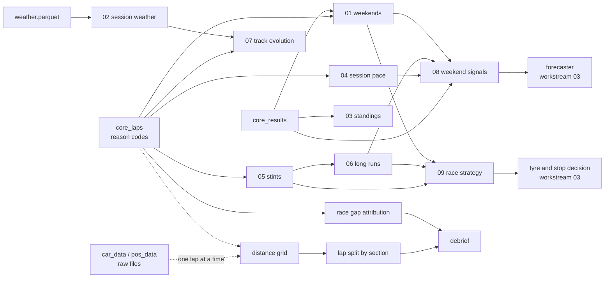

# 02 · Data analytics and statistics

Workstreams: [01 Data engineering](01-data-engineering.md) · **02 Analytics and statistics** · [03 Forecasting and machine learning](03-forecasting-machine-learning.md) · [04 ML engineering](04-ml-engineering.md) · [05 Backend engineering](05-backend-engineering.md) · [06 Applied AI](06-applied-ai.md)

This document describes the analytical layer as it exists now: which laps count, how pace, tyre wear and track change are measured, which statistical methods are used, what the analytical tables contain and how to read them. The investigations behind these choices are in the research archive: [case 01 · Lap eligibility](../research/cases/01-lap-eligibility.md), [case 03 · Practice versus qualifying](../research/cases/03-practice-vs-qualifying.md), [case 04 · Fuel and tyre degradation](../research/cases/04-fuel-and-tyre-degradation.md) and [case 05 · Track evolution](../research/cases/05-track-evolution.md). The tables are built by the data layer described in [workstream 01](01-data-engineering.md).

## 1. Overview

A lap time mixes many effects: the car, the driver, fuel load, tyre age and compound, how much rubber is on the track, traffic, safety cars and weather. This workstream defines measures that compare like with like, written as SQL so that every consumer uses the same definition, and provides the statistical methods used to separate effects where public data allows it.

| | |
|---|---|
| Lap eligibility | One reason code per lap: `clean`, or the first of 13 rules it breaks, in a fixed order. 54.9% of 297,724 laps are clean (races 78.2%, qualifying 26.7%) |
| Analytical tables | Nine marts: weekend overview, session weather, standings, session pace, tyre stints, practice long runs, track evolution, weekend signals, race strategy |
| On-demand analyses | Two laps on a 5 m distance grid; a qualifying lap gap split by kind of track section; a race gap split into pace, tyre age, compound and traffic, with bootstrap ranges |
| Statistical methods | Medians, least-squares slopes, a within-group (fixed effects) estimate, Spearman rank correlation, paired laps with a least-squares attribution, bootstrap ranges |
| Research | Which pre-race signal predicts race pace: qualifying (median Spearman 0.80) far ahead of practice long runs (0.39) over 86 dry weekends |
| Status | Implemented; validated by data checks and unit tests. The fuel effect is an assumed value (see [§ 12](#12-limitations-and-operational-considerations)) |

## 2. Problem and purpose

**Problem.** Raw lap times answer almost nothing on their own:

- Most laps are not representative: out-laps, in-laps, laps behind a safety car or under yellow flags, deleted laps, laps on wet tyres. A raw average mixes them all.
- Practice, qualifying and race running are different programmes. Teams do not publish fuel loads, so a practice "long run" may carry very different fuel from one team to another.
- Cars get lighter by burning fuel while tyres wear, so the two effects partly cancel in the lap times of a stint.
- The track gets faster during a session as rubber goes down, and faster drivers often run late, which looks like a faster track.
- Two drivers' race gap mixes pace with tyre age, compound and traffic.

**Purpose.** Measures that are defined once, documented, checked and reproducible, and statistical methods that separate the effects the data can separate, and say so when it cannot. These measures feed the forecaster ([workstream 03](03-forecasting-machine-learning.md)), the app windows ([workstream 05](05-backend-engineering.md)) and the AI assistant's tools ([workstream 06](06-applied-ai.md)).

## 3. What was implemented

| Capability | Status | Where |
|---|---|---|
| Lap eligibility: a yes/no flag per rule and one reason code per lap; the `slow` rule at 107% of the session's clean median | Implemented, validated (register [E01, E02](../research/experiment-register.md)) | [`sql/core/02_core_laps.sql`](../../sql/core/02_core_laps.sql) |
| Weekend overview: winner, pole, race laps, safety-car and VSC laps, red flag, wet-tyre share, `is_wet_race`, clean-lap share | Implemented, validated (check 10) | [`01_mart_weekends.sql`](../../sql/marts/01_mart_weekends.sql) |
| Session weather with the 0 °C track-sensor dropout treated as missing | Implemented, validated (checks 13, 18; register [E05](../research/experiment-register.md)) | [`02_mart_session_weather.sql`](../../sql/marts/02_mart_session_weather.sql) |
| Drivers' championship after every round (window functions) | Implemented, validated (check 11) | [`03_mart_standings.sql`](../../sql/marts/03_mart_standings.sql) |
| Session pace: clean laps, best and median clean lap, gap to the best, rank | Implemented, validated (check 12) | [`04_mart_driver_session_pace.sql`](../../sql/marts/04_mart_driver_session_pace.sql) |
| Tyre stints with a wear slope and an explicit fuel correction | Implemented, validated (check 14); fuel value **Assumed** ([E08](../research/experiment-register.md)) | [`05_mart_stints.sql`](../../sql/marts/05_mart_stints.sql) |
| Practice long runs | Implemented, validated (check 15; [E11](../research/experiment-register.md)) | [`06_mart_long_runs.sql`](../../sql/marts/06_mart_long_runs.sql) |
| Track evolution estimated within driver and compound, with a reliability flag | Implemented, validated (check 16; [E12](../research/experiment-register.md)) | [`07_mart_track_evolution.sql`](../../sql/marts/07_mart_track_evolution.sql) |
| Weekend signals: practice, qualifying and race pace of each driver at each weekend | Implemented, validated (check 17) | [`08_mart_weekend_signals.sql`](../../sql/marts/08_mart_weekend_signals.sql) |
| Race strategy: practice and race tyre wear, pit-stop loss, top-10 stop count | Implemented, validated (checks 19, 20) | [`09_mart_race_strategy.sql`](../../sql/marts/09_mart_race_strategy.sql) |
| Two laps on one distance grid; apexes; per-corner time loss | Implemented, tested ([E06](../research/experiment-register.md)) | [`alignment/`](../../src/telemetry_core/alignment/) |
| A lap gap split by kind of track section | Implemented, tested | [`debrief/segments.py`](../../src/dpec/debrief/segments.py) |
| A race gap split into pace, tyre age, compound and traffic, with 80% bootstrap ranges | Implemented, tested; known limit when inputs move together ([E27](../research/experiment-register.md)) | [`debrief/attribution.py`](../../src/dpec/debrief/attribution.py) |
| Post-race debrief page for the adopted team's cars | Implemented | [`debrief/report.py`](../../src/dpec/debrief/report.py) |
| Research: which pre-race signal predicts race pace | Validated ([E13](../research/experiment-register.md)) | [`b3_practice_vs_race.ipynb`](../../notebooks/02_research/b3_practice_vs_race.ipynb), [report](../../reports/b3-practice-vs-race.md) |
| Exploratory questions on the marts | Exploratory | [`b1_questions.sql`](../../notebooks/02_analytics/b1_questions.sql), [`01_meet_the_data.ipynb`](../../notebooks/01_data/01_meet_the_data.ipynb) |
| Tyre compound pace gaps | Not built: not measurable reliably without fuel and engine-mode data ([E26](../research/experiment-register.md)) | |

## 4. Architecture and workflow

The marts are SQL files that `dpec build` runs in file order after the core tables ([workstream 01](01-data-engineering.md#4-architecture-and-workflow)). The order matters because some marts read others:



**Two kinds of analysis.**

1. **Tables built in advance** (the marts). Each answers one recurring question at a fixed grain, is rebuilt with the warehouse, and is covered by a grain check and, where a rule exists, a plausibility check.
2. **Analyses computed on demand** (lap comparison and the debrief). They need the raw telemetry, which is too large to store on a grid for every lap (about 175 million rows for all clean laps at 5 m, [E06](../research/experiment-register.md)), so they load the two laps they need from the raw files when asked.

## 5. Important components and responsibilities

### 5.1 Lap eligibility: which laps count

Every lap in [`core_laps`](../data-dictionary.md#core_laps) gets one yes/no column per rule and exactly one `lap_reason`: the **first** rule it breaks, in a fixed order, or `clean`. Because the order is fixed, each lap is counted once and the counts add up to all laps. Counts are from the saved warehouse:

| Order | `lap_reason` | Rule | Laps | Share |
|---|---|---|---|---|
| 1 | `no_time` | No lap time recorded | 41,890 | 14.1% |
| 2 | `generated` | A lap FastF1 added itself (all 231 such laps have no time, so they stop at rule 1) | 0 | 0% |
| 3 | `in_lap` | The car entered the pit lane | 28,243 | 9.5% |
| 4 | `out_lap` | The car left the pit lane | 10,789 | 3.6% |
| 5 | `lap_one` | The first lap of a race or sprint (standing start) | 1,883 | 0.6% |
| 6 | `red_flag` | Track status contains 5 | 12 | 0.0% |
| 7 | `safety_car` | Track status contains 4 | 4,144 | 1.4% |
| 8 | `vsc` | Track status contains 6 or 7 (virtual safety car) | 2,584 | 0.9% |
| 9 | `yellow` | Track status contains 2 | 10,227 | 3.4% |
| 10 | `deleted` | Lap time deleted by the stewards (track limits) | 2,571 | 0.9% |
| 11 | `inaccurate` | FastF1 marks the timing as not accurate | 104 | 0.0% |
| 12 | `wet_tyre` | Intermediate or wet tyres | 8,808 | 3.0% |
| 13 | `slow` | Slower than 107% of the session's median clean lap (`slow_lap_pct`) | 22,870 | 7.7% |
| | `clean` | None of the above | 163,599 | 54.9% |

`is_clean` is `lap_reason = 'clean'`. The `slow` rule is computed last, against the median of the laps that passed rules 1–12, so one very slow lap cannot move the limit. At 107% it removes 395 race laps; a 103% limit would remove 3,445 and drop laps on worn tyres, which are real race pace ([case 01](../research/cases/01-lap-eligibility.md)).

By session type, the clean share is: race 78.2%, sprint 73.6%, FP2 47.0%, FP1 40.7%, FP3 29.5%, sprint qualifying 28.1%, qualifying 26.7%. Qualifying is low because most of its laps are out-laps, in-laps and cool-down laps.

### 5.2 Pace measures

| Measure | Definition | Table |
|---|---|---|
| Best and median clean lap | `min` and `median` of a driver's clean laps in a session | `mart_driver_session_pace` |
| `gap_to_best_pct` | `100 × (best_lap_s / fastest best lap of the session − 1)`; 0 = fastest | `mart_driver_session_pace` |
| `quali_gap_pct` | The qualifying session's `gap_to_best_pct` (best clean lap across Q1–Q3) | `mart_weekend_signals` |
| `race_pace_gap_pct` | `100 × (median clean race lap / best median of that race − 1)`, only for drivers with at least 10 clean race laps; 0 = the best race pace | `mart_weekend_signals` |
| `long_run_gap_pct`, `fp2_long_run_gap_pct` | Median over a driver's practice long runs of `gap_to_best_same_tyre_pct` (all practice, or FP2 only) | `mart_weekend_signals` |

Gaps are in percent of a lap rather than seconds, so that circuits of different lengths are comparable: 1% is about 0.9 s on a 90 s lap. The median is used for race pace because it is not pulled by a few slow laps that pass the rules (the [median](https://en.wikipedia.org/wiki/Median) is robust to outliers).

### 5.3 Tyre stints and wear

[`mart_stints`](../data-dictionary.md#mart_stints) has one row per set of tyres a driver used in a session. Tyre names other than the five real compounds (FastF1 also writes `TEST_UNKNOWN`, `nan` or an empty value) become `UNKNOWN`; the stint's compound is its most common name.

Tyre wear is the [least-squares slope](https://en.wikipedia.org/wiki/Simple_linear_regression) of clean lap times against tyre age, computed only when a stint has at least 4 clean laps, plus a fuel correction:

```text
deg_s_per_lap = regr_slope(lap_time_s, tyre_age_laps) + fuel_effect_s_per_lap      (0.06 s per lap)
```

A car gets about 0.06 s faster per lap as fuel burns. That hides part of the tyre wear in the raw slope, so the fuel effect is added back. Fuel loads are not public, so 0.06 is an **assumed** value; the compound order and the gaps between compounds are unchanged for any value from 0.04 to 0.08, while the absolute wear changes ([E08](../research/experiment-register.md), [decision 0008](../decisions/0008-stints-and-long-runs.md)).

### 5.4 Practice long runs

[`mart_long_runs`](../data-dictionary.md#mart_long_runs) keeps the practice stints that look like race running: clean laps on a slick compound, each within `long_run_band_pct` (2%) of the stint's median clean lap, at least `long_run_min_laps` (5) of them. Push laps and traffic laps fall outside the band. Each run has its median lap, a fuel-adjusted median (`lap_time_s + 0.06 × laps into the run`, which moves every lap back to the car's weight at the start of the run), a wear slope, and `gap_to_best_same_tyre_pct`, the gap to the quickest run of the session on the same compound. Saved data: 2,603 runs (FP1 1,091 in 97 sessions, FP2 1,226 in 77, FP3 286 in 58). Eight of the 85 FP2 sessions have none (rain, red flags, a tyre test).

### 5.5 Track evolution

[`mart_track_evolution`](../data-dictionary.md#mart_track_evolution) estimates how much faster the track gets during each practice, qualifying and sprint qualifying session, in seconds per 10 minutes. A naive slope of lap time against clock time is biased, because fast drivers often run late. The estimate therefore compares each lap only with the same driver's other laps on the same compound, a [fixed effects](https://en.wikipedia.org/wiki/Fixed_effects_model) (within) estimate:

```text
push laps   = clean laps within push_lap_band_pct (1.5%) of the driver's best on that compound
lap'        = lap_time_s − mean(lap_time_s)  within (session, driver, compound)
minute'     = minute     − mean(minute)      within (session, driver, compound), groups of 2+ laps
evo_s_per_10min = 10 × regr_slope(lap', minute')
```

Car, driver and tyre drop out because each is constant inside a group. The row also carries the median change in the same drivers' best times from Q1 to Q2 and Q2 to Q3, and weather. `is_reliable` is true only with no rain, fewer than 10% of laps on wet tyres and at least 10 drivers; the first version without this rule failed check 16 on 12 sessions ([case 05](../research/cases/05-track-evolution.md)). Races are excluded: fuel burn and tyre wear dominate their lap times.

### 5.6 Weekend signals

[`mart_weekend_signals`](../data-dictionary.md#mart_weekend_signals) has one row per driver per race weekend for drivers with a race pace: the number of long runs and their gaps, the long-run wear, the qualifying gap, the race pace gap, grid, finish and points. It is the table the research in [case 03](../research/cases/03-practice-vs-qualifying.md) used and the source of the forecaster's training table ([workstream 03](03-forecasting-machine-learning.md#5-important-components-and-responsibilities)). Team form, the forecaster's main input, is not in this table: it is computed in Python from earlier races only, so that it can never include the race it predicts.

### 5.7 Race strategy

[`mart_race_strategy`](../data-dictionary.md#mart_race_strategy) has one row per race: what practice said about tyre wear next to what the race showed.

| Column | Definition |
|---|---|
| `practice_deg_s_per_lap` | Median wear of this weekend's practice long runs on slick tyres (all teams) |
| `race_deg_s_per_lap` | Median wear of race stints on slick tyres with at least 8 clean laps |
| `pit_loss_s` | Median over green-flag stops of `in-lap + out-lap − 2 × the driver's median clean race lap`; stops where either lap was under a safety car, VSC or red flag are excluded (they cost less) |
| `green_stops` | Number of stops used for `pit_loss_s` |
| `top10_stops` | Most common number of stops (stints − 1) among the top-10 finishers |

### 5.8 Overview, weather and standings

- [`mart_weekends`](../data-dictionary.md#mart_weekends): one row per race weekend. `is_wet_race` is true when more than 10% of race laps were on intermediate or wet tyres (13 of 109 races; 96 are dry). `race_laps` is the most laps any car completed.
- [`mart_session_weather`](../data-dictionary.md#mart_session_weather): one row per session from FastF1's one-a-minute weather samples. A track temperature of exactly 0 °C is treated as missing (47 of 54,295 readings), because it is a sensor dropout, not weather.
- [`mart_standings`](../data-dictionary.md#mart_standings): race and sprint points per round, running totals by window function, and the championship order by points, then wins.

### 5.9 Telemetry on a distance grid

Comparing two laps sample by sample does not work: telemetry arrives about four times a second, at different points of the lap for each car. [`distance_grid.py`](../../src/telemetry_core/alignment/distance_grid.py) puts a lap on a fixed grid:

1. Distance is the running sum of average speed × time between samples.
2. The exact lap start and end (from `core_laps`) are found by [linear interpolation](https://en.wikipedia.org/wiki/Linear_interpolation), so the grid's lap time equals the official lap time.
3. The second lap is stretched to the reference lap's length, so each grid row is the same point on track for both laps.
4. Continuous channels (time, speed, throttle, rpm) are interpolated; step channels (gear, brake, DRS) take the last sample before the point.
5. `delta()` gives the time gap at every point; `apexes()` finds corners as the lowest speed within ±150 m and below 250 km/h; `corner_table()` gives the time lost from 150 m before to 150 m after each apex.

The grid step is `grid_step_m` (5 m) for `dpec compare`; the API's comparison defaults to 10 m to keep responses small; the debrief uses 5 m.

### 5.10 Debrief: a lap gap by kind of track section

[`segments.py`](../../src/dpec/debrief/segments.py) assigns every 5 m step of the gap between two laps to one kind of track section, read from the faster (reference) lap, checked in this order: **braking** (brake on); **straight** (throttle at least 95%); **traction** (after the apex of a corner taken below 200 km/h, before full throttle); **slow corner** (below 120 km/h), **medium corner**, **fast corner** (200 km/h or more). The gap made in each step is summed per kind. Because the parts are the gap cut into pieces, they add up to the whole lap gap by construction. Kinds are used instead of corner numbers because "slow corners" means the same thing at every track ([decision 0016](../decisions/0016-debrief.md)).

### 5.11 Debrief: a race gap split into causes

[`attribution.py`](../../src/dpec/debrief/attribution.py) pairs two drivers' laps with the same lap number on which both were clean and on slick tyres. Pairing cancels what both cars share on that lap: the fuel burnt so far and the track's grip. The per-lap gap is then explained by a [least-squares](https://en.wikipedia.org/wiki/Ordinary_least_squares) regression:

```text
gap_s = pace + a × tyre_age_diff + b × hardness_diff + c × A_in_traffic + d × B_in_traffic
```

- `hardness` is 0 for soft, 1 for medium and 2 for hard.
- A car is in traffic on a lap when it crossed the line less than 1.5 s after the car ahead (any car, including a lapped one).
- Each part's share of the average gap is its coefficient × the average of its input. With the intercept (`pace`, the gap on equal tyres in clean air), the parts add up to the average gap exactly.
- An input that never changes in the paired laps cannot be separated from pace: its part is left empty and its effect stays inside pace.
- 80% ranges come from 1,000 [bootstrap](https://en.wikipedia.org/wiki/Bootstrapping_(statistics)) resamples of the laps (seed 0, so the result is repeatable): the 10th and 90th percentiles of each part.
- At least 10 paired laps are required.

These parts are associations, not proven causes; the tool output says so.

### 5.12 Statistical methods in one place

| Method | Used for | Where |
|---|---|---|
| Median | Race pace, session weather, pit loss, wear per race | marts 02, 04, 08, 09 |
| Least-squares slope (`regr_slope`) | Tyre wear per stint and per long run | marts 05, 06 |
| Within-group ([fixed effects](https://en.wikipedia.org/wiki/Fixed_effects_model)) slope | Track evolution | mart 07 |
| [Spearman rank correlation](https://en.wikipedia.org/wiki/Spearman%27s_rank_correlation_coefficient) per weekend, then the median over weekends | Which signal orders drivers like the race | b3 research; also the forecaster's `median_rho` ([workstream 03](03-forecasting-machine-learning.md)) |
| Bootstrap over weekends | Confidence interval of the difference between two signals | b3 research |
| Leave-one-weekend-out mean absolute error | Error of each signal in the research ([cross-validation](https://en.wikipedia.org/wiki/Cross-validation_(statistics))) | b3 research |
| Paired comparison + least-squares attribution | Race gap split | debrief |
| Bootstrap over laps | 80% ranges of the race gap parts | debrief |

## 6. Codebase map with actual file references

| Path | Role |
|---|---|
| [`sql/core/02_core_laps.sql`](../../sql/core/02_core_laps.sql) | Lap flags and reason codes (§ 5.1) |
| [`sql/marts/01_mart_weekends.sql`](../../sql/marts/01_mart_weekends.sql) … [`09_mart_race_strategy.sql`](../../sql/marts/09_mart_race_strategy.sql) | The nine analytical tables (§ 5.2–5.8) |
| [`src/telemetry_core/alignment/lap_telemetry.py`](../../src/telemetry_core/alignment/lap_telemetry.py) | Loads one lap's car telemetry and track position from the raw files, using the lap's start and end from `core_laps` |
| [`src/telemetry_core/alignment/distance_grid.py`](../../src/telemetry_core/alignment/distance_grid.py) | Distance grid, delta, apexes (§ 5.9) |
| [`src/telemetry_core/alignment/compare.py`](../../src/telemetry_core/alignment/compare.py) | Two laps side by side with track position; per-corner table |
| [`src/dpec/debrief/segments.py`](../../src/dpec/debrief/segments.py) | Lap gap by kind of section (§ 5.10) |
| [`src/dpec/debrief/attribution.py`](../../src/dpec/debrief/attribution.py) | Paired laps, regression, bootstrap (§ 5.11) |
| [`src/dpec/debrief/report.py`](../../src/dpec/debrief/report.py) | The debrief page: both parts next to the forecast, in templated sentences |
| [`src/dpec/cli.py`](../../src/dpec/cli.py) | `compare`, `debrief` commands |
| [`notebooks/01_data/01_meet_the_data.ipynb`](../../notebooks/01_data/01_meet_the_data.ipynb) | First look at the data |
| [`notebooks/02_analytics/b1_questions.sql`](../../notebooks/02_analytics/b1_questions.sql) | Exploratory questions: wet races and red flags per season, how often pole wins, title margins, sessions with rain |
| [`notebooks/02_research/b3_practice_vs_race.ipynb`](../../notebooks/02_research/b3_practice_vs_race.ipynb), [`reports/b3-practice-vs-race.md`](../../reports/b3-practice-vs-race.md) | Signal research ([case 03](../research/cases/03-practice-vs-qualifying.md)) |
| Tests: [`test_marts.py`](../../tests/telemetry_core/test_marts.py), [`test_distance_grid.py`](../../tests/telemetry_core/test_distance_grid.py), [`test_debrief.py`](../../tests/dpec/test_debrief.py) | See [§ 10](#10-tests-and-verification-evidence) |

## 7. Inputs and outputs

**Inputs:** `core_laps`, `core_results`, `core_sessions`, the raw `weather.parquet` files, and for on-demand analyses the raw `car_data.parquet` and `pos_data.parquet` of the session. Thresholds come from [`config/dpec.yaml`](../../config/dpec.yaml).

**Outputs:** the nine marts in `data/warehouse.duckdb`; debrief pages in `reports/debriefs/`; comparison charts in `reports/figures/` (not in git); JSON for the app's windows through the API ([workstream 05](05-backend-engineering.md)).

### Reading the analytical tables

Every column is described in the [data dictionary](../data-dictionary.md). The points below are the ones most often misread.

| Table | One row per | Key | Read it like this | Watch out for |
|---|---|---|---|---|
| `mart_weekends` | race weekend | `season, round` | Overview; `is_wet_race` decides whether a race is forecast | `race_laps` is the most laps completed, not the scheduled distance |
| `mart_session_weather` | session | `session_key` | Medians of one-a-minute samples; `rain_share` = share of minutes with rain | Track temperature of 0 °C was set to missing before summarising |
| `mart_standings` | driver after a round | `season, round, driver_code` | `total_points` is the running sum of race and sprint points | Rows exist only for rounds in which the driver has a result |
| `mart_driver_session_pace` | driver in a session with a clean lap | `session_key, driver_code` | `gap_to_best_pct` 0 = fastest; uses clean laps only | A driver with no clean lap is absent, not slow |
| `mart_stints` | tyre set used in a session | `session_key, driver_code, stint` | `deg_s_per_lap` = seconds lost per lap of tyre age, fuel-corrected | Empty with fewer than 4 clean laps; absolute values depend on the assumed fuel effect |
| `mart_long_runs` | practice long run | `session_key, driver_code, stint` | Compare runs on the same compound in the same session (`gap_to_best_same_tyre_pct`) | Fuel loads differ between teams and are unknown |
| `mart_track_evolution` | practice or qualifying session | `session_key` | Negative = the track got faster; use only rows with `is_reliable` | 390 of the 409 practice and qualifying sessions have an estimate; 337 are reliable |
| `mart_weekend_signals` | driver at a weekend, with a race pace | `season, round, driver_code` | All gaps in % behind the best of that session | Includes wet races (`is_wet_race`); the forecaster drops them |
| `mart_race_strategy` | race | `season, round` | Practice wear next to race wear, pit loss and the top-10 stop count | `pit_loss_s` is a median of green-flag stops; empty for races without them |

### A worked example: Bahrain 2024 in the tables

The same weekend read through four marts (values from the saved warehouse):

| Table | What it shows |
|---|---|
| `mart_weekend_signals` (race pace, % behind the best) | VER 0.000, SAI 0.657, PER 0.769, RUS 0.991, NOR 1.110, HAM 1.211; RUS started 3rd, HAM 9th |
| `mart_long_runs` (FP2, soft tyres) | VER's 11-lap run had a median of 96.645 s; RUS was 0.270% behind on the same compound |
| `mart_track_evolution` | Qualifying got 0.138 s faster per 10 minutes; the same drivers' best times improved by a median 0.352 s from Q1 to Q2 and 0.227 s from Q2 to Q3; reliable |
| `mart_race_strategy` | 57 laps; practice wear 0.1395 s/lap (median of 37 long runs) against race wear 0.0995 s/lap (59 stints); pit loss 24.88 s (41 green-flag stops); the top 10 mostly stopped twice |

Practice wear above race wear is typical: practice runs are short and on a green track. The tyre decision corrects for this with a regression on earlier races ([workstream 03](03-forecasting-machine-learning.md#5-important-components-and-responsibilities)).

## 8. How to run or use the functionality

The marts are built by `dpec build` ([workstream 01](01-data-engineering.md#8-how-to-run-or-use-the-functionality)). To use them:

```bash
# any question as SQL (read-only)
uv run dpec sql "SELECT circuit, race_deg_s_per_lap, pit_loss_s, top10_stops
                 FROM mart_race_strategy WHERE season = 2024 ORDER BY round"
uv run dpec sql "SELECT session_type, median(evo_s_per_10min) FROM mart_track_evolution
                 WHERE is_reliable GROUP BY 1"

# two laps on the distance grid: prints official and grid lap times, corner alignment, saves a chart
uv run dpec compare 2024_01_Q VER 16 LEC 12

# post-race debrief of the adopted team's cars (needs the raw telemetry)
uv run dpec debrief --season 2024 --round 1
```

- `dpec compare` arguments: session key, driver, lap, other driver, other lap; `--other-session` compares laps from different sessions. The chart goes to `reports/figures/`.
- The exploratory queries in [`b1_questions.sql`](../../notebooks/02_analytics/b1_questions.sql) can be pasted into `dpec sql` or a DuckDB shell.
- The notebooks run on the project's Python environment (`make setup`, then open them in Jupyter with the project's kernel).
- In the app, the marts back the session board, laps and long runs, tyre strategy, weather and track, data quality, results and standings windows; the comparison backs telemetry, track map, lap delta and corner table (local only); the debrief window shows both debrief parts ([workstream 05](05-backend-engineering.md#5-important-components-and-responsibilities)).

## 9. Important configurations and commands

| Setting | Value | Effect | Decision |
|---|---|---|---|
| `slow_lap_pct` | 107 | Laps above this % of the session's clean median become `slow` | [0003](../decisions/0003-clean-laps.md) |
| `fuel_effect_s_per_lap` | 0.06 | Added to every wear slope; used for fuel-adjusted long-run medians | [0008](../decisions/0008-stints-and-long-runs.md) |
| `long_run_min_laps` | 5 | Minimum laps in a long run (also used by check 15) | [0008](../decisions/0008-stints-and-long-runs.md) |
| `long_run_band_pct` | 2 | Long-run laps are within this % of the stint median | [0008](../decisions/0008-stints-and-long-runs.md) |
| `push_lap_band_pct` | 1.5 | Push laps for track evolution are within this % of the driver's best on that compound | [0008](../decisions/0008-stints-and-long-runs.md), [0009](../decisions/0009-track-evolution.md) |
| `grid_step_m` | 5 | Distance grid step for `dpec compare` | [0004](../decisions/0004-distance-grid.md) |

Constants in code (not settings): wet-race threshold 10% of race laps on wet tyres (mart 01); at least 4 clean laps for a stint's slope (mart 05); at least 10 clean laps for a race pace (mart 08); at least 8 clean laps for race wear (mart 09); evolution reliability rule (mart 07); traffic 1.5 s, 10 paired laps, 1,000 bootstrap draws ([`attribution.py`](../../src/dpec/debrief/attribution.py)); section speeds 120 and 200 km/h and full throttle 95% ([`segments.py`](../../src/dpec/debrief/segments.py)).

After changing a setting: `make build && make check`, then rerun the backtest and replay if the forecaster or decision tables depend on it ([workstream 04](04-ml-engineering.md#8-how-to-run-or-use-the-functionality)).

## 10. Tests and verification evidence

**Unit tests (fake data with effects planted on purpose).** 22 of the 129 tests:

| File | Tests | What they prove |
|---|---|---|
| [`test_marts.py`](../../tests/telemetry_core/test_marts.py) | 11 | Standings run through the season; weekend overview; weather summary, and weather ignores track sensor dropouts; pace uses clean laps only; the race strategy table measures a planted pit stop; stints split by tyre set; a long run drops the push lap and adds the fuel effect; track evolution ignores who is faster; weekend signals join practice, qualifying and race; the checks pass on good data |
| [`test_distance_grid.py`](../../tests/telemetry_core/test_distance_grid.py) | 6 | Distance and time on the grid; the grid starts and ends exactly on the line; stretching to the reference length; gear is never interpolated; the delta of a slower lap; apexes find the slow corners |
| [`test_debrief.py`](../../tests/dpec/test_debrief.py) | 5 | Section kinds are checked braking first, then flat out; the split adds up to the whole gap; the race parts add up to the average gap; the bootstrap is repeatable and its ranges hold the estimate; too few laps is an error |

The debrief tests plant known effects and check that they are recovered: a lap pair losing 0.2 s in one slow corner and 0.1 s on the following straight; 60 paired laps with 0.5 s of pace, 0.05 s per lap of tyre age and 0.4 s in traffic ([decision 0016](../decisions/0016-debrief.md)).

**Data checks on the real warehouse:** grain checks 10, 12, 14, 17 and 19, and plausibility checks 11 (standings), 13 and 18 (weather), 15 (long runs), 16 (track evolution) and 20 (pit loss) all pass ([workstream 01 § 10](01-data-engineering.md#10-tests-and-verification-evidence)).

**Recomputed numbers.** The clean shares, the wet-race detection (Japan 2022 and São Paulo 2024 have no clean race laps) and the weather sample count are recomputed in [numbers-check.md](../../reports/numbers-check.md#messy-data). The counts in § 5.1 and the worked example in § 7 were queried from the saved warehouse on 9 November 2026.

## 11. Results and practical value

What the analytical layer shows on the saved data, 2022–2026:

| Finding | Value | Evidence |
|---|---|---|
| Share of laps that represent pace | 54.9% overall; 78.2% in races, 26.7% in qualifying | `core_laps`, [E01](../research/experiment-register.md) |
| Median race tyre wear (stints with 8+ clean laps) | soft 0.085, medium 0.065, hard 0.057 s per lap of tyre age | `mart_stints`, [E09](../research/experiment-register.md) |
| Track evolution in qualifying | Faster in 87 of 87 reliable sessions, median −0.15 s per 10 minutes; sprint qualifying about twice as fast (−0.33) | `mart_track_evolution`, [E12](../research/experiment-register.md) |
| Track evolution in FP2 | Median −0.25 s per 10 minutes, but slower in 13 of 74 reliable sessions: high-fuel runs mix fuel and wear into lap times | `mart_track_evolution`, [case 05](../research/cases/05-track-evolution.md) |
| Best pre-race signal | Qualifying: median Spearman 0.80 against 0.39 for practice long runs (86 dry weekends; bootstrap 95% CI of the difference −0.48 to −0.34); FP2 runs alone 0.59 | [report](../../reports/b3-practice-vs-race.md), [E13](../research/experiment-register.md) |
| A qualifying gap explained | Bahrain 2024: RUS 0.320 s slower than LEC, mostly on straights (+0.257 s) and corner exits (+0.245 s), partly won back in slow corners (−0.195 s) | [methods.md § 10](../methods.md#10-the-debrief-where-the-time-went) |
| A race gap explained | Bahrain 2024: PER 0.450 s per lap behind VER over 46 paired laps; pace 0.239 s (80% range −0.178 to +0.549), older tyres +0.130 s, PER's traffic +0.070 s (in traffic on 19.6% of the laps), harder tyres +0.012 s, VER's traffic −0.001 s | `attribute()` on `core_laps`, recomputed 9 November 2026; the same split answers exam question C06 ([`reports/ai/`](../../reports/ai/README.md)) |
| A forecast miss explained | Singapore 2026: RUS 1.49 s per lap off the best race pace (LEC's) over 49 paired laps; pace 0.936 s, the two traffic parts together 0.485 s; he qualified 6th, started 19th and was within 1.5 s of a car ahead on 76% of those laps. The leader's traffic part has the "wrong" sign (+0.223 s), the collinearity case described in § 12 | [methods.md § 10](../methods.md#10-the-debrief-where-the-time-went), [decision 0016](../decisions/0016-debrief.md); race part recomputed 9 November 2026 |

**Practical value.**

- The forecaster was built on the signal research: it starts from qualifying, not practice, because the data showed qualifying orders the race far better ([case 03](../research/cases/03-practice-vs-qualifying.md)).
- The tyre decision learns from `mart_race_strategy`: practice wear overstates race wear (for example 0.1395 against 0.0995 s/lap at Bahrain 2024), and the decision corrects it with earlier races.
- The debrief turns a forecast miss into a cause that can be checked, and the Singapore 2026 case produced a concrete idea for later (the starting grid after penalties as an input, [E28](../research/experiment-register.md)).
- Every measure is one documented SQL definition, so the app, the forecaster and the AI assistant can never disagree about what "clean", "race pace" or "pit loss" means.

## 12. Limitations and operational considerations

- **Assumed fuel effect.** 0.06 s per lap is not measured; absolute wear values depend on it, although compound order and gaps do not ([E08](../research/experiment-register.md)).
- **What public data cannot show.** Fuel loads, setups, engine modes, tyre temperatures and pressures, and in 2026 the battery (ERS) and active-aero state ([methods.md § 14](../methods.md#14-what-public-data-cant-tell-and-other-limits)). Long runs from different teams may carry different fuel.
- **Linear models.** Wear and evolution are straight-line slopes; a sudden grip change (after a red flag, for example) or a tyre "cliff" is not modelled.
- **Unreliable evolution sessions are flagged, not removed.** Use `is_reliable`. The reliability rule itself has no unit test ([decision 0009](../decisions/0009-track-evolution.md)).
- **Race attribution.** Traffic cannot tell a fight from a car that was simply close. When both cars are in traffic on the same laps, the two traffic terms move together ([multicollinearity](https://en.wikipedia.org/wiki/Multicollinearity)) and one can take a "wrong" sign, as at Singapore 2026: read those parts together ([E27](../research/experiment-register.md)). Pairing cancels the fuel both cars burn, not a difference in starting fuel.
- **Compounds are not modelled.** Compound pace gaps cannot be measured reliably without fuel and engine-mode data ([E26](../research/experiment-register.md)).
- **Wet races.** The pace and wear measures are designed for dry running; wet races are flagged (`is_wet_race`) and left out of forecasting.
- **Telemetry analyses need the raw files** (4.1 GB). They are not available in the public copy, which shows a picture and the race part of the debrief instead ([workstream 05](05-backend-engineering.md)).

## 13. References to deeper engineering documents and experiments

- Why: [case 01](../research/cases/01-lap-eligibility.md), [case 03](../research/cases/03-practice-vs-qualifying.md), [case 04](../research/cases/04-fuel-and-tyre-degradation.md), [case 05](../research/cases/05-track-evolution.md); register entries [E01, E02, E05, E06, E08–E13, E26–E28](../research/experiment-register.md)
- Decisions: [0003 · Clean laps](../decisions/0003-clean-laps.md), [0004 · Distance grid](../decisions/0004-distance-grid.md), [0007 · Marts](../decisions/0007-marts.md), [0008 · Stints and long runs](../decisions/0008-stints-and-long-runs.md), [0009 · Track evolution](../decisions/0009-track-evolution.md), [0010 · Forecast signals](../decisions/0010-forecast-signals.md), [0016 · Debrief](../decisions/0016-debrief.md)
- Reference: [data dictionary](../data-dictionary.md), [codebase-map.md § SQL](../engineering/codebase-map.md#sql)
- Narrative: [methods.md § 4–6 and § 10](../methods.md#4-messy-data-and-what-i-did-about-it)
- Previous: [01 · Data engineering](01-data-engineering.md) · Next: [03 · Forecasting and machine learning](03-forecasting-machine-learning.md)
