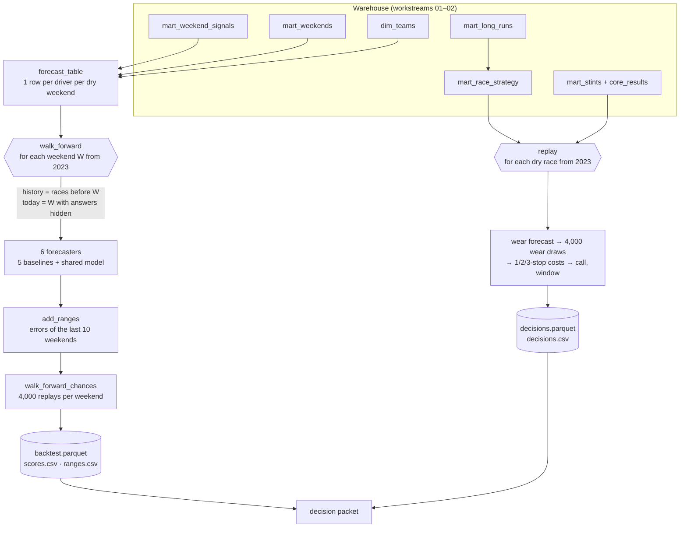

# 03 · Forecasting and machine learning

Workstreams: [01 Data engineering](01-data-engineering.md) · [02 Analytics and statistics](02-data-analytics-statistics.md) · **03 Forecasting and machine learning** · [04 ML engineering](04-ml-engineering.md) · [05 Backend engineering](05-backend-engineering.md) · [06 Applied AI](06-applied-ai.md)

This document describes the forecasting system as it exists now: what it predicts, from which inputs, how it is validated, how uncertainty is expressed, and how a forecast becomes a tyre and pit-stop decision. The forecaster's accuracy and limits on one page are in the [model card](../model-card.md). Why it was built this way is in [case 06 · Shared versus separate models](../research/cases/06-shared-vs-separate-models.md), [case 07 · Temporal validation and ranges](../research/cases/07-temporal-validation-and-ranges.md) and [case 08 · Strategy modelling](../research/cases/08-strategy-modelling.md). How the models are run, reproduced and published is in [workstream 04](04-ml-engineering.md).

## 1. Overview

The forecaster predicts each car's **race pace** in a dry Grand Prix, in percent behind the best race pace of that race, twice per weekend: after practice and after qualifying. Each forecast has an 80% range and three chances: best race pace, a top-3 race pace, and beating the teammate. A second model turns the weekend into a **pit-stop decision**: how many stops, how sure, and when the first stop should come.

| | |
|---|---|
| Target | `race_pace_gap_pct`: a driver's median clean race lap, % behind the best median of that race (0 = fastest car on Sunday) |
| Unit of prediction | one driver at one dry race weekend at one checkpoint |
| Data | 1,846 driver-weekends in 96 dry races, 2022–2026; 2022 only teaches, forecasts start in 2023 (78 weekends) |
| Model | One weighted least-squares regression for every track and year, refitted before every weekend on earlier races only |
| Baselines | Five: no signal, team form, last race, signal as is, a per-year model |
| Validation | Walk-forward by race date; settings chosen on 2023–24 (41 weekends), results reported on 2025–26 (37 weekends) |
| Accuracy, test years | 0.648% after practice and 0.548% after qualifying (0.58 s and 0.49 s on a 90 s lap); best of all forecasters at both checkpoints |
| Uncertainty | Split-conformal 80% ranges: 78.5% and 79.9% of real race paces inside on the test years |
| Decision | Stop count matched the top 10's most common stop count in 58% of 78 dry races, against 46% for "always one stop" |
| Status | Implemented and validated in a backtest and replay; 0 live weekends (see [live-weekends.md](../live-weekends.md)) |

## 2. Problem and purpose

**The question.** Before the race, how fast will each car be on Sunday, and how sure is that? And given that, how many pit stops should our cars plan?

**Why it is hard.**

- **Little data per situation.** A season has 22 to 24 races and each circuit appears 3 to 4 times in the history, so a model per track learns mostly noise.
- **The ground moves.** Cars develop during a season, and in 2026 the technical rules changed.
- **Missing inputs.** Fuel loads, setups and engine modes are not public, so practice pace is noisy.
- **Leakage is easy.** A random train/test split puts laps of the same race on both sides; copying a teammate's race pace then scores 0.51%, better than any honest forecaster ([E14](../research/experiment-register.md)).
- **A decision cannot be scored by its outcome alone.** The plans that were not chosen were never raced.

**Purpose.** Forecasts that use only what was known before the session, that beat simple baselines on years not used to choose any setting, that state honest ranges and chances, and that lead to a decision whose quality can be measured with public data.

## 3. What was implemented

| Component | Status | Where |
|---|---|---|
| Target, checkpoints, and the one training table | Implemented, tested | [`targets.py`](../../src/dpec/forecasting/targets.py) |
| Information hidden at each checkpoint (`hide_answers`) | Implemented, tested | `targets.CHECKPOINTS` |
| Inputs from earlier races only: team form, driver versus team | Implemented, tested | [`features.py`](../../src/dpec/forecasting/features.py) |
| Five baselines with one common signature | Implemented, tested | [`baselines.py`](../../src/dpec/forecasting/baselines.py) |
| Shared weighted regression with recency weights | Implemented, validated (E15, E18, E19) | [`model.py`](../../src/dpec/forecasting/model.py) |
| Walk-forward backtest and scoring | Implemented, validated (E14) | [`backtest.py`](../../src/dpec/forecasting/backtest.py) |
| 80% ranges by split-conformal prediction, walk-forward | Implemented, validated (E20) | [`ranges.py`](../../src/dpec/forecasting/ranges.py) |
| Chances by simulation | Implemented, validated; known limit: too flat (E22) | [`simulate.py`](../../src/dpec/forecasting/simulate.py) |
| Race tyre wear forecast from practice and circuit history | Implemented, validated (E10) | [`tyres.py`](../../src/dpec/decisions/tyres.py) |
| Pit loss, useful tyre life | Implemented | `tyres.py` |
| 1-, 2- and 3-stop plan costs, the 65% "clear" rule, first-stop window, the wear at which another plan wins | Implemented, validated in the replay (E25) | [`plans.py`](../../src/dpec/decisions/plans.py) |
| Decision replay for every past dry race, and `decide_next()` for a race not yet run | Implemented, validated | [`replay.py`](../../src/dpec/decisions/replay.py) |
| One-page decision packet | Implemented | [`packet.py`](../../src/dpec/decisions/packet.py) |
| One model per track; a per-circuit offset (mixed model); a rules-era switch; a Bayesian version | Rejected (E15–E17; the Bayesian version was not built because its first step, the mixed model, was worse) | [decision 0012](../decisions/0012-shared-model.md) |
| Tyre compound choice | Rejected for now (E26) | [decision 0014](../decisions/0014-decision-packet.md) |
| Practice long-run pace as a model input | Not used: the shared model's formulas have no long-run term (see [§ 12](#12-limitations-and-operational-considerations)) | `model.FORMULAS` |
| Chances drawn per weekend instead of per driver; the starting grid after penalties as an input | Future (E22, E28) | [model card](../model-card.md#known-limits) |

## 4. Architecture and workflow



**Forecast workflow** (`dpec backtest`):

1. `forecast_table()` reads one row per driver per **dry** race weekend (the qualifying gap, long-run gaps, grid, race pace, finish, points) and adds the team's lineage, so a renamed team keeps its history.
2. For each weekend W from 2023, `history` is every row of races **strictly before** W's race date, and `today` is W's rows. Weekends with fewer than 8 drivers are skipped.
3. For each checkpoint, `hide_answers()` removes what is not known yet: after practice, the race result and the qualifying columns; after qualifying, the race result.
4. Every forecaster gets `(history, today)` and returns one guess per driver. The guess is stored next to the real answer.
5. `add_ranges()` adds an 80% range to each guess from the same forecaster's errors in the 10 forecast weekends before W.
6. `walk_forward_chances()` replays W's race order 4,000 times with errors drawn from the same past errors, giving the chances.
7. `score()` summarises by checkpoint, forecaster and years (tune, test, all).

**Decision workflow** (`dpec replay`):

1. For each dry race from 2023, in date order, using only earlier races and this weekend's practice: forecast race tyre wear, take pit loss from the circuit's history, and draw 4,000 wear values from the wear forecast's last 20 errors.
2. Cost the 1-, 2- and 3-stop plans for every draw; the plan that is cheapest most often is the call, "clear" if it wins at least 65% of draws.
3. Compute the first-stop window and the wear level at which the runner-up plan would win.
4. Only after the race is scored do its errors join the history that later races learn from.

## 5. Important components and responsibilities

### 5.1 Target and checkpoints

`race_pace_gap_pct` is defined in [`mart_weekend_signals`](../data-dictionary.md#mart_weekend_signals) ([workstream 02 § 5.2](02-data-analytics-statistics.md#52-pace-measures)): the median clean race lap in % behind the best median of that race, for drivers with at least 10 clean race laps. It measures pace, not position: starts, safety cars, strategy and reliability decide positions, and are not forecast. Wet races (more than 10% of race laps on wet tyres) are not forecast ([decision 0011](../decisions/0011-target-and-fair-test.md)).

| Checkpoint | Known | Hidden (`CHECKPOINTS`) |
|---|---|---|
| `after_practice` | practice long runs, history | `race_pace_gap_pct`, `race_clean_laps`, `finish_position`, `points`, `quali_gap_pct`, `grid_position` |
| `after_quali` | practice, qualifying gap, grid, history | `race_pace_gap_pct`, `race_clean_laps`, `finish_position`, `points` |

### 5.2 Inputs built from earlier races

From [`features.py`](../../src/dpec/forecasting/features.py), computed on history and today together, each row from races before its own weekend:

- **`team_form`**: the team's average race gap per race, as an exponentially weighted mean over its earlier races with a half-life of 3 races (pandas `shift().ewm(halflife=3)`; the `shift` keeps a race from seeing itself). A new team gets the average gap of all earlier races.
- **`driver_vs_team`**: the driver's race gap minus his team's average in each earlier race, exponentially weighted with a half-life of 6 races. A rookie gets 0 (the same as the team).
- **`quali_gap_pct`**: this weekend's qualifying gap (after qualifying only).

### 5.3 Baselines

Every forecaster has the same signature, `forecaster(history, today) → one guess per row of today`, so nothing else can leak in ([`baselines.py`](../../src/dpec/forecasting/baselines.py)).

| Baseline | Guess |
|---|---|
| `no_signal` | The average gap of all earlier races, for everyone: the floor every guess must beat |
| `team_form` | The team's average gap over its last 3 dry races |
| `last_race` | The driver's gap at his previous dry race; a rookie gets his team's form |
| `signal_as_is` | This weekend's most trusted signal, unchanged: qualifying gap, else FP2 long-run gap, else any long-run gap, else team form |
| `per_year_model` | A straight line `race gap ~ signal` fitted on one season (this one once it has 3 weekends, otherwise the previous one), one line per signal, the most trusted available signal wins |

### 5.4 The shared model

[`model.py`](../../src/dpec/forecasting/model.py) fits one [weighted least-squares](https://en.wikipedia.org/wiki/Weighted_least_squares) regression per checkpoint, for every track and every year:

```text
after practice:   race_pace_gap_pct ~ team_form + driver_vs_team
after qualifying: race_pace_gap_pct ~ quali_gap_pct + team_form + driver_vs_team

weight of a training row = 0.5 ** (races_ago / 12)        # 1 for the last race, 0.5 twelve races earlier
```

- It is refitted before every weekend on all earlier races (statsmodels `smf.wls`).
- The target is relative to the best car of that race, so the general speed of a circuit is already removed; what is left ("this car suits this track") is real but small, and a per-circuit offset made forecasts worse (E16).
- Recency weights let the model keep learning through a season and after a rules change. Half-lives of 6, 12, 24 or 48 races, or equal weights, were within 0.003% on the tune years; 12 was kept (E18).
- If fewer than 50 training rows have the needed inputs (`MIN_ROWS`), the guess stays the team form.
- Every driver first gets the after-practice guess; drivers with a qualifying time then get the after-qualifying guess. A driver without a qualifying time therefore still has a forecast after qualifying.

### 5.5 Walk-forward validation

[`backtest.py`](../../src/dpec/forecasting/backtest.py) implements [walk-forward validation](https://en.wikipedia.org/wiki/Walk_forward_optimization): each weekend is forecast with a model that has seen only earlier races, exactly as it would have been live. Settings were chosen on the **tune years** 2023–24; the **test years** 2025–26 are reported and were not used to choose anything ([decision 0011](../decisions/0011-target-and-fair-test.md)).

| Metric | Definition |
|---|---|
| `mae_pct` | Mean absolute error of the race pace gap, in % of a lap |
| `mae_s` | The same in seconds on a 90 s lap (`mae_pct / 100 × 90`) |
| `median_rho` | [Spearman rank correlation](https://en.wikipedia.org/wiki/Spearman%27s_rank_correlation_coefficient) between forecast and real race pace per weekend, then the median over weekends: does the forecast order the drivers right |
| Coverage and width | Share of real race paces inside the 80% range, and its average width in % of a lap |
| Brier score | Mean squared error of a probability against what happened ([Brier score](https://en.wikipedia.org/wiki/Brier_score)); computed for the top-3 chance in the research notebook |

### 5.6 Ranges: split-conformal, walk-forward

[`ranges.py`](../../src/dpec/forecasting/ranges.py) uses [split-conformal prediction](https://en.wikipedia.org/wiki/Conformal_prediction) in a walk-forward way:

```text
errors   = actual − predicted, same forecaster and checkpoint, over the 10 forecast weekends before W
half     = 80th percentile of |errors|
range(W) = predicted ± half          (no range until 5 earlier forecast weekends exist)
```

When errors grow (after a rules change), ranges grow too, a few races later. The window of 10 weekends was chosen on the tune years ([decision 0013](../decisions/0013-ranges-and-chances.md)).

### 5.7 Chances: simulation

[`simulate.py`](../../src/dpec/forecasting/simulate.py) replays the race order 4,000 times. In each replay every driver's guess gets one error drawn at random from the same past errors used for the range. A driver's chance of the best race pace is the share of replays in which he has it; likewise for a top-3 pace and `mean_rank`. The chance of beating the teammate is computed only for teams with exactly two drivers. The random generator is seeded (seed 0), so the same inputs give the same chances.

### 5.8 From pace to a pit-stop decision

[`tyres.py`](../../src/dpec/decisions/tyres.py) and [`plans.py`](../../src/dpec/decisions/plans.py):

| Step | Method |
|---|---|
| Race tyre wear | OLS `race_deg_s_per_lap ~ practice_deg_s_per_lap + circuit_deg` on earlier races, where `circuit_deg` is the circuit's median race wear in earlier races (all circuits for a new one). With fewer than 15 earlier races, or no practice long runs, the forecast is the circuit's history. Practice alone overstates race wear by about 1.6× (E10) |
| Wear uncertainty | The 80th percentile of the absolute wear-forecast errors over the last 20 races (none until 5 exist); 4,000 draws of `max(wear + past error, 0)` |
| Pit loss | The circuit's median `pit_loss_s` in earlier races (all circuits for a new one) |
| Plan cost | `wear × laps of tyre age summed over the stints + stops × pit loss`. A stint of L laps on a new set loses `wear × L × (L − 1) / 2`; stints are as equal as possible. Fuel burns the same in every plan and cancels out |
| Plans | 1, 2 or 3 stops (at least one, because the rules require two dry compounds) |
| Call | The plan that is cheapest in most draws; "clear" if it wins at least 65% of them, otherwise "no clear decision" with the two closest plans |
| First-stop window | Laps on which the first stop (later stints split equally) costs at most 1 s more than the best timing; once 20 real green-flag first stops of that plan exist, shifted by the median distance between real first stops and the window's middle (the undercut makes teams stop early) |
| Risk | The wear at which the runner-up plan becomes cheaper: both costs are straight lines in wear, so they cross at one point |
| Useful tyre life | The lap at which a set has lost as much time as one stop costs: `L = (1 + sqrt(1 + 8 × pit_loss / wear)) / 2` |

**Scoring what public data can check** ([`replay.py`](../../src/dpec/decisions/replay.py)): the wear error and whether the real race wear fell inside the range; whether the call matched the top-10 finishers' most common stop count; and the share of the top 10's real green-flag first stops (of drivers on the called plan) inside the window. Never "did the plan win": the other plans were not raced. Baseline: always one stop.

### 5.9 The decision packet

[`packet.py`](../../src/dpec/decisions/packet.py) writes one page per race as it would have looked before the race: the race pace forecast for our cars, the tyre wear forecast, the plan comparison, the reasons the call could be wrong (each with its number, for example the wear at which another plan wins, or thin practice evidence when there were fewer than 15 dry long runs), then what really happened. Every sentence is a template filled with computed numbers; no sentence is generated by an AI model.

## 6. Codebase map with actual file references

| Path | Role |
|---|---|
| [`src/dpec/forecasting/targets.py`](../../src/dpec/forecasting/targets.py) | Target, checkpoints, `forecast_table()`, `hide_answers()` |
| [`src/dpec/forecasting/features.py`](../../src/dpec/forecasting/features.py) | `add_form()`: team form and driver versus team |
| [`src/dpec/forecasting/baselines.py`](../../src/dpec/forecasting/baselines.py) | Five baselines, `BASELINES` |
| [`src/dpec/forecasting/model.py`](../../src/dpec/forecasting/model.py) | `FORMULAS`, `recency_weights()`, `fit()`, `shared_model()` |
| [`src/dpec/forecasting/backtest.py`](../../src/dpec/forecasting/backtest.py) | `walk_forward()`, `score()` |
| [`src/dpec/forecasting/ranges.py`](../../src/dpec/forecasting/ranges.py) | `past_errors()`, `add_ranges()`, `coverage_table()` |
| [`src/dpec/forecasting/simulate.py`](../../src/dpec/forecasting/simulate.py) | `simulate()`, `walk_forward_chances()` |
| [`src/dpec/decisions/tyres.py`](../../src/dpec/decisions/tyres.py) | `strategy_table()`, `wear_forecast()`, `circuit_history()`, `useful_life()` |
| [`src/dpec/decisions/plans.py`](../../src/dpec/decisions/plans.py) | `plan_cost()`, `compare_plans()`, `first_stop_window()`, `flip_wear()` |
| [`src/dpec/decisions/replay.py`](../../src/dpec/decisions/replay.py) | `decide()`, `replay()`, `decide_next()`, `score()` |
| [`src/dpec/decisions/packet.py`](../../src/dpec/decisions/packet.py) | `make_packet()`, `to_markdown()`, `our_lineage()` |
| [`src/dpec/cli.py`](../../src/dpec/cli.py) | `backtest`, `replay`, `packet` commands |
| [`notebooks/03_forecast/c2_shared_model.ipynb`](../../notebooks/03_forecast/c2_shared_model.ipynb) | Shared versus separate models, circuit offsets, rules-era switch, half-lives |
| [`notebooks/03_forecast/c3_ranges_and_chances.ipynb`](../../notebooks/03_forecast/c3_ranges_and_chances.ipynb) | Range coverage, chances and their calibration, Brier scores, input ablation |
| [`reports/backtest/`](../../reports/backtest/) | `scores.csv`, `ranges.csv`, `decisions.csv` |
| Tests: [`test_forecasting.py`](../../tests/dpec/test_forecasting.py), [`test_model.py`](../../tests/dpec/test_model.py), [`test_ranges.py`](../../tests/dpec/test_ranges.py), [`test_decisions.py`](../../tests/dpec/test_decisions.py) | See [§ 10](#10-tests-and-verification-evidence) |

## 7. Inputs and outputs

**Inputs:** `mart_weekend_signals`, `mart_weekends` and `dim_teams` (forecaster); `mart_race_strategy`, `mart_long_runs`, `mart_stints`, `core_results` and `core_laps` (decisions). No raw files and no network.

**Outputs.**

| File | In git | One row per | Columns |
|---|---|---|---|
| `data/forecasts/backtest.parquet` | No (rebuildable) | driver, weekend, checkpoint, forecaster (18,012 rows: 1,501 per checkpoint × 6 forecasters × 2) | `season`, `round`, `weekend`, `circuit`, `driver_code`, `lineage`, `checkpoint`, `forecaster`, `predicted`, `actual`, `low`, `high`, `years` (tune/test), and for the shared model `p_best`, `p_top3`, `mean_rank`, `p_beats_teammate` |
| [`reports/backtest/scores.csv`](../../reports/backtest/scores.csv) | Yes | checkpoint, forecaster, years | `weekends`, `rows`, `mae_pct`, `mae_s`, `median_rho` |
| [`reports/backtest/ranges.csv`](../../reports/backtest/ranges.csv) | Yes | years, checkpoint | `rows`, `inside`, `width_pct` |
| `data/forecasts/decisions.parquet` | No (rebuildable) | dry race from 2023 (78 rows) | `deg`, `deg_low`, `deg_high`, `pit_loss_s`, `useful_life`, `stops`, `p_best`, `clear`, `shift`, `window_first`, `window_last`, and what happened: `actual_deg`, `actual_stops`, `green_first_stops`, `inside_window` |
| [`reports/backtest/decisions.csv`](../../reports/backtest/decisions.csv) | Yes | group of races (all, clear, no clear decision) | `races`, `stops_right`, `always_one_stop_right`, `wear_error_s_per_lap`, `wear_inside_range`, `first_stops`, `inside_window`, `window_share` |
| `reports/packets/<season>-<round>-<circuit>.md` | Not committed at present (see [workstream 04 § 12](04-ml-engineering.md#12-limitations-and-operational-considerations)) | race | The decision packet |

**Example rows** from `backtest.parquet` (shared model, after qualifying):

| Weekend | Driver | Forecast | 80% range | Actual | Chances |
|---|---|---|---|---|---|
| Bahrain 2024 | HAM | 0.688% | 0.006 to 1.370 | 1.211% | top 3: 0.256 |
| Bahrain 2024 | VER | 0.233% | −0.449 to 0.915 | 0.000% | best: 0.311, top 3: 0.628 |
| Singapore 2025 | RUS | 0.525% | −0.380 to 1.429 | 0.048% | best: 0.152, top 3: 0.434, beats teammate: 0.646 |

## 8. How to run or use the functionality

```bash
uv run dpec backtest                            # every dry race from 2023, every forecaster (17 s in the verification run)
uv run dpec backtest --first-season 2023 --test-from 2025    # the defaults, written out
uv run dpec replay                              # tyre and stop decision for every dry race from 2023
uv run dpec packet --season 2024 --round 1      # one race's decision packet (needs the backtest first)
uv run dpec packet --season 2024 --round 1 --checkpoint after_practice
```

`backtest` prints the scores for all, tune and test years and the range coverage, and writes the files in § 7. Reading the saved forecasts with SQL:

```bash
uv run dpec sql "SELECT driver_code, round(predicted, 3) AS forecast, round(low, 3) AS low,
                 round(high, 3) AS high, round(actual, 3) AS actual, round(p_top3, 3) AS p_top3
                 FROM read_parquet('data/forecasts/backtest.parquet')
                 WHERE forecaster = 'shared_model' AND checkpoint = 'after_quali'
                   AND season = 2024 AND round = 1 ORDER BY predicted"
```

**Changing the model.** Change [`model.py`](../../src/dpec/forecasting/model.py) (the `formulas` and `halflife` arguments exist for experiments), rerun `dpec backtest`, and compare `scores.csv` on the **tune** years first; look at the test years only after the choice is made ([operations.md § 4](../engineering/operations.md#4-forecast-backtest-and-strategy-replay)). A new forecaster only needs the common signature and an entry in the `forecasters` dictionary of the `backtest` command. The same model code serves the live freeze, so a change reaches it automatically ([workstream 04](04-ml-engineering.md#5-important-components-and-responsibilities)).

In the app, the race pace forecast window shows the backtest's forecast for a weekend next to what happened; the tyre decision is available through the AI assistant's `tyre_decision` tool ([workstream 06](06-applied-ai.md)).

## 9. Important configurations and commands

The forecaster's settings are constants in code, chosen on the tune years and recorded in decisions; they are deliberately not in the YAML file, so that a changed setting is a reviewed code change followed by a new backtest.

| Constant | Value | Where | Decision |
|---|---|---|---|
| Team form half-life | 3 races | `features.add_form` | [0012](../decisions/0012-shared-model.md) |
| Driver versus team half-life | 6 races | `features.add_form` | [0012](../decisions/0012-shared-model.md) |
| Recency half-life | 12 races | `model.shared_model` | [0012](../decisions/0012-shared-model.md) |
| Minimum training rows | 50 | `model.MIN_ROWS` | [0012](../decisions/0012-shared-model.md) |
| Minimum drivers in a weekend | 8 | `backtest.walk_forward` | [0011](../decisions/0011-target-and-fair-test.md) |
| Range coverage, window, minimum weekends | 0.8, 10, 5 | `ranges.py` | [0013](../decisions/0013-ranges-and-chances.md) |
| Simulation draws and seed | 4,000, 0 | `simulate.simulate` | [0013](../decisions/0013-ranges-and-chances.md) |
| Minimum earlier races for the wear regression | 15 | `tyres.MIN_RACES` | [0014](../decisions/0014-decision-packet.md) |
| Plans, "clear" threshold, window tolerance | 1–3 stops, 0.65, 1 s | `plans.py` | [0014](../decisions/0014-decision-packet.md) |
| Wear error window, minimum errors, undercut shift after | 20 races, 5, 20 first stops | `replay.py` | [0014](../decisions/0014-decision-packet.md) |
| Thin practice evidence | fewer than 15 dry long runs | `packet.THIN_PRACTICE` | [0014](../decisions/0014-decision-packet.md) |

| Command option | Default | Meaning |
|---|---|---|
| `backtest --first-season` | 2023 | First season forecast; earlier ones only teach |
| `backtest --test-from` | 2025 | Seasons from here on are the reported test years |
| `replay --first-season` | 2023 | First season replayed |
| `packet --checkpoint` | `after_quali` | Which forecast the packet shows |

## 10. Tests and verification evidence

**Unit tests (fake data).** 29 of the 129 tests:

| File | Tests | What they prove |
|---|---|---|
| [`test_forecasting.py`](../../tests/dpec/test_forecasting.py) | 9 | `hide_answers` removes what is not known yet; a forecaster cannot read today's answer; walk-forward never sees the future and starts after the first race; team form is the average of the last three races; a rookie gets his team's form; `signal_as_is` prefers qualifying; `score` counts errors and order; the baselines beat no signal on a clear season |
| [`test_model.py`](../../tests/dpec/test_model.py) | 6 | Team form starts from the previous race and never uses a later race; driver versus team finds the faster teammate; recency weights halve every half-life; the shared model learns a clear rule and never sees the future |
| [`test_ranges.py`](../../tests/dpec/test_ranges.py) | 6 | Ranges cover about 80% on simulated data; no range before enough past weekends; ranges never use a later weekend; chances add up and are repeatable; walk-forward chances start after five weekends |
| [`test_decisions.py`](../../tests/dpec/test_decisions.py) | 8 | A plan's cost adds tyre wear and stops; the plans' chances add up; low wear gives a wider window; the flip wear is where two plans cost the same; useful life loses one pit stop; circuit history falls back to all circuits; the replay never sees the future; the replay starts in the first season and stops at `until` |

**Verification on the saved data (9 November 2026).**

- **Rerun from scratch:** `dpec backtest` (17 s) and `dpec replay` (8 s) on the saved warehouse reproduced the committed `scores.csv`, `ranges.csv` and `decisions.csv` byte for byte, and the saved Parquet files to within floating-point rounding (largest difference below 10⁻¹³; chances identical).
- `backtest.parquet` (18,012 rows, 78 weekends) re-scored independently gives the same `mae_pct` as `scores.csv` for every forecaster, checkpoint and year group.
- The input ablation was rerun with the walk-forward code: full model 0.556% / 0.498%; without team form 0.871% / 0.593%; without the qualifying gap 0.557% after qualifying; without driver versus team 0.567% / 0.503%; without recency weights 0.553% / 0.513% (after practice / after qualifying, all forecast years). These match the model card.
- Range coverage and widths match `ranges.csv`; top-3 Brier scores, calibration bins and the teammate Brier were recomputed from the saved forecasts (values in § 11).
- The 2026 dry runs reproduce the backtest exactly through the live code path (E23, [workstream 04](04-ml-engineering.md#10-tests-and-verification-evidence)).

## 11. Results and practical value

Full results and limits are in the [model card](../model-card.md); the main ones:

**Accuracy against the baselines** (mean absolute error in % of a lap; [`scores.csv`](../../reports/backtest/scores.csv)):

| Forecaster | Test 2025–26, after practice | Test, after qualifying | All 2023–26, after practice | All, after qualifying |
|---|---|---|---|---|
| **Shared model** | **0.648** | **0.548** | **0.556** | **0.498** |
| Team form | 0.674 | 0.674 | 0.584 | 0.584 |
| Per-year model | 0.883 | 0.589 | 0.795 | 0.579 |
| Signal as is | 1.071 | 0.594 | 0.945 | 0.617 |
| Last race | 0.744 | 0.744 | 0.688 | 0.688 |
| No signal | 1.047 | 1.047 | 0.898 | 0.898 |

The shared model has the lowest error at both checkpoints in every year group. It does not win everywhere on order: after qualifying on the test years the per-year model's median Spearman is higher (0.843 against 0.821), and after practice team form's is (0.776 against 0.767).

**Ranges and chances.**

| Measure | After practice | After qualifying |
|---|---|---|
| Inside the 80% range, tune years (average width) | 80.0% (1.44%) | 81.0% (1.39%) |
| Inside the 80% range, test years (average width) | 78.5% (1.90%) | 79.9% (1.70%) |
| Top-3 chance Brier, test years (no information) | 0.080 (0.129) | 0.070 (0.129) |
| Top-3 chance Brier, all years (no information) | 0.084 (0.131) | 0.077 (0.131) |
| Beating the teammate, Brier, all years (coin: 0.25) | 0.231 | 0.219 |

Calibration after qualifying, all years: drivers given a 60–80% top-3 chance made the top 3 in 79% of cases (said 67%); those given 20–40% in 21% (said 31%). The chances are too flat: the favourites are under-rated ([c3 notebook](../../notebooks/03_forecast/c3_ranges_and_chances.ipynb)).

**Which inputs carry the model** (ablation above): team form carries the after-practice forecast (removing it raises the error from 0.556% to 0.871%); the qualifying gap adds about 0.06 points after qualifying.

**After a rules change.** In 2026 rounds 1–5 the shared model was not the best: after practice 0.838% against 0.794% for last race and 0.803% for team form; after qualifying 0.626% against 0.570% for the per-year model, and only 68% of race paces fell inside the range after practice. From round 6 to the last saved race (11 dry weekends) it was best again at both checkpoints (0.713% and 0.571%).

**Decision replay** ([`decisions.csv`](../../reports/backtest/decisions.csv)):

| Races | Count | Stop count right | Always one stop | Wear inside range | First stops inside window |
|---|---|---|---|---|---|
| All | 78 | **57.7%** | 46.2% | 73.1% | 51.8% |
| Clear call | 51 | **66.7%** | 56.9% | 68.6% | 46.6% |
| No clear decision | 27 | 40.7% | 25.9% | 81.5% | 66.7% |

Average wear error: 0.028 s per lap. The replay called 1 stop 49 times and 2 stops 29 times, never 3, while the top 10 made 3 or more stops in 10 of the 78 races. Example, Bahrain 2024: wear forecast 0.0734 s/lap (range 0.0159 to 0.1308), pit loss 25.29 s, call 1 stop with a 0.739 chance (clear), window laps 20–27; the packet named the risk that 2 stops win above 0.093 s/lap. Real wear was 0.0995 s/lap and the top 10 mostly stopped twice: a wrong call, with the right stated reason ([case 08](../research/cases/08-strategy-modelling.md)).

**Practical value.** The forecasts beat every simple rule on years never used for tuning, they say how sure they are and are right about that about 80% of the time, and the decision layer turns them into a call that is right more often than the obvious default, while saying "no clear decision" when the race is close.

## 12. Limitations and operational considerations

- **Rules changes.** The first races of a new rules era are the weakest (2026 rounds 1–5); ranges catch up a few races later. [Decision 0012](../decisions/0012-shared-model.md#what-would-change-it) describes what to compare at the next change.
- **Chances are too flat** because each driver's error is drawn independently; a shared error per weekend would keep the order together (Future, E22). Beating the teammate is barely better than a coin.
- **Inputs that are missing**: tyre strategy, fuel, weather during the race, upgrades, and the starting grid after penalties (Singapore 2026: qualified 6th, started 19th; E28).
- **Long-run pace is not a model input.** [Decision 0010](../decisions/0010-forecast-signals.md) names FP2 long runs a "second input and sanity check"; the shared model adopted in [decision 0012](../decisions/0012-shared-model.md) uses team form and driver versus team after practice instead, and long-run pace enters only through two baselines (signal as is, per-year model) and the tyre-wear input of the decision. No recorded test adds FP2 long runs to the shared model against the 5% rule of decision 0010.
- **The decision is simple on purpose**: equal stints, no compounds, no safety cars, no traffic or rivals. Wear ranges are too narrow (73% inside instead of 80%), only about half of real first stops fall inside the window, and 3-stop races are never called.
- **Decision scoring is against what the top 10 did**, which is not the same as the best plan.
- **Race length.** The replay uses each race's real length, a small leak where the length changed (Montreal 2026: 68 laps, 70 before); the live path uses the previous length or `--race-laps` (E24).
- **No wet races.** Neither the forecaster nor the decision covers them.
- **Backtest only.** No forecast has yet been frozen before a real session (0 live weekends): see [live-weekends.md](../live-weekends.md).

## 13. References to deeper engineering documents and experiments

- Why: [case 03](../research/cases/03-practice-vs-qualifying.md), [case 06](../research/cases/06-shared-vs-separate-models.md), [case 07](../research/cases/07-temporal-validation-and-ranges.md), [case 08](../research/cases/08-strategy-modelling.md); register entries [E13–E26](../research/experiment-register.md)
- Decisions: [0010 · Forecast signals](../decisions/0010-forecast-signals.md), [0011 · Target and fair test](../decisions/0011-target-and-fair-test.md), [0012 · Shared model](../decisions/0012-shared-model.md), [0013 · Ranges and chances](../decisions/0013-ranges-and-chances.md), [0014 · Decision packet](../decisions/0014-decision-packet.md)
- Reference: [model card](../model-card.md), [numbers-check.md](../../reports/numbers-check.md#at-a-glance-and-results), [codebase-map.md § Forecasting](../engineering/codebase-map.md#forecasting-forecasting)
- Narrative: [methods.md § 6–8](../methods.md#6-research-what-actually-predicts-race-pace)
- Previous: [02 · Data analytics and statistics](02-data-analytics-statistics.md) · Next: [04 · ML engineering](04-ml-engineering.md)
