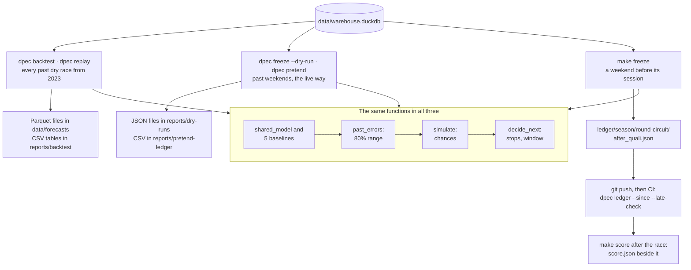

# 04 · ML engineering

Workstreams: [01 Data engineering](01-data-engineering.md) · [02 Analytics and statistics](02-data-analytics-statistics.md) · [03 Forecasting and machine learning](03-forecasting-machine-learning.md) · **04 ML engineering** · [05 Backend engineering](05-backend-engineering.md) · [06 Applied AI](06-applied-ai.md)

This document describes how the models of [workstream 03](03-forecasting-machine-learning.md) are implemented, configured, run, reproduced, validated, frozen, scored and tested. What the models predict and how accurate they are is in workstream 03 and the [model card](../model-card.md). Why the validation and the public record are built this way is in [case 07 · Temporal validation and ranges](../research/cases/07-temporal-validation-and-ranges.md), [case 09 · Release, deployment and data access](../research/cases/09-release-deployment-data-access.md) and [decision 0015](../decisions/0015-public-record.md). Every command with its options is in [operations.md](../engineering/operations.md#4-forecast-backtest-and-strategy-replay).

## 1. Overview

ML engineering here means one thing: the code that evaluates a forecast on history is the same code that would make a forecast before a real race, and every result can be re-created and checked by someone else.

| | |
|---|---|
| Scope | Model code structure, configuration, the boundary between training and prediction, the walk-forward backtest and decision replay, reproducibility, the forecast freeze, the write-once public record, scoring, dry runs, evaluation automation, tests and CI |
| Model lifecycle | No stored model files. Every forecaster is refitted before every weekend on earlier races only; the full backtest (78 weekends × 2 checkpoints × 6 forecasters, with ranges and chances) runs in 17 s |
| One code path | The backtest, the dry runs and a live freeze call the same functions: `shared_model`, the five `BASELINES`, `walk_forward`, `past_errors`, `simulate`, `decide_next` |
| Leakage guard | Two cuts before every forecaster call: history = races before this race's date; today = this weekend with the checkpoint's unknown columns removed (`hide_answers`) |
| Reproducibility | Locked environment (`uv.lock`), fixed seeds, no random splits. A rerun on 9 November 2026 reproduced the committed `scores.csv`, `ranges.csv` and `decisions.csv` byte for byte |
| Provenance | Each frozen file records the git commit of the code (`code_version`), a hash of its inputs (`inputs_sha256`) and a hash of its own content (`sha256`) |
| Public record | Write-once JSON files under `ledger/`, validated by strict Pydantic models and published JSON Schemas; CI fails on any edited, deleted or late file |
| Live path = tested path | `dpec pretend --season 2026` froze and scored 16 dry races the live way: 322 driver forecasts identical to the backtest (largest difference 0.0000%), error 0.573% in both ([E23](../research/experiment-register.md)) |
| Tests | 129 tests in 22 s, on fake data; 47 of them cover the ML code, the record, the snapshot and the settings |
| Status | Implemented and tested. The live part (freeze, push, CI check, score) has run 0 times for real, because new data stopped in October 2026 ([live-weekends.md](../live-weekends.md#why-there-are-none)) |

## 2. Problem and purpose

The forecasting method is only half of the work. These problems exist whatever the model is:

- **Training-serving skew.** If the backtest and the live forecast run different code, a good backtest says nothing about the live forecasts.
- **Leakage.** A forecaster that can see any part of the race it predicts, or any later race, looks excellent and is useless. In pandas it takes one wrong filter or join.
- **After-the-fact forecasts prove nothing.** A forecast written or edited after the race is not evidence. Proof needs a clock that the author does not control, and a way to detect edits.
- **Reproducibility.** A number in the README must be re-creatable from the code and the data, with the same digits.
- **Frequent refits.** About 24 refits per season, each on exactly the data available at that moment.
- **One maintainer.** No servers to run or pay for: everything has to be files, commands and CI.

**Purpose.** One tested code path from warehouse to forecast to score, which a reviewer can rerun and check, and a record format in which a forecast cannot be changed or back-dated without the change showing.

## 3. What was implemented

| Component | Status | Where |
|---|---|---|
| One forecaster contract, `forecaster(history, today) -> Series`, for the shared model and all baselines | Implemented, tested | [`baselines.py`](../../src/dpec/forecasting/baselines.py), [`model.py`](../../src/dpec/forecasting/model.py) |
| Leakage cuts: by race date and by hidden columns | Implemented, tested (6 "never sees the future" tests) | [`backtest.py`](../../src/dpec/forecasting/backtest.py), [`targets.py`](../../src/dpec/forecasting/targets.py) |
| Refit before every weekend; no stored models | Implemented (by design) | `model.shared_model` |
| Walk-forward backtest with tune and test years, every prediction saved | Implemented, validated ([E14](../research/experiment-register.md)) | `dpec backtest` in [`cli.py`](../../src/dpec/cli.py) |
| Decision replay for every past dry race, and the same decision for a race not yet run | Implemented, tested (live decision = replay decision) | [`replay.py`](../../src/dpec/decisions/replay.py) |
| Validated settings file; model constants in code; run options on the command line | Implemented, tested | [`config.py`](../../src/telemetry_core/config.py), [`config/`](../../config/dpec.yaml) |
| Locked environment: `--locked` in CI, `--frozen` in Docker; fixed seeds | Implemented; verified by a rerun (§ 10) | [`uv.lock`](../../uv.lock), [`ci.yml`](../../.github/workflows/ci.yml), [`Dockerfile`](../../Dockerfile) |
| Forecast freeze with a deadline of session start minus 30 minutes | Implemented, tested; never used live | [`freeze.py`](../../src/dpec/record/freeze.py), [`live.py`](../../src/dpec/record/live.py) |
| Write-once ledger: content hash, strict models, JSON Schema | Implemented, tested | [`ledger.py`](../../src/dpec/record/ledger.py), [`schemas/`](../../schemas/forecast.schema.json) |
| CI guard: no edited or deleted ledger file, no forecast after its deadline | Implemented, tested with a real git repository in a test; in CI it has only run on an empty ledger | `ledger` job in [`ci.yml`](../../.github/workflows/ci.yml) |
| Scoring with the backtest's measures, and a verdict | Implemented, tested | [`score.py`](../../src/dpec/record/score.py) |
| Dry runs and a "pretend ledger" for a past season | Implemented, validated ([E23](../research/experiment-register.md)) | `dpec freeze --dry-run`, `dpec pretend` |
| Data snapshot with a SHA-256 list for the public copy | Implemented, tested | [`snapshot.py`](../../src/dpec/publish/snapshot.py) |
| Automated exam for the AI assistant | Implemented | [workstream 06](06-applied-ai.md) |
| Experiment-tracking server, model registry, feature store, job scheduler | Not implemented: runs are compared through CSV files in git (see § 12) | |
| Automatic monitoring of live accuracy, retraining triggers | Not implemented: live accuracy would show in scored weekends, of which there are none | |

## 4. Architecture and workflow

Three entry points, one set of model functions. The architecture of the whole system is in [architecture.md](../engineering/architecture.md#2-data-flow); this is the ML part of it.



**A live weekend, step by step** (designed and tested; 0 real runs):

1. FastF1 publishes qualifying about three hours after it starts. `make freeze ROUND=<n>` then runs `ingest`, `build` and `check` for that weekend, then `dpec freeze` ([§ 5.5](#55-the-live-freeze)).
2. `dpec freeze` refuses to run after the deadline (race start minus 30 minutes), builds the weekend as it looks before the race, fits every forecaster on earlier races, adds ranges, chances and the tyre decision, and writes `ledger/<season>/<round>-<circuit>/after_quali.json` once.
3. The file is committed and pushed straight away. The time of the push, as seen by GitHub, is the proof that the forecast existed before the race.
4. The `ledger` CI job checks every ledger file against its hash and its schema, fails if any earlier file was changed or deleted, and fails if the new forecast arrived after its deadline ([§ 5.6](#56-the-public-record-ledger)).
5. After the race, `make score ROUND=<n>` ingests and rebuilds, then writes `score.json` next to the frozen file, without touching it ([§ 5.7](#57-scoring-and-verdicts)). It is committed and checked the same way.

## 5. Important components and responsibilities

### 5.1 The forecaster contract and the two leakage cuts

Every forecaster, the shared model and the five baselines alike, is a plain function `forecaster(history, today)` that returns one guess per row of `today`. Nothing else reaches it.

| Cut | Code | What it removes |
|---|---|---|
| Time | `history = table[table["race_date"] < today["race_date"].iloc[0]]`, in `walk_forward` and again in `make_forecast` | This race and every later race |
| Columns | `hide_answers(today, checkpoint)` drops `CHECKPOINTS[checkpoint]` | After practice: the race answers (`race_pace_gap_pct`, `race_clean_laps`, `finish_position`, `points`) and qualifying (`quali_gap_pct`, `grid_position`). After qualifying: the race answers |

- A forecaster that reaches for a hidden column fails with a `KeyError` instead of quietly using it (`test_a_forecaster_cannot_read_todays_answer`).
- Inputs such as `team_form` and `driver_vs_team` are computed inside the call from `history` and `today` ([`features.py`](../../src/dpec/forecasting/features.py)), so there is no precomputed feature table that could carry later information.
- The baselines get exactly the same inputs as the model, and their guesses are frozen in every live file too, so the skill score after the race compares like with like.

### 5.2 Models are refitted, not stored

`shared_model` fits a weighted least-squares formula (statsmodels) for the checkpoint each time it is called, on the training rows of `history`, with recency weights that halve every 12 races. With fewer than 50 training rows the guess stays at team form ([workstream 03 § 5.4](03-forecasting-machine-learning.md#54-the-shared-model)).

- There are no pickled models and no registry. What identifies a forecast is the code version plus the data it was made from; what is kept is the predictions and the scores ([§ 7](#7-inputs-and-outputs)).
- The cost is small: the whole backtest runs in 17 s, so refitting every weekend is cheaper than managing stored models.
- The trade-off: re-creating an old forecast exactly needs the same code and the same warehouse content. That is why each frozen file records `code_version` and `inputs_sha256` ([§ 5.4](#54-reproducibility-and-provenance)).

### 5.3 Walk-forward backtest and decision replay

| Command | What it runs | Saves |
|---|---|---|
| `dpec backtest` | `forecast_table` → `walk_forward` over every dry weekend from 2023 with the 5 baselines and the shared model → `add_ranges` → tune/test label → `walk_forward_chances` for the shared model → `score` overall and per years | `data/forecasts/backtest.parquet` (18,012 rows, every guess; not in git); [`reports/backtest/scores.csv`](../../reports/backtest/scores.csv) and [`ranges.csv`](../../reports/backtest/ranges.csv) (in git) |
| `dpec replay` | `replay_all`: the tyre and stop decision for each dry race from earlier races only, next to what happened | `data/forecasts/decisions.parquet` (78 races); [`reports/backtest/decisions.csv`](../../reports/backtest/decisions.csv) |

- Settings are chosen on the tune years 2023–24 only, and the test years 2025–26 are reported ([decision 0011](../decisions/0011-target-and-fair-test.md)). The options `--first-season` and `--test-from` move those boundaries.
- `walk_forward(..., weekends=[...])` forecasts only chosen weekends. A live freeze uses it to compute the shared model's errors over the last 10 forecast weekends, which give the range and the chances.
- `decide_next` makes the decision for a race that has not run by calling `replay` on the earlier races, so it learns exactly what the replay learns: the wear forecast's past errors and the undercut shift (`test_live_decision_is_the_replays_decision`).

### 5.4 Reproducibility and provenance

| Layer | How it is held fixed |
|---|---|
| Python and packages | `.python-version` 3.12; [`uv.lock`](../../uv.lock) pins every package. CI runs `uv sync --locked`, which fails if the lock file is out of date with `pyproject.toml`; the Docker image runs `uv sync --frozen --no-dev` |
| Randomness | Seed 0 for the 4,000 race replays in `simulate` and the 4,000 tyre-wear draws in `decide`. There is no random split anywhere; the regressions are deterministic |
| Data | The warehouse is rebuilt from the raw files by `dpec build` ([workstream 01](01-data-engineering.md)); the forecast files are rebuilt by `dpec backtest` and `dpec replay` |
| Evidence files | The small score tables are committed, so a rerun that changes a result shows as a `git diff` |
| One frozen forecast | `code_version`: the short git commit, plus `+changes` if `src/`, `sql/` or `config/` differ from it. `inputs_sha256`: SHA-256 of today's rows as CSV plus the number of history rows and the latest history date. `sha256`: of the file's own content |

**Rerun evidence (9 November 2026).** In a fresh clone of the repository at commit `eb4d677`, on a copy of the project's saved warehouse, `dpec backtest` (17 s) and `dpec replay` (8 s) rewrote `scores.csv`, `ranges.csv` and `decisions.csv` identical byte for byte to the committed files. The Parquet files differed by at most 1e-13, which is floating-point summation order. The input ablation rerun matched the [model card](../model-card.md) to three decimals.

### 5.5 The live freeze

`make_forecast(warehouse, season, round, checkpoint, adopted_team, race_laps)` in [`freeze.py`](../../src/dpec/record/freeze.py) builds the record in eight steps:

1. **Sessions.** `weekend_sessions` reads the weekend's saved sessions; with none it stops and prints the `ingest` command to run.
2. **Target time.** `start_of` finds when the target session starts: qualifying for `after_practice`, the race for `after_quali` (`live.TARGETS`). It reads the time from the warehouse for a past weekend and from the official schedule (through FastF1) for a future one.
3. **Deadline.** `check_deadline` sets the deadline at start minus 30 minutes (`MARGIN_MIN`) and raises `TooLate` after it. Only dry runs skip this.
4. **Today's rows.** `today_rows` takes the drivers of the last session before the target, joins their long-run and qualifying signals, sets the answer columns to empty and applies `hide_answers`. The rows have the same columns as the backtest's table, so the same forecaster code runs on them. `after_quali` is refused while qualifying is not yet saved.
5. **History.** Every row of `forecast_table` with a race date before this race.
6. **Pace.** `pace_forecast` runs the shared model and the five baselines, then the shared model's walk-forward errors over the last 10 forecast weekends; with at least 5 such weekends it adds the 80% range and the chances.
7. **Tyres and stops.** `tyre_decision` calls `decide_next` with this weekend's practice wear. Race length comes from the latest race at the circuit, or from `--race-laps` at a new circuit (otherwise there is no decision). Using the real length of a race not yet run would be a small leak ([E24](../research/experiment-register.md)).
8. **Write.** The record is written once to `ledger/<season>/<round>-<circuit>/<checkpoint>.json`, and the command prints a summary and the `git add / commit / push` line.

A frozen file, trimmed to one driver and one plan. This one is a **dry run**, made by `dpec pretend` on 9 November 2026, after the race (`frozen_at_utc` is later than `deadline_utc`), so it is not evidence of anything except the format and the code path:

```json
{
  "kind": "forecast",
  "season": 2026,
  "round": 17,
  "event_name": "Singapore Grand Prix",
  "circuit": "Singapore",
  "checkpoint": "after_quali",
  "target_session": "R",
  "target_start_utc": "2026-10-11T12:00:00Z",
  "deadline_utc": "2026-10-11T11:30:00Z",
  "frozen_at_utc": "2026-11-09T08:23:04.413753Z",
  "sessions_seen": ["FP1", "SQ", "S", "Q"],
  "code_version": "eb4d677",
  "inputs_sha256": "f6cda8c521acbc3e8290afc1f29a2afe424709c5f5b1826c01b433c9497455d0",
  "method": "shared model (decision 0012); 80% split-conformal range from its errors in the last 10 forecast weekends (decision 0013); tyres and stops (decision 0014)",
  "drivers": [
    {
      "driver_code": "ANT", "team": "Mercedes", "ours": true,
      "predicted_gap_pct": 0.4036, "low_pct": -0.5311, "high_pct": 1.3383,
      "p_best": 0.1777, "p_top3": 0.4645, "p_beats_teammate": 0.583,
      "baselines": {"no_signal": 1.5811, "last_race": 0.405, "team_form": 0.3055,
                    "signal_as_is": 0.207, "per_year_model": 0.6625}
    }
  ],
  "decision": {
    "call": "1 stop", "most_likely_stops": 1, "clear": true, "p_best": 0.7532,
    "tyre_wear_s_per_lap": 0.07, "tyre_wear_low": 0.0246, "tyre_wear_high": 0.1153,
    "pit_loss_s": 29.68, "useful_life_laps": 29.6, "race_laps": 62,
    "first_stop_window": [24, 30],
    "plans": [{"stops": 1, "seconds_behind_best": 0.0, "low_s": 0.0, "high_s": 6.21, "p_best": 0.7532}],
    "reasons": ["If tyre wear is above 0.093 s/lap (forecast 0.070), 2 stops would beat 1 stop. Watch the first stint's lap times."]
  },
  "sha256": "5af2fcbcef81750a362064468e22ac7133939a6e203398a9f9c4253edc0bb2fe"
}
```

The full file has 22 drivers, 3 plans and 3 reasons. The field meanings are in the [forecast schema](../../schemas/forecast.schema.json).

### 5.6 The public record (ledger)

| Part | What it does |
|---|---|
| Layout | `ledger/<season>/<round>-<circuit>/after_practice.json`, `after_quali.json`, `score.json`; the circuit name is reduced to plain letters (`slug`: "São Paulo" → `sao-paulo`) |
| Strict models | `Forecast`, `DriverForecast`, `Decision`, `Plan`, `Score`, `CheckpointScore`, `OurCar`, `DecisionScore`, all with `extra="forbid"`: an unknown or missing field is an error, not ignored |
| `content_hash` | SHA-256 of the record as JSON without its own `sha256` field, keys sorted, no spaces, so the same content always gives the same hash |
| `write_once` | Refuses a path that exists (`FileExistsError`). `overwrite=True` exists only for dry runs, which are written under `reports/dry-runs/`, never under `ledger/` |
| `problems()` | Lists every ledger file that does not validate, or whose content no longer matches its `sha256` |
| `git_changes(since)` | A file edited together with a new, valid hash looks fine on its own, so git is the second witness: `git diff --name-status --no-renames <since> HEAD -- ledger` lists files added (A), modified (M) and deleted (D). Anything but A is a problem |
| `late()` | A forecast added in this push whose `deadline_utc` has passed by the time the CI job runs |
| CI job `ledger` | On every push: full history (`fetch-depth: 0`), then `dpec ledger --since "${{ github.event.before }}" --late-check`. If the `since` commit is missing from the history (rewritten history), the job fails |
| JSON Schema | `dpec schema` writes [`forecast.schema.json`](../../schemas/forecast.schema.json) and [`score.schema.json`](../../schemas/score.schema.json) from the models; `test_schema_files_are_current` fails if they drift. Anyone can check a file without running this project |

Only JSON files belong under `ledger/`: the CI job reads every file added there, so a README in that folder would fail the job ([operations.md § 5](../engineering/operations.md#5-forecast-freeze-scoring-and-dry-runs)).

### 5.7 Scoring and verdicts

`score_weekend` scores every frozen checkpoint in one event folder, with the same measures as the backtest:

- **Per checkpoint:** drivers scored (at least 5 with both a forecast and a race pace), mean absolute error, Spearman rank correlation, share of real race paces inside the 80% range, every baseline's error from its frozen guesses, skill against team form (1 − error ÷ team-form error), and a row for each of our cars. It records `forecast_sha256`, the exact frozen file it scored.
- **Decision**, from the latest checkpoint: actual race tyre wear and the error, whether it fell inside the range, the top 10's most common stop count and whether the call matched it, and how many first stops of that plan fell inside the window.
- **Wet races are not scored** (decision 0011): the scorer stops with a message.

The verdict comes from the last checkpoint, with thresholds taken from the backtest's test years:

| Verdict | Rule |
|---|---|
| GOOD | Error no larger than the shared model's usual error (0.65% after practice, 0.55% after qualifying) and, where there are ranges, at least 70% of real paces inside |
| MISS | Error above 1.05%, about the no-signal baseline's test-year error (1.047%), or fewer than half of real paces inside the ranges |
| OK | Anything in between |

Example, the Singapore 2026 dry run above: 21 drivers scored, error 0.4755%, Spearman 0.91, 95% inside the ranges, skill 0.24 against team form, verdict GOOD. The "1 stop" call matched the top 10, and the race wear (0.061 s/lap) was inside the forecast range, but only 1 of 6 green-flag first stops on that plan fell inside the window of laps 24–30.

### 5.8 Dry runs and the pretend ledger

- `dpec freeze --dry-run` and `dpec score --dry-run` run the live code on any weekend, write under `reports/dry-runs/` (ignored by git) and may overwrite. The deadline is not enforced, but the command says whether a real freeze at that moment would have been refused.
- `dpec pretend --season 2026` freezes and scores every dry race of a past season the live way, writes a table to `reports/pretend-ledger/2026-after_quali.csv`, then compares every frozen forecast with the backtest's guess for the same driver and race.
- Result, 9 November 2026: 16 dry races in 89 s; verdicts GOOD 11, OK 4, MISS 1 (Catalunya); 322 driver forecasts in both; largest difference 0.0000%; error 0.573% in both. The race-by-race table is in [live-weekends.md](../live-weekends.md#the-dry-runs-race-by-race).
- The dry runs are packed into the data snapshot, and the online copy shows them in the record window, labelled as dry runs ([workstream 05](05-backend-engineering.md)).

### 5.9 Artifact policy

- **Raw data, the warehouse and every prediction file are rebuildable and stay out of git** (`.gitignore`: `data/`, `*.duckdb`, `*.parquet`, `reports/dry-runs/`, `dist/`, `snapshot/`).
- **Small evidence tables are committed**, so results are reviewable and a change shows in a diff: `reports/backtest/*.csv`, `reports/ai/*.csv`.
- **The ledger is committed and append-only** by design. It does not exist yet (0 live weekends).
- **The public copy gets a snapshot**, never the raw data: `dpec snapshot` packs the warehouse, the forecast Parquet files, the ledger and the dry runs (12.5 MB for release v1.2) with a `SHA256SUMS` list and a manifest; the Docker build runs `sha256sum -c SHA256SUMS` and fails on any changed byte.
- The full list with sizes and consumers is in [§ 7](#7-inputs-and-outputs).

### 5.10 Evaluation automation

| What is evaluated | Command | Measures | Saved in |
|---|---|---|---|
| Forecasts on history | `dpec backtest` | Error in % and in seconds on a 90 s lap, median per-weekend Spearman, by checkpoint, forecaster and years; range coverage | `scores.csv`, `ranges.csv` |
| Decisions on history | `dpec replay` | Stop count right against "always one stop", wear error, wear inside range, first stops inside the window | `decisions.csv` |
| The live path against the backtest | `dpec pretend` | Verdict per race; largest frozen-versus-backtest difference | `reports/pretend-ledger/` |
| One frozen weekend | `dpec score` | As § 5.7 | `score.json` |
| The warehouse | `dpec check` | 21 data checks | [workstream 01](01-data-engineering.md) |
| The AI assistant | `dpec eval-ai`, `dpec eval-report` | 50 questions graded against answers computed from the warehouse | `reports/ai/`, [workstream 06](06-applied-ai.md) |
| Calibration and input ablation | notebook [`c3_ranges_and_chances.ipynb`](../../notebooks/03_forecast/c3_ranges_and_chances.ipynb) | Brier score, reliability bins, error without each input | the notebook's outputs |

These run on demand. CI runs the tests, the linter and the ledger guard, but not the backtest: the warehouse is not available there.

### 5.11 Test strategy

| Layer | What it proves | Examples |
|---|---|---|
| Unit tests on fake data | Each function does what it says, without internet, raw data or an API key | the whole suite |
| "Never sees the future" | Changing a later race, or today's answer, does not move one earlier guess | `test_walk_forward_never_sees_the_future`, `test_form_never_uses_a_later_race`, `test_shared_model_never_sees_the_future`, `test_ranges_never_use_a_later_weekend`, `test_replay_never_sees_the_future`, `test_a_forecaster_cannot_read_todays_answer` |
| Known answers | A rule planted in the fake data is recovered; sums add up | `test_shared_model_learns_a_clear_rule`, `test_recency_weights_halve_every_halflife`, `test_flip_wear_is_where_two_plans_cost_the_same`, `test_score_checkpoint_adds_up` |
| Parity | Two paths that must agree do agree | `test_live_decision_is_the_replays_decision`, `test_public_settings_only_change_the_mode`, `test_schema_files_are_current` |
| Integrity | A changed, rewritten or late file is caught | `test_an_edited_file_is_caught`, `test_git_sees_a_frozen_file_change`, `test_a_late_forecast_is_found`, `test_snapshot_has_the_data_and_checksums_that_catch_a_change` |
| Real-data checks | The real warehouse obeys the rules; the live path matches the backtest on real races | `dpec check`, `dpec pretend` |
| Release smoke test | The built image starts and behaves as the public copy | [`release.yml`](../../.github/workflows/release.yml), [workstream 05](05-backend-engineering.md) |

### 5.12 Continuous integration

| Workflow | Trigger | Steps |
|---|---|---|
| [`ci.yml`](../../.github/workflows/ci.yml), job `test` | every push and pull request | checkout, setup-uv, `uv sync --locked`, `ruff check .`, `pytest -q` |
| [`ci.yml`](../../.github/workflows/ci.yml), job `ledger` | every push | checkout with full history, `uv sync --locked`, `dpec ledger --since <previous commit> --late-check` |
| [`release.yml`](../../.github/workflows/release.yml) | a GitHub Release is published | download the attached snapshot, build the image (checksums verified), smoke-test it, push it to `ghcr.io` ([workstream 05](05-backend-engineering.md)) |

## 6. Codebase map with actual file references

| Path | ML-engineering responsibility |
|---|---|
| [`src/dpec/forecasting/targets.py`](../../src/dpec/forecasting/targets.py) | `forecast_table` (the one training table), `TARGET`, `ANSWERS`, `CHECKPOINTS`, `hide_answers` |
| [`src/dpec/forecasting/backtest.py`](../../src/dpec/forecasting/backtest.py) | `walk_forward` (the time cut, every forecaster, both checkpoints), `score` |
| [`model.py`](../../src/dpec/forecasting/model.py), [`baselines.py`](../../src/dpec/forecasting/baselines.py), [`features.py`](../../src/dpec/forecasting/features.py), [`ranges.py`](../../src/dpec/forecasting/ranges.py), [`simulate.py`](../../src/dpec/forecasting/simulate.py) | The model code, described in [workstream 03](03-forecasting-machine-learning.md#5-important-components-and-responsibilities) |
| [`src/dpec/decisions/replay.py`](../../src/dpec/decisions/replay.py) | `replay_all`, `replay`, `decide_next`, `score` |
| [`src/dpec/record/live.py`](../../src/dpec/record/live.py) | `TARGETS`, `weekend_sessions`, `start_of`, `today_rows` |
| [`src/dpec/record/freeze.py`](../../src/dpec/record/freeze.py) | `make_forecast`, `check_deadline`, `TooLate`, `pace_forecast`, `tyre_decision`, `describe` |
| [`src/dpec/record/ledger.py`](../../src/dpec/record/ledger.py) | Record models, `content_hash`, `write_once`, `read`, `problems`, `git_changes`, `late`, `code_version`, `MARGIN_MIN` |
| [`src/dpec/record/score.py`](../../src/dpec/record/score.py) | `score_weekend`, `score_checkpoint`, `score_decision`, `verdict`, `GOOD_MAE`, `MISS_MAE` |
| [`src/dpec/publish/snapshot.py`](../../src/dpec/publish/snapshot.py) | `make_snapshot`, `verify` |
| [`src/dpec/cli.py`](../../src/dpec/cli.py) | Commands `backtest`, `replay`, `packet`, `freeze`, `score`, `ledger`, `pretend`, `schema`, `snapshot` |
| [`src/telemetry_core/config.py`](../../src/telemetry_core/config.py) | `Settings` and `load_settings` |
| [`config/dpec.yaml`](../../config/dpec.yaml), [`config/public.yaml`](../../config/public.yaml) | Local and public settings (identical except `mode`) |
| [`schemas/`](../../schemas/forecast.schema.json) | JSON Schemas of the forecast and score files |
| [`Makefile`](../../Makefile) | `test`, `lint`, `data`, `freeze`, `score`, `snapshot`, `image` |
| [`.github/workflows/`](../../.github/workflows/ci.yml) | `ci.yml` (tests, lint, ledger guard), `release.yml` (image) |
| [`pyproject.toml`](../../pyproject.toml), [`uv.lock`](../../uv.lock), `.python-version` | Dependencies, the lock, the Python version, pytest and ruff settings |
| [`tests/dpec/`](../../tests/dpec/test_record.py), [`tests/test_config.py`](../../tests/test_config.py) | The tests in § 10 |
| [`reports/backtest/`](../../reports/backtest/scores.csv) | Committed score tables |
| [`notebooks/03_forecast/`](../../notebooks/03_forecast/c2_shared_model.ipynb) | The research notebooks behind the model choices |

## 7. Inputs and outputs

**Inputs**

| Input | Read by | Notes |
|---|---|---|
| `mart_weekend_signals`, `mart_weekends`, `dim_teams` | `forecast_table` | One row per driver per dry race weekend ([data dictionary](../data-dictionary.md)) |
| `mart_race_strategy`, `core_laps` (first stops) | `strategy_table`, `first_stops` | Decision replay and `decide_next` |
| `core_sessions`, `core_laps`, `mart_long_runs`, `mart_driver_session_pace`, `core_results` | `live.today_rows` | A weekend before its target session |
| `mart_long_runs` | `freeze.tyre_decision` | This weekend's practice wear |
| The official schedule | `live.start_of` | Only for a weekend whose target session is not in the warehouse yet |
| `config/dpec.yaml` | every command | `adopted_team` decides which cars are "ours" |
| Git history | `code_version`, `git_changes` | CI needs the full history |

**Outputs**

| Artifact | Made by | In git | Used by |
|---|---|---|---|
| `data/warehouse.duckdb` | `dpec build` | No | Everything; the snapshot |
| `data/forecasts/backtest.parquet` (18,012 rows) | `dpec backtest` | No | API forecast windows, `packet`, the `pretend` comparison, the snapshot |
| `data/forecasts/decisions.parquet` (78 races) | `dpec replay` | No | API, the snapshot |
| `reports/backtest/scores.csv`, `ranges.csv`, `decisions.csv` | `backtest`, `replay` | Yes | README numbers, [numbers-check](../../reports/numbers-check.md) |
| `ledger/<season>/<round>-<circuit>/*.json` | `freeze`, `score` | Yes, by design (none exist yet) | CI guard, API, the snapshot |
| `reports/dry-runs/<season>/<round>-<circuit>/*.json` | `--dry-run`, `pretend` | No (ignored), but packed into the snapshot | The online record window |
| `reports/pretend-ledger/<season>-<checkpoint>.csv` | `pretend` | Code comment says "kept in git"; not committed (§ 12) | numbers-check |
| `reports/packets/*.md`, `reports/debriefs/*.md` | `packet`, `debrief` | Code comments say "kept in git"; none committed (§ 12) | Reading |
| `schemas/*.schema.json` | `dpec schema` | Yes | Outside validation; `test_schema_files_are_current` |
| `dist/dpec-data-<date>.tar.gz` | `dpec snapshot` | No; attached to a GitHub Release | `release.yml`, the Docker image |

## 8. How to run or use the functionality

Prerequisite: a built warehouse (`make data`, [workstream 01 § 8](01-data-engineering.md#8-how-to-run-or-use-the-functionality)).

**Reproduce the published model results**

```bash
uv run dpec backtest                 # 17 s in the verification run
uv run dpec replay                   # 8 s
git diff --stat reports/backtest/    # no output = every committed number reproduced
```

**Check a model change honestly**

1. Change the code, then `make test` and `make lint`.
2. `uv run dpec backtest` and compare the **tune** years (2023–24) in `scores.csv` with the committed version (`git diff reports/backtest/scores.csv`).
3. Only if the change is kept, look at the test years, then run `uv run dpec replay` and `uv run dpec pretend --season 2026` (the largest difference must stay 0.0000%).
4. Update the [model card](../model-card.md) and [numbers-check](../../reports/numbers-check.md), and record the reason in a [decision record](../decisions/README.md).

**Try the live path on a past weekend**

```bash
uv run dpec freeze --season 2026 --round 17 --dry-run   # writes reports/dry-runs/2026/17-singapore/after_quali.json
uv run dpec score  --season 2026 --round 17 --dry-run   # writes score.json beside it
uv run dpec pretend --season 2026                       # every dry race of 2026, compared with the backtest
```

**Run a live weekend** (needs new data first: [live-weekends.md § To restart](../live-weekends.md#to-restart))

```bash
make freeze ROUND=19                  # after qualifying, before race start minus 30 minutes
git add ledger/ && git commit -m "Freeze 19-mexico-city" && git push
make score ROUND=19                   # after the race
git add ledger/ && git commit -m "Score 19-mexico-city" && git push
```

**Check the public record**

```bash
uv run dpec ledger                    # every file valid and matching its hash
```

From outside the project, any JSON Schema validator works. `jsonschema` is already in the locked environment (through other packages):

```python
import json, jsonschema
schema = json.load(open("schemas/forecast.schema.json"))
jsonschema.validate(json.load(open("reports/dry-runs/2026/17-singapore/after_quali.json")), schema)
```

In the verification run, all 32 dry-run files of 2026 matched their own hash, both Singapore files validated against their schemas, and the same file with one unknown field added was rejected.

## 9. Important configurations and commands

**Configuration layers**

| Layer | Where | Holds | Checked by |
|---|---|---|---|
| Project settings | [`config/dpec.yaml`](../../config/dpec.yaml); [`config/public.yaml`](../../config/public.yaml) for the online copy | Data-preparation rules that change the marts (slow-lap %, fuel effect, long-run and push-lap rules), the adopted team, seasons, mode, assistant settings | Pydantic `Settings` with `extra="forbid"` and value ranges (5 tests); the public file may differ only in `mode` (1 test). Full list: [codebase map](../engineering/codebase-map.md#configuration) |
| Model constants | Module-level constants in code, next to the function that uses them, each linked to its decision record | Half-life, minimum rows, range window, draws, seeds, thresholds ([workstream 03 § 9](03-forecasting-machine-learning.md#9-important-configurations-and-commands)) | Behaviour tests; a change is a code change, visible in git and in `code_version` |
| Run options | Command-line options | Seasons, round, checkpoint, race laps, dry run, the `--since` commit | Typer types |

**Constants of the record and scoring**

| Constant | Value | Where | Meaning |
|---|---|---|---|
| `MARGIN_MIN` | 30 | `ledger.py` | A forecast must be frozen at least 30 minutes before its session |
| `TARGETS` | `after_practice` → Q, `after_quali` → R | `live.py` | The session each checkpoint is frozen before |
| `CHECKPOINTS` | `after_practice`, `after_quali` | `ledger.py`, `targets.py` | The two forecast moments |
| `GOOD_MAE` | 0.65 / 0.55 (%) | `score.py` | The shared model's usual test-year error after practice / after qualifying |
| `MISS_MAE` | 1.05 (%) | `score.py` | About the no-signal baseline's test-year error |
| Minimum drivers scored | 5 | `score.score_checkpoint` | Fewer drivers with a forecast and a race pace: no score |
| Range inside share | GOOD ≥ 0.7, MISS < 0.5 | `score.verdict` | |
| Seeds | 0 | `simulate.py`, `replay.decide` | Same inputs, same chances and decision |
| `LEDGER` | `ledger/` | `ledger.py` | Root of the public record |

**Commands**

| Command | Does | Writes |
|---|---|---|
| `uv run dpec backtest [--first-season 2023] [--test-from 2025]` | Walk-forward backtest | § 7 |
| `uv run dpec replay [--first-season 2023]` | Decision replay | § 7 |
| `uv run dpec packet --season S --round R [--checkpoint]` | One past race's decision page (needs `backtest`) | `reports/packets/` |
| `uv run dpec freeze --season S --round R [--checkpoint] [--race-laps N] [--dry-run]` | Freeze a forecast | `ledger/` or `reports/dry-runs/` |
| `uv run dpec score --season S --round R [--dry-run]` | Score a frozen weekend | `score.json` |
| `uv run dpec ledger [--since COMMIT] [--late-check]` | Check the public record | nothing |
| `uv run dpec pretend --season S [--checkpoint]` | Pretend ledger for a past season | `reports/dry-runs/`, `reports/pretend-ledger/` |
| `uv run dpec schema` | Write the JSON Schemas | `schemas/` |
| `uv run dpec snapshot` | Pack the public data | `dist/` |
| `make test` · `make lint` · `make freeze ROUND=n` · `make score ROUND=n` | Shortcuts (`SEASON` defaults to 2026, `CHECKPOINT` to `after_quali`) | |

## 10. Tests and verification evidence

**Tests that cover this workstream: 47 of the 129**

| File | Tests | What they prove |
|---|---|---|
| [`test_forecasting.py`](../../tests/dpec/test_forecasting.py) | 9 | Hidden columns, the time cut, the start of the walk-forward, the baselines, scoring |
| [`test_model.py`](../../tests/dpec/test_model.py) | 6 | Inputs from earlier races only, recency weights, the shared model learns a planted rule and never sees the future |
| [`test_ranges.py`](../../tests/dpec/test_ranges.py) | 6 | Range coverage, no range before 5 weekends, no later weekend used, chances add up and repeat |
| [`test_decisions.py`](../../tests/dpec/test_decisions.py) | 8 | Plan costs, chances, window, flip wear, useful life, circuit fallback, the replay never sees the future and stops where told |
| [`test_record.py`](../../tests/dpec/test_record.py) | 11 | Below |
| [`test_publish.py`](../../tests/dpec/test_publish.py) | 2 | Public settings differ only in `mode`; the snapshot holds the right files and its checksums catch a change |
| [`test_config.py`](../../tests/test_config.py) | 5 | The real settings load; a typo, a wrong mode or a value out of range fails |

The 11 record tests: the content hash ignores its own field; the hash changes when one number changes; the ledger is write-once; an edited file is caught; git sees a frozen file that was rewritten with a new valid hash; a late forecast is found; the deadline is start minus 30 minutes and one minute later is refused; the verdict rules; `score_checkpoint` adds up on a hand-made example; the live decision equals the replay's decision; the schema files match the models.

**Verification runs, 9 November 2026** (fresh clone of `eb4d677`, a copy of the project's saved warehouse, Python 3.13)

| Check | Result |
|---|---|
| `pytest -q` | 129 passed in 22 s (one deprecation warning from pandas) |
| `ruff check .` | Passed |
| `dpec check` on the warehouse copy | 21 passed, 0 failed |
| `dpec backtest` | 17 s; `scores.csv` and `ranges.csv` identical to the committed files |
| `dpec replay` | 8 s; `decisions.csv` identical |
| Input ablation | Identical to the model card (for example 0.556% → 0.871% after practice without team form) |
| `dpec pretend --season 2026` | 89 s; 16 races; GOOD 11, OK 4, MISS 1; largest difference 0.0000%; 0.573% against 0.573% |
| Hashes and schemas | 32 of 32 dry-run files match their hash; Singapore forecast and score validate; an unknown field is rejected |
| `dpec ledger` | "Ledger OK: 0 files": there is no `ledger/` folder yet |

**Not verified:** a rebuild of the warehouse from the 4.1 GB of raw files (they were not copied for this check); the CI ledger job against a real frozen file; a freeze before a real deadline; the schedule lookup for a future weekend; the Python 3.12 environment the project pins (the 3.13 results match the committed files).

## 11. Results and practical value

- **The reported numbers can be re-created exactly.** Anyone with the data can rerun two commands and get the committed score tables byte for byte.
- **The live path is the tested path.** The pretend ledger shows the code that would freeze a live forecast gives the same 322 numbers as the backtest, so the backtest's accuracy is the accuracy to expect live.
- **A forecast cannot be changed or back-dated quietly.** The file hash catches an edit, git catches a re-hashed edit, and CI's clock catches a late file.
- **Outsiders can check the record without the project.** The JSON Schemas describe every field.
- **A model change can be judged in minutes.** Tests (22 s), backtest (17 s), replay (8 s) and the pretend ledger (89 s) take about two and a half minutes together.
- **No running cost.** No tracking server, registry or scheduler: files, commands and CI minutes.

## 12. Limitations and operational considerations

- **0 live weekends.** Freeze, push, CI check and score have never run for real. The CI ledger job has only ever run with no ledger files: no file under `ledger/` has been committed in the repository's 210 commits.
- **The deadline is judged when the CI job runs**, shortly after a push, by the CI runner's clock. A queued job can only make a forecast look later, never earlier. On a newly created branch the comparison is skipped (there is no earlier commit), so a live forecast should be pushed to the existing main branch, not to a new branch.
- **Protection against a force-push lives on GitHub, not in the code.** A rewritten history makes the next ledger job fail, because its `since` commit is missing.
- **`code_version` marks uncommitted changes only in `src/`, `sql/` and `config/`**, not in `seeds/` or `uv.lock`.
- **`inputs_sha256` covers today's rows plus the history's size and latest date**, not the content of older races. Re-creating an old forecast needs the same code and the same warehouse; the warehouse is not versioned, except as release snapshots.
- **Files the code calls "kept in git" are not committed.** `reports/pretend-ledger/`, `reports/packets/` and `reports/debriefs/` have never been in the history, although `cli.py` comments say they are kept, and numbers-check cites the pretend-ledger CSV.
- **No experiment tracker.** Runs are compared through committed CSV files and their diffs; calibration and ablation live in a notebook, not in a command.
- **The backtest does not run in CI** (no warehouse there). A change that moves results is caught only when someone reruns it; the committed CSVs then make the change visible.
- **Only `ingest` is tested end to end through the command line.** The `freeze`, `score`, `pretend` and `ledger` commands are covered by tests of the functions they call and by running them, not by command-line tests.
- **A live weekend needs a person.** Nothing is scheduled; someone must run `make freeze` between qualifying plus about 3 hours and race start minus 30 minutes.
- **Data access.** Since October 2026, F1 timing data needs a login, so no new weekend can be frozen ([decision 0015, update of 5 November 2026](../decisions/0015-public-record.md#update-5-november-2026-no-live-weekends); [E32](../research/experiment-register.md)).

## 13. References to deeper engineering documents and experiments

- **The models:** [workstream 03](03-forecasting-machine-learning.md) · [model card](../model-card.md) · [decisions 0010–0014](../decisions/README.md)
- **Why this validation and record:** [case 06 · Shared versus separate models](../research/cases/06-shared-vs-separate-models.md) · [case 07 · Temporal validation and ranges](../research/cases/07-temporal-validation-and-ranges.md) · [case 08 · Strategy modelling](../research/cases/08-strategy-modelling.md) · [case 09 · Release, deployment and data access](../research/cases/09-release-deployment-data-access.md) · [decision 0011](../decisions/0011-target-and-fair-test.md) · [decision 0015](../decisions/0015-public-record.md) · [decision 0018](../decisions/0018-public-copy.md)
- **Experiments:** [E14](../research/experiment-register.md) (random versus time-ordered split), E18 (recency half-life), E20 (ranges), E23 (live path reproduces the backtest), E24 (race-length leak), E31 (release workflow), E32 (data access), all in the [experiment register](../research/experiment-register.md)
- **Operations:** [operations.md § 4–5](../engineering/operations.md#4-forecast-backtest-and-strategy-replay) · [§ 7 Tests and linting](../engineering/operations.md#7-tests-and-linting) · [§ 9 Release and deployment](../engineering/operations.md#9-release-and-deployment)
- **Status and evidence:** [live-weekends.md](../live-weekends.md) · [numbers-check](../../reports/numbers-check.md) · [codebase map](../engineering/codebase-map.md#public-record-record)
- **Serving the outputs:** [workstream 05](05-backend-engineering.md)
- **General methods:** [Leakage (machine learning)](https://en.wikipedia.org/wiki/Leakage_(machine_learning)) · [SHA-2](https://en.wikipedia.org/wiki/SHA-2) · [JSON Schema](https://json-schema.org/) · [Pydantic JSON Schema](https://docs.pydantic.dev/latest/concepts/json_schema/) · [uv](https://docs.astral.sh/uv/)
- Previous: [03 · Forecasting and machine learning](03-forecasting-machine-learning.md) · Next: [05 · Backend engineering](05-backend-engineering.md)
