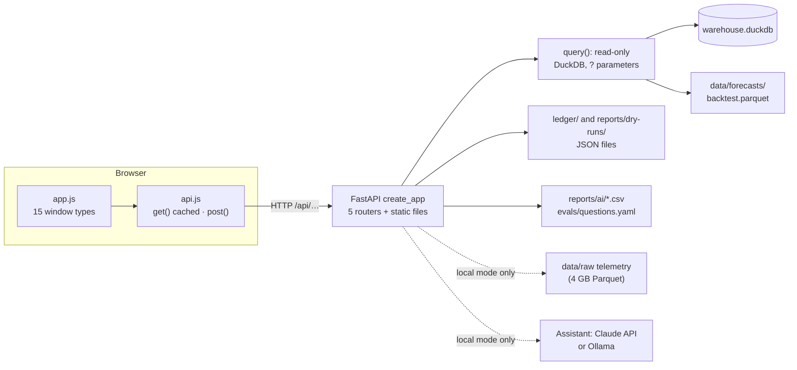

# 05 · Backend engineering

Workstreams: [01 Data engineering](01-data-engineering.md) · [02 Analytics and statistics](02-data-analytics-statistics.md) · [03 Forecasting and machine learning](03-forecasting-machine-learning.md) · [04 ML engineering](04-ml-engineering.md) · **05 Backend engineering** · [06 Applied AI](06-applied-ai.md)

This document describes how the warehouse, the saved forecasts, the public record and the AI assistant reach a browser: the FastAPI application, its routes, validation, database access, responses and errors, its configuration, the front end that calls it, the local and public modes, the Docker image, the release workflow and the deployment. Why the public copy is a versioned snapshot on a free host is in [decision 0018](../decisions/0018-public-copy.md) and [case 09 · Release, deployment and data access](../research/cases/09-release-deployment-data-access.md). The step-by-step release procedure is in [operations.md § 9](../engineering/operations.md#9-release-and-deployment).

## 1. Overview

| | |
|---|---|
| Purpose | Serve the analysis tables, forecasts, public record and assistant to a browser app, locally and online |
| Stack | FastAPI on Uvicorn; DuckDB opened read-only; Pydantic for settings and request bodies; plain HTML, CSS and JavaScript modules with no framework and no build step |
| API | 18 endpoints under `/api` (17 GET, 1 POST), JSON only; OpenAPI at `/api/openapi.json`, interactive docs at `/api/docs` |
| Writes | None. Every endpoint reads; the one POST asks the assistant a question and stores nothing |
| Front end | 15 window types linked by one shared context (weekend, session, two drivers), 4 layout presets, settings kept in the browser |
| Modes | `local` (the full system) and `public` (the online copy: no telemetry traces, no live AI). One code base; the mode comes from the settings file |
| Packaging | One Docker image (`python:3.12-slim`, non-root) holding the app and a data snapshot whose SHA-256 checksums are verified during the build |
| Release | Publishing a GitHub Release builds the image, smoke-tests it and pushes it to the GitHub container registry |
| Hosting | A free Render web service running the `:latest` image: <https://f1-pace-intelligence.onrender.com> |
| Tests | 17 API tests and 2 publishing tests; a release smoke test of 6 checks |
| Measured (9 November 2026) | On the full warehouse, most endpoints answered in 15–60 ms; the race debrief in about 0.8 s; a request with a wrong parameter was refused in 1–2 ms |

## 2. Problem and purpose

- **Many views of the same data.** Fifteen windows each need a small, specific answer (one session's pace table, one driver's laps, one weekend's forecast), not the warehouse.
- **A public site must be safe by construction.** No writes, no visitor-supplied SQL, no way for a visitor to spend money on AI calls, and no 4 GB of raw telemetry to host.
- **The online copy should be the tested app**, not a second product: what a visitor sees should be what runs locally, minus what cannot be offered online.
- **One maintainer, no budget.** Free hosting, no database server, no live feed to keep alive ([decision 0018](../decisions/0018-public-copy.md)).
- **The warehouse is rebuilt locally from time to time**, so the app must not hold it open.

**Purpose.** A small read-only HTTP layer with one question per address, a front end that needs no build step, and one image that carries a verified data snapshot and is released by publishing a GitHub Release.

## 3. What was implemented

| Component | Status | Where |
|---|---|---|
| Application factory `create_app(config)` | Implemented, tested | [`api/main.py`](../../src/dpec/api/main.py) |
| 18 endpoints in five routers: analytics, forecasts, record, debrief, chat | Implemented, tested (17 tests) | [`api/routes/`](../../src/dpec/api/routes/analytics.py) |
| Request validation: typed paths and queries, session names, question length | Implemented, tested | FastAPI and Pydantic, in the routes |
| Read-only DuckDB access, one short connection per query, bound parameters | Implemented | [`warehouse.query`](../../src/telemetry_core/warehouse.py) |
| Public mode: telemetry refused (404), live chat refused (403), recorded answers instead | Implemented, tested | routes; [`web/app/app.js`](../../web/app/app.js) |
| Data freshness in `/api/health` (snapshot date, commit, last race) | Implemented, tested | `analytics.snapshot_info` |
| Front end served by the same app | Implemented | [`web/app/`](../../web/app/index.html) |
| Docker image: checksum check, non-root user, health check | Implemented; release v1.2 built and deployed | [`Dockerfile`](../../Dockerfile), [`.dockerignore`](../../.dockerignore) |
| Release workflow: build, smoke test, push to `ghcr.io` | Implemented, validated: v1.0 and v1.1 were stopped, v1.2 passed ([E31](../research/experiment-register.md)) | [`release.yml`](../../.github/workflows/release.yml) |
| Hosting on Render's free plan | In use since 5 November 2026 ([E30](../research/experiment-register.md)) | [operations.md § 9](../engineering/operations.md#9-release-and-deployment) |
| Hugging Face Space files | Kept but not used: Docker Spaces now need a paid plan | [`deploy/huggingface/`](../../deploy/huggingface/Dockerfile) |
| Authentication, rate limiting, CORS headers | Not implemented: every public endpoint is read-only and the page calls its own origin (see § 12) | |
| Server-side cache, connection pool | Not implemented: each query opens the warehouse file; the browser caches answers | |
| Automatic redeploy when a new image is pushed | Not implemented: Render needs a manual deploy | |
| Static GitHub Pages copy | Future (planned in decision 0018) | |

## 4. Architecture and workflow

The system-wide picture, including the runtime modes, is in [architecture.md](../engineering/architecture.md#4-runtime-modes). The serving part:



**One request, step by step**

1. A window needs data for the current context. Its `key(c)` names an address; `get()` in [`api.js`](../../web/app/api.js) returns the cached answer if another window already asked for it, otherwise it sends one request.
2. FastAPI matches the route. The API routers are registered before the static files, so `/api/…` always reaches the API. Path and query values are checked against their types; a wrong one is answered with 422 before any SQL runs.
3. The handler runs one parameterised query through `query()`, which opens a read-only DuckDB connection, executes, returns a table and closes the connection.
4. `rows()` turns the table into JSON records: missing values become `null`, timestamps become ISO strings.
5. A known problem (no such weekend, no backtest yet, a local-only feature online) becomes an HTTP error with a plain-language `detail`.
6. The window draws the answer. On an error, the local app shows the full detail; the public copy shows one plain sentence and keeps the detail under "Details".

**From code to the online copy**

1. `make snapshot` packs the warehouse, the forecast files, the ledger and the dry runs into `dist/dpec-data-<date>.tar.gz` with a `SHA256SUMS` list and a manifest ([workstream 04 § 5.9](04-ml-engineering.md#59-artifact-policy)).
2. A GitHub Release is published with that file attached.
3. [`release.yml`](../../.github/workflows/release.yml) downloads and unpacks it, builds the image (the build fails on any checksum mismatch), starts the container, runs the smoke test, and pushes `ghcr.io/<owner>/<repo>:<tag>` and `:latest`.
4. On Render, a manual deploy pulls `:latest`. The footer of the site then shows the new snapshot date.

## 5. Important components and responsibilities

### 5.1 Application factory and server

- `create_app(config)` loads the settings into `app.state.settings`, includes the five routers under the `/api` prefix, then mounts `web/app/` at `/` with `html=True`, so `/` serves `index.html`. Docs are at `/api/docs` and the schema at `/api/openapi.json`; ReDoc is off.
- Tests call `create_app` with a settings file that points at a small warehouse built from fake raw files by the real SQL (§ 10).
- `dpec serve` runs Uvicorn on `127.0.0.1:8000` by default, with log level `warning`. The image runs it on `0.0.0.0:7860` with [`config/public.yaml`](../../config/public.yaml).

### 5.2 Endpoints

| Endpoint | Returns | Defaults and errors | Public mode |
|---|---|---|---|
| `GET /api/health` | `status`, `team`, `mode`, number of sessions, latest season, latest event and date, `snapshot` (`made`, `code_version`, `data_up_to`) | `snapshot` is `null` on the local app | Same; `snapshot` read from the image's `manifest.json` |
| `GET /api/settings` | Team name, adopted team and its lineage, fuel effect, mode | | Same |
| `GET /api/weekends[?season=]` | Every weekend, newest first, with pole, winner, wet flag | | Same |
| `GET /api/weekends/{season}/{round}` | The weekend's overview row and its sessions in time order, with lap and clean-lap counts | 404 if not in the warehouse | Same |
| `…/pace?session=` | Best and median clean lap per driver, gap, best compound | `session` Q; unknown session 422 | Same |
| `…/laps?driver=&session=` | Every lap of one driver, with lap reason and an `in_long_run` flag | `driver` required (422 without); `session` R | Same |
| `…/long-runs?session=` | Practice long runs, quickest first per compound | `session` FP2 | Same |
| `…/stints?session=` | Tyre stints, drivers in finishing order | `session` R | Same |
| `…/weather` | Weather and track evolution for each session | | Same |
| `…/quality` | Lap reasons per session and saved tables that are empty | | Same |
| `…/results?session=` | Official classification | `session` R | Same |
| `GET /api/standings/{season}/{round}` | Drivers' and teams' championship after the round | | Same |
| `…/compare?a=&b=&session=&lap_a=&lap_b=&step_m=` | Two laps on one distance grid: speed, throttle, brake, gear, gap, track position, corner table | `session` Q, `step_m` 10, each driver's fastest clean lap by default; 404 without a clean lap or without telemetry files | 404: "telemetry traces are only on the local app (the raw files are 4 GB)" |
| `…/forecast` | The shared model's forecast at both checkpoints: guess, range, chances, actual, grid and finish | 404 if no backtest is saved; 404 for 2022 or a wet race, with the reason | Same |
| `GET /api/record?source=` | Frozen weekends, newest first: `intact` (hashes re-checked), frozen time and minutes before the deadline, our cars, the call, verdict, error, skill | `source` `ledger` or `dry-runs` | Same; the window shows the dry runs while the ledger is empty |
| `…/debrief?a=&b=&session=` | A's lap against B's split by section of track, and A's race gap to B split into pace, tyres and traffic with 80% ranges | A part that cannot be computed comes back as a note, not an error | The lap part becomes a note; the race part works |
| `POST /api/chat` | Answer, every tool call, provider, model, seconds, tokens | Body `{"question": "…"}`, 3–500 characters (422 otherwise); provider problems 503 | 403 |
| `GET /api/chat/recorded` | The newest exam run of the assistant, joined with the question texts | Takes no inputs, so a visitor cannot point it at another folder | Same |

`…` stands for `/api/weekends/{season}/{round}`. Column meanings are in the [data dictionary](../data-dictionary.md); the forecast fields in [workstream 03 § 7](03-forecasting-machine-learning.md#7-inputs-and-outputs); the record fields in [workstream 04 § 5.6](04-ml-engineering.md#56-the-public-record-ledger); the assistant in [workstream 06](06-applied-ai.md).

### 5.3 Validation

- Path and query parameters are typed (`int`, `str`, `float`). `Session` is a `Literal` of FP1, FP2, FP3, SQ, S, Q and R, so `?session=XX` is answered with 422 before any SQL runs.
- The chat body is the Pydantic model `Question` with `min_length=3` and `max_length=500`.
- Write methods on read addresses are answered with 405 (`test_the_api_is_read_only`).
- Settings are validated when the app starts ([workstream 01 § 5](01-data-engineering.md#5-important-components-and-responsibilities)): a typo or an out-of-range value stops the app instead of starting it wrong.

### 5.4 Database access

- **One function.** `query(warehouse, sql, params)` opens `duckdb.connect(path, read_only=True)`, runs the SQL with `?` parameters, returns a pandas table and closes the connection. Values never become SQL text.
- **Small queries.** Each route runs one or two queries against the marts or core tables. The forecast route reads the Parquet file directly (`read_parquet(?)`) and joins it with `core_results` in the same query.
- **Files, not tables, for the record.** The record route reads the JSON files and re-checks each file's hash on every request.
- **No connection between requests**, so the local `dpec build` can take DuckDB's write lock while the app is running. Requests made during a build fail (§ 12).
- **The assistant's own SQL** goes through a separate guard ([workstream 06](06-applied-ai.md)).

### 5.5 Responses

- JSON lists of row objects, made by pandas `to_json(orient="records", date_format="iso")`. Field names are the warehouse's column names, so the SQL, the API and the windows share one vocabulary.
- Sizes measured on the full warehouse: all 109 weekends 24 KB; one session's pace table 4 KB; one driver's race laps 11 KB; one weekend's forecast 11 KB; the recorded exam 32 KB; the OpenAPI schema 16 KB.

Example, `GET /api/health` on the public app built from a fresh snapshot (9 November 2026):

```json
{"status": "ok", "team": "DPEC", "mode": "public", "sessions": 545, "latest": 2026,
 "latest_event": "Singapore Grand Prix", "latest_date": "2026-10-11",
 "snapshot": {"made": "2026-11-09", "code_version": "eb4d677", "data_up_to": "Singapore Grand Prix 2026"}}
```

### 5.6 Error handling

| Status | When | Detail returned |
|---|---|---|
| 404 | Weekend not in the warehouse | "no weekend 2024 round 30 in the warehouse" |
| 404 | No backtest saved | "no forecasts yet: run \`uv run dpec backtest\`" |
| 404 | Forecast asked for 2022 or a wet race | "no forecast for 2022 round 1: forecasts start in 2023 (2022 only teaches the model), and wet races are not forecast (decision 0011)" |
| 404 | Telemetry on the public copy | "telemetry traces are only on the local app (the raw files are 4 GB)" |
| 404 | Telemetry files missing, or a driver without a clean lap | "no telemetry: …", "VER has no clean lap in 2024_01_Q" |
| 403 | Live chat on the public copy | "the race engineer only runs on the local app" |
| 405 | A write method on a read address | "Method Not Allowed" |
| 422 | Wrong type, unknown session, missing driver, question too short or too long | FastAPI's list of what failed and where |
| 503 | The assistant's provider failed | for example "no Claude API key: run \`export ANTHROPIC_API_KEY=...\` first"; a Claude API error with its status; Ollama not running or its model not downloaded |
| 200 with a note | A debrief part that cannot be computed | `lap_note` or `race_note` explains why; the other part is still returned |

In the browser, [`api.js`](../../web/app/api.js) keeps the status, detail and address on every error. A failed answer is removed from the cache, so asking again sends a new request. A window that fails to draw shows a message instead of going blank.

### 5.7 Configuration

| Setting | Used for |
|---|---|
| `mode` | `public` switches off telemetry and live chat in the API, and switches the front end to the public presets and wording |
| `team_name`, `adopted_team` | Shown in the app; `adopted_team` decides which cars carry "★ OURS" |
| `long_run_band_pct` | The `in_long_run` flag in `…/laps` |
| `fuel_effect_s_per_lap` | Shown in the app's settings |
| `paths.warehouse`, `paths.data`, `paths.raw` | Where the warehouse, the forecast files and the telemetry are |
| `assistant.*` | Provider, model, effort and tool-call limit for `POST /api/chat` ([workstream 06](06-applied-ai.md)) |

- The local app reads [`config/dpec.yaml`](../../config/dpec.yaml); the image reads [`config/public.yaml`](../../config/public.yaml). The two may differ only in `mode` (`test_public_settings_only_change_the_mode`).
- `ANTHROPIC_API_KEY` is read from the environment only for local chat with Claude. It is never written to a file and never copied into the image.
- Host and port are options of `dpec serve`.

### 5.8 Front-end integration

- **Files.** [`index.html`](../../web/app/index.html), [`style.css`](../../web/app/style.css), [`app.js`](../../web/app/app.js) (614 lines) and [`api.js`](../../web/app/api.js) (46 lines): JavaScript modules, no framework, no bundler, no build step. Charts are inline SVG drawn by `app.js`; fonts come from Google Fonts.
- **One door to the server.** `api.js` is the only file that calls the API. `get()` keeps each answer in memory by address, so ten windows asking for the same table cost one request. `post()` is never cached.
- **Windows.** Fifteen types: session board, telemetry traces, track map, lap delta, corner table, laps and long runs, tyre strategy, weather and track, data quality, standings, results, race pace forecast, public record, debrief, race engineer. Each is defined by `key(c)` (which data it needs), `load(c)` (fetch it) and `render()` (draw it), and all share one context: weekend, session, two drivers and a cursor position on the lap.
- **Layouts.** Four presets: Pit wall (three monitors), Performance, Strategy and Laptop (one window at a time, as tabs). The public copy has its own versions, in which the four raw-data windows become one picture of telemetry.
- **Settings.** Theme (day, night, system), units (km/h or mph), density, a colour-blind palette and data-source labels. Layouts and settings are saved in the browser's `localStorage` under separate keys for the local app (`dpec-pitwall-app-v1`) and the public copy (`dpec-pitwall-public-v1`), inside `try/catch`, so a browser that blocks storage still shows the page.
- **Safety.** An `esc()` helper escapes text before it is placed in the page's HTML (35 uses), including the assistant's answers, which are escaped before the small amount of Markdown formatting (bold, tables) is applied.

### 5.9 Local and public mode

| | Local | Public |
|---|---|---|
| Settings file | `config/dpec.yaml` | `config/public.yaml` (only `mode` differs) |
| Telemetry traces, lap delta, track map, corner table, qualifying lap split | Yes | No: the API answers 404 with the reason; the window shows a picture |
| Live questions to the assistant | Yes (`POST /api/chat`) | No: 403; the window shows the newest recorded exam answers |
| Everything else | Yes | Yes, from the snapshot |
| Messages | Full error text and hints for the developer | One plain sentence; the status and address under "Details" |
| Freshness shown | Last local build | Snapshot date and last race in the footer |

The mechanism is one setting read in three routes (`compare`, `debrief`, `chat`) and by the front end, which asks `/api/settings` once at start-up. The user-facing version of this table is in [operations.md § 10](../engineering/operations.md#10-public-versus-local-functionality).

### 5.10 Docker image

| Step in the [`Dockerfile`](../../Dockerfile) | Why it matters |
|---|---|
| `FROM python:3.12-slim`; uv 0.12.24 copied from its official image | The Python version the project pins; the same uv version reads `uv.lock` the same way |
| `uv sync --frozen --no-dev --no-install-project`, then copy `src/` and sync again | Libraries in their own layer, reused until `pyproject.toml` or `uv.lock` change; `--frozen` installs exactly the lock file |
| Copy `config/`, `web/app/`, `evals/questions.yaml`, `reports/ai/` | The app, its settings and the recorded exam answers it shows online |
| Copy the unpacked snapshot, then `RUN sha256sum -c SHA256SUMS` | The build fails if any data file differs from the checksum list made by `dpec snapshot` |
| `useradd dpec`, `chmod -R a+rX /app`, `USER dpec` | The app runs as a normal user and only needs to read |
| `EXPOSE 7860`; `HEALTHCHECK` every 30 s calling `/api/health` | The port the hosts expect; the container reports itself unhealthy if the app stops answering |
| `CMD dpec serve --host 0.0.0.0 --port 7860 --config config/public.yaml` | The image can only start the public copy |

[`.dockerignore`](../../.dockerignore) is an allowlist: everything is excluded except `pyproject.toml`, `uv.lock`, `README.md`, `src/`, `config/`, `web/app/`, `snapshot/`, `evals/questions.yaml` and `reports/ai/`, so the 40 GB `data/` folder can never enter the build.

### 5.11 Release workflow and hosting

- **Trigger and rights.** A published GitHub Release; the workflow may read the repository and write packages.
- **Smoke test.** After the container answers `/api/health` (up to 30 tries, 2 s apart), six checks: `/api/health` reports `"mode":"public"`; it carries a snapshot date; the page has a `<title>`; `/api/weekends` returns weekends with a winner; `/api/chat/recorded` returns answers; `POST /api/chat` is refused with 403. Any failure stops the release before the push.
- **Registry.** `ghcr.io/<owner>/<repo>:<tag>` and `:latest`; the image is public.
- **History** ([E31](../research/experiment-register.md)): v1.0 stopped (no data file attached), v1.1 stopped (the file was corrupted by re-saving it), v1.2 passed and was deployed.
- **Hosting.** A free Render web service pulls `:latest` (port 7860, health check `/api/health`, 0.1 CPU and 512 MB of memory). It sleeps after 15 minutes without visitors; the next visit waits about a minute. Render does not redeploy when `:latest` changes, so each release needs a manual deploy ([decision 0018, update of 5 November 2026](../decisions/0018-public-copy.md#update-5-november-2026-render-instead-of-hugging-face)).

## 6. Codebase map with actual file references

| Path | Responsibility |
|---|---|
| [`src/dpec/api/main.py`](../../src/dpec/api/main.py) | `create_app`: settings, routers, static files, docs addresses |
| [`src/dpec/api/routes/analytics.py`](../../src/dpec/api/routes/analytics.py) | `rows`, `Session`, `LOCAL_ONLY`, `snapshot_info`; health, settings, weekends, pace, laps, long runs, stints, weather, quality, results, standings, compare |
| [`src/dpec/api/routes/forecasts.py`](../../src/dpec/api/routes/forecasts.py) | The saved walk-forward forecast for one weekend |
| [`src/dpec/api/routes/record.py`](../../src/dpec/api/routes/record.py) | `weekend_row`, `/record` for the ledger or the dry runs |
| [`src/dpec/api/routes/debrief.py`](../../src/dpec/api/routes/debrief.py) | Lap split and race attribution, with notes for missing parts |
| [`src/dpec/api/routes/chat.py`](../../src/dpec/api/routes/chat.py) | `Question`, `POST /chat`, `newest_run`, `/chat/recorded` |
| [`src/telemetry_core/warehouse.py`](../../src/telemetry_core/warehouse.py) | `query()`: the read-only connection |
| [`src/dpec/cli.py`](../../src/dpec/cli.py) | `serve`, `snapshot` |
| [`src/dpec/publish/snapshot.py`](../../src/dpec/publish/snapshot.py) | The data snapshot and its checksums |
| [`web/app/`](../../web/app/index.html) | `index.html`, `style.css`, `app.js`, `api.js` |
| [`web/prototype/`](../../web/prototype/index.html) | The first design prototype with made-up data, kept for reference |
| [`config/public.yaml`](../../config/public.yaml) | Settings of the online copy |
| [`Dockerfile`](../../Dockerfile), [`.dockerignore`](../../.dockerignore) | The public image |
| [`.github/workflows/release.yml`](../../.github/workflows/release.yml) | Build, smoke test, push |
| [`deploy/huggingface/`](../../deploy/huggingface/README.md) | Space files for a paid Hugging Face account (not in use) |
| [`Makefile`](../../Makefile) | `run`, `public`, `snapshot`, `image`, `image-run` |
| [`tests/dpec/test_api.py`](../../tests/dpec/test_api.py), [`tests/dpec/test_publish.py`](../../tests/dpec/test_publish.py) | API and publishing tests |

## 7. Inputs and outputs

| Input | Read by | Local | Public image |
|---|---|---|---|
| `data/warehouse.duckdb` | Almost every route | Built by `dpec build` | From the snapshot |
| `data/forecasts/backtest.parquet` | `…/forecast` | Made by `dpec backtest` | From the snapshot |
| `ledger/**/*.json`, `reports/dry-runs/**/*.json` | `/record` | As saved | From the snapshot |
| `reports/ai/eval-*.csv`, `evals/questions.yaml` | `/chat/recorded` | As saved | Copied into the image |
| `data/raw/…/car_data.parquet`, `pos_data.parquet` | `…/compare`, lap part of `…/debrief` | If downloaded | Not present |
| `manifest.json` | `/health` (`snapshot`) | Not present | From the snapshot |
| Settings file, `ANTHROPIC_API_KEY` | App start-up; local chat | `config/dpec.yaml` | `config/public.yaml`; no key |

**Outputs.** JSON responses only: the backend writes no files. The release workflow outputs the Docker image in the registry; Uvicorn logs at `warning` level.

## 8. How to run or use the functionality

Prerequisites for the local app: a built warehouse and a saved backtest (`make data`, `uv run dpec backtest`).

```bash
make run              # local app: http://127.0.0.1:8000 · API docs: http://127.0.0.1:8000/api/docs
make public           # the same app with config/public.yaml: what visitors see
```

Ask the API directly:

```bash
curl -s localhost:8000/api/health
curl -s "localhost:8000/api/weekends/2024/1/pace?session=Q"
curl -s "localhost:8000/api/weekends/2024/1/forecast"
curl -s "localhost:8000/api/record?source=dry-runs"
curl -s -X POST localhost:8000/api/chat -H 'Content-Type: application/json' \
     -d '{"question": "Who was fastest in Bahrain 2024 qualifying?"}'   # local, needs a provider
```

Build and run the public image on your own computer (needs Docker):

```bash
make image            # snapshot → unpack into snapshot/ → docker build -t dpec-public .
make image-run        # http://localhost:7860
```

To release and deploy, follow [operations.md § 9](../engineering/operations.md#9-release-and-deployment); to diagnose a failed release or an old online copy, [operations.md § 11](../engineering/operations.md#11-troubleshooting).

## 9. Important configurations and commands

| Item | Value | Where |
|---|---|---|
| Local address | `127.0.0.1:8000` | `dpec serve` defaults |
| Image address | `0.0.0.0:7860` | `Dockerfile` `CMD` |
| API prefix, docs, schema | `/api`, `/api/docs`, `/api/openapi.json` | `create_app` |
| Sessions accepted | FP1, FP2, FP3, SQ, S, Q, R | `analytics.Session` |
| Question length | 3–500 characters | `chat.Question` |
| Default grid step for `compare` | 10 m | `analytics.compare` |
| Local-only windows | telemetry, trackmap, delta, corners | `LOCAL_ONLY` in `app.js` |
| Browser storage keys | `dpec-pitwall-app-v1`, `dpec-pitwall-public-v1` | `app.js` |
| Image build settings | `UV_COMPILE_BYTECODE=1`, `UV_LINK_MODE=copy` | `Dockerfile` |
| Health check | every 30 s, 5 s timeout, `/api/health` | `Dockerfile` |

| Command | Does |
|---|---|
| `uv run dpec serve [--host] [--port] [--config]` | Start the app |
| `make run` · `make public` | Local app · public mode on your computer |
| `uv run dpec snapshot` · `make snapshot` | Pack the public data with checksums |
| `make image` · `make image-run` | Build and run the public image |

## 10. Tests and verification evidence

**API tests** ([`test_api.py`](../../tests/dpec/test_api.py), 17). A fixture saves a fake weekend (two drivers, a qualifying session and a race, with synthetic car and position data in which every lap lasts 100 s and has one corner), builds a warehouse from it with the real `sql/core` and `sql/marts` files, and serves it through `create_app` with FastAPI's test client.

| Test | Proves |
|---|---|
| `test_health_counts_sessions`, `test_health_says_how_fresh_the_data_is` | Health reports the warehouse's sessions, and the snapshot date when a manifest is present |
| `test_weekend_lists_its_sessions_in_time_order`, `test_pace_is_fastest_first`, `test_results_in_finishing_order` | Ordering of the main tables |
| `test_unknown_weekend_is_404_and_bad_session_is_422` | 404 and 422 behaviour |
| `test_the_api_is_read_only` | POST and DELETE on read addresses are refused with 405 |
| `test_compare_puts_both_laps_on_one_grid`, `test_compare_without_a_clean_lap_is_404` | Telemetry alignment through the API |
| `test_forecast_needs_a_backtest_first`, `test_forecast_shows_the_saved_guesses` | The forecast route's two cases |
| `test_record_lists_frozen_weekends` | The record route reads frozen files |
| `test_debrief_splits_the_lap_and_says_why_the_race_part_is_missing` | Partial results come back with a note |
| `test_chat_answers_with_the_tools_it_used` | The chat route returns the answer and its tool calls (with a scripted model, no network) |
| `test_chat_is_off_on_the_public_copy`, `test_public_copy_has_no_telemetry_but_keeps_the_rest` | Public-mode refusals, and that the rest still works |
| `test_recorded_answers_join_the_newest_run_with_its_questions` | The newest run is chosen and joined with the questions; the address takes no inputs and works in public mode |

**Publishing tests** ([`test_publish.py`](../../tests/dpec/test_publish.py), 2): the public settings differ from the local ones only in `mode`; the snapshot holds exactly the warehouse, the forecasts, the ledger, the dry runs, `SHA256SUMS` and `manifest.json`, and its checksums catch a changed file.

**Verification runs, 9 November 2026** (fresh clone of `eb4d677`, a copy of the project's saved warehouse, Python 3.13):

| Check | Result |
|---|---|
| `pytest -q` | 129 passed, including the 19 above |
| OpenAPI schema of the running app | 18 endpoints: 17 GET, 1 POST |
| Every GET endpoint for Bahrain 2024 on the local app | 200; most answered in 15–60 ms, the race debrief in 0.77–0.84 s |
| Error paths | Unknown weekend 404; `?session=XX` 422; `/api/weekends/x/1` 422; laps without a driver 422; POST and DELETE 405; a two-letter question 422; a 2022 forecast 404 with its reason; chat without an API key 503 with the fix in the message |
| Public mode | `compare` 404 with "only on the local app"; the debrief's lap part a note, its race part computed; `POST /api/chat` 403; `/api/chat/recorded` 200 (50 of 50 answers from 8 November) |
| `dpec snapshot` | 12.5 MB, 35 files (warehouse, 2 forecast files, 32 dry-run files); `sha256sum -c SHA256SUMS` passed for all 35 |
| Release smoke test, outside Docker | The snapshot unpacked next to the files the image copies, the public app started from there: all 6 smoke-test checks passed; 16 dry-run weekends, all `intact` |
| Database lock | While one process holds a DuckDB file open for writing, a read-only connection from another process fails with "Could not set lock on file"; it succeeds once the writer closes |

**Not verified here:** a Docker build (no Docker daemon in the verification environment; release v1.2's build and smoke test passed on GitHub, [E31](../research/experiment-register.md)); the live Render site (not reachable from the verification environment); a live chat answer (no API key used; the exam run of 8 November is the evidence, [workstream 06](06-applied-ai.md)).

## 11. Results and practical value

- **Eighteen small read-only endpoints serve fifteen linked windows**, mostly within 60 ms on the full 2022–2026 warehouse.
- **The online copy is the tested app.** One setting switches off the two features that cannot run online, and the tests check both modes.
- **A bad release cannot reach visitors.** The checksums and the smoke test stopped v1.0 and v1.1; v1.2 passed and is the version online.
- **Visitors cannot change anything or spend anything.** No write endpoints, no visitor SQL, no live AI calls online.
- **No running cost.** A free host runs a public image; data versions travel with GitHub Releases; the site never depends on F1's timing feed, which now needs a login.
- **Easy to inspect.** The OpenAPI docs at `/api/docs` list every address with its parameters, and every response uses the warehouse's documented column names.

## 12. Limitations and operational considerations

- **A fixed snapshot, not live data.** The online copy holds data up to the Singapore Grand Prix 2026 and changes only with a new release.
- **Free hosting trade-offs.** The service sleeps after 15 minutes without visitors and the next visit waits about a minute; it has 0.1 CPU and 512 MB of memory; a new release needs a manual deploy on Render.
- **Requests fail during a local build.** DuckDB allows one writing process or several reading processes, not both. While `dpec build` runs, most routes answer with a server error, and `compare` and `debrief` report it as missing telemetry. The public copy never builds, so this affects only the local app.
- **Local errors can include file paths.** For example, the local `compare` 404 passes DuckDB's message with the missing file's path. Online, `compare` is refused before that point.
- **No server-side cache or connection pool.** Every query opens the warehouse file. This is fine for a portfolio site, not for heavy traffic.
- **No authentication or rate limiting.** Acceptable because every public endpoint is read-only and the only costly one is switched off online; a busy public site would still need limits at the host.
- **No CORS headers.** The API is meant for the page it serves; another website cannot call it from a browser.
- **No automated front-end tests.** The release smoke test checks only that the page has a title; the windows are checked by hand.
- **The newest exam run is shown online.** `/chat/recorded` picks the run with the latest date (the longest on the same day). A short trial run on a later day than the last full run would replace the full run in the next release, so a full exam should be the last run before `make snapshot`.
- **External fonts.** Without internet, the page falls back to system fonts.
- **Leftover deployment files.** `deploy/huggingface/` stays in the repository although the Space is no longer used.

## 13. References to deeper engineering documents and experiments

- **Why:** [decision 0018 · Public copy](../decisions/0018-public-copy.md) · [case 09 · Release, deployment and data access](../research/cases/09-release-deployment-data-access.md) · [E30](../research/experiment-register.md) (free hosting), E31 (release workflow), E32 (data access)
- **Related decisions:** [0015 · Public record](../decisions/0015-public-record.md) · [0016 · Debrief](../decisions/0016-debrief.md) · [0017 · Race engineer](../decisions/0017-race-engineer.md)
- **Reference:** [architecture.md § 4 Runtime modes](../engineering/architecture.md#4-runtime-modes) · [codebase-map.md § API](../engineering/codebase-map.md#api-api) · [operations.md § 8–11](../engineering/operations.md#8-run-the-app) · [data dictionary](../data-dictionary.md)
- **What the endpoints serve:** [workstream 02](02-data-analytics-statistics.md) (tables) · [workstream 03](03-forecasting-machine-learning.md) (forecasts) · [workstream 04](04-ml-engineering.md) (record and snapshot) · [workstream 06](06-applied-ai.md) (assistant)
- **General:** [FastAPI](https://fastapi.tiangolo.com/) · [DuckDB concurrency](https://duckdb.org/docs/stable/connect/concurrency) · [Docker health checks](https://docs.docker.com/reference/dockerfile/#healthcheck) · [GitHub Container Registry](https://docs.github.com/en/packages/working-with-a-github-packages-registry/working-with-the-container-registry)
- Previous: [04 · ML engineering](04-ml-engineering.md) · Next: [06 · Applied AI](06-applied-ai.md)
