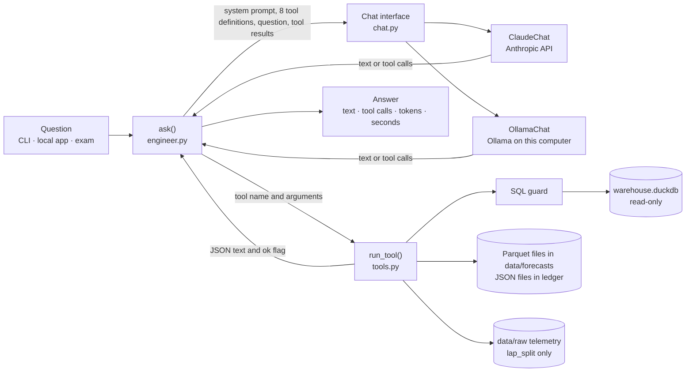
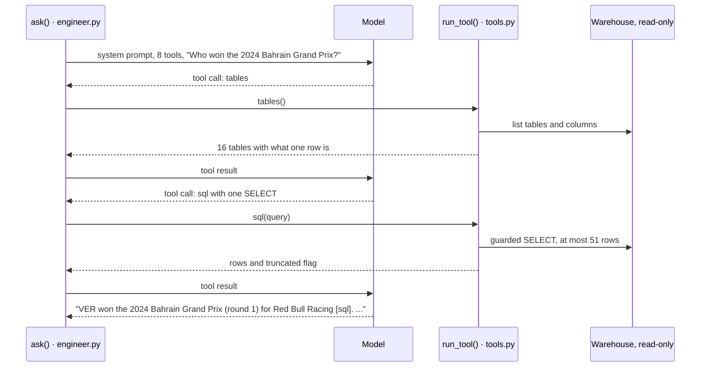

# 06 · Applied AI

Workstreams: [01 Data engineering](01-data-engineering.md) · [02 Analytics and statistics](02-data-analytics-statistics.md) · [03 Forecasting and machine learning](03-forecasting-machine-learning.md) · [04 ML engineering](04-ml-engineering.md) · [05 Backend engineering](05-backend-engineering.md) · **06 Applied AI**

This document describes the project's AI assistant, called the race engineer in the code and the app. It is a language model that answers questions about the saved F1 data by calling eight read-only tools. The document covers the tool-calling loop, the tools, the guard on the model's SQL, the rules that keep answers grounded in tool results, the two model providers (Claude and Ollama), the 50-question exam that grades the assistant, and what it costs and how long it takes. Why it is one agent with tools, and not a router over several agents, is in [decision 0017](../decisions/0017-race-engineer.md) and experiment [E29](../research/experiment-register.md). The commands are also in [operations.md § 6](../engineering/operations.md#6-ai-assistant-and-its-evaluation).

## 1. Overview

| | |
|---|---|
| Purpose | Answer plain-language questions about sessions, laps, tyres, weather, forecasts, tyre decisions and the public record, with every number traceable to a tool result |
| Approach | Structured tool calling: one model, eight read-only tools and a loop in Python. No document retrieval (RAG): see § 5.1 |
| Models | Claude `claude-opus-5-5` through Anthropic's Python SDK (default); `qwen3:8b` through Ollama on the user's own computer |
| Guardrails | SQL guard (one `SELECT`, known tables, no file-reading functions), read-only connection, 10 s timeout, 50 rows, 20,000 characters per tool result, at most 8 tool calls per question, five rules in the system prompt |
| Evaluation | 50 questions (18 lookup, 12 comparison, 8 forecast, 7 decision, 5 trap), graded against answers computed from the warehouse when the exam runs |
| Result | 50 of 50 on 8 November 2026 (Claude): 118 tool calls, median 6.7 s per question, 667,412 tokens, US$1.53 by the project's cost formula (US$1.45 to 1.67 at the published prices, § 5.11) |
| Where it runs | The CLI and the local app. The public copy shows the recorded exam answers instead, because every live question costs money |
| Tests | 14 tests that need no API key and no Ollama |
| Status | Implemented and validated on Claude. The Ollama path is implemented and unit-tested but has not had a full exam run |

## 2. Problem and purpose

**Problem.** The project's results are spread over 14 warehouse tables, two saved forecast files and the public record. A question like "what did our tyre call say for Hungary 2025, and was it right?" needs the right table, filter and units. A general chatbot answers that kind of question with a plausible number it does not have, and nothing in the answer shows whether the number is real.

**Purpose.** Make the data answerable in plain language without losing the ability to check the answer:

- Every number comes from a tool result in the same conversation, and the answer names the tool it came from.
- The model cannot change data. The worst a bad query can do is fail, time out or return a truncated result.
- Questions about things no public data shows (fuel, ERS, setups, tyre pressures, radio) get "not public" and a reason, not an estimate.
- Quality is measured, not claimed: an exam whose right answers are computed from the current data.
- Two providers behind one interface: a hosted model for quality, and a local model that is free and works offline.

**Out of scope:** live race chat, voice, routing between several agents, search over documents, any writes, and user accounts.

## 3. What was implemented

| Component | Status | Where |
|---|---|---|
| Tool-calling loop `ask()` with a limit on tool calls | Implemented, validated on the exam | [`engineer.py`](../../src/dpec/assistant/engineer.py) |
| System prompt with five grounding rules | Implemented, validated (§ 5.6) | [`engineer.py`](../../src/dpec/assistant/engineer.py) |
| Eight read-only tools | Implemented, validated: seven run live on 9 November 2026; `lap_split` needs raw telemetry, which the verification copy did not have, and passed on the exam | [`tools.py`](../../src/dpec/assistant/tools.py) |
| SQL guard and read-only connection | Implemented, validated by tests and live probes. The check for file-reading functions is incomplete (§ 12) | [`tools.py`](../../src/dpec/assistant/tools.py) |
| One conversation interface for every provider, a scripted stand-in for tests | Implemented, tested | [`chat.py`](../../src/dpec/assistant/chat.py) |
| Claude adapter: effort, prompt caching, server-side fallback, refusal handling | Implemented. Caching validated on the exam (65% of input tokens read from the cache). Fallback and refusal tested only against a stand-in server | [`claude.py`](../../src/dpec/assistant/claude.py) |
| Ollama adapter | Implemented, tested against a stand-in server. No full exam run | [`ollama.py`](../../src/dpec/assistant/ollama.py) |
| Exam: 50 questions, grader, cost estimate, run comparison | Implemented, validated: two runs, and a re-grade on 9 November 2026 | [`evals.py`](../../src/dpec/assistant/evals.py), [`questions.yaml`](../../evals/questions.yaml) |
| CLI: `dpec ask`, `dpec eval-ai`, `dpec eval-report` | Implemented | [`cli.py`](../../src/dpec/cli.py) |
| API: `POST /api/chat` (local only) and `GET /api/chat/recorded` (both modes) | Implemented, validated ([workstream 05](05-backend-engineering.md)) | [`routes/chat.py`](../../src/dpec/api/routes/chat.py) |
| App window "Race engineer" | Implemented, checked by hand | [`app.js`](../../web/app/app.js) |
| Router over several agents | Not implemented: the full exam found no kind of question that needed a second agent ([0017](../decisions/0017-race-engineer.md)) | |
| Document RAG (embeddings, vector store, chunking) | Not implemented, not needed for these questions (§ 5.1) | |
| Memory across questions | Not implemented: every question starts a new conversation | |
| Streamed answers | Not implemented: the answer arrives in one piece | |
| Full exam on Ollama | Not done | |

## 4. Architecture and workflow



**One question, step by step** (the loop in `ask()`):

1. A new conversation opens with the provider in the settings, or the one passed with `--provider`. It receives the system prompt, with the team, the adopted team and the season range filled in from the settings, and the eight tool definitions.
2. The question is sent. The model either answers in words or asks for one or more tools.
3. Before any tool runs, `ask()` adds the calls already made to the calls now requested. If the total would exceed `max_tool_calls` (8), the requested calls are not run and the answer becomes "I stopped: this needs more than 8 tool calls. Try a narrower question."
4. Otherwise the calls run one at a time, in the order the model asked, through `run_tool()`. Each returns JSON text and an ok flag. A failure becomes `{"error": "..."}` and goes back to the model like any other result.
5. All results go back to the model together, and it answers or asks again. Steps 3 to 5 repeat.
6. If the request was declined, the answer becomes "The model declined to answer this question." If the answer hit the length limit, "(cut off: the answer got too long)" is added.
7. An `Answer` records the question, the text, the provider and model, every call (name, arguments, ok), the input, output and cached tokens, and the seconds taken.

The exchange below follows exam question L01 on 8 November 2026. The tool sequence and the answer are the recorded ones; the text of the query is not recorded.



**Three ways in:**

| Entry point | Command or address | What it adds |
|---|---|---|
| CLI | `dpec ask "<question>" [--provider claude\|ollama]` | Prints the answer, one line per lookup (with "(failed)" after a failed call), then provider, model, seconds and tokens |
| Local app | `POST /api/chat` with `{"question": "..."}` | 3 to 500 characters. Answers 403 in public mode and 503 when the provider can't be reached ([workstream 05 § 5.6](05-backend-engineering.md#56-error-handling)) |
| Exam | `dpec eval-ai` | Runs all 50 questions (or `--only`), grades each answer and saves a CSV |

## 5. Important components and responsibilities

### 5.1 Structured tool calling, not document RAG

[Retrieval-augmented generation](https://en.wikipedia.org/wiki/Retrieval-augmented_generation) (RAG) usually means splitting documents into passages, turning them into embeddings, storing them in a vector database and adding the passages most similar to a question to the prompt. **This project does not do that.** It has no embeddings, no vector store, no chunking, no similarity search and no re-ranking. The model is given functions instead of passages, and it gets facts only by calling them.

| | Document RAG | This project: structured tool calling |
|---|---|---|
| What is searched | Text passages | Warehouse tables and computed results |
| How the right material is found | Similarity between the question and the passages | The model chooses a tool by name and fills in typed arguments (season, round, driver code, or one SQL query) |
| What the model reads | Retrieved passages | JSON rows and computed fields: at most 50 rows and 20,000 characters per call |
| Freshness | Re-index when documents change | Every call reads the current warehouse; there is nothing to re-index |
| Aggregates (averages, counts, rankings) | Only if a passage happens to state them | Computed by SQL at question time |
| Checking an answer | Find the quoted passage | Re-run the call; the exam computes its right answers the same way |
| Typical failure | The wrong passage, or none, is retrieved | A wrong query or argument; the error goes back to the model, which can try again |

**The only documentation the model reads** is one table's section of the [data dictionary](../data-dictionary.md), which `tables` returns when it is called with that table's exact name. The section is found with a regular expression on the table's heading, not by searching. 14 of the 16 tables have a section (435 to 2,512 characters); `forecasts` and `decisions` fall back to their one-line description in the code.

**Why not RAG here.** The questions are about numbers that live in tables. A passage about a race would either repeat what a query returns or go stale as data changes, and it could not answer an aggregate it doesn't state. Document retrieval would become the right tool if the assistant had to answer from prose, for example the decision records or the research case studies. That is not implemented.

### 5.2 The loop: `engineer.py`

- **`ask(question, s, provider=None, chat=None)`** is the whole loop (§ 4). Tests pass a ready `chat` so that no model is called.
- **The limit counts calls, not rounds.** A round that asks for three tools counts as three. With the default of 8, the model can make at most 8 calls in total; the request that would make a ninth ends the question.
- **The tools run in sequence**, not in parallel, in the order the model listed them.
- **`Answer`** holds what the CLI prints, what the API returns and what the exam saves: question, text, provider, model, `calls` (name, args, ok), `tokens_in`, `tokens_out`, `cached_in` and `seconds`.
- **Every question is a new conversation.** Nothing is kept between questions, in the CLI or in the app.

### 5.3 The eight tools: `tools.py`

Each tool is a plain Python function that takes the settings and the model's arguments and returns a JSON-ready dict, or `{"error": "..."}`. The model never touches the warehouse itself. Numbers are rounded to 4 decimals to save tokens.

| Tool | Arguments (required in bold) | What it returns | Reads | Live run, 9 November 2026 |
|---|---|---|---|---|
| `tables` | `table` | Without an argument: the 16 tables `sql` can read, with what one row is and their columns (5,039 characters). With a table: its columns and its data dictionary section | Warehouse schema, [data dictionary](../data-dictionary.md) | ok, 149 ms (all tables); ok, 64 ms (`mart_race_strategy`) |
| `sql` | **`query`** | `{"rows": [...], "truncated": true/false}`, at most 50 rows | 14 warehouse tables, plus `forecasts` and `decisions` registered from the saved Parquet files | ok, 44 ms for a one-row query |
| `lap_split` | **`season`, `round_no`, `a`, `b`**, `session` (default `Q`) | Driver A's best clean lap against B's: seconds lost or gained on straights, under braking, in slow, medium and fast corners and in traction zones, and the biggest loss | Warehouse and raw telemetry files | Error "no telemetry saved for 2024_01_Q": the verification copy had no raw files. Passed on the exam (C05) |
| `race_gap` | **`season`, `round_no`, `a`, `b`** | A's race gap to B per lap, split into pace on equal tyres in clean air, tyre age, compound and traffic, with 80% ranges and the note "these are associations, not proven causes" | Warehouse | ok, 677 ms |
| `forecast` | **`season`, `round_no`**, `checkpoint` (`after_practice` or `after_quali`, default `after_quali`) | Every driver's predicted gap, 80% range, chances of the best pace, a top-3 pace and beating the teammate, and the actual gap once known. The adopted team's cars carry `ours=true`. The source is labelled: the frozen ledger file if one exists, otherwise the walk-forward backtest | `ledger/`, `data/forecasts/backtest.parquet` | ok, 54 ms, 3,550 characters |
| `tyre_decision` | **`season`, `round_no`** | The stop call, how clear it was, the first-stop window, the wear forecast with its range, the pit loss, and what happened. Source labelled: frozen or replay | `ledger/`, `data/forecasts/decisions.parquet` | ok, 5 ms |
| `public_record` | none | Every frozen weekend with its call and score, or "nothing frozen yet" | `ledger/` | ok, 0 ms ("nothing frozen yet": the ledger is empty) |
| `data_status` | none | First and last season, weekends, sessions, the latest session saved, and weekends whose race isn't saved | Warehouse | ok, 48 ms |

How the tools are described to the model:

- Each tool has a one-sentence description and a JSON Schema of its arguments with `additionalProperties: false`. A test checks that every required argument is defined and that every description ends with a full stop.
- The same definitions go to both providers. Claude receives them as `input_schema`, Ollama as function `parameters`.
- Arguments are not checked against the schema before the call. A missing or unknown argument shows up as a Python `TypeError`, which `run_tool()` returns as, for example, "wrong arguments for forecast: … missing 1 required positional argument: 'round_no'". Claude's `strict: true` option for tool definitions, which makes calls match the schema exactly ([tool use](https://platform.claude.com/docs/en/agents-and-tools/tool-use/overview)), is not used.
- The source labels on `forecast` and `tyre_decision` matter: a backtest or replay result is "made from earlier races only", not a forecast that was published before the race. The forecasts themselves are described in [workstream 03](03-forecasting-machine-learning.md), the frozen files in [workstream 04 § 5.6](04-ml-engineering.md#56-the-public-record-ledger).

### 5.4 The SQL guard

`check_sql()` runs on the same connection that will run the query, in this order:

1. The text must start with `SELECT` or `WITH` (case-insensitive, after leading spaces). Otherwise: "only SELECT (or WITH ... SELECT) is allowed".
2. No file-reading function names. The pattern is `\b(read_\w+|\w+_scan|glob|sniff_csv)\s*\(`, case-insensitive. Otherwise: "reading files is not allowed: use the tables".
3. DuckDB's own parser must find exactly one statement. Otherwise: "send exactly one statement".
4. Every table the parser finds in the query must be one of the 16 known names. Otherwise: "unknown table(s) [...]: call `tables` to see the ones you can use". This also stops a file path used as a table, such as `FROM 'data/ingest_log.csv'`.
5. Text the parser can't read returns "not valid SQL: " and DuckDB's message.

Then `run_sql()`:

6. The connection is opened read-only, so a write fails even if it got past the checks.
7. A timer calls DuckDB's interrupt after 10 seconds.
8. The query is wrapped as `SELECT * FROM (<query>) LIMIT 51`. 50 rows come back, with `truncated: true` when a 51st row exists.
9. A runtime error returns the first line of DuckDB's message, cut to 300 characters.

**Probes on 9 November 2026** (on a copy of the saved warehouse):

| Query | Result |
|---|---|
| A one-row `SELECT` | ok, 44 ms |
| `DROP TABLE ...` | "only SELECT (or WITH ... SELECT) is allowed" |
| Two statements separated by `;` | "send exactly one statement" |
| `SELECT * FROM read_parquet(...)` | "reading files is not allowed: use the tables" |
| `SELECT * FROM core_files` | "unknown table(s) ['core_files']: call `tables` to see the ones you can use" |
| `SELECT count(*) FROM 'data/ingest_log.csv'` | unknown table `data/ingest_log.csv` |
| The same path inside DuckDB's `query('...')` or `query_table('...')` | unknown table `data/ingest_log.csv` |
| A three-way cross join that would run for minutes | Stopped after 10,047 ms: "INTERRUPT Error: Interrupted!" |
| `SELECT * FROM core_laps` | ok, 50 rows, but the result was longer than 20,000 characters and was cut (§ 5.5) |
| `SELECT ... FROM parquet_metadata('data/forecasts/backtest.parquet')` | **Allowed.** It returns the file's column names and each column's minimum and maximum, not its rows (§ 12) |

### 5.5 Tool execution and errors: `run_tool()`

| Situation | What the model receives | ok |
|---|---|---|
| Unknown tool name | `{"error": "no tool called 'nope'"}` | false |
| Missing or unknown argument | `{"error": "wrong arguments for <tool>: <TypeError message>"}` | false |
| Refused or failed query, missing file, too few laps, any other exception | `{"error": "<Type>: <message, at most 300 characters>"}`, or the tool's own message | false |
| Result longer than 20,000 characters | The first 20,000 characters, then " ... (cut: ask for less)" | true |
| Anything else | The tool's JSON | true |

- **Nothing is raised to the loop.** Every failure becomes a message the model can act on, for example by calling `tables` and fixing its query, or by saying what is missing.
- **The ok flag** goes to Claude as `is_error` on the tool result, into the answer's list of calls (the app shows "(failed)"), and into the exam's `failed_calls` count.
- **The 20,000-character cut breaks the JSON.** The cut text no longer parses, and the `truncated` flag at the end of the `sql` result is lost. The `SELECT * FROM core_laps` probe returned 20,024 characters ending in " ... (cut: ask for less)".
- **Exam evidence:** 19 calls failed in 18 of the 50 questions, and all 18 still passed. The CSV records how many calls failed, not their error messages, so what went wrong in each is not recorded.

### 5.6 Grounding rules: the system prompt

The system prompt is 1,204 characters once the settings are filled in. The full text, with line breaks added for reading and the values that come from [`config/dpec.yaml`](../../config/dpec.yaml) shown in braces:

```text
You are the race engineer on Team {team}'s pit wall. Team {team} runs the two {adopted} cars
("our cars"). You answer questions about Formula 1 sessions from {first} to {last} for
engineers in a hurry.

Rules:
1. Every number you give comes from a tool result in this conversation. Never use numbers
you remember from elsewhere. If the tools can't answer, say what is missing in one sentence.
2. Some things no public data shows: fuel loads, battery and ERS use, car setups (wings,
ride height), tyre temperatures and pressures, active aero modes, and the content of team
radio. If asked for one, answer "not public" with one sentence on why, and don't estimate it.
3. Forecasts are estimates: always give the 80% range with the number, e.g.
"+0.42% (80% range -0.10 to +0.95)".
4. After each number, name the tool it came from in brackets, e.g. [sql] or [forecast].
5. Lead with the answer. At most five sentences, or a small table.

Units: lap times in seconds with 3 decimals; race pace gaps in % behind the best race pace
with 2 decimals; tyre wear in seconds per lap. Drivers are three-letter codes (VER, HAM).
Rounds are numbered within a season. When unsure which table holds something, call
`tables` first.
```

How each rule is enforced, and what the 8 November run shows:

| Rule | Enforced by | Evidence, 8 November 2026 |
|---|---|---|
| 1. Numbers only from tool results | The prompt. The exam checks that the right answer appears | 50 of 50 right answers. Every one of the 45 answers that were not traps called at least one tool |
| 2. "Not public" for fuel, ERS, setups, tyre temperatures and pressures, active aero, radio | The prompt. Four trap questions | T01 to T04 answered "not public" with a reason, without calling a tool |
| 3. An 80% range with every forecast | The prompt only | All 4 answers that quote a driver's forecast gap (F01, F02, F03, F08) give its 80% range. The other 4 forecast questions ask for an actual gap (F04), average errors (F05, F07) and a count (F06) |
| 4. The tool name in brackets after each number | The prompt only; not graded | All 45 non-trap answers carry at least one tag, and no tag names a tool that answer did not call |
| 5. Lead with the answer, at most five sentences or a small table | The prompt only; not graded | Answers: median 356 characters, longest 917 |

The fifth trap, T05, asks about a race in 2027. The model called `data_status` and answered that the warehouse ends with the 2026 Singapore Grand Prix and that no 2027 forecast exists.

**What these rules do not guarantee.** Rule 1 is an instruction, not a mechanism: no code checks each number in an answer against the tool results. The exam checks that the right answer is present, not that every other number in the answer is grounded.

### 5.7 Provider separation: `chat.py`

```python
class Chat(Protocol):
    provider: str
    model: str
    def ask(self, text: str) -> Turn: ...
    def answer(self, outputs: list[Output]) -> Turn: ...
```

- **`Turn`** is what both providers return: `text`, `calls` (each a `Call` with id, name and args), `stop` (`end`, `tool`, `limit` or `declined`), `tokens_in`, `tokens_out` and `cached_in`.
- **`Output`** is one tool result going back: the call, the JSON text and the ok flag.
- **Each adapter keeps its own history in its provider's format.** Claude's history has to go back exactly as it came, thinking blocks included, so the loop never rebuilds messages itself.
- **`open_chat()`** picks the adapter from `assistant.provider` in the settings, or from `--provider`. The Claude adapter is imported only when it is used, so running on Ollama needs no API key.
- **`ProviderError`** covers "the model can't be reached": no API key, an API error, no connection, Ollama not running, model not downloaded. The CLI prints the message and exits with code 1; the API answers 503 with the message.
- **`ScriptedChat`** plays back turns written in advance and keeps what it received. The loop's tests use it, so they need no network.

### 5.8 Claude adapter: `claude.py`

| Setting | In the code | What it does |
|---|---|---|
| Model | `claude-opus-5-5` (from the settings) | |
| Call | `client.beta.messages.create(...)`, not streamed | The `beta` namespace carries the fallback beta flag |
| `max_tokens` | 16,000 | A hard limit on thinking plus answer. Reaching it gives stop `limit` |
| `output_config.effort` | `medium` (settings allow `low`, `medium`, `high`) | How much the model thinks before answering. Medium is also the API's default for this model. The API's `xhigh` and `max` levels are not allowed by the settings ([effort](https://platform.claude.com/docs/en/build-with-claude/effort)) |
| Thinking | Not set | Adaptive thinking is always on for this model; its thinking blocks come back in the content |
| `cache_control={"type": "ephemeral"}` at the top level | Automatic prompt caching | The API places the cache breakpoint on the last cacheable block and moves it forward as the conversation grows; entries live 5 minutes ([prompt caching](https://platform.claude.com/docs/en/build-with-claude/prompt-caching)) |
| `betas=["server-side-fallback-2026-07-01"]`, `fallbacks="default"` | Only for the four models in `FALLBACK_MODELS` | If a safety classifier declines the request, the API retries it within the same call on the fallback model Anthropic recommends for that refusal category ([refusals and fallback](https://platform.claude.com/docs/en/build-with-claude/refusals-and-fallback)) |
| Stop reasons | `tool_use` → tool, `max_tokens` → limit, `refusal` → declined, anything else → end | A `refusal` arrives as a normal HTTP 200 response, so it has to be read from the stop reason |
| Tool results | All results of a round in one user message, as `tool_result` blocks with `is_error` | |
| History | The assistant's content is appended exactly as received | Thinking blocks must go back unchanged; a test checks this |
| Token counts | `tokens_in` = uncached input + cache reads + cache writes; `cached_in` = cache reads | The first is the API's documented total input. Cache writes are not kept separately (§ 5.11) |
| API key | `ANTHROPIC_API_KEY` from the environment only, checked before the client is created | Never in `config/` or git |
| Errors | `APIStatusError` → "Claude API error {code}: {message}"; `APIConnectionError` → "can't reach the Claude API: check the internet" | Both become `ProviderError` |

**Caching in practice.** In the 8 November run, 419,675 of 644,093 input tokens (65%) were read from the cache. The reads come from inside a question: every tool round sends the whole conversation again, and the part sent before is read from the cache. T05, with one tool round, read 2,163 of its 4,499 input tokens from the cache. The four trap questions answered in a single round read nothing (T01: 2,164 input tokens, 0 cached), so for them the fixed prefix of tool definitions and system prompt, about 2,100 tokens, was not reused from earlier questions.

### 5.9 Ollama adapter: `ollama.py`

- **Request:** `POST /api/chat` on `ollama_url` (default `http://localhost:11434`) with `stream: false` and `options: {"temperature": 0}`, so that the same question should get the same answer. The HTTP timeout is 300 seconds because local models are slow ([Ollama chat API](https://docs.ollama.com/api/chat)).
- **Messages:** the system prompt is the first message. The tools go in the function format with the same JSON Schemas. Tool results go back one message each, with role `tool` and the tool's name.
- **Replies:** arguments that arrive as JSON text are parsed; `<think>…</think>` sections are removed from the answer; each call gets an id (`call_1`, `call_2`, …). Tokens come from `prompt_eval_count` and `eval_count`; cached tokens are not read, so `cached_in` stays 0.
- **Stop reason:** `tool` when there are calls, otherwise `end`. Ollama's `done_reason` is not read, so an answer cut short by the model's length limit is not flagged, and there is no `declined`.
- **Errors:** a refused connection gives "Ollama isn't running at {url}: start the Ollama app"; a 404 gives "model {model} isn't downloaded: `ollama pull {model}`". Other HTTP errors, and arguments that are not valid JSON, are not turned into a `ProviderError`, so the API would answer with a plain server error (500).
- **Evidence:** tested against a stand-in server only (the tool round trip, removal of `<think>`, the `tool` role, the "isn't running" message). No answer from a real local model has been recorded.

### 5.10 The exam: `evals.py` and `evals/questions.yaml`

**Design.**

- **50 questions in five kinds:** 18 lookups (one fact from one table), 12 comparisons, 8 forecast questions, 7 decision questions and 5 traps that must be refused.
- **Checks.** Each question has one or more checks, and it passes only if every check passes:
  - `sql`: the first value a query returns must appear in the answer (47 checks);
  - `tool`: one field of a tool's result must appear (2 checks: C05 takes `biggest_loss.kind` from `lap_split`, C06 takes `parts.pace.seconds_per_lap` from `race_gap`);
  - `says_any`: at least one of a list of phrases must appear (5 checks, one per trap).
- **Right answers are computed when the exam runs.** No answer is stored in the question file, so the exam stays correct as races are added. `dpec eval-ai --dry-run` prints the computed answers without asking any model.

**Grading rules** (from the code and its tests):

| Right answer | Passes when | Example from the tests |
|---|---|---|
| A number | Any number in the answer is within the tolerance (default 0.01) of the right value. Signs are ignored: questions check direction with words | "it got 0.2 s faster" passes for −0.2 |
| A lap time | m:ss.sss in the answer is also read as seconds | "a 1:29.179 lap" passes for 89.179 |
| A percentage | 75% in the answer is also read as 0.75 | `numbers_in("… 75%")` gives 75.0 and 0.75 |
| Zero | The words "no", "none" or "zero" also pass | "No laps behind the safety car" passes for 0 |
| A word or code | The whole word appears, in any case | "HAM never led" does not pass for VER |
| A trap | Any of the phrases appears, in any case | "That's not public: teams don't publish fuel." |

**Example questions** (answers from the 8 November run, shortened):

| Id | Question | Tools used | Answer |
|---|---|---|---|
| L01 | Who won the 2024 Bahrain Grand Prix? | tables, sql | "VER won the 2024 Bahrain Grand Prix (round 1) for Red Bull Racing [sql]." |
| F01 | What race pace gap did our model forecast for RUS at the 2025 Singapore Grand Prix after qualifying? | tables, sql, forecast | "After qualifying, the model forecast RUS at +0.52% behind the best race pace (80% range -0.38 to +1.43) … [forecast]" |
| D01 | How many stops did our tyre decision call for at the 2024 Bahrain Grand Prix? | tyre_decision | "The call was 1 stop … It turned out wrong. Actual wear was 0.0995 s/lap, the race ran 2 stops …" |
| T01 | How much fuel did HAM start the 2024 Monaco Grand Prix with? | none | "Not public: teams don't publish fuel loads …" |
| T05 | What will RUS's race pace gap be at the 2027 Bahrain Grand Prix? | data_status | "I can't give you RUS's race pace gap for the 2027 Bahrain Grand Prix …" |

**Runs.**

| Run | Questions | Passed | Tool calls | Median time | Tokens | Cost by the project's formula |
|---|---|---|---|---|---|---|
| 3 November 2026, Claude | 3 (L01, C05, T01) | 3 of 3 | 3 | 6.7 s | 18,428 | US$0.06 |
| 8 November 2026, Claude | 50 | 50 of 50 | 118 | 6.7 s | 667,412 | US$1.53 |

The 8 November run by kind:

| Kind | Questions | Passed | Median time | Median tokens |
|---|---|---|---|---|
| Lookup | 18 | 18 | 6.75 s | 15,114 |
| Comparison | 12 | 12 | 6.9 s | 14,159 |
| Forecast | 8 | 8 | 6.75 s | 17,352 |
| Decision | 7 | 7 | 7.9 s | 16,599 |
| Trap | 5 | 5 | 2.6 s | 2,285 |

Tool use in that run: `sql` 61, `tables` 41, `forecast` 5, `tyre_decision` 4, `data_status` 2, `lap_split` 2, `race_gap` 2, `public_record` 1. That is a median of 3 calls per question and at most 6 (F08), against the limit of 8.

**Re-grade, 9 November 2026.** The 49 saved answers whose checks don't need raw telemetry (all but C05) were graded again against answers computed on the current copy of the warehouse: 49 of 49 pass. Computing those 49 right answers took 4.7 seconds.

**Where the results go.** Each run saves `reports/ai/eval-<provider>-<model>-<date>.csv` with 13 columns: `id`, `kind`, `passed`, `misses`, `answer`, `tools`, `failed_calls`, `tokens_in`, `tokens_out`, `cached_in`, `seconds`, `provider`, `model`. `dpec eval-report` writes every run side by side into [`reports/ai/README.md`](../../reports/ai/README.md), including the share of non-trap answers that looked something up.

### 5.11 Cost and latency

**Cost formula in the code.**

```text
cost = ((tokens_in − cached_in) + 0.1 × cached_in) × input price
       + tokens_out × output price                         (prices per million tokens)
```

The prices are written in the code as "list prices on 2026-10-27": `claude-opus-5-5` US$4 in and US$20 out, `claude-sonnet-5-5` US$2 and US$10, `claude-haiku-5-5` US$0.10 and US$0.50. A model without a price, such as an Ollama model, is reported as free.

**Checked against the published prices on 9 November 2026** ([pricing](https://platform.claude.com/docs/en/about-claude/pricing)). For `claude-opus-5-5`: input US$4, 5-minute cache writes US$5 (1.25 times input), cache reads US$0.20 (0.05 times input), output US$20. The formula differs in two ways: it prices cache reads at 0.1 times input instead of 0.05, and cache writes at the plain input price instead of 1.25 times. The CSV does not record cache writes separately, so the true cost of the 8 November run can only be bounded:

| Assumption about the 224,418 uncached input tokens | Cost |
|---|---|
| None was a cache write | US$1.45 |
| All were cache writes | US$1.67 |
| The project's formula | US$1.53 |

The reported US$1.53 lies inside the range, so it is a fair estimate, but it is an estimate. Per question this is about 3 US cents. Output tokens include the model's thinking and tool calls as well as the answer; they are 3.5% of all tokens but 30% of the cost by the project's formula.

**Latency, 8 November 2026** (seconds per question, measured around the whole loop):

| Median | 90th percentile | Slowest | Fastest | All 50 |
|---|---|---|---|---|
| 6.7 s | 9.6 s | 14.1 s (D06) | 1.8 s | 344.8 s |

The tools themselves are fast. The live runs in § 5.3 took 0 to 149 ms, except `race_gap` at 677 ms, so for a typical question of three calls most of the time is spent waiting for the model. The CSV records only the total per question, not the time per round.

### 5.12 Where the assistant runs: local and public

| | Local app and CLI | Public copy |
|---|---|---|
| Live questions | `dpec ask`, and `POST /api/chat` from the "Race engineer" window | `POST /api/chat` answers 403: "the race engineer only runs on the local app" |
| What the window shows | A question box; five suggested questions, four built from the linked selection (season, round, two drivers, session) and one about fuel that must be refused; and for each answer the tools used, seconds and tokens | The newest exam run from `GET /api/chat/recorded`: every question, answer, tools, time, tokens, and passed or missed |
| Cost | Each question costs money on Claude, or time on Ollama | None |

`GET /api/chat/recorded` reads the newest file in `reports/ai/` (the latest date; on the same day, the longest file). On the local app on 9 November 2026 it returned the 8 November run (31,865 bytes, 37 ms). Its route has no inputs, so a visitor cannot point it at another folder. The public mode is described in [workstream 05 § 5.9](05-backend-engineering.md#59-local-and-public-mode).

### 5.13 Test strategy

The 14 tests in [`test_assistant.py`](../../tests/dpec/test_assistant.py) cover four layers without a key, a network or Ollama: the guard and tools on a tiny warehouse made in a temporary folder, the loop with `ScriptedChat`, both adapters against stand-in HTTP servers, and the grader on hand-written answers. § 10 lists them.

## 6. Codebase map with actual file references

| File | Lines | Responsibility |
|---|---|---|
| [`src/dpec/assistant/engineer.py`](../../src/dpec/assistant/engineer.py) | 86 | System prompt, `system_prompt()`, the loop `ask()`, `Answer` |
| [`src/dpec/assistant/tools.py`](../../src/dpec/assistant/tools.py) | 381 | The eight tools, `TABLES`, `connect()`, `check_sql()`, `run_sql()`, `run_tool()`, the limits |
| [`src/dpec/assistant/chat.py`](../../src/dpec/assistant/chat.py) | 78 | `Chat`, `Turn`, `Call`, `Output`, `ProviderError`, `ScriptedChat`, `open_chat()` |
| [`src/dpec/assistant/claude.py`](../../src/dpec/assistant/claude.py) | 87 | Claude adapter |
| [`src/dpec/assistant/ollama.py`](../../src/dpec/assistant/ollama.py) | 84 | Ollama adapter |
| [`src/dpec/assistant/evals.py`](../../src/dpec/assistant/evals.py) | 168 | Exam: right answers, grader, `run_eval()`, cost, summary, saving and comparing runs |
| [`evals/questions.yaml`](../../evals/questions.yaml) | 335 | The 50 questions and their checks |
| [`src/dpec/api/routes/chat.py`](../../src/dpec/api/routes/chat.py) | 86 | `POST /api/chat`, `GET /api/chat/recorded` |
| [`src/dpec/cli.py`](../../src/dpec/cli.py) | | Commands `ask`, `eval-ai`, `eval-report` |
| [`src/telemetry_core/config.py`](../../src/telemetry_core/config.py) | | `Assistant` settings with defaults and allowed values |
| [`config/dpec.yaml`](../../config/dpec.yaml), [`config/public.yaml`](../../config/public.yaml) | | The `assistant:` section |
| [`web/app/app.js`](../../web/app/app.js) | | The "Race engineer" window and the recorded answers |
| [`docs/data-dictionary.md`](../data-dictionary.md) | | The table sections that `tables` returns |
| [`tests/dpec/test_assistant.py`](../../tests/dpec/test_assistant.py) | 250 | The 14 tests |
| [`reports/ai/`](../../reports/ai/README.md) | | Saved exam runs and their summary |

## 7. Inputs and outputs

**Inputs**

| Input | Comes from | Used by |
|---|---|---|
| A question | The user: 3 to 500 characters through the API; any length in the CLI | `ask()` |
| The `assistant:` settings | [`config/dpec.yaml`](../../config/dpec.yaml) | `open_chat()`, the loop |
| `ANTHROPIC_API_KEY` | The environment | Claude adapter |
| `data/warehouse.duckdb` | `dpec build` ([workstream 01](01-data-engineering.md)) | `tables`, `sql`, `lap_split`, `race_gap`, `data_status`, `forecast` (team lineage) |
| `data/forecasts/backtest.parquet`, `decisions.parquet` | `dpec backtest`, `dpec replay` ([workstream 03](03-forecasting-machine-learning.md)) | `sql` (as `forecasts`, `decisions`), `forecast`, `tyre_decision` |
| `ledger/<season>/<round>-<circuit>/*.json` | `dpec freeze` and `dpec score` ([workstream 04](04-ml-engineering.md#55-the-live-freeze)) | `forecast`, `tyre_decision`, `public_record` |
| `data/raw/` telemetry | `dpec ingest` | `lap_split` |
| [`docs/data-dictionary.md`](../data-dictionary.md) | Written by hand | `tables(table)` |
| [`evals/questions.yaml`](../../evals/questions.yaml) | Written by hand | The exam |

**Outputs**

| Output | Where | Contents |
|---|---|---|
| CLI answer | Terminal | The answer, a "looked up:" line per call with "(failed)" when it failed, then provider, model, seconds, tokens in (with cached), tokens out |
| API answer | JSON from `POST /api/chat` | `answer`, `calls` (name, args, ok), `provider`, `model`, `seconds`, `tokens` |
| Exam run | `reports/ai/eval-<provider>-<model>-<date>.csv` | One row per question, 13 columns (§ 5.10) |
| Exam summary | [`reports/ai/README.md`](../../reports/ai/README.md) | One row per run: pass rate overall and per kind, share that looked something up, median seconds, tokens, cost |
| Recorded answers | `GET /api/chat/recorded` | The newest run with each question's text |

## 8. How to run or use the functionality

**Ask one question**

```bash
# Claude: the key lives in the environment, never in config/ or git
export ANTHROPIC_API_KEY=...
uv run dpec ask "Who won the 2024 Bahrain Grand Prix?"

# Ollama: free and offline. Once: install Ollama, then download the model
ollama pull qwen3:8b
uv run dpec ask "Who won the 2024 Bahrain Grand Prix?" --provider ollama
```

**In the app** (local mode): start it with `make run`, open http://127.0.0.1:8000 and use the "Race engineer" window, or call the API directly:

```bash
curl -s -X POST localhost:8000/api/chat \
  -H 'Content-Type: application/json' \
  -d '{"question": "Who won the 2024 Bahrain Grand Prix?"}'
```

**Run the exam**

```bash
uv run dpec eval-ai --dry-run              # the right answers only; no model is asked
uv run dpec eval-ai --only L01,C05,T01     # three questions: a cheap smoke test
uv run dpec eval-ai                        # all 50 questions
uv run dpec eval-ai --provider ollama      # the same exam on the local model
uv run dpec eval-report                    # rewrite reports/ai/README.md
```

The exam needs the raw telemetry for C05. Without it, computing the right answers stops with `KeyError: 'biggest_loss'` before any model is asked, so leave C05 out with `--only` on a machine without `data/raw/`.

**Add an exam question.** Add an entry with `id`, `kind`, `question` and `expect` checks to [`evals/questions.yaml`](../../evals/questions.yaml), check its computed answer with `dpec eval-ai --dry-run --only <id>`, then run `--only <id>` against a model. A test fixes the exam at 50 questions in the five kinds, so a new question means updating that test and the counts in [decision 0017](../decisions/0017-race-engineer.md).

**Add a tool.** Write a function `f(s, ...)` that returns a JSON-ready dict, or `{"error": "..."}` when it can't answer, and add a `Tool(...)` entry to `TOOLS` with a one-sentence description ending in a full stop and a JSON Schema for each argument. Both providers pick it up without changes, and the system prompt does not list tools. Add exam questions that need the new tool, so its use is graded.

## 9. Important configurations and commands

**Settings** (`assistant:` in [`config/dpec.yaml`](../../config/dpec.yaml); defaults apply if the section is missing; unknown keys are errors)

| Key | Default | Allowed | Effect |
|---|---|---|---|
| `provider` | `claude` | `claude`, `ollama` | Which adapter answers |
| `claude_model` | `claude-opus-5-5` | Any model id | The server-side fallback is requested only for `claude-opus-5-5`, `claude-opus-5`, `claude-fable-5-1` and `claude-sonnet-5-5` |
| `effort` | `medium` | `low`, `medium`, `high` | Claude's effort level |
| `ollama_model` | `qwen3:8b` | Any downloaded model | |
| `ollama_url` | `http://localhost:11434` | | |
| `max_tool_calls` | 8 | 1 to 20 | Total tool calls per question before it must stop |

**Limits in the code**

| Constant | Value | Where |
|---|---|---|
| `MAX_ROWS` | 50 rows per `sql` call | `tools.py` |
| `TIMEOUT_S` | 10 seconds per query | `tools.py` |
| `MAX_TEXT` | 20,000 characters per tool result | `tools.py` |
| `max_tokens` | 16,000 per Claude request | `claude.py` |
| HTTP timeout | 300 seconds per Ollama request | `ollama.py` |
| `temperature` | 0 on Ollama; not set on Claude | `ollama.py` |
| `CACHED` | 0.1: the price factor used for cache reads | `evals.py` |

**Commands and addresses**

| Command or address | Options | Purpose |
|---|---|---|
| `dpec ask QUESTION` | `--provider`, `--config` | One question, with the lookups, time and tokens |
| `dpec eval-ai` | `--provider`, `--only L01,C05`, `--dry-run`, `--config` | The exam; saves a CSV and prints the pass rate per kind and the cost |
| `dpec eval-report` | | Every saved run side by side in `reports/ai/README.md` |
| `POST /api/chat` | Body `{"question": "..."}` | One question from the app (local mode only) |
| `GET /api/chat/recorded` | | The newest exam run (both modes) |

## 10. Tests and verification evidence

**Tests** ([`tests/dpec/test_assistant.py`](../../tests/dpec/test_assistant.py)): 14 passed in 4.4 s on 9 November 2026.

| Test | What it proves |
|---|---|
| `test_only_one_select_on_known_tables_is_allowed` | `SELECT` and `WITH` pass; `DELETE`, `PRAGMA`, two statements, `read_csv('/etc/passwd')`, a file path as a table and an unknown table are refused |
| `test_sql_tool_returns_at_most_max_rows` | 60 rows in the table, 50 returned, `truncated` set |
| `test_tool_problems_go_back_to_the_model_as_errors` | An unknown tool, a missing argument, a refused query and a missing forecast file each return an error with ok false |
| `test_every_tool_has_a_valid_schema` | Required arguments are defined; every description ends with a full stop |
| `test_engineer_runs_the_tools_and_returns_the_final_answer` | The loop runs the call, sends the result back, returns the final text and adds up the tokens |
| `test_engineer_stops_after_the_tool_call_limit` | With a limit of 2, a model that keeps asking gets 2 calls and "I stopped …" |
| `test_a_declined_question_says_so` | A declined turn becomes "The model declined to answer this question." |
| `test_claude_gets_the_tools_and_its_own_turn_back_unchanged` | Against a stand-in API: all eight tools are sent, `fallbacks` and the beta header are set, the thinking block goes back unchanged, the tool result answers the right call, cached tokens are added up; without a key there is a clear `ProviderError` |
| `test_ollama_round_trip_and_a_clear_error_when_it_is_off` | Against a stand-in server: the tool result goes back with role `tool`, `<think>` is removed, and a refused connection gives "isn't running" |
| `test_numbers_are_read_like_a_person_would` | Lap times are also read as seconds and percentages also as fractions |
| `test_check_rules` | Whole words, lap times, ignored signs, the tolerance, zero as "no", trap phrases |
| `test_grade_needs_every_check` | A question passes only if every check passes |
| `test_the_exam_has_50_questions_of_five_kinds` | 50 unique ids: 18, 12, 8, 7 and 5; every question has a check |
| `test_summary_cost_and_comparison` | The pass rate, the cost formula and the comparison table |

**Verification on 9 November 2026** (code at commit `eb4d677`, a copy of the project's saved warehouse, no raw telemetry, no API key, no money spent):

| Check | Result |
|---|---|
| The 14 assistant tests | 14 passed in 4.4 s |
| Each tool run directly | 7 of 8 ok; `lap_split` reports that no telemetry is saved (§ 5.3) |
| SQL guard probes | As in § 5.4, including the gap with `parquet_metadata` |
| Right answers for 49 questions (`--dry-run`, all but C05) | Computed in 4.7 s |
| C05 without raw telemetry | The dry run stops with `KeyError: 'biggest_loss'` |
| Re-grade of the 8 November answers | 49 of 49 pass against answers computed now |
| Recount of the 8 November CSV | 50 of 50, 118 calls, 19 failed calls in 18 questions, 667,412 tokens, US$1.531922 by the formula: matches [`reports/ai/README.md`](../../reports/ai/README.md) and [decision 0017](../decisions/0017-race-engineer.md) |
| Grounding counts from the same CSV | 45 of 45 non-trap answers tagged, no tag for a tool that wasn't called, the 80% range in all 4 answers that quote a forecast gap |
| Prices against the published page | Differ as described in § 5.11 |
| `SET enable_external_access = false` on a separate read-only connection | Blocks `parquet_metadata` and file paths; the warehouse tables and a registered forecast table still work. Not in the code (§ 12) |

**Not verified**

- No question was sent to Claude or Ollama for this document; the run results come from the saved CSV files.
- The fallback and refusal paths on the real API: they are tested only against a stand-in server.
- Ollama with a real model.
- `lap_split` and C05's right answer, which need the raw telemetry files.
- Run-to-run variation: there has been one full run.
- The verification ran on Python 3.13, not the pinned 3.12.

## 11. Results and practical value

- **A measured assistant.** 50 of 50 on a 50-question exam whose right answers come from the data. Every non-trap answer called at least one tool, and all five traps were refused.
- **Cheap and quick enough for a demo:** about 3 US cents and 7 seconds per question on Claude.
- **Safe by construction.** A read-only connection, the guard, row and size caps and the call limit mean the worst outcome is a failed or stopped query, not changed data.
- **Answers that can be checked.** Each number carries the tool it came from, and the CSV keeps every answer with its tools, time and tokens.
- **Provider independence.** One interface for both providers; switching is one setting or one option.
- **A reusable benchmark.** The exam recomputes its answers, so it stays valid as data grows, and it can compare models on accuracy, time and cost under the same rules.
- **Public value at no cost.** The online copy shows real recorded answers with their checks instead of a live model.

## 12. Limitations and operational considerations

- **Grounding is a prompt rule, not a check.** Nothing verifies each number in an answer against the tool results; the exam checks only that the right answer appears.
- **The grader's weak spots** ([decision 0017](../decisions/0017-race-engineer.md)): it reads every number in an answer, so a small integer such as a stop count can pass by appearing elsewhere in the sentence; a number written in words fails; trap phrases match anywhere in the text.
- **A sample, not a guarantee.** 50 questions, one full run, one provider. A new kind of question can fail, and Claude's answers vary a little between runs.
- **The file-reader check is incomplete.** It blocks a list of function names. DuckDB's Parquet metadata functions, such as `parquet_metadata`, are not on the list: they return a file's column names and per-column minimum and maximum values, though not its rows, and the connection stays read-only. Setting `enable_external_access = false` on the connection after it opens blocked all file access in a separate test while keeping the warehouse and the registered tables working; it is not in the code.
- **Long results are cut mid-JSON.** Above 20,000 characters, the model receives JSON that no longer parses, without the `truncated` flag.
- **Arguments are checked by the Python call, not the schema**, and Claude's `strict` mode is not used.
- **No memory and no streaming.** Each question is a new conversation, so a follow-up question must repeat its context, and the app shows "looking it up…" until the whole answer arrives (up to 14.1 s in the exam).
- **Cost is an estimate.** The formula's cache factors differ from the published prices, and cache writes are not recorded (§ 5.11).
- **Fallback answers are recorded under the configured model.** If a fallback happened, the answer would come from another model, but `Answer` and the CSV record `claude-opus-5-5`; the response's own model field is not read. Whether any fallback happened in the 8 November run is not recorded.
- **Ollama is the least tested path.** No full exam run; `done_reason` is not read, so cut-off answers are not flagged; HTTP errors other than 404, and malformed arguments, end in a server error instead of a clear message.
- **The exam needs raw telemetry for C05**, and fails before asking anything without it (§ 8).
- **Partial runs show "nan%"** in `reports/ai/README.md` for kinds they did not include (the 3 November row).
- **The newest run is what the public copy shows.** A short trial run on a later day than the last full run would replace the full run in the next snapshot, so the full exam should be the last run before `make snapshot` ([workstream 05 § 12](05-backend-engineering.md#12-limitations-and-operational-considerations)).
- **Live questions cost money** and need `ANTHROPIC_API_KEY` in the environment of the process that runs the app. `POST /api/chat` has no rate limit, which is acceptable only because it is switched off online.
- **Tool results are passed to the model as data.** Their text comes from FastF1 and the project's own files, and the tools can only read, so text in the data that looks like an instruction could at worst change an answer, not the data.

## 13. References to deeper engineering documents and experiments

- **Why:** [decision 0017 · The race engineer](../decisions/0017-race-engineer.md) · [E29](../research/experiment-register.md) (one agent or a router) · [methods.md § 11](../methods.md#11-the-ai-race-engineer-and-its-exam)
- **Reference:** [architecture.md · AI assistant](../engineering/architecture.md#ai-assistant-race-engineer) · [codebase-map.md · AI assistant](../engineering/codebase-map.md#ai-assistant-assistant) · [operations.md § 6](../engineering/operations.md#6-ai-assistant-and-its-evaluation) · [data dictionary](../data-dictionary.md)
- **Results:** [`reports/ai/README.md`](../../reports/ai/README.md) · [`evals/questions.yaml`](../../evals/questions.yaml)
- **What the tools read:** [workstream 01](01-data-engineering.md) (warehouse) · [workstream 02](02-data-analytics-statistics.md) (marts) · [workstream 03](03-forecasting-machine-learning.md) (forecasts, ranges, tyre decisions) · [workstream 04](04-ml-engineering.md) (ledger, frozen files) · [workstream 05](05-backend-engineering.md) (the chat addresses and public mode)
- **General:** [Retrieval-augmented generation](https://en.wikipedia.org/wiki/Retrieval-augmented_generation) · [Claude tool use](https://platform.claude.com/docs/en/agents-and-tools/tool-use/overview) · [Prompt caching](https://platform.claude.com/docs/en/build-with-claude/prompt-caching) · [Effort](https://platform.claude.com/docs/en/build-with-claude/effort) · [Refusals and fallback](https://platform.claude.com/docs/en/build-with-claude/refusals-and-fallback) · [Claude pricing](https://platform.claude.com/docs/en/about-claude/pricing) · [Ollama chat API](https://docs.ollama.com/api/chat)
- Previous: [05 · Backend engineering](05-backend-engineering.md)
