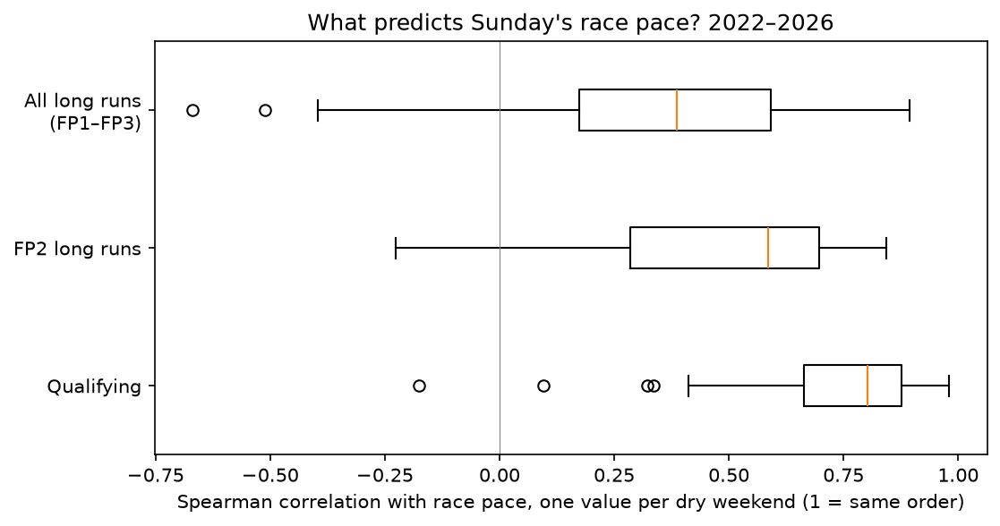

# Does practice predict Sunday? (step B3)

Date: 2026-10-22 · Data: 2022–2026, 96 dry races, 1,846 driver-weekends

## Answer in three lines
Qualifying pace predicts race pace far better than practice long runs: median Spearman 0.80 vs 0.39 over 86 dry weekends.
The gap is not luck: bootstrap 95% CI for long runs minus quali is -0.48 to -0.34.
The forecaster starts from qualifying; long runs add only ~2% lower error (≈0.01 s per lap) and are used as a check.

## Question and method
- Target: race pace = median clean race lap, % behind the best median (10+ clean laps, dry races).
- Signals known before the race: practice long runs (all, and FP2 only), qualifying pace.
- Per weekend: Spearman correlation of each signal with race pace. Then the median over weekends.
- Uncertainty: bootstrap over weekends. Error: leave-one-weekend-out mean absolute error.

## Results

| signal | weekends | median rho | share above 0.5 |
|---|---|---|---|
| Qualifying | 86 | 0.80 | 0.90 |
| All long runs (FP1–FP3) | 86 | 0.39 | 0.31 |
| FP2 long runs | 58 | 0.59 | 0.60 |

- Long runs minus quali: -0.41, 95% CI -0.48 to -0.34.
- Mean absolute error, % of lap: no signal 0.885, quali 0.597, long runs 0.843, both 0.586.
- By season: quali wins every year (0.66–0.92); long runs are weakest in 2023 (0.16), the year of one dominant car.

## What I think it means
- FP1 long runs are weak because FP1 is used for setup, parts tests and rookies; FP2 alone is better (0.59), but on the same 54 weekends still behind quali (0.57 vs 0.80).
- Long runs on top of quali cut the error from 0.597% to 0.586%: about 0.01 s on a 90 s lap. Not worth a main place in the model.
- Part of quali's strength is the grid itself (clean air). That is fine for predicting Sunday, but the debrief must not call it "car speed".

## Limits (what could make this wrong)
- Clean air: qualifying sets the grid, and the grid affects race pace.
- Long runs are compared on the same compound, but fuel loads are unknown: two teams'
  "long runs" may carry very different fuel.
- Sprint weekends have only one practice session, so long runs are thin there, and wet races were left out, so none of this says anything about rain.

## What the forecaster will use
Qualifying pace as the main signal. FP2 long runs as a second input and a sanity check (flag weekends where they disagree strongly with quali). FP1 long runs not used.
